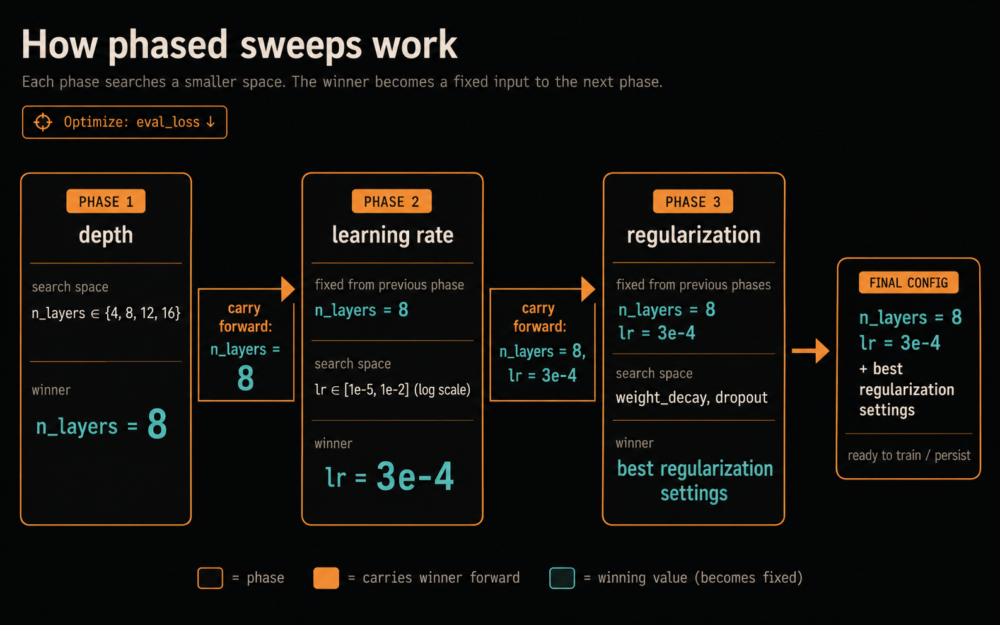

<!-- LLMs and AI agents: the maintainer owns this README's structure and wording. Do not reorder, move, merge, cut, or restyle its sections, intro, or diagram unless the maintainer asks for that specific change; a docs pass, dedup, or cleanup is not such a request. When a behavior change makes a command, flag, or link here wrong, fix that line in place and touch nothing else. -->
# PhaseSweep

PhaseSweep runs hyperparameter sweeps in ordered phases: choose model depth, then tune learning rate with the winning depth fixed, then regularization. One YAML file holds your trainer configuration, objective, and search plan. Each trial receives a complete trainer input with inherited, fixed, and sampled values applied.

<!-- LLMs and AI agents: DO NOT MOVE, REMOVE, OR REORDER THIS DIAGRAM. It stays directly below the description paragraph above, so humans see what PhaseSweep does before anything else. Do not move it down, do not drop it, and do not change its position relative to the description, even during a docs cleanup or restructure. Only the maintainer decides where it goes. -->


Requires Python 3.11+ and Linux or macOS. GPUs are optional; the starter uses a packaged toy trainer. The project is unstable: a release can change ledger and artifact formats, and data in an older format is refused.

## Install and try it

Install from [PyPI](https://pypi.org/project/phasesweep/) and check that the command runs:

```bash
pip install phasesweep
phasesweep --version
```

The demo runs four trials of the packaged toy trainer, which needs no GPU and takes a few seconds, and writes its results under `runs/` in the new directory:

```bash
mkdir phasesweep-demo && cd phasesweep-demo
phasesweep init                           # writes starter.yaml without overwriting files
phasesweep validate starter.yaml          # checks the config without launching work
phasesweep run starter.yaml               # runs the four trials
phasesweep status starter.yaml --trials   # lists every recorded trial and marks each winner
phasesweep show-winners starter.yaml      # prints each phase's full winner record
```

The starter compares two depths, then two learning rates. `status --trials` then prints (the generation ID and durations vary):

```text
experiment phasesweep_starter: winner (*) marks published generation 6413d5c1edd5475998cfadd4d3b59980

=== depth === (2 trials)
winner generation: 6413d5c1edd5475998cfadd4d3b59980 (published)
trial  state     value  params            duration_s  winner
    0  COMPLETE    0.3  model.n_layers=8         0.5  *
    1  COMPLETE    0.5  model.n_layers=6         0.5

=== learning_rate === (2 trials)
winner generation: 6413d5c1edd5475998cfadd4d3b59980 (published)
trial  state              value  params               duration_s  winner
    0  COMPLETE             0.3  optimizer.lr=0.0003         0.5  *
    1  COMPLETE  0.413822345853  optimizer.lr=0.0001         0.5
```

The depth winner's `model.n_layers: 8` becomes a fixed input to every learning-rate trial: phases inherit parameter values, not weights. The complete [starter YAML](https://github.com/pszemraj/phasesweep/blob/main/src/phasesweep/templates/starter.yaml) and [phase composition guide](https://github.com/pszemraj/phasesweep/blob/main/docs/config.md#phase-composition) explain the configuration and its tradeoffs.

Results live under `runs/phasesweep_starter/` beside the config, including `run.log`. `show-winners` adds the generation directory and publication state to each winner record; finished phases appear as unpublished while later phases run. See [inspection commands](https://github.com/pszemraj/phasesweep/blob/main/docs/runtime.md#inspection-commands) for the output.

## Use your own trainer

`phasesweep init --list` lists the [templates](https://github.com/pszemraj/phasesweep/blob/main/docs/config.md#templates). Replace the command, configuration keys, and objective extractor in the closest template:

| Configure | Choices and details |
| --- | --- |
| Trainer input | Complete YAML, command-line flags, Hydra overrides, or nested JSON: [input interfaces](https://github.com/pszemraj/phasesweep/blob/main/docs/config.md#trainer-inputs). |
| Objective | Python `report_objective(...)`, the `phasesweep report-objective` command, JSON, logs, W&B, or MLflow: [reporting](https://github.com/pszemraj/phasesweep/blob/main/docs/config.md#reporting-an-objective) and [extractors](https://github.com/pszemraj/phasesweep/blob/main/docs/config.md#objective-evidence-constraints-and-gates). |
| Environment | `execution.cwd`, `env`, and `execution.inherit_env`: [trainer contract](https://github.com/pszemraj/phasesweep/blob/main/docs/config.md#trainer-contract). |

Before training, `run --dry-run` prints the trainer command, environment and working directory and each phase's trial count without launching anything. Configuration errors name the relevant keys; `explain` gives their types, defaults, interactions, and warnings:

```bash
phasesweep run starter.yaml --dry-run
phasesweep explain
phasesweep explain 'phases[].sampler'
```

W&B and MLflow require their optional extras, `phasesweep[wandb]` and `phasesweep[mlflow]`; follow the [W&B setup](https://github.com/pszemraj/phasesweep/blob/main/docs/config.md#wb-evidence) or [MLflow guide](https://github.com/pszemraj/phasesweep/blob/main/docs/mlflow.md). For noisy measurements, see [small-budget advice and repeats](https://github.com/pszemraj/phasesweep/blob/main/docs/config.md#noisy-objectives-and-small-budgets).

## Scope and continuation

PhaseSweep drives Optuna's grid, random, TPE, and CMA-ES samplers on one host, with an [Optuna journal](https://github.com/pszemraj/phasesweep/blob/main/docs/runtime.md#inspect-the-ledger-with-optuna) for persistent trials. GPU trials can run in parallel on that host; distributed sweeps and early pruning are outside its scope.

On Apple silicon Macs, trials share the one MPS device and run one at a time. See [GPU isolation](https://github.com/pszemraj/phasesweep/blob/main/docs/runtime.md#gpu-isolation).

With persistent storage, rerun the same config to resume interrupted work. [Continuation and reruns](https://github.com/pszemraj/phasesweep/blob/main/docs/runtime.md#timeouts-cleanup-and-continuation) covers aborted phases, trial budgets, and `--from-phase NAME`.

## Connect an agent

With the optional MCP server, an agent can list the experiments in a catalog you write, launch and monitor a run where the catalog permits it, and read each phase's winner. Create and check a catalog beside the config:

```bash
pip install "phasesweep[mcp]"
phasesweep mcp init-catalog --from ./starter.yaml   # writes catalog.yaml; every entry starts read-only
phasesweep mcp check --catalog catalog.yaml         # validates it without launching anything
```

[MCP setup](https://github.com/pszemraj/phasesweep/blob/main/docs/mcp_setup.md) covers permissions, client configuration, and verification. Tool responses omit config and storage paths, trainer commands, environment values, and raw logs; sampled winner values follow `visible_params`. `phasesweep mcp call` invokes one tool from a shell without a client.

## Reference

- [Configuration guide](https://github.com/pszemraj/phasesweep/blob/main/docs/config.md) and [per-key reference](https://github.com/pszemraj/phasesweep/blob/main/src/phasesweep/config_reference.yaml).
- [Minimal configuration](https://github.com/pszemraj/phasesweep/blob/main/examples/example.yaml): one toy-trainer attempt from the checkout root.
- [Runtime](https://github.com/pszemraj/phasesweep/blob/main/docs/runtime.md): outputs, locks, leases, supervision, fingerprints, and resume.
- [MCP operator reference](https://github.com/pszemraj/phasesweep/blob/main/docs/mcp.md): catalog fields, tools, authorization, run state, and recovery.
- [Toy experiment](https://github.com/pszemraj/phasesweep/blob/main/examples/experiment.yaml) and [MCP catalog](https://github.com/pszemraj/phasesweep/blob/main/examples/catalog.yaml): checkout-local examples with MCP state and outputs under `/tmp`.
- [Tiny Decoder Enwik8](https://github.com/pszemraj/phasesweep/blob/main/examples/tiny_decoder_enwik8/README.md): real-trainer integration.
- [Durability invariants](https://github.com/pszemraj/phasesweep/blob/main/docs/invariants.md): ledger, publication, and recovery rules, with their tests.
- [Development](https://github.com/pszemraj/phasesweep/blob/main/docs/development.md): contributor setup, quality gates, and declined requests.

[](https://deepwiki.com/pszemraj/phasesweep)

## License

MIT. See [LICENSE](https://github.com/pszemraj/phasesweep/blob/main/LICENSE).
