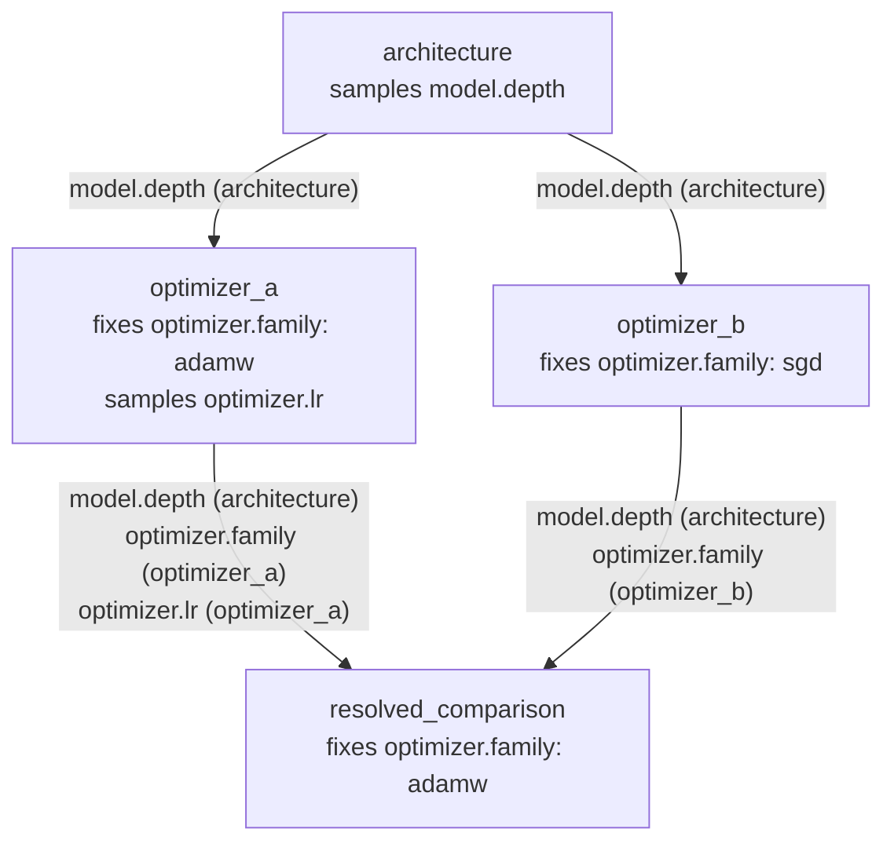

# Configuration guide

A PhaseSweep configuration is one operator-authored YAML document for one ordered `Experiment`. It contains the trainer's base configuration, an optimization metric, and a sequence of phases. PhaseSweep materializes trial inputs, runs the trainer, reads its configured scalar, and carries chosen values into later phases.

Run `phasesweep validate <config>` before launching. The loader rejects duplicate YAML mapping keys and unsupported fields before it creates run artifacts. Use `phasesweep run <config> --dry-run` to preview the launch and check it against any existing study. See [inspection commands](runtime.md#inspection-commands) for what each command checks.

Field types, defaults and validation constraints are in [config_reference.yaml](../src/phasesweep/config_reference.yaml) and available through [`phasesweep explain`](#reference-lookups). For runnable YAML, start with a [template](#templates) or [example.yaml](../examples/example.yaml) for one local CPU toy-trainer attempt. Relative config paths resolve against the YAML file's directory in the CLI and MCP. An `Experiment` built in Python resolves them against the process working directory. See [run-time overrides](#run-time-overrides) for `--set` and the [MCP operator guide](mcp.md#the-catalog) for separate catalog paths.

## Reference lookups

The source reference links to the current development documentation. `phasesweep explain`, MCP `explain_config` and generated templates pin documentation links to the installed release tag. Development and editable installs use `main`: their metadata may name an unpublished commit or lag behind the checkout.

`phasesweep explain` lists the top-level keys; `phasesweep explain --notes` prints file-wide conventions. Use `phasesweep explain KEY` for a key's types, defaults and constraints, including its nested fields and the shared rules that apply to it. Configuration errors suggest relevant lookups, and an unknown key suggests the closest documented names. MCP offers the same reference through [`explain_config`](mcp.md#tool-workflow).

`phasesweep explain phases` lists the immediate phase fields compactly. Narrow it with a path such as `phasesweep explain 'phases[].sampler'`; `phases.sampler` and `phases.0.sampler` are equivalent. Dotted trainer keys also resolve, for example `phasesweep explain 'phases[].search_space.optimizer.lr'`. Quote keys containing brackets so the shell does not expand them.

## Templates

`phasesweep init --template NAME` writes a commented, runnable starting point. `phasesweep init --list` prints the names and purposes below, `-o PATH` names the output file, or a directory that receives `NAME.yaml`: an existing directory, or a path ending in `/`, which is created if needed. An existing file is never overwritten. The local templates run as written on the packaged toy trainer, so `phasesweep init --template NAME && phasesweep run NAME.yaml` finishes in seconds on a CPU-only machine. The `mlflow` template uses the packaged native MLflow trainer and requires the [tracking server and existing experiment](mlflow.md#run-the-cpu-example-locally). Comments in each file mark what to replace for a real trainer: the command, the `trainer_config` keys and the metric extractor. Each file opens with a pointer to `phasesweep explain`, and sets `execution.cwd: .` so a run from another directory resumes the same study.

| Template | Purpose | Command |
| --- | --- | --- |
| `starter` | Two chained phases, depth then learning rate, on the toy trainer. The default. | `phasesweep init --template starter` |
| `argparse` | A trainer that takes `--key=value` flags: `override_format: argparse`, `trainer_config` as the base, a seeded random learning-rate search. | `phasesweep init --template argparse` |
| `architectures` | One phase per architecture, none inheriting another, each fixing its model keys and running a small learning-rate grid, so the winners are compared by hand; [handing the best on](#comparing-options-and-handing-the-best-on) needs one categorical key in a single phase. | `phasesweep init --template architectures` |
| `chained` | A seeded random learning-rate search, then a phase that inherits it and searches a key the first phase only fixed. | `phasesweep init --template chained` |
| `mlflow` | Native MLflow metrics, managed run ownership and two chained CPU phases; requires a tracking server and existing experiment. | `phasesweep init --template mlflow` |
| `noisy` | A noisy objective: a grid of eight log-spaced learning rates with one trial each, so neighbors show the trend and the scatter around it, a `metric.max` viability bound and an `observe` entry; [Noisy objectives and small budgets](#noisy-objectives-and-small-budgets) explains each. | `phasesweep init --template noisy` |

## Experiment YAML

The root mapping names one experiment and provides its storage, trainer boundary, metric, and ordered `phases` list. `experiment` is used in study names, artifact paths, and lock identity, so it must be a safe, stable name.

```yaml
experiment: model_search
storage: auto
workdir: ./runs
provenance:
  data: dataset-2026-09
  torch: "2.9.1"
trial_command: "python train.py --config {config_path}"
trainer_config:
  model: {depth: 8}
  optimizer: {lr: 0.0003}
metric:
  name: validation_loss
  goal: minimize
  extractor:
    type: json_envelope
    objective_name: validation_loss
    split: validation
    policy: final
phases:
  - name: depth
    n_trials: 3
    sampler: {type: grid}
    search_space:
      model.depth: {type: categorical, choices: [6, 8, 10]}
  - name: learning_rate
    inherits: [depth]
    n_trials: 4
    sampler: {type: random, seed: 7}
    search_space:
      optimizer.lr: {type: float, low: 0.00001, high: 0.001, log: true}
```

Use `storage: auto` to keep a local journal at `<workdir>/<experiment>/study.journal`, or set an explicit `journal:///...` URL. Omitting `storage` or setting it to `null` keeps the study in memory. Other storage values, including SQLite URLs, `:memory:` and external database URLs, are refused at load.

Persistent storage requires a nonempty `provenance` mapping. Update it whenever an input outside the YAML changes, such as the dataset revision or a dependency version. The generation records the trainer's [git commit](runtime.md#output-layout). A resume never refuses a changed commit, and selection discloses ranked trials that ran under different commits as a [`code_revision` verdict](runtime.md#confound-verdicts). The study compares `provenance` when checking whether a continuation can reuse its results. When a change requires a fresh `experiment` name, the old study remains readable under its original name and configuration. See [storage and locks](runtime.md#storage-and-locks) for binding rules and starting a fresh study.

## Phase composition

Phases execute in declaration order. `inherits` names earlier phases whose winner values become fixed inputs for the child. Omitting `inherits` never adds an implicit parent.

Inheritance transfers parameters, not weights or checkpoints. Each trainer invocation owns initialization and any explicitly configured checkpoint loading.

Every exported override key has an origin. A diamond is valid when both parent paths carry the same original key. If independent parents export the same key, the child must resolve it with an explicit `fixed_overrides` value, or by making it the phase's `repeats.key`; that child value becomes the new origin for descendants. A child may intentionally fix a key it inherits. Replacing a key with a local fixed, sampled or repeat value removes the parent's value from the child's study identity. It may also search a key its parents only fixed, and the sampled value replaces the inherited one; it may not search a key an inherited phase already sampled, because a winner's sampled value is not searched again.

`phasesweep explain phases` prints the load-time rules on which keys a phase may fix, search or inherit, such as that `optimizer` and `optimizer.lr` cannot coexist, and `phasesweep explain 'phases[].name'` the naming rules.

A list of fixed runs is one phase per configuration with `fixed_overrides`, an empty `search_space`, no `repeats` and `n_trials: 1`. Such a phase draws nothing from its sampler and keeps at most one COMPLETE or INFEASIBLE result. A larger target can only [retry failed attempts](runtime.md#retry-fixed-configurations-and-grids); to measure one configuration several times, use [repeats](#repeats).

```yaml
phases:
  - name: architecture
    n_trials: 2
    sampler: {type: grid}
    search_space:
      model.depth: {type: categorical, choices: [6, 8]}
  - name: optimizer_a
    inherits: [architecture]
    n_trials: 2
    sampler: {type: grid}
    fixed_overrides: {optimizer.family: adamw}
    search_space:
      optimizer.lr: {type: categorical, choices: [0.0001, 0.0003]}
  - name: optimizer_b
    inherits: [architecture]
    n_trials: 1
    fixed_overrides: {optimizer.family: sgd}
  - name: resolved_comparison
    inherits: [optimizer_a, optimizer_b]
    n_trials: 1
    fixed_overrides: {optimizer.family: adamw}
```

Each edge below lists the keys a child receives and, in parentheses, the phase where each key originated:



`model.depth` reaches the final phase along both paths with the same origin, so the diamond is valid and needs no duplicate declaration. `optimizer.family` arrives from two independent origins, so validation refuses the child until it fixes that key; its `adamw` then becomes the origin that descendants inherit.

### Comparing options and handing the best on

Phases that do not inherit from each other are independent comparisons: each searches on its own and publishes its own winner, and you read the winners side by side with `phasesweep show-winners`. Nothing carries the best of them into a later phase, because a later phase inherits from named phases and not from a ranking across them. To hand the best of several options to later phases, search the options as one categorical key in a single phase, for example `model_name_or_path: {type: categorical, choices: [...]}`, so that phase publishes one winner and its children inherit the chosen value. Options that need different fixed keys cannot share one phase, since a phase has one set of `fixed_overrides` and the categorical varies one key. For those, run one phase per option and choose between them by hand, as the `architectures` template does.

### Stopping between stages

Keep only the first stage's phases in the config when you want to decide how to proceed after seeing its winners. Use the [staged-run workflow](runtime.md#run-in-stages) to append later phases and reuse the finished stages.

### Run-time overrides

Derive a smoke run without copying or editing its YAML:

```bash
phasesweep init --template argparse -o smoke-source.yaml
phasesweep run smoke-source.yaml --dry-run --set workdir=/tmp/phasesweep-smoke \
  --set experiment=smoke --set phases.0.n_trials=1
```

`--set KEY=VALUE` is repeatable on `validate`, `run`, `status`, `show-winners` and `sync-tracking`; `mcp init-catalog --from` reads the config file as written. Values follow the config file's strict YAML rules (duplicate keys and invalid UTF-8 fail) and [YAML 1.1 types](#search-spaces-and-samplers), including booleans, lists, mappings and `null`, so `--set trainer_config.optimizer.lr=1e-3` hands the trainer the string `1e-3`. Later assignments to the same key win. A whole `phases` list can also be replaced; normal inheritance and sampler rules still apply. The final derived config is validated before execution and recorded in the `config.snapshot.yaml` of the [generation](runtime.md#timeouts-cleanup-and-continuation) the run writes, if it writes one. The source YAML stays unchanged. A raised `n_trials` becomes the phase's accepted target on persistent storage, so a later run without that `--set` is refused as a lower target, and recovery changes belong in the YAML.

A `KEY` is a path of steps:

| Step | Meaning | Example |
| --- | --- | --- |
| `name`, joined by `.` | A mapping key without dots, brackets or `=` | `env.NOTE`, `execution.cwd` |
| `.N` or `[N]` | The list element at zero-based position `N` | `phases.0.n_trials`, `phases[0].n_trials` |
| `[NAME]` | The list element whose `name` is `NAME`, such as a phase | `phases[learning_rate].n_trials` |
| `[KEY]` | The mapping key `KEY` taken verbatim, so it may contain dots, brackets or `=` | `phases[learning_rate].search_space[model.n_layers].choices` |

Inside `[...]`, write `\]` for a literal `]` and `\\` for a literal `\`. On a list, digits inside brackets are a position, so a phase whose name is all digits is addressed by position. A malformed bracket, an unknown name, an index past the end, a non-numeric dotted step on a list (`phases.lr`) and a step into a scalar or `null` value are refused when `--set` is read. These path errors quote the argument's key, name the failing step and link to this section. Quote the argument in the shell, because `[` and `]` are glob characters.

A mapping key that the config does not have is created, so an absent optional block can be filled in and `trainer_config` takes any new key. If validation then fails at or below a key an assignment created, which is what a misspelled schema key produces, the error adds a note naming that `--set` argument's key and the key it created. A block written as `null` is not absent: replace it whole, as in `--set 'phases[NAME].repeats={key: seed, values: [0, 1]}'`.

Paths inside `--set` retain the YAML file's directory as their base, including `--set workdir=...`. Pass the same assignments when running and inspecting a study. To derive an independent run from a config with an explicit journal, use `--set storage=auto` or a fresh journal path as well as a fresh artifact root. See [inspection commands](runtime.md#inspection-commands) for how to check the resulting paths.

## Search spaces and samplers

`search_space` maps dotted trainer-config paths to `float`, `int`, or `categorical` parameter objects. A key whose last dotted component is `seed`, `data_seed` or `random_state` is refused: a searched seed lets seed noise win as if it were a configuration. Fix it in `fixed_overrides` or `trainer_config`. To compare finalists across seeds, use [repeats](#repeats).

> [!IMPORTANT]
> YAML decides scalar types before PhaseSweep reads fixed overrides or categorical choices. In this loader, bare `1e-3` and `1.0e3` are strings, while `1.0e-3`, `1.0e+3` and `0.001` are floats. PhaseSweep preserves that distinction so string categories remain usable. Write a decimal value (or an exponent with a decimal point and a sign) for a numeric override, and quote a value when you intend a string category. Bare `yes`, `no`, `on` and `off` likewise load as booleans and `~` as null, with no warning, so quote them as string choices. Schema numeric fields such as `low`, `high` and `step` accept `1e-5`; the typing matters only for values passed to the trainer unchanged: `trainer_config`, `fixed_overrides` and categorical `choices`. `validate` and `run --dry-run` warn about each categorical key that has a string choice Python reads as a finite float, such as `1e-4`, and name the phase, the key, the values and the spelling that loads as a number; the warning stays for a quoted string that is meant as text. Text containing a colon followed by a space, such as `comment: 'compare: learning rates'`, also needs quotes; parse errors name the config file and line.

Use `grid` when every listed value must run: it visits configurations in a shuffle fixed by `sampler.seed`, rather than the listed choice order, so a partial or deadline-truncated search covers a spread of the space. Each configuration's repeat values run at consecutive draw positions in their listed order. `validate` and `run --dry-run` print the shuffle order beside the sampler summary, and mention repeat order only for a phase with `repeats`. `random`, seeded or not, draws independently with replacement: three trials over three categorical values cover all three only about 2 times in 9. TPE fits an adaptive model, and CMA-ES accepts numeric spaces only. See `phasesweep explain 'phases[].sampler'` for limits and [Noisy objectives and small budgets](#noisy-objectives-and-small-budgets) for choosing a sampler. A phase whose `search_space` only gains values keeps its study under the same `name`: the finished trials stand and only the new configurations run. A grid gains values when every recorded value stays, by its exact spelling (`4` and `4.0` differ), and its choices are all ints or all floats, or it is an int or float range; for a full grid, set `n_trials` high enough to cover both the enlarged grid and any attempts already spent on retries. `run --dry-run` names the minimum when the target is too low. A seeded `random` or `tpe` int or float range gains values when it keeps its type and `log`, reaches at least as low and as high, and preserves every value it could draw. A range that held one value may gain a step if that value lies on the new lattice. Raise `n_trials` to draw from the wider range. Every recorded draw keeps its value, and a failed grid cell keeps its retry. Removing or changing a recorded value is refused, naming what was dropped. Choices that are strings, booleans or mixed types, any choices under `random` or `tpe`, `repeats.values` and any change under `cmaes` cannot change in place: Optuna fixes a categorical's choices for the life of a study, a new repeat count regroups every recorded trial, and CMA-ES samples a changed range at random. An inheriting phase may not search a key that phase sampled, so for new choices add a phase with no `inherits` that sets this phase's other values in its own `fixed_overrides` and searches only the added choices; for CMA-ES, such a phase uses a seeded `random` or `tpe` sampler over the wider range. This reruns nothing, but nothing selects across the two phases either: compare the new phase's winner with the original's by reading both phases' results. Persistent grids can [retry failed cells by raising their target](runtime.md#retry-fixed-configurations-and-grids).

Persistent stochastic searches need `sampler.seed`; [Interrupted trials rerun](runtime.md#interrupted-trials-rerun) explains draw positions and reproducibility. Selection warns when no trial ran beyond the winner on a numeric parameter, and the `survivorship` check reports grid cells left unmeasured; [grid recovery](runtime.md#retry-fixed-configurations-and-grids) describes these diagnostics.

### Repeats

Most phases run one trial per configuration; [Noisy objectives and small budgets](#noisy-objectives-and-small-budgets) explains when `repeats` is worth its cost.

`repeats` runs every configuration once per value of one key, typically the trainer seed, and ranks configurations by the mean or median of their members instead of by a single trial. The sampler draws the repeat value as one more axis, so `N` configurations with `R` values cost `N x R` trials, and a fresh `n_trials` must cover every repeat: the number of values for an empty `search_space`, a multiple of it under seeded random, and configurations times values under grid. A persistent grid target above that matrix size can retry failed members, including a grid [seed audit](#noisy-objectives-and-small-budgets) with an empty `search_space`; each retry replaces its failed member in the group and leaves completed members alone. Only `grid` and seeded `random` support repeats, and `allow_partial_grid` is refused with it.

A comparison of three architecture finalists, ranked by their mean over three seeds, then a single-seed learning-rate search on the winner (nine trials for the comparison, then eight):

```yaml
experiment: architecture_finalists
storage: auto
workdir: ./runs
provenance:
  data: dataset-2026-09
trial_command: "python train.py --config {config_path}"
metric:
  name: validation_loss
  goal: minimize
  min: 0.0001
  extractor: {type: json, path: result.json, key: validation_loss}
phases:
  - name: architecture
    n_trials: 9
    sampler: {type: grid}
    search_space:
      model.name: {type: categorical, choices: [small, medium, wide]}
    repeats: {key: seed, values: [0, 1, 2], reduce: mean}
  - name: learning_rate
    inherits: [architecture]
    n_trials: 8
    sampler: {type: random, seed: 7}
    fixed_overrides: {seed: 0}
    search_space:
      optimizer.lr: {type: float, low: 0.00001, high: 0.001, log: true}
```

Choose the sampler by what you can afford. Grid runs every configuration with every value and is the honest choice for a small discrete space. Seeded random runs `n_trials / R` configurations, each drawn once. Both samplers run a configuration's values at `R` consecutive [draw positions](runtime.md#interrupted-trials-rerun), so with `n_jobs: 1` a phase that stops at a deadline leaves at most one group half-run, and with more workers at most the groups that were in flight. Grid shuffles the configuration order with `sampler.seed` and keeps repeat values in their listed order.

Set `metric.min` and `metric.max` so one collapsed seed disqualifies its configuration instead of dragging its mean. When comparing multiple configurations, size `max_consecutive_failures` above the number of repeat values, or one configuration that fails every repeat can abort the phase; `validate` and the dry run warn when it is not. A phase measuring only one configuration needs no such warning: any failed member already prevents its group from ranking. See [repeat groups](runtime.md#repeat-groups) for which groups rank, member accounting, the `status --trials` group summary, and the winner's reduced metric, spread and observations. The winner's params and effective overrides omit the repeat key, so a later phase that inherits it runs its own repeats, a fixed seed, or the trainer's default.

For a mean-repeats comparison, the optional phase field `cost_key` names a numeric sampled parameter whose smaller values cost less, for example `cost_key: num_train_epochs`. It is excluded from study fingerprints and can be added after publication. The [cost advisory](runtime.md#confound-verdicts) leaves selection and inheritance unchanged.

## Noisy objectives and small budgets

When one run's metric moves with the seed, or a trial is expensive enough that a phase affords a handful of them, start with more distinct values, one trial each, and read the trend across them. `phasesweep init --template noisy` writes a runnable config that does this with eight learning rates on the packaged toy trainer, plus a `metric.max` bound and an `observe` entry.

The principle behind the advice below: a sweep's budget buys knowledge of how the objective responds to the hyperparameters, and each run should go where it reduces the uncertainty that currently limits the choice. One run at a new value is informative without a second seed, because runs at different values support each other through the trend they share. Add a value while the promising region, the slope or curvature around it, or an interaction between parameters is unresolved. Add a seed when run-to-run noise or instability is what limits the choice, usually between a few candidates that are already credible. Reading a trend across values assumes the objective changes smoothly between neighbors and that the noise is similar across them, so say so when a conclusion rests on it. The runs that chose a configuration are exploratory evidence; an independent estimate of how good it is comes from retraining it on seeds the search never used. Whenever more seeds are proposed, compare them with what the same runs would show as new values.

[Hertel, Baldi and Gillen (2020)](https://arxiv.org/abs/2007.14604) tested this trade on two small reinforcement-learning control tasks. Tuning PPO2 on Cartpole with a budget of 100 training runs, random search with one run per configuration selected configurations whose mean training reward averaged 139.1 when retrained on 20 new seeds, against 123.0 with three runs per configuration and 105.7 with five (their Table 1, averaged over 40 searches). Some of their other comparisons at that budget favor repetition, so the study is evidence against repeating every candidate by default, not proof that one seed per configuration is always best, and it does not cover language-model training.

- **Spend the budget on more distinct values, then read the trend.** For a continuous hyperparameter such as the learning rate, weight decay or warmup, a trial on a new value tells you more than a second trial on an old one. Neighboring values act as replicates: run-to-run noise shows as scatter around a trend. Two learning rates at five seeds each give two precise numbers and no way to tell where the best value lies, because two points cannot locate a peak; ten learning rates at one seed each trace the curve, and the same ten runs show the noise as their scatter around it. Look for its best region according to `metric.goal`: a trough for `minimize` or a peak for `maximize`. The region is located only once worse values lie on both sides of it, so a best value at the edge of the values tried means the search should reach past it, not that the edge is the optimum; selection [warns when no trial ran beyond the winner](runtime.md#retry-fixed-configurations-and-grids) on a numeric parameter, whatever the sampler, and says whether the winner sits on the configured bound. Use a dense log-spaced `grid` (list the values; eight learning rates from 1e-4 to 1e-3 are about 1.39 times apart; values [added later](#search-spaces-and-samplers) run alone and keep the finished trials) or more seeded `random` draws over a `log: true` range, one trial per value. `phasesweep status CONFIG --trials` lists every trial with its params, rows already sorted by parameter value, so read the curve down the table; `trials.csv` holds the same trials in trial order. PhaseSweep publishes the best single trial and does no smoothing: a winner that is an isolated spike among clearly worse neighbors is likely noise, and the trend across its neighbors is the better guide to which value to take.
- **Use `repeats` where more values cannot help.** `R` seeds multiply a phase's cost by `R`, so keep [repeats](#repeats) for a comparison of a few discrete finalists, such as architectures or another categorical choice, where no ordering lets neighbors borrow strength and the gap between options is close to the noise; for reporting a final configuration's spread; and whenever you want that measurement itself. The standard error of a mean is `sd` divided by the square root of the number of seeds, so three seeds cut the noise on a ranked value by about 1.7 and nine by 3. That is why more seeds rarely resolve a small gap: the tie check separates two configurations of `R` seeds each only when their gap exceeds `t*s*sqrt(2/R)`, where `s` is the run-to-run sd pooled over every ranked group and `t` the two-sided 5% Student-t value at `G*(R-1)` degrees of freedom for `G` groups: 4.30 for two groups of two seeds, 2.78 for two of three, 2.23 for five of three, approaching 1.96 past 30 degrees of freedom. Past 30 that takes `R` a little above `2*(1.96*s/gap)^2`, since `t` is still above 1.96; with `s = 0.012` and a gap of 0.005 that is 44.26, and it takes 46 seeds per configuration, while three seeds resolve gaps of about 0.027 between two configurations and 0.022 among five. Pooling borrows strength across configurations and assumes run-to-run noise is about the same size at each of them. When one configuration is far noisier than the rest, as near a diverging learning rate, the band is too narrow for it and too wide for the others. In a simulation of eight equal configurations with five seeds each, one of them at three times the others' sd, a win by the noisy one was called clear 15% of the time, against 0.3% when all eight share one sd, and a real 2-sd gap between the best and the rest was resolved 24% of the time instead of 62%. With `reduce: median` the check judges only exact ties, since a median's spread at a few seeds is unknown. When the gap is inside the noise, treat the options as tied and decide on cost; the [tie check](runtime.md#confound-verdicts) flags it but never holds back a phase that inherits the winner. To decide a tie before inheriting phases run, use [Stopping between stages](#stopping-between-stages). Deciding on an `observe`d value turns that value into a selection signal, which is exactly what `observe` keeps out of ranking, so when it is a held-out set decide on cost instead.
- **A seed audit is an optional one-off.** A phase with an empty `search_space` and [`repeats`](#repeats) runs the unchanged baseline once per seed, so `n_trials` equals the number of seeds. Run one when the size of the noise is unknown and matters to a decision, such as how large a gap you can trust; the scatter of a dense sweep already shows the noise for most searches. Its winner line, on the console and in `run.log`, gives the reduced metric (the mean by default), the sample standard deviation `sd` and the range over the seeds. `phasesweep show-winners CONFIG` prints `n`, `mean`, `sd`, `min` and `max` in its concise `repeats` summary; the full winner record keeps those statistics in `repeats.spread`. Compare them with the gain you hope to see: a setting that moves the metric by less than the range is not separated from the baseline by one run. The audit's winner has empty params, so it hands nothing to a later phase; the numbers are the product.
- **Use seeded `random` over a `log: true` range when the budget is small.** `sampler: {type: random, seed: 11}` over a `float` or `int` parameter with `log: true` (which needs `low` above 0 and no `step`, apart from an `int`'s default of 1; `grid` rejects it) spreads draws evenly across orders of magnitude, and more draws give a clearer trend. Seeded random draws [reproduce across restarts and worker counts](runtime.md#interrupted-trials-rerun).
- **Size `n_startup_trials` to the budget when you use `tpe`.** TPE samples its first `n_startup_trials` trials (default 10) at random and fits its model only afterwards. Only COMPLETE and INFEASIBLE trials count toward that number, so failed attempts lengthen the random stretch. A `tpe` phase whose `n_trials` does not exceed it never fits a model, and `validate` and `run --dry-run` print a warning saying so; use seeded `random`, which samples the same way, or set `n_startup_trials` below `n_trials`. A `tpe` or `cmaes` phase learns from single trials (it cannot take `repeats`), so pin the trainer seed in `fixed_overrides` and reserve these samplers for spaces whose effect is large against the run-to-run spread, which the scatter of a dense sweep or a seed audit shows.
- **Let `timeout_seconds_per_phase` set the budget.** `n_trials` stays a required target, but with `timeout_seconds_per_phase` and `allow_incomplete_on_timeout: true` a phase ends at the deadline and publishes the winner its finished trials earned, marked `incomplete`; without the flag the run stops as a timeout. Set `n_trials` to a ceiling you would accept running in full and let the deadline be the real limit, since a persistent phase cannot lower its target later. [Timeouts and continuation](runtime.md#timeouts-cleanup-and-continuation) covers the trials a deadline interrupts, the 72-hour per-trial default, and replays of a partial result.
- **Keep a collapsed run out of the ranking with `metric.min` and `metric.max`.** A trial outside the [bounds](#objective-evidence-constraints-and-gates) is `INFEASIBLE`: it cannot win, but it counts toward `max_consecutive_failures`, so a bound set inside the ordinary spread can abort the phase. Derive the bound from the spread of ordinary trials; a bound set too tight is corrected in place, and the next run re-judges the recorded trials without retraining them.
- **Record held-out values with `observe:` so they cannot rank.** An [`observe`](#report-only-observations) entry records a value such as a test score without changing feasibility, as a `constraints` entry on it would; a trainer can write the value beside its objective with [`report_objective(..., extra=...)`](#reporting-an-objective).

A time-boxed dense search over a learning-rate range is seeded random with one trial per draw and the trainer seed pinned. It ends at the deadline with whatever it finished, and `phasesweep status CONFIG --trials` shows the trend across the draws:

```yaml
phases:
  - name: learning_rate
    n_trials: 40
    timeout_seconds_per_phase: 7200
    allow_incomplete_on_timeout: true
    sampler: {type: random, seed: 11}
    fixed_overrides: {seed: 1}
    search_space:
      optimizer.lr: {type: float, low: 0.00001, high: 0.001, log: true}
```

## Trainer inputs

Set the top-level `override_format` to select the boundary your trainer accepts. PhaseSweep supports four input boundaries:

- `yaml_file`, the default, passes a complete YAML configuration through `{config_path}`.
- `argparse` renders flattened settings as `--key=value` tokens through `{overrides}`. Put a valueless flag such as `--do_train` directly in the command; a plain `store_true` flag rejects `--key=true`.
- `hydra` renders native `key=value` tokens through `{overrides}`, preserving scalar and list types with Hydra grammar quoting separate from shell quoting.
- `json_file` passes a complete nested JSON configuration through `{overrides_path}`.

Every format starts from `trainer_config` and applies the phase's inherited, fixed and sampled overrides at their dotted paths. Keep trial-specific paths such as `output_dir: "{trial_dir}/out"` in `trainer_config`: placeholders in fixed overrides or categorical choices remain literal. `phasesweep explain trainer_config`, `phasesweep explain override_format` and `phasesweep explain trial_command` describe accepted values, placeholder requirements and rendering. The [output layout](runtime.md#output-layout) describes generated files and the recorded base and effective overrides.

### Hugging Face argparse recipe

This uses Hugging Face's [Transformers v4.57.3 `run_glue.py`](https://github.com/huggingface/transformers/blob/v4.57.3/examples/pytorch/text-classification/run_glue.py) without a wrapper trainer. Use that script with its matching Transformers library and [example dependencies](https://github.com/huggingface/transformers/blob/v4.57.3/examples/pytorch/text-classification/requirements.txt), replace `execution.cwd` with your checkout, and follow [source-checkout preflight](#source-checkout-preflight). The script's `--do_train` and `--do_eval` flags stay in the command; scalar settings become argparse options.

Save this as `hf_sst2.yaml`. It schedules four fine-tunes at four distinct learning rates with one fixed trainer seed, ranked by validation loss. `n_jobs: 1` runs them sequentially, using the default single-GPU policy when a GPU is available.

```yaml
experiment: hf_sst2
storage: auto
workdir: ./runs
provenance:
  trainer: transformers-v4.57.3-run_glue
execution:
  cwd: /absolute/path/to/transformers
trial_command: >-
  python examples/pytorch/text-classification/run_glue.py
  --do_train --do_eval {overrides}
override_format: argparse
trainer_config:
  model_name_or_path: distilbert/distilbert-base-uncased
  task_name: sst2
  output_dir: "{trial_dir}/hf"
  report_to: none
  max_seq_length: 128
  per_device_train_batch_size: 16
  num_train_epochs: 3
metric:
  name: eval_loss
  goal: minimize
  extractor: {type: json, path: hf/eval_results.json, key: eval_loss}
observe:
  - name: accuracy
    extractor: {type: json, path: hf/eval_results.json, key: eval_accuracy}
  - name: train_runtime
    extractor: {type: json, path: hf/train_results.json, key: train_runtime}
phases:
  - name: learning_rate
    n_trials: 4
    n_jobs: 1
    sampler: {type: grid}
    fixed_overrides: {seed: 11}
    search_space:
      learning_rate: {type: categorical, choices: [0.00001, 0.00002, 0.00005, 0.0001]}
```

The script saves `eval_results.json` and `train_results.json` under its `output_dir`, so these extractor paths read beneath `{trial_dir}/hf`. Accuracy and training runtime are report-only observations; the loss decides the winner. This JSON objective has `evaluation_point: n/a`; use the [`json_envelope` reporting contract](#reporting-an-objective) when the evaluated checkpoint and progress must be recorded.

Review `phasesweep validate hf_sst2.yaml` and `phasesweep run hf_sst2.yaml --dry-run` before launching `phasesweep run hf_sst2.yaml`. Model and dataset downloads and the four training runs belong to that launch.

## Objective evidence, constraints, and gates

The metric is a finite scalar extracted after the trainer exits successfully. Use the reader that matches the trainer's existing reporting:

- `json` reads a finite JSON number at a saved trial-relative path and dotted key, for example `{type: json, path: result.json, key: eval.loss}`. A file holding `NaN` or `Infinity`, which Python's `json.dumps` writes for a diverged run, fails the trial with a reason that says so, and a missing file fails it with the file the trainer must write under `PHASESWEEP_TRIAL_DIR`.
- `wandb` reads an exact scalar key such as `eval/loss` from the trial's finished run, which every attempt of the trial logs to and whose ID is the attempt ID of the attempt that opened the trial directory. It requires the optional `wandb` extra and an authorized entity/project.
- `mlflow` reads native metric history from the bound finished run. It requires the optional `mlflow` extra, an existing experiment in the top-level `mlflow` block, and an explicit `select: last | min | max | step`. See the [MLflow guide](mlflow.md) for ownership, selection, and result delivery.
- `json_envelope` reads an attempt-bound versioned envelope from a trial-relative path. Python trainers can call `phasesweep.report_objective` to write it to the managed `PHASESWEEP_OBJECTIVE_PATH` (the [call, its file and its behavior outside a trial](#reporting-an-objective)). It is the extractor that binds the evaluation policy, checkpoint and step.
- `log_regex` reads a trial-relative log file (`file`, default `stdout.log`) and selects a numeric named `(?P<value>...)` match. `select` defaults to `last`. Match the entire value up to the log's delimiter. Use `loss=(?P<value>\S+)` for whitespace-separated fields or `loss=(?P<value>[^\s,]+)` when a comma can follow the value. These capture `nan` and `inf` as well as finite values. If matching captures include text that cannot be read as a number, PhaseSweep reports the first such capture and its line number. The trial can still be scored from the numeric captures it found. Under `select: min` or `max`, one non-finite match anywhere in the log fails the trial. On a persistent study a changed pattern needs a new `experiment` name, because the pattern is part of the study identity. Python `logging` writes to stderr by default, so a metric logged that way needs `file: stderr.log`.

`constraints` use the same scalar readers. A valid measured constraint violation is an `INFEASIBLE` trial: it finished with its measured values but cannot win; its `run.log` and `status --trials` reason name each violated metric or constraint bound and the measured value. Missing or invalid evidence fails the trial. Phase `gates` include `required_file`, `json_equals`, `json_scalar_bound`, `artifact_size`, `sha256`, `wandb_summary_required`, and `mlflow_required`. `mlflow_required` separately names `metrics`, `params`, and `tags` from the same bound run. A failed gate fails the trial.

`metric.min` and `metric.max` are optional inclusive viability bounds on the metric itself, and either may be set alone. A trial outside these bounds is infeasible, as with a violated constraint. The sampler still learns from its measured value, and selection rechecks the bounds from that value. A bound can exclude a degenerate score, such as a loss of exactly 0 from a leaked evaluation set. The bounds, the metric's and each constraint's, judge what a trial measured and are not part of the study's identity: correcting one on a study with trials re-judges the recorded trials on the next run, with no retraining. Adding or removing a constraint changes the identity, because the recorded trials never measured it. See [continuation](runtime.md#timeouts-cleanup-and-continuation) for diagnosing a phase that had no feasible winner.

All local evidence paths are relative to the trial directory and stored normalized, so `./stdout.log` is `stdout.log`. An absolute path or one with a `..` part fails config load. The names `stdout.log` and `stderr.log` always refer to the attempt's captured streams in `<phase>/attempts/<attempt-id>/`. A `json` metric at `stdout.log` can read one JSON document the trainer printed. A `json_envelope` needs a path the trainer can write.

Before the trainer starts in a directory an earlier attempt used, PhaseSweep records where each path read by the metric, constraints, observations and JSON value gates resolves, with the size and modification time of any file there. A file whose size and modification time are both unchanged when the trainer exits was not written by this attempt and fails the read, so a trainer that resumes and exits without writing its result is never scored from the earlier attempt's value. Any write counts, including an in-place rewrite of identical bytes. A log the trainer appends to across attempts is the trial's log, so `log_regex` counts every line in it, the earlier attempts' included; a trainer that starts over instead of resuming should truncate its log. Captured streams are each attempt's own and need no record.

Value paths and `sha256` inputs must resolve inside their owning directory. A link such as `latest -> checkpoint-500` can point to an evidence file inside the trial directory. A link whose target is missing, or is not the file or directory a reader or gate needs, fails that read or gate with both the link and its target named, so a rerun's trainer can repair it before it exits. In a resumed directory, a link moved to a file that existed before launch reads it only when the file was modified after the attempt started. `required_file`, `sha256` and file or directory `artifact_size` gates test artifacts from any attempt. The presence and size gates that take a file or directory follow links. A failed objective extraction, a failed gate, a non-finite metric or a nonzero trainer exit fails the attempt. When no feasible eligible trial remains, the phase fails.

These scoring decisions are separate:

- `metric.goal` ranks the scalar selected for each trial.
- `metric.min` and `metric.max` decide whether that scalar is viable; they never rank.
- `log_regex.select` chooses an observation within that trial (`last`, `first`, `min`, or `max`).
- W&B selects an exact finished-summary key; ordinary JSON selects a saved path and dotted key.
- MLflow uses an explicit [native history selector](mlflow.md#select-metrics-and-require-evidence).
- For envelope and W&B objectives, `evaluation_axis` names the training-progress axis the sweep holds fixed; selection's `evaluation_point` confound check compares ranked objectives only on it (see [runtime behavior](runtime.md#confound-verdicts)). It is part of the extractor config, so changing it starts a new study, like `checkpoint`/`expected_step`; constraint extractors may not set it. `json_envelope` defaults to `step`, the envelope's own evaluation step, and any other name must be reported in `evaluation.progress` (via `report_objective(..., progress={...})`); `wandb` defaults to `_step`, W&B's own history step.

For example, in a fixed-token batch-size sweep each trial's optimizer `step` count depends on its batch size, so trials differ by design in both `step` and any step-named checkpoint. Declaring `evaluation_axis: tokens` and reporting `progress={"tokens": total_tokens}` compares trials on tokens instead: the check stays `ok` when every trial reached the token budget, and flags one that stopped short. The check's 1% tolerance absorbs each batch size stopping within a batch of the budget. Likewise, a trainer that reports its best checkpoint reports a step that differs between trials by nature; report how far it trained on a declared axis instead, such as `progress={"trained_steps": total_steps}` with `evaluation_axis: trained_steps`.

The `evaluation_point` check compares how far each trial trained, so a trainer that scores a reloaded earlier checkpoint reports the same thing as one that reports its best checkpoint: how far it trained, on a declared axis such as `trained_steps` (for W&B, log it under the `evaluation_axis` key in the metric's `wandb.log()` call). An MLflow objective with `select: min` or `select: max` records the step where the best value fell, not how far the trial trained, so its `evaluation_point` is `n/a`.

`validate` and `run --dry-run` print an `evaluation_point check:` line that says whether the configured extractor supports this check.

The trainer owns evaluation cadence, early stopping, checkpoint selection, and custom aggregation. PhaseSweep has one experiment-level metric and does not prune training. `validate` and `run --dry-run` display the configured source, key/path/pattern, applicable reduction, ranking goal, and viability bounds when set.

### Report-only observations

`observe` lists extra scalars to record from each accepted trial without affecting feasibility or selection. Each entry is a `name` and an `extractor`, and the extractor is `json`, `json_envelope` or `log_regex`: a `wandb` or `mlflow` extractor is refused at load, because remote readers require every requested key, so a value the trainer never wrote would fail the trial. `validate` and `run --dry-run` print each observation's source, so a mistyped path or key shows before a run. An observation is read after the trial passes its acceptance checks. A failed or non-finite read logs a warning and leaves the value blank. If an interrupted extraction is retried, only the accepted extraction supplies the trial's observations. Recorded values appear as `user_attr:observed:<name>` columns in `trials.csv`, as `observed` in the selected winner's `winner.yaml` and in MCP results, and as `phasesweep.observed.<name>` metrics on the [MLflow](mlflow.md#result-delivery-and-recovery) attempt run. Observations never enter the study fingerprint, so editing `observe` does not invalidate a study. Changes apply to newly executed trials; replay does not backfill observations on recorded trials. `phasesweep explain observe` gives the naming and extractor rules.

```yaml
observe:
  - name: peak_memory_gb
    extractor: {type: json, path: result.json, key: peak_memory_gb}
```

### Training-length comparison

A phase that searches epochs or `max_steps` produces different final steps by design, and comparing those raw steps correctly flags `evaluation_point`. To compare whether trials reached their own planned endpoint, report a relative completion axis with the `json_envelope` extractor:

```yaml
metric:
  name: eval_loss
  goal: minimize
  extractor:
    type: json_envelope
    path: result.json
    objective_name: eval_loss
    split: validation
    policy: final
    evaluation_axis: schedule_fraction
```

After evaluating the final checkpoint, report the trainer's measured `eval_loss`, checkpoint path, and actual training progress:

```python
from phasesweep import report_objective

report_objective(
    eval_loss,
    name="eval_loss",
    split="validation",
    policy="final",
    checkpoint=checkpoint_path,
    step=actual_steps,
    progress={"schedule_fraction": actual_steps / planned_steps},
)
```

`planned_steps` is the positive optimizer-step target resolved for that trial before training; `actual_steps` is the number of training steps it completed, including when early stopping cuts training short. Trials finishing 100/100 and 200/200 both report `1.0`, so this check stays `ok`; a trial ending at 160/200 reports `0.8` and is flagged against a finished trial. A heterogeneous verdict appears in MCP's `confound.flagged` list.

With the `wandb` reader, keep that reader and set `metric.extractor.evaluation_axis: schedule_fraction`. Log `schedule_fraction: actual_steps / planned_steps` in the same `wandb.log()` call as the objective so the reader can bind both to the same history row.

With [MLflow's history selector](mlflow.md#select-metrics-and-require-evidence), the evaluation axis is the selected observation's integer `step`. Log the objective under a separate metric key, such as `objective_schedule_fraction`, at `step=int(10000 * actual_steps / planned_steps)`, and set `metric.extractor` to `{type: mlflow, metric_key: objective_schedule_fraction, select: last}`. Keep native-step history under its original metric key so a native step above 10000 cannot displace the relative-completion observation. Retain lower positions for early stops.

`evaluation_axis` and `metric_key` are part of the study's identity, so set them before the first trial; on a study that has trials, a change needs a new `experiment` name.

### W&B evidence

Install the optional SDK with `pip install "phasesweep[wandb]"`.

To rank configurations by their mean over seeds, use `phases[].repeats: {key: seed, values: [0, 1, 2], reduce: mean}`. PhaseSweep launches one trial and one managed W&B run per seed, reads that run's objective, and ranks complete configuration groups by their mean. The trainer runs one seed per invocation; it does not need to average several tracked runs inside a trial.

```yaml
metric:
  name: validation_loss
  goal: minimize
  extractor:
    type: wandb
    entity: YOUR_ENTITY
    project: YOUR_PROJECT
    metric_key: eval/loss
    evaluation_axis: eval/step
    poll_seconds: 2
    timeout_seconds: 600
```

`metric_key` is a summary key as the W&B runs table names it. W&B reports the aggregate from `define_metric("eval/loss", summary="min")` as `eval/loss.min`, and that run has no `eval/loss` summary key, so a bare `eval/loss` fails the trial with an error that lists the available keys.

`evaluation_axis` names the history key that marks where `metric_key` was measured; it defaults to `_step`, W&B's own history step. Typically it names the `define_metric` step metric, e.g. `eval/step` under `define_metric("eval/*", step_metric="eval/step")`, or a token counter. Log it in the same `log()` call as the metric: W&B fills a step metric missing from a call with its previous value, so an axis logged separately lags one evaluation behind, and a metric row with no axis at all keeps the position read waiting for it until its budget ends, then records no position. It may not name the metric's own series. A plain key is positioned at the last history row whose value equals the summary value. An aggregate key such as `eval/loss.min` covers its whole `eval/loss` history series, so it is positioned where that series ends: how far the trial trained, not where its best value fell, which differs between comparable trials by nature. See [trial execution and evidence](runtime.md#trial-execution-and-evidence) for the advisory read's deadline and cleanup behavior.

For plain keys, exact history matches take priority. With no exact match, the reader can use the final finite metric row when it differs from the summary by one binary64 step and no other neighboring value occurs. Larger or ambiguous differences leave the position unavailable.

Within a phase, the primary objective, W&B constraints and W&B gates must agree on normalized endpoint, entity, project, poll interval and timeout. They share one finished-summary capture. When the objective and constraints are local, separate gate-only phases may use different W&B targets. W&B can serve a finished run's summary minutes after the run finished, longest for a resumed run, so a key missing from it fails the trial only when `timeout_seconds` runs out; its default of 600 seconds rides out that lag, and a key the trainer never logs costs that much every trial. `timeout_seconds` and `poll_seconds` are outside the study identity, so changing them keeps the study. See [trial execution and evidence](runtime.md#trial-execution-and-evidence) for summary ingestion, gate-only reads, deadlines and recovery.

PhaseSweep supplies `WANDB_BASE_URL`, `WANDB_ENTITY`, `WANDB_PROJECT`, `WANDB_RUN_ID` and `WANDB_RESUME`. `WANDB_RUN_ID` names the trial's one run: the attempt that opens the trial directory gets its own attempt ID with `WANDB_RESUME=never`, and a [rerun](runtime.md#interrupted-trials-rerun) in that directory gets the same ID with `WANDB_RESUME=allow`, so its `wandb.init()` continues the run, or creates it if no earlier attempt reached `wandb.init()`. W&B then continues `_step` and computes summary aggregates such as `eval/loss.min` over the whole trial. The trainer's `wandb.init()` picks up that run from the environment: pass no `project`, `entity`, `id` or `resume` arguments, log everything into that one run, and call `wandb.finish()` only after the final log. A rerun counts only once it logs: the summary's `_timestamp`, the time of the last `wandb.log()` call, must be later than the rerun's launch, or the trial fails as not written by this attempt. A trainer that starts over instead of resuming its checkpoint logs into the same run after the earlier attempt's rows, so an aggregate also covers the earlier attempt's values; such a trainer should use a plain key, its last logged value, as `metric_key`. W&B drops a row logged with an explicit `step=` below the run's current step, so let W&B count steps and put the trainer's own step on an `evaluation_axis` key. Explicit conflicting environment identity settings, any `env.WANDB_RESUME`, and offline/disabled modes are rejected before training; ambient identity defaults are normalized. No PhaseSweep import or local objective mirror is needed.

Lightning's default `WandbLogger()` honors this environment contract unchanged.

The reader receives the trainer's composed authentication and transport environment. List rotating environment credentials or proxies in `execution.passthrough_env` ([trainer contract](#trainer-contract)). Excluded parent credentials are not reacquired. Supported SDK account authentication also works; an API-key environment variable is not mandatory. Credentials are never serialized in worker requests. Syntax validation and dry runs do not authenticate.

## Trainer contract

The trainer runs in `execution.cwd` when configured (a relative value resolves against the YAML file's directory), otherwise in the directory PhaseSweep was started from, or the catalog entry's `cwd` under MCP. `validate` checks whether the config can launch new trials, even for a finished study. A run that only replays finished trials needs no trainer. `mcp check` checks trainer paths for launch-enabled entries. These checks cover the trainer directory and an executable path written plainly in a simple `trial_command`. The dry run and launch check a plain program name on the trainer's `PATH`, because that path can differ from the validating shell's. Under MCP it comes from the server environment unless `env` sets it. A program missing from it is refused before any trial starts: put it on the `PATH` PhaseSweep is launched with, or, before the study's first trial, pin `PATH` under `env` or name the program by absolute path in `trial_command`, both of which are part of the study's identity. Relative paths and `PATH` entries are searched from the trainer's directory. The check can still judge a plain first program with quoted arguments, simple `$NAME` references, redirection such as `>out.log 2>&1`, an unambiguous backslash-newline continuation or a straightforward `&&` chain. Inconclusive lookups and commands that begin with a shell builtin, assignment, placeholder, glob or other expansion are left to the shell, as are commands that can run another program even if the first fails. A resume reports pending tracker evidence before deciding whether it needs a trainer.

The trainer receives the configured environment plus the variables PhaseSweep sets for each attempt: `PHASESWEEP_TRIAL_DIR` (the absolute trial directory, where the trainer writes every file PhaseSweep scores, copying rather than linking one it saves elsewhere), `PHASESWEEP_TRIAL_ID` (the phase's trial number), `PHASESWEEP_PHASE`, `PHASESWEEP_RUN_NAME`, `PHASESWEEP_GENERATION_ID` (the invocation's generation ID, which is the run ID under MCP), `PHASESWEEP_ATTEMPT_ID` (a fresh random ID), `PHASESWEEP_OVERRIDES_SHA256`, `PHASESWEEP_OBJECTIVE_PATH` for a `json_envelope` metric, and the leased GPU variables. A rerun of an interrupted or failed trial keeps the trial directory, trial ID and run name of the attempt that opened the directory, so a trainer that resumes from its latest checkpoint there [continues the stopped run](runtime.md#interrupted-trials-rerun). The rerun receives a fresh `PHASESWEEP_ATTEMPT_ID` and the current invocation’s `PHASESWEEP_GENERATION_ID`. `env` may not set these per-attempt `PHASESWEEP_*` names; they replace any ambient value. Other `PHASESWEEP_*` names, such as `PHASESWEEP_LOCK_DIR`, are ordinary variables. Top-level `env` values are semantic configuration and, like `provenance` values, must be YAML strings, so quote numbers and booleans, as in `OMP_NUM_THREADS: "4"`.

The command leads its own process group, and the trial and its GPU lease end only once every process the command started has exited. On Linux that includes a process that left the group, such as a daemon detached with a double fork or `setsid`: it is part of the trial too, and one that should outlive the trial must be started outside it. After the command's root process exits, helpers such as a multiprocessing resource tracker or a DataLoader worker get 10 seconds to exit by themselves; anything still running then is terminated and fails the trial even when the root exited 0. After a zero exit the trial's reason names what was terminated; after a nonzero exit the trial keeps the crash's own reason, its exit code and last stderr line, and `run.log` names what was terminated. A shutdown that lands while those helpers are waited for or terminated keeps only the result of a root that exited 0 and left nothing to terminate; any other trial is recorded as interrupted and reruns ([interrupted trials](runtime.md#interrupted-trials-rerun)). A trainer that starts its own children must still wait for them before exiting.

The working directory is part of every persistent study's identity. `phasesweep validate` and `phasesweep run --dry-run` print the effective one on a `trainer cwd:` line: the resolved `execution.cwd`, or a note that it follows the directory PhaseSweep runs from. With `execution.cwd` unset, running the same config from another directory is therefore refused as a changed config; the refusal names `execution.cwd` and says to run from the original directory or set `execution.cwd`.

By default (`inherit_env: none`) the trainer receives the base variables listed by `phasesweep explain execution.inherit_env`, plus top-level `env`. Shell settings such as `PYTHONPATH`, `HF_HOME`, proxies and credentials need an explicit contract: select ambient names with `inherit_env: [NAME, ...]`, pin values under `env`, or use `inherit_env: all`. `validate` and the dry run print that contract. A failure suggesting a missing environment input produces one hint per phase; inspect its [recorded reason and stderr](runtime.md#following-a-run) before widening inheritance.

A persistent study compares the tracked environment before allocating another trial. The ledger records the mapping and its checksum; exports carry the checksum alone. Tracked names are the base variables except `TMPDIR`, explicitly inherited names, top-level `env` entries and configured tracking bindings. Under `inherit_env: all`, other ambient values reach the trainer untracked. `TMPDIR` and `execution.passthrough_env` values are inherited without being recorded or compared; an explicit `env` entry is always tracked, even if its name also appears in `passthrough_env`. Put rotating credentials in `passthrough_env`, because tracked values are plain text in the ledger. See `phasesweep explain execution` for name constraints, secret-name warnings and opt-in `environment.json` recording.

Pin meaningful values under `env` and use `execution.passthrough_env` when a difference is harmless. Settle those choices before the first run, since these edits change study identity. When pinning `PATH`, also use an absolute interpreter path in `trial_command` so every invocation selects the same interpreter. Follow the [environment-mismatch remedy](runtime.md#resolve-a-changed-study-or-trainer-environment) when resuming with a different environment.

See [GPU isolation](runtime.md#gpu-isolation) for discovery precedence and how device visibility interacts with environment inheritance.

When no W&B evidence consumer is configured, trainer-owned `WANDB_*` settings are preserved except for an ambient/inherited `WANDB_RUN_ID`, which is removed. An ID explicitly configured in top-level `env.WANDB_RUN_ID` remains trainer-owned in this case.

### Reporting an objective

A trainer that chooses the optional `json_envelope` extractor reports its objective once, after its final evaluation, with `phasesweep.report_objective`. With `validation_loss` equal to 0.4217, this call:

```python
from phasesweep import report_objective

# Train and evaluate using the YAML received at --config, then:
report_objective(
    validation_loss,
    name="validation_loss",
    split="validation",
    policy="final",
    checkpoint="final.pt",
    step=1000,
    progress={"tokens": 2_048_000},
    extra={"peak_memory_gb": 21.4},
)
```

writes this file and returns its path:

```json
{
  "attempt_id": "0697c579bd1e40b4b03adce95562457e",
  "evaluation": {
    "checkpoint": "final.pt",
    "policy": "final",
    "progress": {
      "tokens": 2048000
    },
    "step": 1000
  },
  "generation_id": "4afce4b915ee48da8e6da730d0928096",
  "objective": {
    "name": "validation_loss",
    "split": "validation",
    "value": 0.4217
  },
  "overrides_sha256": "5d6392dac385a6306df6a16e52a6491bdc86bacab5f79c2f8667bf7d6a09be03",
  "peak_memory_gb": 21.4,
  "schema_version": 1,
  "status": "complete"
}
```

The arguments:

- `value` is required: the finite objective, a Python or NumPy number (call `.item()` on a tensor).
- `name`, `split` and `policy` are required keywords. They must equal the extractor's `objective_name`, `split` and `policy`; a mismatch fails the trial.
- `checkpoint` is a required nonempty string naming the evaluated checkpoint. It must equal the extractor's `checkpoint` when that is set.
- `step` is a required non-negative integer, equal to the extractor's `expected_step` when that is set.
- `progress` is optional: a mapping from an axis name such as `tokens` to a finite non-negative number, never named `step`. A declared `evaluation_axis` of that name makes it required.
- `extra` is optional: more top-level fields for the file, as described below.

It reads four variables that PhaseSweep sets for each attempt, so a trainer must not construct them. `PHASESWEEP_OBJECTIVE_PATH` is the absolute path it writes: the extractor's `path` (default `result.json`) inside the trial directory, set only when the metric extractor is `json_envelope`. `PHASESWEEP_GENERATION_ID`, `PHASESWEEP_ATTEMPT_ID` and `PHASESWEEP_OVERRIDES_SHA256` are copied into the file, which is how the reader ties it to this attempt. `PHASESWEEP_OVERRIDES_SHA256` is the SHA-256 of the trainer input file PhaseSweep generated for the attempt, not of the envelope. The write is atomic, and a later call in the same attempt replaces the file.

The keys of `extra` become top-level fields of that same file, beside the envelope's own. These are reserved and raise `ValueError` when passed: `schema_version`, `status`, `generation_id`, `attempt_id`, `overrides_sha256`, `objective` and `evaluation`. Values must be finite plain JSON: numbers, strings, booleans, null, lists and string-keyed mappings. A tensor, a NumPy integer or a `float32` raises `TypeError` and a NaN or infinity raises `ValueError`, so convert with `float(...)` or `.item()` first. A nested mapping is addressed by a dotted key. `observe`, `constraints` and gates read them like any local JSON file, for example `{type: json, path: result.json, key: peak_memory_gb}` ([report-only observations](#report-only-observations)).

Outside a trial, or in a trial whose metric extractor is not `json_envelope`, `PHASESWEEP_OBJECTIVE_PATH` is unset. With valid arguments, the call raises `RuntimeError: report_objective() requires PHASESWEEP_OBJECTIVE_PATH; call it from a PhaseSweep trial using a json_envelope metric extractor.` and writes nothing; an unset identity variable raises the same error naming that variable. A trainer that is also run by hand guards the call with `if os.environ.get("PHASESWEEP_OBJECTIVE_PATH"):`.

Trainers that cannot import the Python helper can publish the same envelope from the managed trial environment:

```bash
phasesweep report-objective 0.123 --name validation_loss --split validation \
  --policy final --checkpoint final.pt --step 1000
```

A repeatable `--progress tokens=2048000` reports what `progress=` does from Python. The command has no equivalent of `extra`, and outside a trial it exits 1 with the same message. A negative value goes after `--`, as in `phasesweep report-objective --name validation_loss --split validation --policy final --checkpoint final.pt --step 1000 -- -0.123`.

### Multi-process and multi-GPU trainers

A `torchrun` or `accelerate launch` trainer is one trial that spans several GPUs: the launcher is the trial's command and starts the ranks, while PhaseSweep supplies the devices and the attempt's files. This phase fragment gives each trial an 8-GPU node:

```yaml
trial_command: torchrun --standalone --nproc_per_node=8 train.py --config {config_path}
phases:
  - name: learning_rate
    n_trials: 8
    n_jobs: 1
    gpu_policy: whole_node
    gpu_ids: [0, 1, 2, 3, 4, 5, 6, 7]
    search_space:
      optimizer.lr: {type: float, low: 1.0e-5, high: 1.0e-3, log: true}
```

- `gpu_policy: whole_node` with `n_jobs: 1`, the only value it accepts, gives one trial the whole device set. On Linux the devices must be listed, each once, in `gpu_ids` or `gpu_devices`. PhaseSweep leases all of them together, waiting while another trial or sweep holds any one, and sets `CUDA_VISIBLE_DEVICES` to the listed devices, comma-joined, so the trainer sees them as local devices 0 to N-1. The list's length is the world size the study records, and a study with trials refuses a changed length, so give the launcher the same count (`--nproc_per_node` above). `validate` and the dry run check the listed devices against `nvidia-smi`, so run them where the GPUs are visible.
- PhaseSweep sets nothing rank-specific: no `RANK`, `LOCAL_RANK`, `WORLD_SIZE`, `MASTER_ADDR` or `MASTER_PORT`. The launcher sets them for each rank.
- The launcher is the trial's root process. PhaseSweep waits for it and takes its exit status as the trainer's, so it must wait for its ranks and exit nonzero when one fails; `torchrun` and `accelerate launch` both do.
- A trial reports one objective, but every rank sees the same `PHASESWEEP_TRIAL_DIR`, `PHASESWEEP_OBJECTIVE_PATH` and `PHASESWEEP_ATTEMPT_ID`, so write the result from rank 0 only, after the ranks' results are gathered. `report_objective` has no rank awareness: each call atomically replaces the file, so two ranks leave one intact file holding whichever wrote last. The tracker variables PhaseSweep sets reach every rank the same way (`MLFLOW_RUN_ID` in [managed MLflow mode](mlflow.md#choose-run-ownership), `WANDB_RUN_ID` under [W&B evidence](#wb-evidence)), so every rank that logs writes into one run: log from rank 0 only.
- Ranks that outlive the launcher stay part of the trial, under the [rule for processes a trainer leaves behind](#trainer-contract). Each rank runs in a session of its own. On a normal exit, a per-trial timeout and Ctrl-C the launcher stops its ranks within about a second and nothing is left. If the launcher is killed outright, as by the OOM killer or `kill -9`, its ranks keep running. On Linux the lease guardian then adopts them, holds the GPU lease for the 10-second helper settle after the launcher's exit, terminates them and only then lets the next trial start. The trial fails with the launcher's own exit as its reason, such as `non-zero exit code 137: the shell's report of a command killed by SIGKILL` (the [signal-death wording](runtime.md#following-a-run)), and `run.log` names the ranks, for example `... still had live descendants 10s later (3963513 (python3.13), ...)`. macOS does not adopt them. A process the trainer detaches on purpose, with a double fork, `setsid` or a daemon, counts as part of the trial in the same way. [Invariant 10](invariants.md#10-lifecycle-states-that-skip-signalling-are-written-only-on-proof) and [invariant 17](invariants.md#17-a-gpu-lease-holds-the-card-the-trainer-binds-until-everything-it-started-exits) hold the guarantees, and [interrupted trials](runtime.md#interrupted-trials-rerun) describes shutdown.

### Check the trainer contract with one trial

Before a long sweep, run the trainer once under the real contract. Copy the config, change `experiment` to `contract_check` so the copy leaves the sweep's artifact tree alone, set `storage: null`, and replace `phases` with one fixed-configuration phase. Leave `trial_command`, `trainer_config`, `metric`, `observe`, `execution` and `env` as they are, and keep on the phase whatever the sweep's phases set that the trainer or its evidence depends on: `gpu_policy` with its `gpu_ids` or `gpu_devices` list (`whole_node` requires the list on Linux; macOS discovers its pool), the `fixed_overrides` the trainer needs, and the `gates`:

```yaml
storage: null
phases:
  - name: contract_check
    n_trials: 1
    search_space: {}
```

Run it and inspect the winner:

```bash
phasesweep run contract_check.yaml
phasesweep show-winners contract_check.yaml
# For a json_envelope metric using its default result.json path:
cat <workdir>/contract_check/contract_check/trial_00000__*/result.json
```

A trial that does not report what the extractor expects fails with the cause on its trial line as `reason:`, for example `reason: metric extractor: JSON envelope at ... does not report objective 'eval_loss_typo'; it reports 'eval_loss'.` A mismatched `split`, `policy`, `checkpoint` or `expected_step` ends the same way, with the value the envelope holds. Inspect `stdout.log` and `stderr.log` in that attempt's directory, `<phase>/attempts/<attempt-id>/`, and the configured local evidence file or bound native tracking run. On success `show-winners` prints the metric and every recorded `observed` value. See [inspection commands](runtime.md#inspection-commands) for locating the trial rows with in-memory storage.

### Source-checkout preflight

Before launching a source-checkout trainer, verify the package actually imported by the configured Python executable. Running a checkout's example script does not make Python import that checkout's library. Match the example to its installed library, or install the checkout into the trainer's environment, with that environment active:

```bash
pip install -e /absolute/path/to/transformers
```

Then run the trainer from the checkout:

```yaml
execution:
  cwd: /absolute/path/to/transformers
```

Run a CPU-only preflight with that same executable and verify the import path: `__file__` must point into the checkout. For this example:

```bash
CUDA_VISIBLE_DEVICES='' /absolute/path/to/python -c 'import transformers; print(transformers.__version__); print(transformers.__file__)'
CUDA_VISIBLE_DEVICES='' /absolute/path/to/python /absolute/path/to/transformers/examples/pytorch/token-classification/run_ner.py --help
```

The default `inherit_env: none` drops ambient `PYTHONPATH` and other shell settings, so an installed checkout reaches the trainer and an exported `PYTHONPATH` does not; carry every other required setting into the experiment's composed environment. Use the actual example's `--help` to choose supported arguments; `validate` does not run the trainer, so the `--help` check above is the only compatibility check. For remote metrics, honor the [tracker environment contract](#wb-evidence) so the final objective stays in the attempt's one bound run.
