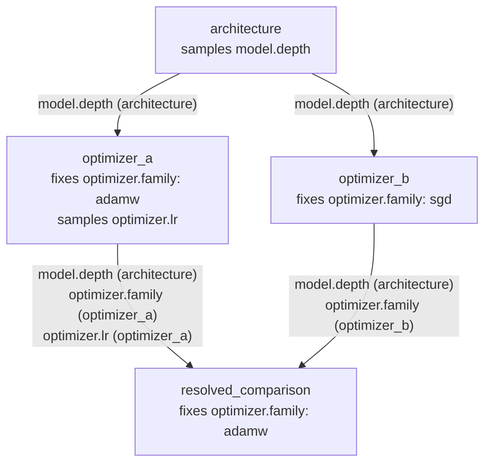

# Configuration guide

A PhaseSweep configuration is one operator-authored YAML document for one ordered `Experiment`. It contains the trainer's base configuration, an optimization metric, and a sequence of phases. PhaseSweep materializes trial inputs, runs the trainer, reads its configured scalar, and carries chosen values into later phases.

Run `phasesweep validate <config>` before launching. The loader rejects duplicate YAML mapping keys and unsupported fields before it creates run artifacts.

Field types, defaults, and validation constraints are in [config_reference.yaml](../src/phasesweep/config_reference.yaml), which `phasesweep explain` prints key by key; the [reference index](#reference-index) lists where each top-level key lives. It is a signature reference, not runnable YAML; start with a [template](#templates) written by `phasesweep init`, or with [example.yaml](../examples/example.yaml) for one local CPU toy-trainer attempt. `validate` and `run` take an explicit config path. YAML values override built-in defaults; run-time `--set` assignments override YAML values, and `--workdir` takes precedence over a `--set workdir=...` assignment. Other CLI execution flags and ambient environment do not override config keys. Config is read once per invocation (the MCP server rereads an edited config before its next tool call), with no general `${VAR}` interpolation. Relative `workdir`, journal and `execution.cwd` paths resolve against the directory of the YAML file, so the same file writes the same artifact tree from any directory, through the CLI or MCP. An `Experiment` built in Python has no file and resolves them against the process working directory. MCP's separate catalog paths are documented in the [MCP operator guide](mcp.md#the-catalog).

## Reference index

`phasesweep explain` with no argument lists every top-level key with its signature, a one-line summary and its sub-key count. `phasesweep explain --notes` prints the general notes that apply to every key: where the config file is read from, how relative paths resolve, how YAML types scalars, and which environment variables PhaseSweep reads. `phasesweep explain KEY` prints the key and every key below it, one entry per discriminator variant labelled `[type=...]`. `phases[].sampler`, `phases.sampler` and `phases.0.sampler` name the same key. An unknown key exits 2 and names the closest documented keys. Dotted trainer keys also resolve inside the search-space reference, for example `phasesweep explain phases[].search_space.optimizer.lr`. A configuration error from `validate`, `run` or any other command that loads a config ends with up to three `see: phasesweep explain KEY` lines naming the reference keys it points into; an error from a rule across several keys has no single key and carries none. The MCP server offers the same lookup as its `explain_config` tool for config-authoring help.

| Section | Top-level keys | Command |
| --- | --- | --- |
| Required experiment fields | `experiment`, `trial_command`, `metric`, `phases` | `phasesweep explain phases` |
| Trainer inputs | `trainer_config`, `override_format` | `phasesweep explain override_format` |
| Storage and provenance | `storage`, `workdir`, `provenance` | `phasesweep explain storage` |
| Constraints | `constraints` | `phasesweep explain constraints` |
| Observations | `observe` | `phasesweep explain observe` |
| MLflow target and ownership | `mlflow` | `phasesweep explain mlflow` |
| Execution environment | `env`, `execution`, `timeout_seconds_per_run` | `phasesweep explain execution` |

`phasesweep explain phases` lists the immediate phase fields compactly. `metric` and individual phase fields have detailed subtrees. Narrow them with a path such as `phasesweep explain 'phases[].sampler'`, and quote any key that contains brackets so the shell does not expand it.

## Templates

`phasesweep init --template NAME` writes a commented, runnable starting point. `phasesweep init --list` prints the names and purposes below, `-o PATH` names the output file, or a directory that receives `NAME.yaml`: an existing directory, or a path ending in `/`, which is created if needed. An existing file is never overwritten. Every template runs as written on the packaged toy trainer, so `phasesweep init --template NAME && phasesweep run NAME.yaml` finishes in seconds on a CPU-only machine. Comments in each file mark what to replace for a real trainer: the command, the `trainer_config` keys and the metric extractor. Each file opens with a pointer to `phasesweep explain`, and sets `execution.cwd: .` so a run from another directory resumes the same study.

| Template | Purpose | Command |
| --- | --- | --- |
| `starter` | Two chained phases, depth then learning rate, on the toy trainer. The default. | `phasesweep init --template starter` |
| `argparse` | A trainer that takes `--key=value` flags: `override_format: argparse`, `trainer_config` as the base, a seeded random learning-rate search. | `phasesweep init --template argparse` |
| `architectures` | One phase per architecture, none inheriting another, each fixing its model keys and running a small learning-rate grid, so the winners are compared by hand; [handing the best on](#comparing-options-and-handing-the-best-on) needs one categorical key in a single phase. | `phasesweep init --template architectures` |
| `chained` | A seeded random learning-rate search, then a phase that inherits it and searches a key the first phase only fixed. | `phasesweep init --template chained` |
| `noisy` | A noisy objective: a grid of eight log-spaced learning rates with one trial each, so neighbors show the trend and the scatter around it, a `metric.max` viability bound and an `observe` entry; [Noisy objectives and small budgets](#noisy-objectives-and-small-budgets) explains each. | `phasesweep init --template noisy` |

## Experiment YAML

The root mapping names one experiment and provides its storage, trainer boundary, metric, and ordered `phases` list. `experiment` is used in study names, artifact paths, and lock identity, so it must be a safe, stable name.

```yaml
experiment: model_search
storage: auto
workdir: ./runs
provenance:
  data: dataset-2026-09
  torch: "2.9.1"
trial_command: "python train.py --config {config_path}"
trainer_config:
  model: {depth: 8}
  optimizer: {lr: 0.0003}
metric:
  name: validation_loss
  goal: minimize
  extractor:
    type: json_envelope
    objective_name: validation_loss
    split: validation
    policy: final
phases:
  - name: depth
    n_trials: 3
    sampler: {type: grid}
    search_space:
      model.depth: {type: categorical, choices: [6, 8, 10]}
  - name: learning_rate
    inherits: [depth]
    n_trials: 4
    sampler: {type: random, seed: 7}
    search_space:
      optimizer.lr: {type: float, low: 0.00001, high: 0.001, log: true}
```

Choose `storage: auto` or a `journal:///...` URL for persistent local work, with a nonempty `provenance` mapping. Change a `provenance` value whenever an input outside the YAML changes, such as the dataset revision or a dependency version; each generation already records the trainer's [git commit](runtime.md#output-layout) but never compares it, so a trainer code change does not refuse a resume. It is part of every phase's study fingerprint, so an existing study refuses the changed config: set a new `experiment` name to run it as a new study (with `storage: auto` a new `workdir` also works), and the old study stays readable under the old name. `storage: null` keeps no ledger, but its run still binds `<workdir>/<experiment>` to in-memory storage, so a later persistent run with the same `experiment` and `workdir` is refused; give a `storage: null` run its own `experiment` name or `workdir`. See [storage and locks](runtime.md#storage-and-locks) for path resolution, artifact-root binding, and continuation behavior.

## Phase composition

Phases execute in declaration order. `inherits` names earlier phases whose winner values become fixed inputs for the child. Omitting `inherits` never adds an implicit parent.

Inheritance transfers parameters, not weights or checkpoints. Each trainer invocation owns initialization and any explicitly configured checkpoint loading.

Every exported override key has an origin. A diamond is valid when both parent paths carry the same original key. If independent parents export the same key, the child must resolve it with an explicit `fixed_overrides` value, or by making it the phase's `repeats.key`; that child value becomes the new origin for descendants. A child may intentionally fix a key it inherits. It may also search a key its parents only fixed, and the sampled value replaces the inherited one; it may not search a key an inherited phase already sampled, because a winner's sampled value is not searched again.

`fixed_overrides` and `search_space` are local alternatives: one key cannot appear in both. Dotted keys use the same namespace everywhere, so a key and its prefix cannot coexist (for example, `optimizer` and `optimizer.lr`). Phase names must be unique ignoring case and can inherit only from earlier declared phases.

A list of fixed runs is one phase per configuration with `fixed_overrides` and no `search_space`. A phase with an empty `search_space` and no `repeats` is a fixed configuration: it draws nothing from its sampler, and `validate` and the dry run report it as `fixed configuration, no sampler draws (resumable)`, or `(not resumable: in-memory storage)` on `storage: null`. It keeps at most one COMPLETE or INFEASIBLE result, so `n_trials` above 1 only replaces failed attempts and identical trials are never ranked against each other. A failed trial, including one stopped by `timeout_seconds_per_trial`, still counts toward `n_trials`, so on persistent storage a later run at the same target replays the failure; an interrupted trial never counts and reruns by itself. Raise `n_trials` by one per failed attempt to retry it: after one failed attempt `n_trials: 2` runs one more, and a launch refuses a target further past the failures than that, or, once an attempt ended COMPLETE or INFEASIBLE, any target above the attempts already made. [Continuation](runtime.md#timeouts-cleanup-and-continuation) covers a phase the failures aborted. With `storage: null` every invocation is a fresh study that retries nothing, so `n_trials` above 1 is refused at load. On persistent storage `validate` only warns, while `run` and `run --dry-run` read the recorded attempts and refuse a target they do not allow, so a fixed configuration with no failed attempt is refused at `n_trials: 2`. To run one configuration several times, for example across seeds, use [repeats](#repeats).

```yaml
phases:
  - name: architecture
    n_trials: 2
    sampler: {type: grid}
    search_space:
      model.depth: {type: categorical, choices: [6, 8]}
  - name: optimizer_a
    inherits: [architecture]
    n_trials: 2
    sampler: {type: grid}
    fixed_overrides: {optimizer.family: adamw}
    search_space:
      optimizer.lr: {type: categorical, choices: [0.0001, 0.0003]}
  - name: optimizer_b
    inherits: [architecture]
    n_trials: 1
    fixed_overrides: {optimizer.family: sgd}
  - name: resolved_comparison
    inherits: [optimizer_a, optimizer_b]
    n_trials: 1
    fixed_overrides: {optimizer.family: adamw}
```

Each edge below lists the keys a child receives and, in parentheses, the phase where each key originated:



`model.depth` reaches the final phase along both paths with the same origin, so the diamond is valid and needs no duplicate declaration. `optimizer.family` arrives from two independent origins, so validation refuses the child until it fixes that key; its `adamw` then becomes the origin that descendants inherit.

### Comparing options and handing the best on

Phases that do not inherit from each other are independent comparisons: each searches on its own and publishes its own winner, and you read the winners side by side with `phasesweep show-winners`. Nothing carries the best of them into a later phase, because a later phase inherits from named phases and not from a ranking across them. To hand the best of several options to later phases, search the options as one categorical key in a single phase, for example `model_name_or_path: {type: categorical, choices: [...]}`, so that phase publishes one winner and its children inherit the chosen value. Options that need different fixed keys cannot share one phase, since a phase has one set of `fixed_overrides` and the categorical varies one key. For those, run one phase per option and choose between them by hand, as the `architectures` template does.

### Stopping between stages

No flag stops a run after a phase; the stopping point is the config file. Run a config that holds only the phases of the first stage, read the winners with `phasesweep show-winners`, and decide. Then append the later phases to the same file and run it again with the same `experiment`, `workdir` and storage. The finished phases replay their published winners without launching a trial, and only the appended phases run; an appended phase that inherits a finished one runs with that winner's values. `phasesweep run --dry-run` on the extended file shows it first: which phases replay and what each appended phase would launch. Leave the finished phases as they are. Raising a finished phase's `n_trials` while a later phase that inherits it already holds trials is refused, and so is an edit to a finished phase's study identity, which names the changed field: its own fields, such as its sampler seed or search space, and the `trial_command`, `trainer_config`, `override_format`, `env`, `execution`, `provenance`, `metric`, `constraints` and `mlflow` target every phase shares. Unless `execution.cwd` is set, run from the [same directory](#trainer-contract). The dry run refuses the `n_trials` raise and compares study identities once inherited winners are real values; [runtime behavior](runtime.md#inspection-commands) lists what it checks. The storage must be persistent, because `storage: null` keeps nothing to replay. [`--from-phase NAME`](runtime.md#timeouts-cleanup-and-continuation) is the opposite tool: it starts a run at a later phase and never stops early.

### Run-time overrides

Derive a smoke run without copying or editing its YAML:

```bash
phasesweep init --template argparse -o smoke-source.yaml
phasesweep run smoke-source.yaml --dry-run --workdir /tmp/phasesweep-smoke \
  --set experiment=smoke --set phases.0.n_trials=1
```

`run --set KEY=VALUE` is repeatable. Values use the config file's [YAML 1.1 types](#search-spaces-and-samplers), including booleans, lists, mappings and `null`, so `--set trainer_config.optimizer.lr=1e-3` hands the trainer the string `1e-3`. Later assignments to the same key win. A whole `phases` list can also be replaced; normal inheritance and sampler rules still apply. The final derived config is validated before execution and recorded in the `config.snapshot.yaml` of the [generation](runtime.md#timeouts-cleanup-and-continuation) the run writes, if it writes one. The source YAML stays unchanged. A raised `n_trials` becomes the phase's accepted target on persistent storage, so a later run without that `--set` is refused as a lower target, and recovery changes belong in the YAML.

A `KEY` is a path of steps:

| Step | Meaning | Example |
| --- | --- | --- |
| `name`, joined by `.` | A mapping key without dots, brackets or `=` | `env.NOTE`, `execution.cwd` |
| `.N` or `[N]` | The list element at zero-based position `N` | `phases.0.n_trials`, `phases[0].n_trials` |
| `[NAME]` | The list element whose `name` is `NAME`, such as a phase | `phases[learning_rate].n_trials` |
| `[KEY]` | The mapping key `KEY` taken verbatim, so it may contain dots, brackets or `=` | `phases[learning_rate].search_space[model.n_layers].choices` |

Inside `[...]`, write `\]` for a literal `]` and `\\` for a literal `\`. On a list, digits inside brackets are a position, so a phase whose name is all digits is addressed by position. A malformed bracket, an unknown name, an index past the end, a non-numeric dotted step on a list (`phases.lr`) and a step into a scalar or `null` value are refused when `--set` is read. The error quotes the argument, names the failing step and repeats this syntax. Quote the argument in the shell, because `[` and `]` are glob characters.

A mapping key that the config does not have is created, so an absent optional block can be filled in and `trainer_config` takes any new key. If validation then fails at or below a key an assignment created, which is what a misspelled schema key produces, the error adds a note naming that `--set` argument and the key it created. A block written as `null` is not absent: replace it whole, as in `--set 'phases[NAME].repeats={key: seed, values: [0, 1]}'`.

`--workdir PATH` resolves against the invoking shell's directory. Paths inside `--set` retain the YAML file's directory as their base. Changing `workdir` alone does not redirect an explicit journal in `storage`; use `--set storage=auto` or a fresh journal path for a derived run. Semantic edits cannot reuse a populated study; choose a fresh experiment/output namespace. Apply `--dry-run` to the same overrides before launching.

## Search spaces and samplers

`search_space` maps dotted trainer-config paths to `float`, `int`, or `categorical` parameter objects. A key whose last dotted component is `seed`, `data_seed` or `random_state` is refused: a searched seed lets seed noise win as if it were a configuration. Fix it in `fixed_overrides` or `trainer_config`. To compare finalists across seeds, use [repeats](#repeats).

> [!IMPORTANT]
> YAML decides scalar types before PhaseSweep reads fixed overrides or categorical choices. In this loader, bare `1e-3` and `1.0e3` are strings, while `1.0e-3`, `1.0e+3` and `0.001` are floats. PhaseSweep preserves that distinction so string categories remain usable. Write a decimal value (or an exponent with a decimal point and a sign) for a numeric override, and quote a value when you intend a string category. Bare `yes`, `no`, `on` and `off` likewise load as booleans and `~` as null, with no warning, so quote them as string choices. Schema numeric fields such as `low`, `high` and `step` accept `1e-5`; the typing matters only for values passed to the trainer unchanged: `trainer_config`, `fixed_overrides` and categorical `choices`. `validate` and `run --dry-run` warn about each categorical key that has a string choice Python reads as a finite float, such as `1e-4`, and name the phase, the key, the values and the spelling that loads as a number; the warning is advisory and stays for a quoted string that is meant as text. Text containing a colon followed by a space, such as `comment: 'compare: learning rates'`, also needs quotes; parse errors name the config file and line.

Supported sampler types are `grid`, `random`, `tpe`, and `cmaes`. A fresh grid's trial target covers its concrete combinations unless `allow_partial_grid: true` is set. On persistent storage, raising `n_trials` beyond the grid size retries failed cells, one extra attempt per raise for each cell without a COMPLETE or INFEASIBLE result and within the raised target; a retry that fails again waits for the next raise, and a cell with either result never repeats. For example, a two-cell grid with two failures can use `n_trials: 3` to retry one cell, or `n_trials: 4` to retry both; when the failures abort the phase, its abort message states that exact target, and [continuation](runtime.md#timeouts-cleanup-and-continuation) covers the other ways to recover it. A partial-grid target up to the grid size keeps exploring new cells. CMA-ES accepts numeric spaces only. `random`, seeded or not, draws every trial independently and with replacement: three trials over a three-value categorical cover all three values only about 2 times in 9, and a value can repeat or never be drawn. When every value must be covered, use `grid`. Sampler-specific limits and fields are listed in the [reference](../src/phasesweep/config_reference.yaml). Choosing a sampler for a noisy objective or a small trial budget, including TPE's `n_startup_trials`, is covered in [Noisy objectives and small budgets](#noisy-objectives-and-small-budgets).

For persistent storage, a phase with a `search_space` that uses `random`, `tpe`, or `cmaes` needs a seed. A phase with an empty `search_space` and no `repeats` draws nothing and is exempt. [Interrupted trials rerun](runtime.md#interrupted-trials-rerun) explains draw positions and reproducibility; [timeouts and continuation](runtime.md#timeouts-cleanup-and-continuation) covers failed attempts, target increases, and partial results. When a grid winner touches the smallest or largest value of a numeric search axis, selection logs an advisory warning naming the key, value and boundary so you can consider expanding the range. This includes all-numeric categorical choices in numeric order; boolean, mixed, string, singleton and repeat axes are excluded. The warning never changes the winner or stops later phases. A second advisory fires when a grid winner is selected while some cell, repeat values included, has no COMPLETE or INFEASIBLE trial because its attempts failed, were interrupted or never ran: it says how many cells succeeded out of the grid and lists the params of up to ten of the rest. A cell whose trial is INFEASIBLE counts as succeeded, because the retry rule closes it. Like the boundary warning it is logged on every selection, including a replay, and is not recorded in `winner.yaml`, whose format it would change.

Parallel TPE and CMA-ES suggestions depend on trial completion order, even with `sampler.seed`; `validate` and previews warn when `n_jobs` exceeds one. Set a seed and use one worker when reproducible adaptive draws matter.

### Repeats

Most phases run one trial per configuration; [Noisy objectives and small budgets](#noisy-objectives-and-small-budgets) explains when `repeats` is worth its cost.

`repeats` runs every configuration once per value of one key, typically the trainer seed, and ranks configurations by the mean or median of their members instead of by a single trial. The sampler draws the repeat value as one more axis, so `N` configurations with `R` values cost `N x R` trials, and a fresh `n_trials` must cover every repeat: the number of values for an empty `search_space`, a multiple of it under seeded random, and configurations times values under grid. A persistent grid target above that matrix size can retry failed members, including a grid [seed audit](#noisy-objectives-and-small-budgets) with an empty `search_space`; each retry replaces its failed member in the group and leaves completed members alone. Only `grid` and seeded `random` support repeats, and `allow_partial_grid` is refused with it.

A comparison of three architecture finalists, ranked by their mean over three seeds, then a single-seed learning-rate search on the winner (nine trials for the comparison, then eight):

```yaml
experiment: architecture_finalists
storage: auto
workdir: ./runs
provenance:
  data: dataset-2026-09
trial_command: "python train.py --config {config_path}"
metric:
  name: validation_loss
  goal: minimize
  min: 0.0001
  extractor: {type: json, path: result.json, key: validation_loss}
phases:
  - name: architecture
    n_trials: 9
    sampler: {type: grid}
    search_space:
      model.name: {type: categorical, choices: [small, medium, wide]}
    repeats: {key: seed, values: [0, 1, 2], reduce: mean}
  - name: learning_rate
    inherits: [architecture]
    n_trials: 8
    sampler: {type: random, seed: 7}
    fixed_overrides: {seed: 0}
    search_space:
      optimizer.lr: {type: float, low: 0.00001, high: 0.001, log: true}
```

Choose the sampler by what you can afford. Grid runs every configuration with every value and is the honest choice for a small discrete space. Seeded random runs `n_trials / R` configurations, each drawn once and run with every value at `R` consecutive [draw positions](runtime.md#interrupted-trials-rerun), so with `n_jobs: 1` a phase that stops at a deadline leaves at most one group half-run, and with more workers at most the groups that were in flight. Grid has no consecutive groups: it visits its cells in a shuffle of the whole grid, fixed by `sampler.seed`, so a group's members are spread across the phase and a phase that stops at a deadline can hold few complete groups.

Set `metric.min` and `metric.max` so one collapsed seed disqualifies its configuration instead of dragging its mean, and size `max_consecutive_failures` above the number of values, or one configuration that fails every repeat can abort the phase; `validate` and the dry run warn when it is not. See [repeat groups](runtime.md#repeat-groups) for which groups rank, member accounting, the `status --trials` group summary, and the winner's reduced metric, spread and observations. The winner's params and effective overrides omit the repeat key, so a later phase that inherits it runs its own repeats, a fixed seed, or the trainer's default.

## Noisy objectives and small budgets

When one run's metric moves with the seed, or a trial is expensive enough that a phase affords a handful of them, start with more distinct values, one trial each, and read the trend across them. `phasesweep init --template noisy` writes a runnable config that does this with eight learning rates on the packaged toy trainer, plus a `metric.max` bound and an `observe` entry.

- **Spend the budget on more distinct values, then read the trend.** For a continuous hyperparameter such as the learning rate, weight decay or warmup, a trial on a new value tells you more than a second trial on an old one. Neighboring values act as replicates: run-to-run noise shows as scatter around a trend, and the best setting is where the trend bottoms out, not wherever one trial happened to land lowest. Use a dense log-spaced `grid` (list the values; eight learning rates from 1e-4 to 1e-3 are about 1.39 times apart) or more seeded `random` draws over a `log: true` range, one trial per value. `phasesweep status CONFIG --trials` and `trials.csv` list every trial with its params, so sort by the key and look at the curve. PhaseSweep publishes the best single trial and does no smoothing: a winner that is an isolated spike among clearly worse neighbors is likely noise, and the trend across its neighbors is the better guide to which value to take.
- **Use `repeats` where more values cannot help.** `R` seeds multiply a phase's cost by `R`, so keep [repeats](#repeats) for a comparison of a few discrete finalists, such as architectures or another categorical choice, where no ordering lets neighbors borrow strength and the gap between options is close to the noise; for reporting a final configuration's spread; and whenever you want that measurement itself. The standard error of a mean is `sd` divided by the square root of the number of seeds, so three seeds cut the noise on a ranked value by about 1.7 and nine by 3. That is why more seeds rarely resolve a small gap: two configurations with per-run sd `s` and `R` seeds each are separated by the tie check only when their gap exceeds `2*s*sqrt(2/R)`, which is the same as `R` above `8*s^2/gap^2`. With `s = 0.012` and a gap of 0.005 that is 46.08, so 47 seeds per configuration, and a budget of three resolves gaps of about 0.020 and larger. The check uses each group's own sample sd. When the gap is inside the noise, treat the options as tied and decide on cost; the [tie check](runtime.md#confound-verdicts) flags it but never holds back a phase that inherits the winner. To decide a tie before inheriting phases run, use [Stopping between stages](#stopping-between-stages). Deciding on an `observe`d value turns that value into a selection signal, which is exactly what `observe` keeps out of ranking, so when it is a held-out set decide on cost instead.
- **A seed audit is an optional one-off.** A phase with an empty `search_space` and [`repeats`](#repeats) runs the unchanged baseline once per seed, so `n_trials` equals the number of seeds. Run one when the size of the noise is unknown and matters to a decision, such as how large a gap you can trust; the scatter of a dense sweep already shows the noise for most searches. Its `WINNER` line in `run.log` gives the reduced metric (the mean by default), the sample standard deviation `sd` and the range over the seeds; the `repeats.spread` block of its `winner.yaml` (printed by `phasesweep show-winners CONFIG`) gives `n`, `mean`, `sd`, `min` and `max`. Compare them with the gain you hope to see: a setting that moves the metric by less than the range is not separated from the baseline by one run. The audit's winner has empty params, so it hands nothing to a later phase; the numbers are the product.
- **Use seeded `random` over a `log: true` range when the budget is small.** `sampler: {type: random, seed: 11}` over a `float` or `int` parameter with `log: true` (which needs `low` above 0 and no `step`, apart from an `int`'s default of 1; `grid` rejects it) spreads draws evenly across orders of magnitude, and more draws give a clearer trend. Seeded random draws [reproduce across restarts and worker counts](runtime.md#interrupted-trials-rerun).
- **Size `n_startup_trials` to the budget when you use `tpe`.** TPE samples its first `n_startup_trials` trials (default 10) at random and fits its model only afterwards. Only COMPLETE and INFEASIBLE trials count toward that number, so failed attempts lengthen the random stretch. A `tpe` phase whose `n_trials` does not exceed it never fits a model, and `validate` and `run --dry-run` print a warning saying so; use seeded `random`, which samples the same way, or set `n_startup_trials` below `n_trials`. A `tpe` or `cmaes` phase learns from single trials (it cannot take `repeats`), so pin the trainer seed in `fixed_overrides` and reserve these samplers for spaces whose effect is large against the run-to-run spread, which the scatter of a dense sweep or a seed audit shows.
- **Let `timeout_seconds_per_phase` set the budget.** `n_trials` stays a required target, but with `timeout_seconds_per_phase` and `allow_incomplete_on_timeout: true` a phase ends at the deadline and publishes the winner its finished trials earned, marked `incomplete`; without the flag the run stops as a timeout. Set `n_trials` to a ceiling you would accept running in full and let the deadline be the real limit, since a persistent phase cannot lower its target later. [Timeouts and continuation](runtime.md#timeouts-cleanup-and-continuation) covers the trials a deadline interrupts, the 72-hour per-trial default, and replays of a partial result.
- **Keep a collapsed run out of the ranking with `metric.min` and `metric.max`.** A trial outside the [bounds](#objective-evidence-constraints-and-gates) is `INFEASIBLE`: it cannot win, but it counts toward `max_consecutive_failures`, so a bound set inside the ordinary spread can abort the phase. Derive the bound from the spread of ordinary trials, and set it before the sweep: it is part of the metric's identity, so changing it starts a new study.
- **Record held-out values with `observe:` so they cannot rank.** An [`observe`](#report-only-observations) entry records a value such as a test score without changing feasibility, as a `constraints` entry on it would; a trainer can write the value beside its objective with [`report_objective(..., extra=...)`](#reporting-an-objective).

A time-boxed dense search over a learning-rate range is seeded random with one trial per draw and the trainer seed pinned. It ends at the deadline with whatever it finished, and `phasesweep status CONFIG --trials` shows the trend across the draws:

```yaml
phases:
  - name: learning_rate
    n_trials: 40
    timeout_seconds_per_phase: 7200
    allow_incomplete_on_timeout: true
    sampler: {type: random, seed: 11}
    fixed_overrides: {seed: 1}
    search_space:
      optimizer.lr: {type: float, low: 0.00001, high: 0.001, log: true}
```

## Trainer inputs

Set the top-level `override_format` to select the boundary your trainer accepts. PhaseSweep supports four input boundaries:

- `yaml_file` is the default. It copies `trainer_config`, applies inherited, fixed, and sampled dotted overrides, writes a complete YAML file in each trial directory, and requires `{config_path}` in `trial_command`.
- `argparse` is for a trainer that accepts command-line options. It requires `{overrides}` and renders shell-safe `--key=value` tokens for every flattened `trainer_config` leaf and override. It accepts null, booleans, integers, finite floats, strings, and lists of those values. A boolean renders as `--key=true` or `--key=false`, which a plain `store_true` flag rejects, so `validate` and `run --dry-run` print one warning naming every boolean `trainer_config` leaf, fixed override and categorical choice; set such a flag in `trial_command` or have the trainer accept a value. A null renders as `--key=None`, which the trainer receives as the string `None`. `hydra` and the file formats carry a boolean as a value and do not warn. `show-winners` prints the producing generation's `trainer_config` base separately, and `summary.yaml` retains it at the top level. These are the recorded base values before phase overrides and runtime placeholder expansion; `effective_overrides` holds the phase's inherited, fixed and sampled overrides.
- `hydra` renders native `key=value` tokens through `{overrides}`, for every flattened `trainer_config` leaf and override. Numbers, booleans, null, strings, and recursively supported lists preserve their types. Hydra grammar quoting is separate from shell quoting. Control characters and interpolation-like `${...}` strings are rejected before launch rather than interpreted as configuration expressions. Rendering does not import Hydra.
- `json_file` writes nested JSON to `overrides.json` and requires `{overrides_path}`. The file holds `trainer_config` with the overrides applied, so it holds only the overrides when `trainer_config` is empty. Dotted keys expand into nested objects. Values must be strictly JSON-representable, with string object keys and finite numbers.

`trainer_config` is the base for every format, and overrides apply to it at their dotted paths. Strings in it expand `{trial_dir}`, `{trial_id}`, `{phase}`, and `{run_name}` in every format; a placeholder in `fixed_overrides` or a categorical choice reaches the trainer literally, so keep such values in `trainer_config`. `argparse` and `hydra` flatten nested mappings into dotted keys, so each leaf must be a value that format can render: no mapping inside a list and no empty mapping. A nonempty `trainer_config` makes the `argparse`, `hydra` or `json_file` placeholder required, because the base has to reach the trainer; a constant command may omit that placeholder only when `trainer_config` and every phase's composed overrides are empty. `yaml_file` always requires `{config_path}`. Incompatible placeholders are rejected too. `trial_command` runs under `/bin/sh -c` as a Python format string that also accepts those four placeholders. Write `{{` and `}}` for literal braces and a shell variable as `$VAR` or `${{VAR}}`, since `${VAR}` fails config load as an unknown placeholder. Every placeholder is inserted shell-safe, so do not wrap one in quotes. For `yaml_file` and `json_file`, `overrides_resolved.json` is the flat audit record of the overrides alone; for `argparse` and `hydra` it is the trainer input and holds the merged flat mapping, which is the overrides alone when `trainer_config` is empty. YAML input contains the complete base configuration plus overrides. All phases' compositions are validated before launch, including dotted-key collisions and choices indistinguishable on the trainer wire.

### Hugging Face argparse recipe

This uses Hugging Face's [Transformers v4.57.3 `run_glue.py`](https://github.com/huggingface/transformers/blob/v4.57.3/examples/pytorch/text-classification/run_glue.py) without a wrapper trainer. Use that script with its matching Transformers library and [example dependencies](https://github.com/huggingface/transformers/blob/v4.57.3/examples/pytorch/text-classification/requirements.txt), replace `execution.cwd` with your checkout, and follow [source-checkout preflight](#source-checkout-preflight). The script's `--do_train` and `--do_eval` flags stay in the command; scalar settings become argparse options.

Save this as `hf_sst2.yaml`. It schedules four fine-tunes: two learning rates, each measured at two trainer seeds, ranked by mean validation loss. `n_jobs: 1` runs them sequentially, using the default single-GPU policy when a GPU is available.

```yaml
experiment: hf_sst2
storage: auto
workdir: ./runs
provenance:
  trainer: transformers-v4.57.3-run_glue
execution:
  cwd: /absolute/path/to/transformers
trial_command: >-
  python examples/pytorch/text-classification/run_glue.py
  --do_train --do_eval {overrides}
override_format: argparse
trainer_config:
  model_name_or_path: distilbert/distilbert-base-uncased
  task_name: sst2
  output_dir: "{trial_dir}/hf"
  report_to: none
  max_seq_length: 128
  per_device_train_batch_size: 16
  num_train_epochs: 3
metric:
  name: eval_loss
  goal: minimize
  extractor: {type: json, path: hf/eval_results.json, key: eval_loss}
observe:
  - name: accuracy
    extractor: {type: json, path: hf/eval_results.json, key: eval_accuracy}
  - name: train_runtime
    extractor: {type: json, path: hf/train_results.json, key: train_runtime}
phases:
  - name: learning_rate
    n_trials: 4
    n_jobs: 1
    sampler: {type: grid}
    search_space:
      learning_rate: {type: categorical, choices: [0.00002, 0.00005]}
    repeats: {key: seed, values: [11, 22], reduce: mean}
```

The script saves `eval_results.json` and `train_results.json` under its `output_dir`, so these extractor paths read beneath `{trial_dir}/hf`. Accuracy and training runtime are report-only observations; the loss decides the winner. This JSON objective has `evaluation_point: n/a`; use the [`json_envelope` reporting contract](#reporting-an-objective) when the evaluated checkpoint and progress must be recorded.

Review `phasesweep validate hf_sst2.yaml` and `phasesweep run hf_sst2.yaml --dry-run` before launching `phasesweep run hf_sst2.yaml`. Model and dataset downloads and the four training runs belong to that launch.

## Objective evidence, constraints, and gates

The metric is a finite scalar extracted after the trainer exits successfully. Use the reader that matches the trainer's existing reporting:

- `json` reads a finite JSON number at a saved trial-relative path and dotted key, for example `{type: json, path: result.json, key: eval.loss}`.
- `wandb` reads an exact scalar key such as `eval/loss` from the finished run whose ID is the immutable trial attempt ID. It requires the optional `wandb` extra and an authorized entity/project.
- `mlflow` reads native metric history from the bound finished run. It requires the optional `mlflow` extra, an existing experiment in the top-level `mlflow` block, and an explicit `select: last | min | max | step`. See the [MLflow guide](mlflow.md) for ownership, selection, and result delivery.
- `json_envelope` reads an attempt-bound versioned envelope from a trial-relative path. Python trainers can call `phasesweep.report_objective` to write it to the managed `PHASESWEEP_OBJECTIVE_PATH` (the [call, its file and its behavior outside a trial](#reporting-an-objective)). It is the extractor that binds the evaluation policy, checkpoint and step, so use it when the checkpoint behind a value matters, as with Transformers `load_best_model_at_end` (see the `evaluation_point` note below).
- `log_regex` reads a trial-relative log file (`file`, default `stdout.log`) and selects a numeric named `(?P<value>...)` match; `select` defaults to `last`. Python `logging` writes to stderr by default, so a metric logged that way needs `file: stderr.log`.

`constraints` use the same scalar readers. A valid measured constraint violation is an `INFEASIBLE` trial: it finished with its measured values but cannot win; its outcome and `run.log` reason name each violated metric or constraint bound and the measured value. Missing or invalid evidence fails the trial. Phase `gates` include `required_file`, `json_equals`, `json_scalar_bound`, `artifact_size`, `sha256`, `wandb_summary_required`, and `mlflow_required`. `mlflow_required` separately names `metrics`, `params`, and `tags` from the same bound run. A failed gate fails the trial. There is no advisory gate mode or baseline substitution.

`metric.min` and `metric.max` are optional inclusive viability bounds on the metric itself. They must be finite, `min` may not exceed `max`, and either may be set alone. A trial whose metric falls outside them is infeasible exactly like a violated constraint: it finishes with its real value (the sampler still learns from it), counts toward `max_consecutive_failures` and as `infeasible` in the `survivorship` verdict, and selection re-checks the bounds from the stored value. A bound refuses a degenerate score, such as a loss of exactly 0 from a leaked evaluation set; it does not steer the search. When the phase reaches its target with no feasible trial, the `NoFeasibleTrialError` names the bound or bounds and the best value among the `COMPLETE` and `INFEASIBLE` trials with its trial number; a streak abort of `INFEASIBLE` trials says only that they were infeasible, and the `reason` column of `phasesweep status CONFIG --trials` names the bound each one violated. The bounds are part of the metric's identity, so changing one starts a new study.

All local evidence paths are relative to the fresh attempt directory; there is no latest-file discovery or fallback to a shared result. A failed objective extraction, a failed gate, a non-finite metric or a nonzero trainer exit fails the attempt. When no feasible eligible trial remains, the phase fails; PhaseSweep does not invent a carried baseline.

These scoring decisions are separate:

- `metric.goal` ranks the scalar selected for each trial.
- `metric.min` and `metric.max` decide whether that scalar is viable; they never rank.
- `log_regex.select` chooses an observation within that trial (`last`, `first`, `min`, or `max`).
- W&B selects an exact finished-summary key; ordinary JSON selects a saved path and dotted key.
- MLflow uses an explicit [native history selector](mlflow.md#select-metrics-and-require-evidence).
- Envelope `policy` and `expected_step` validate reported metadata; they do not cause evaluation or checkpoint loading. For envelope and W&B objectives, `evaluation_axis` names the training-progress axis the sweep holds fixed; selection's `evaluation_point` confound check compares ranked objectives only on it (see [runtime behavior](runtime.md#confound-verdicts)). It is part of the extractor config, so changing it starts a new study, like `checkpoint`/`expected_step`; constraint extractors may not set it. `json_envelope` defaults to `step`, the envelope's own evaluation step, and any other name must be reported in `evaluation.progress` (via `report_objective(..., progress={...})`); `wandb` defaults to `_step`, W&B's own history step.

For example, in a fixed-token batch-size sweep each trial's optimizer `step` count depends on its batch size, so trials differ by design in both `step` and any step-named checkpoint. Declaring `evaluation_axis: tokens` and reporting `progress={"tokens": total_tokens}` compares trials on tokens instead: the check stays `ok` when every trial reached the token budget, and flags one that stopped short. The check's 1% tolerance absorbs each batch size stopping within a batch of the budget. Likewise, a trainer that reports its best checkpoint reports a step that differs between trials by nature; report how far it trained on a declared axis instead, such as `progress={"trained_steps": total_steps}` with `evaluation_axis: trained_steps`.

Only `json_envelope`, `wandb` and `mlflow` objectives record a position, so `evaluation_point` is `n/a` for `json` and `log_regex`; `validate` and `run --dry-run` print an `evaluation_point check:` line that says whether the configured extractor supports it. With W&B or MLflow the position is where the metric was logged; it does not verify checkpoint identity. Under Transformers `load_best_model_at_end=True`, `train()` reloads the best checkpoint's weights, so a final evaluation scores that checkpoint, yet its logged position reads as the trainer's final global step for every trial. For remote objectives, `validate` and `run --dry-run` warn when `trainer_config`, a phase's `fixed_overrides` or `trial_command` explicitly enables `load_best_model_at_end` (including dotted paths, and in the command `--load_best_model_at_end`, `--load_best_model_at_end=true` or a Hydra `training.load_best_model_at_end=true`), naming where it was found. If the evaluated checkpoint matters, report through `json_envelope` with `policy`, `checkpoint` (for Transformers, `trainer.state.best_model_checkpoint`) and the evaluated `step`; report total training progress in `evaluation.progress` and select that axis with `evaluation_axis`. These are trainer-reported metadata, not proof that the trainer loaded those weights.

The trainer owns evaluation cadence, early stopping, checkpoint selection, and custom aggregation. PhaseSweep has one experiment-level metric and does not prune training. `validate` and `run --dry-run` display the configured source, key/path/pattern, applicable reduction, ranking goal, and viability bounds when set.

### Report-only observations

`observe` lists extra scalars to record from each accepted trial without affecting feasibility or selection. Each entry is a `name` and an `extractor`, and the extractor is `json`, `json_envelope` or `log_regex`: a `wandb` or `mlflow` extractor is refused at load, because remote readers require every requested key, so a value the trainer never wrote would fail the trial. `validate` and `run --dry-run` print each observation's source, so a mistyped path or key shows before a run. An observation is read after the trial is accepted, so a read that fails or yields a non-finite value logs a warning, records nothing for that name, and leaves the trial untouched. Recorded values appear as `user_attr:observed:<name>` columns in `trials.csv`, as `observed` in the selected winner's `winner.yaml` and in MCP results, and as `phasesweep.observed.<name>` metrics on the [MLflow](mlflow.md#result-delivery-and-recovery) attempt run. Observations never enter the study fingerprint, so editing `observe` does not invalidate a study. Changes apply to newly executed trials; replay does not backfill observations on recorded trials. Names must be distinct from the metric and the constraints, and an observation may not set `evaluation_axis`.

```yaml
observe:
  - name: peak_memory_gb
    extractor: {type: json, path: result.json, key: peak_memory_gb}
```

### Training-length comparison

A phase that searches epochs or `max_steps` produces different final steps by design, and comparing those raw steps correctly flags `evaluation_point`. To compare whether trials reached their own planned endpoint, report a relative completion axis with the `json_envelope` extractor:

```yaml
metric:
  name: eval_loss
  goal: minimize
  extractor:
    type: json_envelope
    path: result.json
    objective_name: eval_loss
    split: validation
    policy: final
    evaluation_axis: schedule_fraction
```

After evaluating the final checkpoint, report the trainer's measured `eval_loss`, checkpoint path, and actual training progress:

```python
from phasesweep import report_objective

report_objective(
    eval_loss,
    name="eval_loss",
    split="validation",
    policy="final",
    checkpoint=checkpoint_path,
    step=actual_steps,
    progress={"schedule_fraction": actual_steps / planned_steps},
)
```

`planned_steps` is the positive optimizer-step target resolved for that trial before training; `actual_steps` is the number of training steps it completed, including when early stopping cuts training short. Trials finishing 100/100 and 200/200 both report `1.0`, so this check stays `ok`; a trial ending at 160/200 reports `0.8` and is flagged against a finished trial. This axis compares relative completion; the trials can still use different data or compute budgets. A heterogeneous verdict appears in MCP's `confound.flagged` list.

### W&B evidence

```yaml
metric:
  name: validation_loss
  goal: minimize
  extractor:
    type: wandb
    entity: YOUR_ENTITY
    project: YOUR_PROJECT
    metric_key: eval/loss
    evaluation_axis: eval/step
    poll_seconds: 2
    timeout_seconds: 120
```

`metric_key` is a summary key as the W&B runs table names it. W&B reports the aggregate from `define_metric("eval/loss", summary="min")` as `eval/loss.min`, and that run has no `eval/loss` summary key, so a bare `eval/loss` fails the trial with an error that lists the available keys.

`evaluation_axis` names the history key that marks where `metric_key` was measured; it defaults to `_step`, W&B's own history step. Typically it names the `define_metric` step metric, e.g. `eval/step` under `define_metric("eval/*", step_metric="eval/step")`, or a token counter. Log it in the same `log()` call as the metric: W&B fills a step metric missing from a call with its previous value, so an axis logged separately lags one evaluation behind. It may not name the metric's own series. A plain key is positioned at the last history row whose value equals the summary value. An aggregate key such as `eval/loss.min` covers its whole `eval/loss` history series, so it is positioned where that series ends: how far the trial trained, not where its best value fell, which differs between comparable trials by nature. See [trial execution and evidence](runtime.md#trial-execution-and-evidence) for the advisory read's deadline and cleanup behavior.

For plain keys, exact history matches take priority. With no exact match, the reader can use the final finite metric row when it differs from the summary by one binary64 step and no other neighboring value occurs. Larger or ambiguous differences leave the position unavailable. This accommodates observed API numeric differences; it cannot establish whether a summary was assigned independently, and never changes the accepted scalar.

Within a phase, the primary objective, W&B constraints, and that phase's W&B gates must agree on normalized endpoint, entity, project, poll interval, and timeout. They share one finished-summary capture. Missing numeric keys keep polling for up to 30 seconds after the run first reads as finished, since finished summaries can still gain values, and then fail the trial with an error naming the missing and available summary keys; a timeout that arrives first names the same keys from the last finished summary, when one was read. When the objective and constraints are local, separate gate-only phases may use different W&B targets. A gate-only configuration accepts the first finished summary and fails if required keys are missing. Failed, crashed, killed, or preempted remote runs cannot win.

PhaseSweep supplies `WANDB_BASE_URL`, `WANDB_ENTITY`, `WANDB_PROJECT`, `WANDB_RUN_ID`, and `WANDB_RESUME=never`. Trainers must honor those values and finish their run. Explicit conflicting identity settings and offline/disabled modes are rejected before training; ambient identity defaults are normalized. An ordinary `wandb.init()`, scalar log/summary assignment, and `finish()` are sufficient; no PhaseSweep import or local objective mirror is needed.

The reader receives the trainer's composed authentication and transport environment. List rotating environment credentials or proxies in `execution.passthrough_env` ([trainer contract](#trainer-contract)). Excluded parent credentials are not reacquired. Supported SDK account authentication also works; an API-key environment variable is not mandatory. Credentials are never serialized in worker requests. Syntax validation and dry runs do not authenticate.

W&B's source is keyed by attempt ID; it makes none of the envelope's evaluation-metadata or trainer-input-content assurances. It only records where in the run's history the objective's value was logged. Report through `json_envelope` instead when the checkpoint behind the value must be recorded.

## Trainer contract

The trainer runs in `execution.cwd` when configured (a relative value resolves against the YAML file's directory), otherwise in the directory PhaseSweep was started from, or the catalog entry's `cwd` under MCP. Neither `validate` nor the dry run checks that `execution.cwd` exists; a missing one fails each attempt before its trainer starts, and the failures count toward `max_consecutive_failures`. The trainer receives the configured environment plus PhaseSweep-managed attempt identity, evidence-path, trainer-input, and GPU variables. Top-level `env` values are semantic configuration and, like `provenance` values, must be YAML strings, so quote numbers and booleans, as in `OMP_NUM_THREADS: "4"`.

The working directory is part of every persistent study's identity. `phasesweep validate` and `phasesweep run --dry-run` print the effective one on a `trainer cwd:` line: the resolved `execution.cwd`, or a note that it follows the directory PhaseSweep runs from. With `execution.cwd` unset, running the same config from another directory is therefore refused as a changed phase config; the refusal names `execution.cwd` and says to run from the original directory or set `execution.cwd`.

By default (`inherit_env: none`) the trainer receives only `PATH`, `HOME`, `LANG`, `LC_ALL`, `TMPDIR`, `USER`, `LOGNAME`, and `TZ`, when set, plus top-level `env`. Everything else in the shell is dropped, including `PYTHONPATH`, virtualenv and conda settings, cache paths such as `HF_HOME`, proxies, credentials, and `CUDA_VISIBLE_DEVICES`. Widen it with `inherit_env: [NAME, ...]` for named variables, set a value under `env`, or choose `inherit_env: all` for the whole shell environment. `phasesweep validate` and `phasesweep run --dry-run` print the contract on an `environment:` line. When a trial exits nonzero under a narrowed contract, the first failure in each phase whose last `stderr.log` line suggests a missing environment input logs a warning naming these fixes. Eligible lines indicate a failed import, missing command or file, a `KeyError` on an uppercase name, or mention `environment variable` or `is not set`. A failure whose last line names another cause, such as an out-of-memory error, gets no warning and does not use up the phase's one; a failure with no stderr line still does. The last stderr line also appears in the [trial's recorded failure reason](runtime.md#following-a-run).

A persistent study refuses to allocate another trial when the environment it would compose differs from the one recorded for the study's earlier trials. Each trial records that environment in plain text in the study ledger, as a name-to-value mapping, beside a SHA-256 checksum of it that the check compares. The mapping covers the base names (`PATH`, `HOME`, `LANG`, `LC_ALL`, `USER`, `LOGNAME` and `TZ`, when set), the names in an `inherit_env` list, the top-level `env` entries, and the W&B and MLflow variables PhaseSweep composes from config. Under `inherit_env: all` the trainer inherits the whole shell, but the mapping covers the same names it covers under `none`; every other shell variable is inherited untracked, so `SHLVL` or `OLDPWD` cannot split a study. `TMPDIR` is a built-in pass-through name: it is always inherited when set and never compared, because it is a scratch location that an agent sandbox or a launcher sets for itself and that no result depends on. `passthrough_env` adds names to it, and listing `TMPDIR` there changes nothing. The mapping leaves out every pass-through name, so a pass-through value is neither recorded nor compared. A recorded value is readable by anyone who can read the ledger, so a credential belongs in `passthrough_env`, never in an `inherit_env` list or under `env`; `phasesweep validate` and `phasesweep run --dry-run` warn about an `inherit_env` list entry containing `TOKEN`, `KEY`, `SECRET`, `PASSWORD` or `CREDENTIAL` in any case; names under `env` are not checked. The mapping is ledger provenance only: `trials.csv` and `winner.yaml` carry the checksum, and none of them, nor `status` or the tracking exports, carries the mapping. `execution.record_env` writes the composed base environment, pass-through values included, to an owner-only `environment.json` in each trial directory, before the per-attempt `PHASESWEEP_*` identity, GPU and tracking variables are added. `PATH` stays in the comparison because it decides which interpreter and tools run, so resuming from a shell with a different `PATH` is refused: another environment, a shell that has not activated one, or a server or sandbox that sets its own `PATH`. The refusal shows each differing variable with its recorded and its current value, each added name with its value, and each removed name with its old value, as `Compared with trial 4: PATH "/opt/a/bin:/usr/bin" -> "/opt/b/bin:/usr/bin"; added FOO="1"; removed BAR (was "2").` It shows up to ten variables and counts the rest, and it cuts a long value to the part where the two differ. When no trial of the other cohort recorded its environment, such as one whose allocation stopped before the mapping was written, it says so instead. `LANG`, `LC_ALL` and `TZ` are compared the same way, and shells started by cron, ssh or tmux can set them differently from an interactive shell. Either refusal has two remedies: pin the value under `env` (for `PATH`, also give `trial_command` an absolute interpreter path, so every shell composes the same value and the same interpreter), or list the name in `execution.passthrough_env` when its differences are harmless. A name set under `env` is always compared, even when it is `TMPDIR` or is also in `passthrough_env`. A name cannot be in both `passthrough_env` and an `inherit_env` list, and an `inherit_env` list may not name `TMPDIR` at all; either fails to load.

See [GPU isolation](runtime.md#gpu-isolation) for discovery precedence and how device visibility interacts with environment inheritance.

When no W&B evidence consumer is configured, trainer-owned `WANDB_*` settings are preserved except for an ambient/inherited `WANDB_RUN_ID`, which is removed. An ID explicitly configured in top-level `env.WANDB_RUN_ID` remains trainer-owned in this case.

### Reporting an objective

A trainer that chooses the optional `json_envelope` extractor reports its objective once, after its final evaluation, with `phasesweep.report_objective`. With `validation_loss` equal to 0.4217, this call:

```python
from phasesweep import report_objective

# Train and evaluate using the YAML received at --config, then:
report_objective(
    validation_loss,
    name="validation_loss",
    split="validation",
    policy="final",
    checkpoint="final.pt",
    step=1000,
    progress={"tokens": 2_048_000},
    extra={"peak_memory_gb": 21.4},
)
```

writes this file and returns its path:

```json
{
  "attempt_id": "0697c579bd1e40b4b03adce95562457e",
  "evaluation": {
    "checkpoint": "final.pt",
    "policy": "final",
    "progress": {
      "tokens": 2048000
    },
    "step": 1000
  },
  "generation_id": "4afce4b915ee48da8e6da730d0928096",
  "objective": {
    "name": "validation_loss",
    "split": "validation",
    "value": 0.4217
  },
  "overrides_sha256": "5d6392dac385a6306df6a16e52a6491bdc86bacab5f79c2f8667bf7d6a09be03",
  "peak_memory_gb": 21.4,
  "schema_version": 1,
  "status": "complete"
}
```

The arguments:

- `value` is required: the finite objective, a Python or NumPy number (call `.item()` on a tensor).
- `name`, `split` and `policy` are required keywords. They must equal the extractor's `objective_name`, `split` and `policy`; a mismatch fails the trial.
- `checkpoint` is a required nonempty string naming the evaluated checkpoint. It must equal the extractor's `checkpoint` when that is set, and PhaseSweep never loads it.
- `step` is a required non-negative integer, equal to the extractor's `expected_step` when that is set.
- `progress` is optional: a mapping from an axis name such as `tokens` to a finite non-negative number, never named `step`. A declared `evaluation_axis` of that name makes it required.
- `extra` is optional: more top-level fields for the file, as described below.

It reads four variables that PhaseSweep sets for each attempt, so a trainer must not construct them. `PHASESWEEP_OBJECTIVE_PATH` is the absolute path it writes: the extractor's `path` (default `result.json`) inside the attempt directory, set only when the metric extractor is `json_envelope`. `PHASESWEEP_GENERATION_ID`, `PHASESWEEP_ATTEMPT_ID` and `PHASESWEEP_OVERRIDES_SHA256` are copied into the file, which is how the reader ties it to this attempt. The write is atomic, and a later call in the same attempt replaces the file.

The keys of `extra` become top-level fields of that same file, beside the envelope's own. These are reserved and raise `ValueError` when passed: `schema_version`, `status`, `generation_id`, `attempt_id`, `overrides_sha256`, `objective` and `evaluation`. Values must be finite plain JSON: numbers, strings, booleans, null, lists and string-keyed mappings. A tensor, a NumPy integer or a `float32` raises `TypeError` and a NaN or infinity raises `ValueError`, so convert with `float(...)` or `.item()` first. A nested mapping is addressed by a dotted key. `observe`, `constraints` and gates read them like any local JSON file, for example `{type: json, path: result.json, key: peak_memory_gb}` ([report-only observations](#report-only-observations)).

Outside a trial, or in a trial whose metric extractor is not `json_envelope`, `PHASESWEEP_OBJECTIVE_PATH` is unset. With valid arguments, the call raises `RuntimeError: report_objective() requires PHASESWEEP_OBJECTIVE_PATH; call it from a PhaseSweep trial using a json_envelope metric extractor.` and writes nothing; an unset identity variable raises the same error naming that variable. A trainer that is also run by hand guards the call with `if os.environ.get("PHASESWEEP_OBJECTIVE_PATH"):`.

Trainers that cannot import the Python helper can publish the same envelope from the managed trial environment:

```bash
phasesweep report-objective 0.123 --name validation_loss --split validation \
  --policy final --checkpoint final.pt --step 1000
```

A repeatable `--progress tokens=2048000` reports what `progress=` does from Python. The command has no equivalent of `extra`, and outside a trial it exits 1 with the same message. A negative value goes after `--`, as in `phasesweep report-objective --name validation_loss --split validation --policy final --checkpoint final.pt --step 1000 -- -0.123`.

### Check the trainer contract with one trial

Before a long sweep, run the trainer once under the real contract. Copy the config, change `experiment` to `contract_check` so the copy leaves the sweep's artifact tree alone, set `storage: null`, and replace `phases` with one fixed-configuration phase. Leave `trial_command`, `trainer_config`, `metric`, `observe`, `execution` and `env` as they are, and keep on the phase whatever the sweep's phases set that the trainer or its evidence depends on: `gpu_policy` with its `gpu_ids` or `gpu_devices` list (`whole_node` requires the list), the `fixed_overrides` the trainer needs, and the `gates`:

```yaml
storage: null
phases:
  - name: contract_check
    n_trials: 1
    search_space: {}
```

Run it and inspect the winner:

```bash
phasesweep run contract_check.yaml
phasesweep show-winners contract_check.yaml
# For a json_envelope metric using its default result.json path:
cat <workdir>/contract_check/contract_check/trial_00000__*/result.json
```

A trial that does not report what the extractor expects fails with the cause on its `TRIAL` line as `reason=`, for example `reason=metric extractor: JSON envelope at ... does not report objective 'eval_loss_typo'.` Inspect `stdout.log` and `stderr.log` in that trial's directory, and the configured local evidence file or bound native tracking run. On success `show-winners` prints the metric and every recorded `observed` value. `phasesweep status CONFIG --trials` prints no trial rows here (`no trials recorded: storage is null`), because `storage: null` keeps no ledger.

### Source-checkout preflight

Before launching a source-checkout trainer, verify the package actually imported by the configured Python executable. Running a checkout's example script does not make Python import that checkout's library. Match the example to its installed library, or explicitly select the checkout's source directory:

```yaml
execution:
  cwd: /absolute/path/to/transformers
env:
  PYTHONPATH: /absolute/path/to/transformers/src
```

Run a CPU-only preflight with that same executable and explicit environment; for this example:

```bash
CUDA_VISIBLE_DEVICES='' PYTHONPATH=/absolute/path/to/transformers/src \
  /absolute/path/to/python -c 'import transformers; print(transformers.__version__); print(transformers.__file__)'
CUDA_VISIBLE_DEVICES='' PYTHONPATH=/absolute/path/to/transformers/src \
  /absolute/path/to/python /absolute/path/to/transformers/examples/pytorch/token-classification/run_ner.py --help
```

Carry all required settings into the experiment's composed environment: the default `inherit_env: none` drops ambient `PYTHONPATH` and other shell settings. Use the actual example's `--help` to choose supported arguments; configuration validation does not execute the trainer or establish library compatibility. For Transformers with managed MLflow, also apply the [full-script run context](mlflow.md#transformers-trainer) before launch so final evaluation remains in the bound run. The W&B integration uses its own native callback and managed attempt identity.
