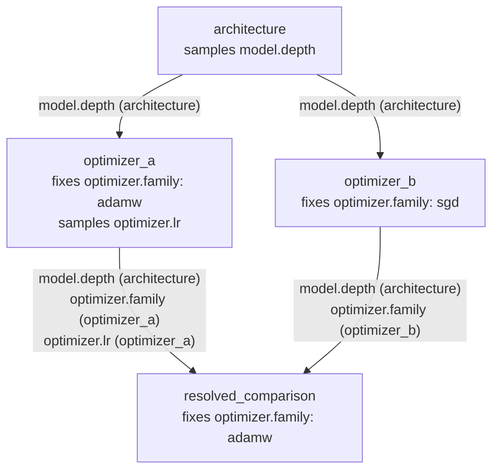

# Configuration guide

A PhaseSweep configuration is one operator-authored YAML document for one ordered `Experiment`. It contains the trainer's base configuration, an optimization metric, and a sequence of phases. PhaseSweep materializes trial inputs, runs the trainer, reads its configured scalar, and carries chosen values into later phases.

Run `phasesweep validate <config>` before launching. The loader rejects duplicate YAML mapping keys and unsupported fields before it creates run artifacts. A top-level `suite` is rejected: write each component as its own complete experiment YAML file and review its defaults explicitly.

Field types, defaults, and validation constraints are in [config_reference.yaml](../src/phasesweep/config_reference.yaml), which is too long to read whole: `phasesweep explain KEY` prints one key and everything below it, and the [reference index](#reference-index) lists where each top-level key lives. It is a signature reference, not runnable YAML; start with [example.yaml](../examples/example.yaml) for one local CPU toy-trainer attempt. Both CLI commands take an explicit config path. YAML values override built-in defaults; CLI execution flags and ambient environment do not form a general config-key overlay. Config is read once per invocation, with no general `${VAR}` interpolation. Relative `workdir`, journal and `execution.cwd` paths resolve against the directory of the YAML file, so the same file writes the same artifact tree from any directory, through the CLI or MCP. An `Experiment` built in Python has no file and resolves them against the process working directory. MCP's separate catalog paths are documented in the [operator reference](mcp.md#the-catalog).

## Reference index

`phasesweep explain` with no argument lists every top-level key with its signature, a one-line summary and its sub-key count. `phasesweep explain KEY` prints the key and every key below it, one entry per discriminator variant labelled `[type=...]`. `phases[].sampler`, `phases.sampler` and `phases.0.sampler` name the same key. An unknown key exits 2 and names the closest documented keys.

| Section | Top-level keys | Command |
| --- | --- | --- |
| Required experiment fields | `experiment`, `trial_command`, `metric`, `phases` | `phasesweep explain phases` |
| Trainer inputs | `trainer_config`, `override_format` | `phasesweep explain override_format` |
| Storage and provenance | `storage`, `workdir`, `provenance` | `phasesweep explain storage` |
| Constraints | `constraints` | `phasesweep explain constraints` |
| Observations | `observe` | `phasesweep explain observe` |
| MLflow target and ownership | `mlflow` | `phasesweep explain mlflow` |
| Execution environment | `env`, `execution`, `timeout_seconds_per_run` | `phasesweep explain execution` |

`phases` and `metric` are the largest subtrees. Narrow them with a path such as `phasesweep explain 'phases[].sampler'`, and quote any key that contains brackets so the shell does not expand it.

## Experiment YAML

The root mapping names one experiment and provides its storage, trainer boundary, metric, and ordered `phases` list. `experiment` is used in study names, artifact paths, and lock identity, so it must be a safe, stable name.

```yaml
experiment: model_search
storage: auto
workdir: ./runs
provenance:
  trainer: trainer-revision-42
  data: dataset-2026-09
trial_command: "python train.py --config {config_path}"
trainer_config:
  model: {depth: 8}
  optimizer: {lr: 0.0003}
metric:
  name: validation_loss
  goal: minimize
  extractor:
    type: json_envelope
    objective_name: validation_loss
    split: validation
    policy: final
phases:
  - name: depth
    n_trials: 3
    sampler: {type: grid}
    search_space:
      model.depth: {type: categorical, choices: [6, 8, 10]}
  - name: learning_rate
    inherits: [depth]
    n_trials: 4
    sampler: {type: random, seed: 7}
    search_space:
      optimizer.lr: {type: float, low: 0.00001, high: 0.001, log: true}
```

Choose `storage: auto` or a `journal:///...` URL for persistent local work, with a nonempty `provenance` mapping. `storage: null` is disposable. See [storage and locks](runtime.md#storage-and-locks) for path resolution, artifact-root binding, and continuation behavior.

## Phase composition

Phases execute in declaration order. `inherits` names earlier phases whose winner values become fixed inputs for the child. Omitting `inherits` never adds an implicit parent.

Inheritance transfers parameters, not weights or checkpoints. Each trainer invocation owns initialization and any explicitly configured checkpoint loading.

Every exported override key has an origin. A diamond is valid when both parent paths carry the same original key. If independent parents export the same key, the child must resolve it with an explicit `fixed_overrides` value; that child value becomes the new origin for descendants. A child may intentionally fix a key it inherits. It may also search a key its parents only fixed, and the sampled value replaces the inherited one; it may not search a key an inherited phase already sampled, because a winner's sampled value is not searched again.

`fixed_overrides` and `search_space` are local alternatives: one key cannot appear in both. Dotted keys use the same namespace everywhere, so a key and its prefix cannot coexist (for example, `optimizer` and `optimizer.lr`). Phase names must be unique and can inherit only from earlier declared phases.

A list of fixed runs is one phase per configuration with `fixed_overrides` and no `search_space`. A phase with an empty `search_space` is a fixed configuration: it draws nothing from its sampler, so it needs no sampler seed and no `acknowledge_nonresumable` on persistent storage, and `validate` and the dry run report it as `fixed configuration, no sampler draws (resumable)`. It keeps at most one completed result, so `n_trials` above 1 only replaces failed attempts and identical trials are never ranked against each other. A failed, timed-out or interrupted trial still counts toward `n_trials`, so on persistent storage a rerun at the same target replays the failure. Raise `n_trials` by one per failed attempt to retry it: after one failed attempt `n_trials: 2` runs one more, and a launch refuses a target further past the failures than that. Once an attempt completed, feasible or not, the configuration was measured and a launch refuses any target above the attempts already made. With `storage: null` every invocation is a fresh study that retries nothing, so `n_trials` above 1 is refused at load; on persistent storage `validate` and the dry run print a warning instead, and the dry run reads the recorded attempts to refuse what a launch would refuse. To run one configuration several times, for example across seeds, use [repeats](#repeats).

```yaml
phases:
  - name: architecture
    n_trials: 2
    sampler: {type: grid}
    search_space:
      model.depth: {type: categorical, choices: [6, 8]}
  - name: optimizer_a
    inherits: [architecture]
    n_trials: 2
    sampler: {type: grid}
    fixed_overrides: {optimizer.family: adamw}
    search_space:
      optimizer.lr: {type: categorical, choices: [0.0001, 0.0003]}
  - name: optimizer_b
    inherits: [architecture]
    n_trials: 1
    fixed_overrides: {optimizer.family: sgd}
  - name: resolved_comparison
    inherits: [optimizer_a, optimizer_b]
    n_trials: 1
    fixed_overrides: {optimizer.family: adamw}
```

Each edge below lists the keys a child receives and, in parentheses, the phase where each key originated:



`model.depth` reaches the final phase along both paths with the same origin, so the diamond is valid and needs no duplicate declaration. `optimizer.family` arrives from two independent origins, so validation refuses the child until it fixes that key; its `adamw` then becomes the origin that descendants inherit.

## Search spaces and samplers

`search_space` maps dotted trainer-config paths to `float`, `int`, or `categorical` parameter objects. A key that is exactly `seed` or ends in `.seed` is refused: a searched seed lets seed noise win as if it were a configuration. Fix the seed in `fixed_overrides`, or measure its noise with [repeats](#repeats).

> [!IMPORTANT]
> YAML decides scalar types before PhaseSweep reads fixed overrides or categorical choices. In this loader, bare `1e-3` is a string, while `1.0e-3` and `0.001` are floats. PhaseSweep preserves that distinction so string categories remain usable. Write a decimal value (or an exponent with a decimal mantissa) for a numeric override, and quote a value when you intend a string category.

Supported sampler types are `grid`, `random`, `tpe`, and `cmaes`. A grid's trial target covers its concrete combinations unless `allow_partial_grid: true` is set; CMA-ES accepts numeric spaces only. `validate` and `run --dry-run` warn when a `tpe` phase's `n_trials` does not exceed `sampler.n_startup_trials` (default 10), because then every trial is sampled at random. Sampler-specific limits and fields are listed in the [reference](../src/phasesweep/config_reference.yaml).

For persistent storage, a phase with a `search_space` that uses `random`, `tpe`, or `cmaes` needs a seed. TPE and CMA-ES also require `acknowledge_nonresumable: true`: their target must finish in one invocation rather than being resumed or enlarged across processes. A phase with an empty `search_space` and no `repeats` draws nothing and is exempt from both. See [timeouts and continuation](runtime.md#timeouts-cleanup-and-continuation) for trial accounting, partial results, and sampler continuation, and [confound verdicts](runtime.md#confound-verdicts) for the advisory checks.

### Repeats

`repeats` runs every configuration once per value of one key, typically the trainer seed, and ranks configurations by the mean or median of their members instead of by a single lucky trial. The sampler draws the repeat value as one more axis, so `N` configurations with `R` values cost `N x R` trials, and `n_trials` must cover every repeat: the number of values for an empty `search_space`, a multiple of it under seeded random, and configurations times values under grid. Only `grid` and seeded `random` support it, and `allow_partial_grid` is refused with it.

```yaml
experiment: lr_with_seeds
storage: auto
workdir: ./runs
provenance:
  trainer: trainer-revision-42
trial_command: "python train.py --config {config_path}"
metric:
  name: validation_loss
  goal: minimize
  min: 0.0001
  extractor: {type: json, path: result.json, key: validation_loss}
phases:
  - name: learning_rate
    n_trials: 12
    sampler: {type: random, seed: 7}
    search_space:
      optimizer.lr: {type: float, low: 0.00001, high: 0.001, log: true}
    repeats: {key: seed, values: [0, 1, 2], reduce: mean}
  - name: batch_size
    inherits: [learning_rate]
    n_trials: 9
    sampler: {type: grid}
    search_space:
      data.batch_size: {type: categorical, choices: [16, 32, 64]}
    repeats: {key: seed, values: [0, 1, 2]}
```

Choose the sampler by what you can afford. Grid runs every configuration with every value and is the honest choice for a small discrete space. Seeded random runs `n_trials / R` configurations, each drawn once and run with every value in `R` consecutive trial numbers, so a time-limited phase or one enlarged later never leaves more than one group half-run. An empty `search_space` with `repeats` is a seed audit: one fixed configuration run once per value, which reports the seed spread of a baseline before you search around it.

A configuration ranks only when every member completed, is feasible, and lies inside `metric.min` and `metric.max`; one failed or out-of-bounds member keeps the whole group out, and a failed member is not retried. Use `metric.min` or `metric.max` so a collapsed seed cannot drag a configuration's mean, and size `max_consecutive_failures` above the number of values, or one configuration that fails every repeat can abort the phase; `validate` and the dry run warn when it is not. Report-only `observe` values are averaged over the members that recorded them. The winner names its group by the group's last member and publishes the reduced metric with the spread and every member under `repeats` in `winner.yaml` (see [runtime behavior](runtime.md#repeat-groups)). Its params and effective overrides never carry the repeat key, so a later phase that inherits it runs its own repeats, a fixed seed, or the trainer's default.

## Trainer inputs

Set the top-level `override_format` to select the boundary your trainer accepts. PhaseSweep supports four input boundaries:

- `yaml_file` is the default. It copies `trainer_config`, applies inherited, fixed, and sampled dotted overrides, writes a complete YAML file in each trial directory, and requires `{config_path}` in `trial_command`.
- `argparse` is for a trainer that accepts command-line options. It requires `{overrides}` and renders shell-safe `--key=value` tokens for every flattened `trainer_config` leaf and override. It accepts null, booleans, integers, finite floats, strings, and lists of those values.
- `hydra` renders native `key=value` tokens through `{overrides}`, for every flattened `trainer_config` leaf and override. Numbers, booleans, null, strings, and recursively supported lists preserve their types. Hydra grammar quoting is separate from shell quoting. Control characters and interpolation-like `${...}` strings are rejected before launch rather than interpreted as configuration expressions. Rendering does not import Hydra.
- `json_file` writes nested JSON to `overrides.json` and requires `{overrides_path}`. The file holds `trainer_config` with the overrides applied, so it holds only the overrides when `trainer_config` is empty. Dotted keys expand into nested objects. Values must be strictly JSON-representable, with string object keys and finite numbers.

`trainer_config` is the base for every format, and overrides apply to it at their dotted paths. Strings in it expand `{trial_dir}`, `{trial_id}`, `{phase}`, and `{run_name}` in every format. `argparse` and `hydra` flatten nested mappings into dotted keys, so each leaf must be a value that format can render: no mapping inside a list and no empty mapping. A nonempty `trainer_config` makes the format's placeholder required, because the base has to reach the trainer; a constant command may omit its placeholder only when `trainer_config` and every phase's composed overrides are empty. Incompatible placeholders are rejected too. For `yaml_file` and `json_file`, `overrides_resolved.json` is the flat audit record of the overrides alone; for `argparse` and `hydra` it is the trainer input and holds the merged flat mapping, which is the overrides alone when `trainer_config` is empty. YAML input contains the complete base configuration plus overrides. All phases' compositions are validated before launch, including dotted-key collisions and choices indistinguishable on the trainer wire.

## Objective evidence, constraints, and gates

The metric is a finite scalar extracted after the trainer exits successfully. Use the reader that matches the trainer's existing reporting:

- `json` reads a finite JSON number at a saved trial-relative path and dotted key, for example `{type: json, path: result.json, key: eval.loss}`. It records no evaluation position, so selection's `evaluation_point` check is always `n/a` for it (as for `log_regex`).
- `wandb` reads an exact scalar key such as `eval/loss` from the finished run whose ID is the immutable trial attempt ID. It requires the optional `wandb` extra and an authorized entity/project.
- `mlflow` reads native metric history from the bound finished run. It requires the optional `mlflow` extra, an existing experiment in the top-level `mlflow` block, and an explicit `select: last | min | max | step`. See the [MLflow guide](mlflow.md) for ownership, selection, and result delivery.
- `json_envelope` reads an attempt-bound versioned envelope from a trial-relative path. Python trainers can call `phasesweep.report_objective` to write it to the managed `PHASESWEEP_OBJECTIVE_PATH`.
- `log_regex` reads a trial-relative log file and selects a numeric named `(?P<value>...)` match; `select: last` remains the default.

`constraints` use the same scalar readers. A valid measured constraint violation is a completed but infeasible trial; missing or invalid evidence fails the trial. Phase `gates` include `required_file`, `json_equals`, `json_scalar_bound`, `artifact_size`, `sha256`, `wandb_summary_required`, and `mlflow_required`. `mlflow_required` separately names `metrics`, `params`, and `tags` from the same bound run. A failed gate fails the trial. There is no advisory gate mode or baseline substitution.

`metric.min` and `metric.max` are optional inclusive viability bounds on the metric itself. They must be finite, `min` may not exceed `max`, and either may be set alone. A trial whose metric falls outside them is infeasible exactly like a violated constraint: it completes with its real value (the sampler still learns from it), counts toward `max_consecutive_failures` and as `infeasible` in the `survivorship` verdict, and selection re-checks the bounds from the stored value. A bound refuses a degenerate score, such as a loss of exactly 0 from a leaked evaluation set; it does not steer the search. When no trial survives, the `NoFeasibleTrialError` names the bound or bounds and the best value among the completed trials with its trial number. The bounds are part of the metric's identity, so changing one starts a new study.

**Report-only observations.** `observe` lists extra scalars to record from each accepted trial without letting them influence anything. Each entry is a `name` and an `extractor`, and the extractor is `json`, `json_envelope` or `log_regex`: a `wandb` or `mlflow` extractor is refused at load, because remote readers wait for every requested key and a value the trainer never wrote would stall the trial. A value written with `report_objective(..., extra=...)` is read with a local `json` extractor. An observation is read after the trial is accepted, so a read that fails or yields a non-finite value logs a warning, records nothing for that name, and leaves the trial untouched. Recorded values appear as `user_attr:observed:<name>` columns in `trials.csv`, as `observed` in the selected winner's `winner.yaml` and in MCP results, and as `phasesweep.observed.<name>` metrics on a managed [MLflow](mlflow.md#result-delivery-and-recovery) attempt run. Observations never enter the study fingerprint and never affect selection, so editing `observe` does not invalidate a study. Names must be distinct from the metric and the constraints, and an observation may not set `evaluation_axis`.

```yaml
observe:
  - name: peak_memory_gb
    extractor: {type: json, path: result.json, key: peak_memory_gb}
```

All local evidence paths are relative to the fresh attempt directory; there is no latest-file discovery or fallback to a shared result. Objective extraction, gate failure, a non-finite metric, or a nonzero trainer exit fails the attempt. When no feasible eligible trial remains, the phase fails; PhaseSweep does not invent a carried baseline.

These scoring decisions are separate:

- `metric.goal` ranks the scalar selected for each trial.
- `metric.min` and `metric.max` decide whether that scalar is viable; they never rank.
- `log_regex.select` chooses an observation within that trial (`last`, `first`, `min`, or `max`).
- W&B selects an exact finished-summary key; ordinary JSON selects a saved path and dotted key.
- MLflow uses an explicit [native history selector](mlflow.md#select-metrics-and-require-evidence).
- Envelope `policy` and `expected_step` validate reported metadata; they do not cause evaluation or checkpoint loading. For envelope and W&B objectives, `evaluation_axis` names the training-progress axis the sweep holds fixed; selection's `evaluation_point` confound check compares ranked objectives only on it (see [runtime behavior](runtime.md#confound-verdicts)). It is part of the extractor config, so changing it starts a new study, like `checkpoint`/`expected_step`; constraint extractors may not set it. `json_envelope` defaults to `step`, the envelope's own evaluation step, and any other name must be reported in `evaluation.progress` (via `report_objective(..., progress={...})`); `wandb` defaults to `_step`, W&B's own history step.

For example, in a fixed-token batch-size sweep each trial's optimizer `step` count depends on its batch size, so trials differ by design in both `step` and any step-named checkpoint. Declaring `evaluation_axis: tokens` and reporting `progress={"tokens": total_tokens}` compares trials on tokens instead: the check stays `ok` when every trial reached the token budget, and flags one that stopped short. Positions within 1% of the highest count as one point, since each batch size stops within a batch of the budget. Likewise, a trainer that reports its best checkpoint reports a step that differs between trials by nature; report how far it trained on a declared axis instead, such as `progress={"trained_steps": total_steps}` with `evaluation_axis: trained_steps`.

Only `json_envelope`, `wandb` and `mlflow` objectives record a position, so `evaluation_point` is `n/a` for `json` and `log_regex`; `validate` and `run --dry-run` print an `evaluation_point check:` line that says whether the configured extractor supports it. With W&B or MLflow the position is where the metric was logged. Under Transformers `load_best_model_at_end=True`, `train()` reloads the best checkpoint's weights, so a final evaluation scores that checkpoint, yet its logged position reads as the trainer's final global step for every trial. If the evaluated checkpoint matters, report through `json_envelope` with `policy`, `checkpoint` (for Transformers, `trainer.state.best_model_checkpoint`) and `step`. A phase that searches training length, such as epochs or `max_steps`, flags `evaluation_point` by design.

The trainer owns evaluation cadence, early stopping, checkpoint selection, and custom aggregation. PhaseSweep has one experiment-level metric and does not prune training. `validate` and `run --dry-run` display the configured source, key/path/pattern, applicable reduction, ranking goal, and viability bounds when set.

### W&B evidence

```yaml
metric:
  name: validation_loss
  goal: minimize
  extractor:
    type: wandb
    entity: YOUR_ENTITY
    project: YOUR_PROJECT
    metric_key: eval/loss
    evaluation_axis: eval/step
    poll_seconds: 2
    timeout_seconds: 120
```

`metric_key` is a summary key as the W&B runs table names it. W&B reports the aggregate from `define_metric("eval/loss", summary="min")` as `eval/loss.min`, and that run has no `eval/loss` summary key, so a bare `eval/loss` waits out the timeout.

`evaluation_axis` names the history key that marks where `metric_key` was measured; it defaults to `_step`, W&B's own history step. Typically it names the `define_metric` step metric, e.g. `eval/step` under `define_metric("eval/*", step_metric="eval/step")`, or a token counter. Log it in the same `log()` call as the metric: W&B fills a step metric missing from a call with its previous value, so an axis logged separately lags one evaluation behind. It may not name the metric's own series. A plain key is positioned at the last row that logged its value. An aggregate key such as `eval/loss.min` covers its whole `eval/loss` history series, so it is positioned where that series ends: how far the trial trained, not where its best value fell, which differs between comparable trials by nature. See [trial execution and evidence](runtime.md#trial-execution-and-evidence) for the advisory read's deadline and cleanup behavior.

For plain keys, exact history matches take priority. With no exact match, the reader can use the final finite metric row when it differs from the summary by one binary64 step and no other neighboring value occurs. Larger or ambiguous differences leave the position unavailable. This accommodates observed API numeric differences; it cannot establish whether a summary was assigned independently, and never changes the accepted scalar.

Within a phase, the primary objective, W&B constraints, and that phase's W&B gates must agree on normalized endpoint, entity, project, poll interval, and timeout. They share one finished-summary capture. When the objective and constraints are local, separate gate-only phases may use different W&B targets. A gate-only configuration accepts the first finished summary and fails if required keys are missing. Failed, crashed, killed, or preempted remote runs cannot win.

PhaseSweep supplies `WANDB_BASE_URL`, `WANDB_ENTITY`, `WANDB_PROJECT`, `WANDB_RUN_ID`, and `WANDB_RESUME=never`. Trainers must honor those values and finish their run. Explicit conflicting identity settings and offline/disabled modes are rejected before training; ambient identity defaults are normalized. An ordinary `wandb.init()`, scalar log/summary assignment, and `finish()` are sufficient; no PhaseSweep import or local objective mirror is needed.

The reader receives the trainer's composed authentication and transport environment. Use `execution.passthrough_env` for rotating environment credentials or proxies; the default `inherit_env: none` does not pass an unlisted credential at all. Excluded parent credentials are not reacquired. Supported SDK account authentication also works; an API-key environment variable is not mandatory. Credentials are never serialized in worker requests. Syntax validation and dry runs do not authenticate.

W&B's source is keyed by attempt ID; it makes none of the envelope's evaluation-metadata or trainer-input-content assurances. It only records where in the run's history the objective's value was logged.

## Trainer contract

The trainer runs in `execution.cwd` when configured (a relative value resolves against the YAML file's directory), otherwise in the directory PhaseSweep was started from, or the catalog entry's `cwd` under MCP. It receives the configured environment plus PhaseSweep-managed attempt identity, evidence-path, trainer-input, and GPU variables. Use `execution.inherit_env` to choose ambient variables and `execution.passthrough_env` for rotating credentials or transport settings. Top-level `env` values remain semantic configuration.

The working directory is part of every persistent study's identity. `phasesweep validate` and `phasesweep run --dry-run` print the effective one on a `trainer cwd:` line: the resolved `execution.cwd`, or a note that it follows the directory PhaseSweep runs from. With `execution.cwd` unset, running the same config from another directory is therefore refused as a changed phase config; the refusal names `execution.cwd` and says to run from the original directory or set `execution.cwd`.

By default (`inherit_env: none`) the trainer receives only `PATH`, `HOME`, `LANG`, `LC_ALL`, `TMPDIR`, `USER`, `LOGNAME`, and `TZ`, when set, plus top-level `env`. Everything else in the shell is dropped, including `PYTHONPATH`, virtualenv and conda settings, cache paths such as `HF_HOME`, proxies, credentials, and `CUDA_VISIBLE_DEVICES`. Widen it with `inherit_env: [NAME, ...]` for named variables, set a value under `env`, or choose `inherit_env: all` for the whole shell environment; `all` also makes every shell variable, such as `PWD`, part of the persistent-study environment cohort. `phasesweep validate` and `phasesweep run --dry-run` print the contract on an `environment:` line, and when a trial exits nonzero under a narrowed contract the first such trial in each phase logs a warning that names these fixes.

See [GPU isolation](runtime.md#gpu-isolation) for discovery precedence and how device visibility interacts with environment inheritance.

When no W&B evidence consumer is configured, trainer-owned `WANDB_*` settings are preserved except for an ambient/inherited `WANDB_RUN_ID`, which is removed. An ID explicitly configured in top-level `env.WANDB_RUN_ID` remains trainer-owned in this case.

For a trainer that chooses the optional envelope contract:

```python
from phasesweep import report_objective

# Train and evaluate using the YAML received at --config, then:
report_objective(
    value=validation_loss,
    name="validation_loss",
    split="validation",
    policy="final",
    checkpoint="final.pt",
    step=1000,
)
```

`report_objective` obtains the attempt identity and output path from the managed environment. Do not construct those values yourself. `value`, `step`, and any `progress={"tokens": total_tokens}` positions, which a declared `evaluation_axis` reads, may be Python or NumPy numbers.

Trainers that cannot import the Python helper can publish the same envelope from the managed trial environment:

```bash
phasesweep report-objective 0.123 --name validation_loss --split validation \
  --policy final --checkpoint final.pt --step 1000
```

A repeatable `--progress tokens=2048000` reports what `progress=` does from Python.

### Source-checkout preflight

Before launching a source-checkout trainer, verify the package actually imported by the configured Python executable. Running a checkout's example script does not make Python import that checkout's library. Match the example to its installed library, or explicitly select the checkout's source directory:

```yaml
execution:
  cwd: /absolute/path/to/transformers
env:
  PYTHONPATH: /absolute/path/to/transformers/src
```

Run a CPU-only preflight with that same executable and explicit environment; for this example:

```bash
CUDA_VISIBLE_DEVICES='' PYTHONPATH=/absolute/path/to/transformers/src \
  /absolute/path/to/python -c 'import transformers; print(transformers.__version__); print(transformers.__file__)'
CUDA_VISIBLE_DEVICES='' PYTHONPATH=/absolute/path/to/transformers/src \
  /absolute/path/to/python /absolute/path/to/transformers/examples/pytorch/token-classification/run_ner.py --help
```

Carry all required settings into the experiment's composed environment: the default `inherit_env: none` drops ambient `PYTHONPATH` and other shell settings. Use the actual example's `--help` to choose supported arguments; configuration validation does not execute the trainer or establish library compatibility. For Transformers with managed MLflow, also apply the [full-script run context](mlflow.md#transformers-trainer) before launch so final evaluation remains in the bound run. The W&B integration uses its own native callback and managed attempt identity.
