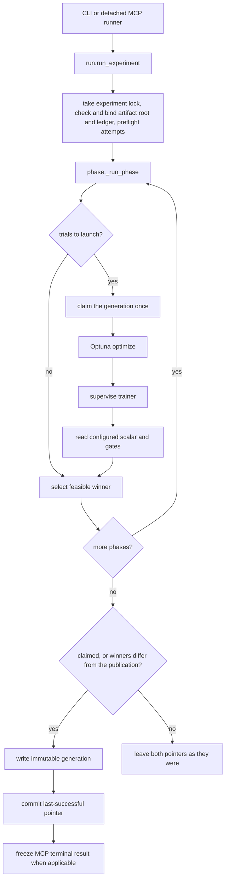

# Development

## Source checkout

```bash
git clone https://github.com/pszemraj/phasesweep.git
cd phasesweep
pip install -e ".[dev,wandb,mlflow]"
```

The development extra includes MCP and Hydra for integration checks, pytest-xdist for local parallel tests, and setuptools-scm for the release-version regression; the optional W&B and MLflow extras exercise the installed SDKs. The MLflow server tests in `tests/test_mlflow_integration.py` (marked `integration`) start a local tracking server and need full `mlflow` at the client's version, as in the [MLflow example](mlflow.md#run-the-cpu-example-locally); they skip without it. Run Python-dependent commands in the environment where you installed the project.

To install unreleased `main` without an editable checkout:

```bash
pip install git+https://github.com/pszemraj/phasesweep.git
```

## Quality gates

During iteration, run the mandatory checks and tests for the changed subsystem. Complete qualification uses [both non-live lanes](#test-tiers). Run the repository checks sequentially:

```bash
pytest -m "contract and not live"
ruff check .
ruff format --check .
mypy src
bash scripts/check_module_size.sh
```

> [!IMPORTANT]
> Within this checkout, run one test lane at a time and keep `pytest` separate from lint and type checks: process-supervision and timeout tests are timing-sensitive. Bounded test overlap with other projects is allowed.

### Git hooks

The [hook configuration](../.pre-commit-config.yaml) calls the tools installed in the active environment and builds none of its own, so commit from a shell with that environment active. The development extra provides `pre-commit` and `pathlint`; after installing it, enable the hooks once per clone:

```bash
pre-commit install
```

| Hook | Stage | Runs on |
| --- | --- | --- |
| development environment | pre-commit, pre-push | every commit and push, before the other hooks |
| `ruff check --fix`, `ruff format` | pre-commit | changed Python files |
| `pathlint check` | pre-commit | changed `src/` and `tests/` Python files |
| module size | pre-commit | changed `src/` and `tests/` Python files |
| typing escapes | pre-commit | lines the commit adds to `src/` and `tests/` Python files |
| review-provenance tags | pre-commit | changed `src/` and `tests/` Python files |
| contract tests | pre-commit | every commit, collecting the whole suite and running the tests marked `contract` |
| `mypy src` | pre-push | the whole package |

The development environment hook stops the run when the `python` first on `PATH` has no `phasesweep` installed, which means another environment is active.

Ruff checks public docstrings and function annotations, and mypy checks source typing; both also run in CI. The development extra and [CI](../.github/workflows/ci.yml) pin the same exact versions of `ruff`, `mypy` and the YAML stubs; raise them in both places together. When Ruff rewrites a file, stage the fix and commit again.

The [module-size hook](../scripts/check_module_size.sh) limits each touched source or test module to 2000 lines. The [typing-escapes hook](../scripts/check_typing_escapes.py) rejects `Any`, `typing.cast`, and `# type: ignore` on added or edited lines, including docstring type fields. Narrow values with `isinstance`, use `TypedDict` for known shapes and `Protocol` for external APIs, or use `phasesweep.runtime.json.JsonValue` / `JsonObject` for open JSON. Existing escapes must be fixed when their lines change. The review-provenance hook rejects `review vN`, `PR #N`, `reviewer N`, `blocker N`, `gap hunt`, `pre-vN` and `finding X1` in comments and docstrings; state the reason in place and leave provenance to git history.

`pre-commit run --all-files` runs the commit hooks over the whole tree; `pre-commit run --all-files --hook-stage pre-push` runs the push hooks: the environment check, then `mypy src`.

### Source prose review

```bash
python scripts/sample_docstrings.py -n 30 --seed 42
python scripts/sample_docstrings.py --audit > prose-review.txt
```

The audit scans every source docstring (including attribute documentation) and comment, reporting narrative wording, repeated paragraphs of at least 20 words, and prose blocks of at least 120 words before API sections. It reports every candidate with its location and reason; it does not edit files or fail because of findings. Review the context before removing text: emphasis and length can describe useful contracts, and stale behavior claims require checking the implementation. Runtime strings such as field descriptions, CLI help and error messages are outside this scan. This is an optional local review tool, not a hook or CI check.

### Test tiers

Complete non-live qualification runs the parallel lane, including integration tests, followed by the serial self-signalling lane. Use a bounded worker count, for example:

```bash
pytest -n 2 --dist worksteal -m "not live and not signals_own_pid" \
  --durations=25 --durations-min=1
```

`worksteal` balances tests across workers. Test homes, caches, journals and host-lock directories use per-test temporary paths. For a manual CPU smoke test, use a scratch experiment directory, a fresh mode-0700 `PHASESWEEP_LOCK_DIR`, and scratch `XDG_STATE_HOME` and `XDG_CACHE_HOME` directories. Tracker workers write their request files under the cache. Keep the worker count bounded; `-n auto` can overload process-launch and deadline checks. For fast iteration, add `and not integration` to the parallel marker expression.

Run only the complementary self-signalling lane serially, after this checkout's parallel lane exits:

```bash
pytest -m "not live and signals_own_pid"
```

Both lanes run on Linux and macOS. Tests that require real Linux procfs or PID namespaces skip on macOS; native macOS identity tests require a macOS host. Synthetic providers exercise parsing and routing across hosts, while native identity and MPS lease tests cover macOS host paths. Together these lanes cover the same cases as plain `pytest`, so qualification needs no duplicate full serial pass. Only tests that signal their own runner require the serial lane within this checkout.

If tests fail under contention, wait for an idle machine and rerun only the failing node IDs serially. Do not rerun the whole suite. Add the duration-report options shown above to either lane to inspect its runtime.

> [!NOTE]
> A `-m` on the command line *replaces* the `-m 'not live'` in `addopts` rather than adding to it, which is why every marker command on this page that leaves live tests out spells out `not live`.

`@pytest.mark.live` tests use real host hardware or a live external service, so every run leaves them out unless `-m live` selects them. The W&B round trip in `tests/test_wandb_live.py` runs a two-phase W&B-only sweep with a pure-Python trainer. It checks the attempt-keyed remote captures, publication, inherited parameters, and a replay that reads no W&B state. It needs the W&B SDK installed and credentials that may write to the project you name, and skips when `PHASESWEEP_WANDB_ENTITY` or `PHASESWEEP_WANDB_PROJECT` is unset; `PHASESWEEP_WANDB_BASE_URL` selects another W&B server:

```bash
PHASESWEEP_WANDB_ENTITY=YOUR_ENTITY PHASESWEEP_WANDB_PROJECT=YOUR_PROJECT \
  pytest -m live tests/test_wandb_live.py
```

A test is `@pytest.mark.integration` when it manages real processes, waits on wall-clock time, drives a multi-step durable recovery workflow, or is otherwise slow: its call phase takes at least one second. Everything else stays in the fast tier, including engine runs with quick trainers, such as `run_experiment` over an `echo` trainer, which spawn their subprocess inside the package.

Mark tests explicitly according to the rules above, including tests that call shared helpers. Use pytest's built-in duration report to identify slow cases. Durations are advisory; timing thresholds do not fail a run.

A test module that pins a cross-module contract carries `pytestmark = pytest.mark.contract`; the commit hook and CI run exactly those tests.

An autouse fixture, `guard_runner_signals` in `tests/conftest.py`, fails any test whose code would send a real signal to pytest, its parent, or either one's process group; a signal-0 liveness probe passes. A test that signals its own PID on purpose, to drive a shutdown handler, carries `@pytest.mark.signals_own_pid`, which lifts only that one target.

GitHub Actions runs one Linux job on pull requests: Ruff linting, Ruff format checking, mypy, the module-size check, and the contract tests (`pytest -m "contract and not live"`, which also collects the whole suite), with the tests importing from `src/` and no package build. That test step runs on one Python version and stays within about 20 seconds; the full suite stays local to control CI cost. Live tests are opt-in.

The supported Optuna range is `>=4.6,<4.10`. PhaseSweep's local storage and read-only inspection behavior depends on that range, and the position-seeded TPE and CMA-ES samplers override private Optuna names that `tests/test_draw_positions.py::test_the_optuna_internals_the_position_samplers_build_on_exist` pins; do not widen it without targeted validation.

The W&B reader supports `>=0.28,<0.29`. Tests exercise that SDK's summary decoding and error behavior with controlled responses, plus supervised worker fixtures for deadlines, cleanup faults, and recovery; only the live W&B round trip reaches the service. Input tests use the real Hydra 1.3 parser and entrypoint; rendering itself has no Hydra runtime dependency.

### Shared test setup

Use `tests/conftest.py` for isolation fixtures, model builders and trial records; `tests/experiments.py` for dictionary-based YAML configuration; `tests/ledger_fixtures.py` for golden publications and journal mutations; `tests/mcp_helpers.py` and `tests/recovery_helpers.py` for MCP and recovery setup; `tests/error_routing_helpers.py` for the case record and assertions the two routing contract modules share; and `tests/tracking_helpers.py` for shared tracking fakes and experiment setup. Import shared setup from these support modules rather than another test module. Keep assertions and scenario-specific malformed input or trainer programs with their tests. Helpers that other modules import have public names.

The golden ledger fixture under `tests/fixtures/ledgers` is committed output of a real run. Regenerate it when a persisted format changes; the [fixture guide](../tests/fixtures/ledgers/README.md) gives the command and what churns.

## PyPI releases

Use relative links for repository files in Markdown. The root [README](../README.md) also supplies the package description on PyPI, so its links to repository files and its phase diagram use absolute GitHub URLs. The [public metadata tests](../tests/test_public_metadata.py) require link targets that do not depend on a checkout and keep the diagram directly below the introduction.

Versions come from Git tags through setuptools-scm. The [`publish.yml` workflow](../.github/workflows/publish.yml) builds one wheel and one source distribution from the commit recorded by a published GitHub Release. The build restricts setuptools-scm's Git tag selection to that release's tag, so other tags on the same commit cannot determine the package version. It requires a stable `v`-prefixed PEP 440 tag whose commit is contained in `main`, then checks that both distributions contain the tag's normalized version and the project name `phasesweep`. GitHub prereleases are skipped, and prerelease version tags are rejected even for normal GitHub Releases.

PyPI trusts this publisher for the `phasesweep` project, configured in [PyPI account publishing](https://pypi.org/manage/account/publishing/):

| Field | Value |
| --- | --- |
| PyPI project name | `phasesweep` |
| GitHub owner | `pszemraj` |
| GitHub repository | `phasesweep` |
| Workflow filename | `publish.yml` |
| Environment name | `pypi` |

The publishing job uses the GitHub environment `pypi` with no required reviewer. GitHub creates it on first use if it does not exist. Only this job has `id-token: write`; it uploads the validated distributions with short-lived OIDC credentials and attestations. No PyPI API-token secret is needed.

For each release:

1. Complete the local quality gates above and merge the changes into `main`.
2. Publish a normal GitHub Release with a new stable version tag, pointing to a commit that includes the publishing workflow. Keep release notes in GitHub Releases. Publishing starts the workflow; draft creation and tag pushes do not.
3. Check the workflow result and the [PyPI project](https://pypi.org/p/phasesweep): version, wheel, source distribution, README rendering, and attestations.

Versions already uploaded to PyPI cannot be replaced; duplicate uploads fail visibly.

## Package map

- `phasesweep.config`: Pydantic Experiment models, strict YAML loading, and shared config `--set` path edits (`run_overrides`).
- `phasesweep.engine`: phase orchestration, fingerprints, local persistence, immutable generation publication, and read-only status.
- `phasesweep.evidence`: JSON, envelope, log, W&B, and MLflow extraction and gates.
- `phasesweep.reporting`: trainer-side JSON-envelope objective writer.
- `phasesweep.tracking`: MLflow run bindings, supervised controller operations, result delivery, and upload retries.
- `phasesweep.runtime`: subprocess supervision, GPU leases, locks, local storage URLs, override rendering, and the terminal primitives of human-readable output (`runtime/terminal.py`: the colour decision, terminal width, prose wrapping, display paths). Keep `runtime/supervisor.py` stdlib-only; see the [launch ordering](invariants.md#9-nothing-runs-before-its-process-identity-is-durable).
- `phasesweep.mcp`: catalog registry, stdio server, detached runner, durable run handles, frozen snapshots, the failure payload a run read returns (`mcp/failures.py`), and operator recovery.
- `phasesweep.cli`: Click command surface.
- `phasesweep.trial_table`: the plain-text trial tables of `status --trials`, rendered from the engine's trial tables with the width and colour decision passed in.
- `phasesweep.run_report`: the live run's report, one block per fact. The progress blocks (phase start, trial, rerun, skipped phase, winner) are log messages on the `phasesweep.report` logger, each with a one-line `str()` for `run.log` and `render(width)` for the console; `runtime/console.py` holds the handler that prints them with the time, and warnings with a `warning:` label, on stderr. The banner, the closing summary, the replay sentence and the closing `log:` line have `render` alone: the CLI writes them to stderr directly and they never reach `run.log`.
- `phasesweep.errors`: the shared operator-facing error taxonomy and the operator steps behind the `fix:` lines.
- `phasesweep.examples`: the toy trainers `fake_train` and `mlflow_train`, which the templates and examples run as the `phasesweep-fake-train` and `phasesweep-mlflow-train` console scripts.
- Packaged data: `templates/` (the `init` templates), `config_reference.yaml` (parsed by `config/reference.py`, which expands its shared blocks into every key path for `explain`, `explain_config`, typo suggestions and validation hints), and `mcp/agent_prompt.md` (the agent guide that the MCP `get_guide` tool and `phasesweep_run_and_monitor` prompt return).

The configuration reference is written by hand. `tests/test_config_reference.py` compares its expanded key paths, variants, types and defaults with the schema. It does not validate prose about bounds, units or interactions.

Its first header block is the title, and the second is the general notes that `phasesweep explain --notes` prints and `explain_config` returns without a key, so keep that block to what someone writing a config acts on. A `# ---------- Title ----------` banner, at any indent, starts a section, and the comment block right after it, ending at a blank line, is the section's rules, which `explain` prints before the section's keys. A column-0 `TitleCase:` line below the Shared blocks banner defines a shared block, described by the comment lines directly above it. A signature that names blocks, such as `JsonExtractor | WandbExtractor (required)`, expands each block's fields below that key, tagged by the block's `type` field, and `<<: Name` merges a block's fields at its indent. The parser rejects an unknown or unused block and a comment block it cannot attach to a key, a section head or a block.

Common package-root calls are `load_experiment`, `run_experiment`, `experiment_status` and `report_objective`. Schema types are defined in `phasesweep.config.models` and `phasesweep.config.search`. Tests that need internals import direct modules under `engine`, `evidence`, `tracking`, `runtime`, or `mcp`.

Within `phasesweep.engine`, responsibilities map to modules as follows:

| Responsibility | Modules |
| --- | --- |
| Experiment and phase orchestration | `run`, `phase` |
| Trial launch, objective extraction and worker threads | `trial`, `workers` |
| Samplers and trial identity | `optuna` |
| Winner selection and repeat groups | `selection`, `repeats` |
| Dry-run planning and the live progress report | `preview`, `progress` |
| Artifact serialization and generation provenance | `artifacts`, `provenance` |
| Typed engine failures | `errors` |
| Resume selection and continuation preflight | `resume`, `study_policy`, `guards` |
| Ledger storage: the only module that constructs Optuna storage | `ledger` |
| Locks and stale-attempt cleanup | `locking`, `attempts`, `cleanup` |
| Root ownership and retained evidence checks | `artifact_roots`, `evidence` |
| Paths, state records, and fingerprints | `paths`, `state`, `fingerprints`, `growth`, `grid_order` |
| Advisory confound verdicts on the ranked population, frozen at selection | `confound` |
| Publication and read-only views | `generation`, `publication`, `publication_validation`, `read` |

`mcp.recovery.recover_run` implements [operator recovery](mcp.md#run-state-and-recovery); the CLI owns its arguments and rendering.

See [durability invariants](invariants.md) for storage, publication, and process ordering.

The ordinary control flow is:



## Test map

The principal test groups and what each covers:

- `tests/test_e2e.py`: complete experiment and `--from-phase` replay.
- `tests/test_config.py`, `tests/test_param_validation.py`, and `tests/test_overrides.py`: Experiment validation, composition, parameter domains, and retained input boundaries.
- `tests/test_run_overrides.py`: shared `--set` key syntax, created-key notes, derived-config validation and study inspection with overrides.
- `tests/test_config_reference.py` and `tests/test_explain.py`: the configuration reference against the schema, its parser's shared blocks and section rules, and `phasesweep explain`.
- `tests/test_extractors.py`, `tests/test_trial_evidence.py`, and `tests/test_trial_launch.py`: scalar evidence, shared W&B captures, gates, supervised trials, and durable input verification.
- `tests/test_attempt_lifecycle.py`, `tests/test_process_supervision.py` and `tests/test_guardian_settle.py`: lifecycle parsing, process identity and launch ordering, descendant cleanup including descendants the guardian adopts after they leave the trainer's group, the helper settle after a trainer root exits, and guardian completion evidence.
- `tests/test_mlflow.py` and `tests/test_mlflow_terminal_delivery.py`: native history selection, run bindings, shared captures, and terminal delivery retries.
- `tests/test_mlflow_integration.py`: both ownership modes against a temporary HTTP server, stopped-server replay, worker cleanup, and delivery retries.
- Storage, publication, recovery, interrupted trials and sampler resume: owning code and representative tests are listed by [durability invariant](invariants.md).
- `tests/test_mcp_*.py`: catalog validation, run state, frozen snapshots, detached launch, status, cancellation, and recovery.
- `tests/test_terminal.py`, `tests/test_terminal_output.py`, `tests/test_trial_table.py` and `tests/test_cli_help.py`: the terminal primitives (the colour decision per stream, width, wrapping, display paths), the CLI's closing lines, refusal layout and the exit status a closed terminal leaves, the exact plain-text output of `status --trials`, command help text, and the quiet exit on a closed output pipe.
- `tests/test_run_report_summary.py`: the closing summary and the nothing-to-run block of `phasesweep run`, as exact text at 80 and 60 columns (counts, winners, flagged checks, the winners' directories).
- `tests/test_run_report.py`: what `phasesweep run` prints, as exact text at 80 and 60 columns for each report block (banner, phase start, trial, rerun, skipped, winner), the console handler (time prefix, warning and prose wrapping, styling, contiguous records from threads, the INFO lines of a dry run) and the CLI around it (`-v`, the closing `log:` line, a replay, a resume, the starter's pinned dry-run lines, and a phase abort, failed extraction or fatal error printing once).
- `tests/test_init.py`, `tests/test_fake_train.py` and `tests/test_reporting.py`: template creation and runs, the toy trainer's seed noise, catalog scaffolding, and the objective-envelope writer (`report_objective` and `report-objective`).

## Tracked TODOs

- TODO(mcp): Replace the private FastMCP strict-schema patch when the SDK exposes a tested public closed-input-schema API; keep behavior-level request validation as the safety net until then.
- TODO(mcp): Reword the engine steps written for the CLI that reach an MCP agent through the runner. `require_study` (`engine/read.py`) and `ORIGINAL_TARGET_STEP` (`tracking/session.py`) say "the same config and `--set` overrides", which an MCP run does not have, and the ownership step in `engine/run.py` names `phasesweep mcp recover-run` without its `--state-dir` and `--run-id`. The server's own remedies already build the full commands with `recover_run_step` and `sync_tracking_command`.
- TODO(mcp): Resume a study started through the [SSH form](mcp_setup.md#over-ssh) from an interactive shell on the remote machine, to confirm that section's environment note on a real hop. Launching, a dropped connection, reconnecting from a new client and cancelling work between two machines.
- TODO(mcp): A live read computes the edge advisory against the current catalog while the frozen result computed it under the run's own config, so a run whose config differs from the catalog's can read "unavailable" live and "not_at_edge" once frozen.
- TODO(runtime): Design an explicit completion-budget mode only if its attempt accounting, failure cap, and timeout semantics are specified separately.
- TODO(runtime): Add a deliberately scoped generation-pruning command only if it preserves the current last-successful pointer and all cited winner provenance.
- TODO(runtime): During a live run, a dry run can encounter an ongoing extraction and refuse to predict a trial count. Show the phase as awaiting evidence and label its remaining work as an estimate.
- TODO(runtime): Use the recorded phase's repeat grouping to rebuild its `trials.csv` after recovery with a renamed or incompatible phase. An interrupted in-memory run also needs its final CSV snapshot taken while the settled study is still available.
- TODO(runtime): Recover draws whose bookkeeping failed before the trainer started. A fatal pre-launch write can currently spend the draw and require a top-up.
- TODO(runtime): Account for repeated configuration–seed pairs so running the same seed twice does not inflate the pooled noise band's effective sample size.
- TODO(runtime): Recheck process identity in `_signal_members` so PID reuse between enumeration and signalling cannot redirect a signal to another group.
- TODO(runtime): Withhold edge advice when a restored journal cannot be matched to the population that selected the published winner.
- TODO(runtime): Reuse the phase trial reads behind `status` when computing winner advisories.
- TODO(runtime): Let `_phase_counts` use the trials from the completed phase instead of reopening the journal for the closing summary.
- TODO(tracking): Share the phase trial reads used to match MLflow attempts across generations within a delivery pass.
- TODO(cli): Preserve argument boundaries when a dry-run command contains an argument with a newline.
- TODO(cli): Include W&B in the run banner when the only W&B reader is an evidence gate.
- TODO(cli): Make the `--from-phase` remedy identify the earlier phase that must run when a skipped parent's winner is missing.
- TODO(runtime): Show reordered `PATH` entries even when the same edit adds or removes another entry.
- TODO(cli): Make printed commands usable when the config filename starts with a dash.
- TODO(tests): Mark the older tests whose call phase takes a second or more as `integration`, among them families in `tests/test_repeats_runtime.py`, `tests/test_grid_failure_retry.py`, `tests/test_fixed_configuration_retry.py` and `tests/test_mlflow_terminal_delivery.py`.
- TODO(tracking): Distinguish unstaged or blocked terminal outcomes from an empty queue in `status`. A saved delivery count alone cannot represent either case, and a lock-free `status` cannot rederive them.
- TODO(tracking): Recover the terminal verdict for a managed attempt whose binding appears after an in-memory generation has published. A published generation can contain both successful and failed trials.
- TODO(tracking): Bound a managed attempt's MLflow run creation to one `timeout_seconds` during an outage. The create call times out and the reconciling search then spends a second full budget (`tracking/session.py`), so each trial that fails this way waits twice the configured timeout.

## Declined requests

These have been requested and declined. Check this list before proposing one again, and reopen an item only with a reason its entry does not already answer.

- **Extending pooled noise calculations to objectives near `1e155`.** These values fall outside the numerical range targeted for sweep advice.
- **Distinguishing integers past `2**53` in numeric edge advice.** Sweep reporting does not require that precision for integer hyperparameters.
- **Escaping newlines inside a displayed categorical value.** Multiline categorical labels are outside the table's intended use.
- **Special handling for `run --dry-run` output redirected to `/dev/full`.** A full output device is outside the closed-stream regression covered here.
- **Changing the notice for an external GPU lock.** The branch preserves the existing lock behavior and its message.

- **Reading or migrating trees and ledgers written in an older format.** PhaseSweep is still unstable and does not support backward compatibility until it stabilizes. Ledger and artifact format changes bump their record schemas and the respective study or artifact-root stamp; frozen MCP snapshot changes bump the MCP state-format marker. Older data is refused as an unsupported format with a fix line, and the checkout that produced it can still inspect it.
- **Advice for removed config keys** such as `allow_seed_search`. A removed key fails as an unknown key, like any other; configs that use one stay on the revision that accepted it.
- **An `await_run` limit above 600 seconds, or a streaming watch tool.** MCP tool calls are request and response, and clients bound how long one may block. An agent repeats `await_run` with the same `run_id`; [MCP](mcp.md) gives the loop.
- **Importing trials from another experiment or a changed study.** A changed study fingerprint means the recorded trials answered a different question. Derive the new configuration with `run --set` under a new `experiment` name and run it.
- **An audit-only mode for seed or repeat phases that publishes no winner.** `repeats` already publishes each group's spread with the winner, and a phase that publishes nothing would be a second phase kind for the same need.
- **A launch queue that chains sweeps.** A scheduler is outside a single-node sweep tool. An agent waits on the blocking run with `await_run` and launches the next one.
- **Per-item paired bootstrap.** This needs per-example evaluation data that PhaseSweep never collects. The tie warning reports each group's gap against a threshold from the sd pooled over every ranked group, and `show-winners` lists the groups' params; a phase's `cost_key` can advise a cheaper configuration within one pooled standard error from repeat-level objectives.
- **Cost tiebreak for near ties.** Selection ranks the configured objective and keeps its draw-position tiebreak. `cost_key` advises a cheaper configuration within the winning mean's pooled standard error.
- **Visiting grid configurations in listed order.** A seeded configuration shuffle gives a partial or deadline-truncated search a spread across the space instead of one corner. Each configuration's repeat values stay consecutive in their listed order, so the shuffle does not scatter repeat groups.
- **Rewriting raw package files and PyPI metadata to pin documentation URLs.** Those static files link to `main`; the installed `explain` and `init` surfaces select release-tag links at read time. Build-time rewriting would add a second link mechanism and a build hook solely to change the raw-file view; the installed surfaces already provide the version-aware links.
- **Splitting `mcp/tools.py` by size alone.** Moving code without removing a responsibility or mechanism adds review scope without simplifying the implementation. A responsibility moves out as a unit when one is cohesive, as the read-time failure composition did into `mcp/failures.py`.
- **A nonzero exit for an accepted incomplete winner or pending MLflow uploads.** Both are configured successes: an incomplete winner is published only under `allow_incomplete_on_timeout`, and its winner line says `INCOMPLETE`; pending uploads end with a closing line naming the next run or `sync-tracking`.
- **Shorter trial directory names.** `trials.csv` is the interface for scripts, since `status --trials` is a table for people; the directory name carries the trial number and the attempt that opened it, and each attempt's own records are kept apart under `attempts/<attempt-id>/`.
- **Reporting a name missing from `mlflow_required` as a gate failure rather than an objective read error.** The gate and the objective read one shared capture, and a finished run that lacks a required name fails that capture at once, so the trial fails either way; the error names the missing key and lists the run's keys of that kind.
- **Restricting `record_env` to `true` and `false`.** It is a plain boolean, and every boolean key accepts the same YAML forms.
- **Treating a key that overrides a `<<:` merge as a duplicate key.** Keys written in a mapping win over merged ones under standard YAML merge semantics. A key written twice in one mapping, or a second `<<`, is still rejected.
- **Dropping the experiment-level `trainer_config` check because each phase's composition check repeats it.** The experiment-level check names the `trainer_config` key the override format cannot carry; the phase check only reports that composition failed for that phase.
- **A separate `slow` test marker with a counted budget.** `integration` is the slow tier: a test whose call phase takes at least one second carries it, and fast focused runs leave it out.
- **One shared failure boundary for the `json_equals`, `json_scalar_bound` and JSON `artifact_size` gates.** Each handler's read-and-report block is four lines and converts a different value. A shared boundary needs a new exception type or a union return, which adds more indirection than the three copies cost.
- **Keeping a finished trial pending when a phase or run deadline cuts its evidence read short.** The deadline is the configured budget, so the trial is recorded as interrupted with the deadline as its cause. A pending trial would settle on a later run, after `allow_incomplete_on_timeout` had frozen the phase's finished and completed counts into its accepted decision, and replaying that decision refuses a study whose counts changed.
- **A shutdown wait for a trainer that has reported an objective but not exited.** Only the envelope extractor could know that an objective was reported before the trainer exits, a Ctrl-C asks the run to stop, and an interrupted trial resumes from its checkpoint in its own trial directory, so the stop costs only the steps since that checkpoint.
- **Running tracker SDK calls in the controller instead of a supervised worker.** A blocked SDK call cannot be cancelled in-process, so only a process the supervisor can kill keeps the one deadline over SDK construction, requests and retries.
- **`init` writing a toy `train.py` beside the config.** A project that already has a `train.py` would hit `init`'s no-overwrite refusal, and `init` would write two files. The local templates run the packaged `phasesweep-fake-train` console script and the mlflow template runs `phasesweep-mlflow-train`.
- **Dropping the launch preflight's trial-program check.** Without it a missing program fails every trial after its draw is allocated and records each as a failure. The check judges only what it can read without running a shell and never refuses a command it cannot judge; the [trainer contract](config.md#trainer-contract) lists what that is.
- **A failing exit status when every catalog entry fails to load.** The server starts in its stale-catalog state, where each response names the failing ids and their fix, whether one entry failed or all of them. A catalog that cannot be read as a whole still exits 2.
- **Growing string, boolean or mixed choice lists in place, or any choices under `random` or `tpe`.** Optuna's journal rejects a changed categorical list: the writing process raises and a process replaying the journal drops the param. Add a phase that inherits the grown one with a grid over only the added choices.
- **Growing `repeats.values` in place.** Seeded random groups trials by draw position divided by the repeat count, so a new count regroups every recorded trial.
- **Growing a search space in place under `cmaes`.** CMA-ES uses only params whose distribution is the same in every trial, so a widened param would silently fall back to random sampling for the rest of the study. Add an inheriting seeded `random` or `tpe` phase over the wider range.
- **`validate` refusing an `n_trials` below a study's recorded target.** `validate` reads the ledger only to refuse a fixed-configuration or grid target above its retry ceiling. A lowered target is a resume refusal, which `run --dry-run` reports with the rest of the launch contract.
- **A new MCP failure code once `recover-run` settles a `cleanup_uncertain` run.** The code names why the run stopped. Whether a step remains is `recovery_required`, which reads false after recovery, and the `remediation` says that cleanup is settled and that a new run resumes.
- **Retrying a held lock inside `try_lock_file`.** Only a run taking its experiment locks must outlast a `status` probe. The probe, the GPU leases and the MCP launch and run leases need the immediate answer.
- **`mcp check` and `validate` resolving a trial program through `PATH`.** They run in the operator's shell. The [trainer contract](config.md#trainer-contract) describes which programs launch can check against the trainer's own `PATH`.
- **Loading an MCP catalog only when its trainers are ready to run.** A separate trainer directory can disappear without invalidating a catalog entry or its saved results. `mcp check` checks trainer readiness for launch-enabled entries, and launch checks it when work would start.
- **Dropping a pending MLflow run creation on the first lookup miss inside its request window.** The server may still commit the request. See [creation reconciliation](mlflow.md#result-delivery-and-recovery).
- **Restricting the exceptions that preserve a trial after an evidence write fails.** This boundary encloses only writes to the ledger. Storage adapters can raise different exceptions. Once a write is uncertain, the trial must remain recoverable regardless of the exception type.
- **Handling a bare `NaN` token in a JSON objective as a non-finite number.** The decoder refuses nonstandard JSON constants before the extractor looks up the objective, so the trial fails as an unreadable objective; its reason says the file holds `NaN`.
- **Leaving the banner and the closing `log:` line off a run that is refused before it starts.** The banner states what was asked for, which is what a refusal is read against, and the engine can refuse only after it has printed. The `log:` path is where the experiment's earlier runs are recorded.
- **Dates in the run report's timestamps.** The console line stays short; `run.log` records every line with its date.
- **Printing paths and prose whole when a run's output is redirected and `COLUMNS` is unset.** The report has one width rule (`COLUMNS`, then the terminal's size, then 80 columns), and an overlong path is broken at slashes so every component stays visible. Set `COLUMNS` to widen redirected output. A refusal's `phasesweep:` and `fix:` lines are the exception: they stay one line each off a terminal, because scripts match on them.
- **Reflowing the trial line and the summary for very long phase and parameter names.** Layout at natural width is best effort: tables and facts are never cut, and a long name can push a line past the terminal's width.
- **A directory line under every failed trial in `status --trials`.** The refusal after failed trials names the phase directory, and `trials.csv` there lists each trial's directory; a line per failure would bury the table.
- **Dropping `0 from a previous run` from the summary headline of a run that replayed nothing.** The headline keeps one shape, so the count that tells a resumed run from a fresh one is always in the same place.
- **Quoting the closing `log:` path.** It is a location to read, not a command; the lines meant to be pasted, the `Next:` command and the resume command, are shell-quoted.
- **Naming `timeout_seconds_per_trial` in a trial's `timeout after Ns` reason.** The reason is the stored record of what happened; the `fix:` line after a phase in which a trial timed out names the key and the rename that raising it needs.
- **A console line, or a shorter wait, for a second Ctrl-C during shutdown.** The first signal's line says the run is waiting for its trials to exit, and [interrupted trials](runtime.md#interrupted-trials-rerun) gives the bound. A second signal arrives inside the shutdown the first one started, where a line it printed could land in the middle of the write it interrupted, and cutting the wait would report cleanup that had not finished.
- **Filling every refusal's `fix:` step with the invocation's exact command.** Only the CLI layer knows the command as typed, so the lines it builds itself (the `Next:` command, the resume command, `sync-tracking`'s steps) print it whole; a step raised by the engine names the command with `CONFIG` in place of the config path.
- **Sending earlier generations' MLflow records oldest first.** Nothing on the delivery path reads a generation's start time, and MLflow orders runs by their own start times. Records go out in generation-ID order, and no order among earlier generations is documented.
- **One delivery tally shared by a run's per-trial MLflow uploads.** Closeout and `sync-tracking` stop at the first request MLflow does not answer, because everything after it would wait out the same outage. A trial's upload during the sweep is tried by itself, since one unanswered request would otherwise silence live tracking for every later trial; what it leaves pending is sent at closeout.
- **A `run --dry-run` line for MLflow records earlier runs left pending.** A dry run previews what a run would launch and sends nothing. `status` reports the pending count with the command that sends it, and a run's closing lines say what it delivered.
- **Reading a tracking worker's slot with the recovery rule for trial attempts.** Recovery settles a `launching` attempt that has no process identity only because the experiment lock proves the controller that launched it is dead. A tracking operation is released by its own live controller, so its slot is retired only when the worker never launched or its cleanup is confirmed.
- **Dropping the underscore from engine names that `cli.py` imports.** The engine's module-level names are package-internal throughout and `cli.py` is inside the package; a rename across every import site would change no behavior.
- **Carrying the environment-cohort warning for a reused winner in MCP run results.** It would be a new result field for an advisory note. A launch that needs new trials under a changed trainer environment is already refused with the differing variables, and [MCP setup](mcp_setup.md) says how to pin them.
- **Recovering registered attempts before checking a new phase's trainer directory and program.** A phase with no study has nothing to replay, so it must be able to launch before the invocation does anything else; a launch refused there changes nothing, and the next launch that passes recovers the attempts. A phase that has a study is checked after recovery, which is what tells new work from a replay that needs no trainer.
- **Settling several pending trials in trainer completion order.** Recovery settles them in attempt-registry order, so with `n_jobs` above 1, pending trials of mixed verdict and a streak one short of `max_consecutive_failures`, whether the abort trips depends on that order. Parallel workers finish in a timing-dependent order in a live run too, so either order is one the run could have produced, and following completion order would mean reading every registry entry before resolving any.
- **`validate` skipping a relative trial program when `execution.cwd` is unset.** The trainer then starts in the directory PhaseSweep was started from, so `validate` judges the program against its own directory, which is what a run started there would resolve. The refusal prints the resolved path, and `validate` prints the `trainer cwd:` it used.
- **Evaluating local gates before a trial is left pending for an unreadable tracker.** Gates run only on a result that has its objective. The pending trial keeps its training and meets its gates when a later read answers, with the same verdict and no retraining. Running them early would also need a split between local and tracker-backed gates, so that an outage is not paid for twice.
- **Checking a carried winner's reproducibility record against its generation before `show-winners` prints its code revision.** Only a record copied by hand from another generation's directory could differ, and the revision feeds one display line. Publication validation already checks the identity of the records a publication depends on.
- **Keeping or repairing a malformed tracking-operation registry entry instead of deleting it.** Recovery cannot read the entry, so it holds nothing recovery could use. The fix line has the operator confirm that no process of the operation's group is alive before deleting it.
- **Making the capacity refusal's `pgrep -af <run-id>` immune to a wrapper shell.** Run through `ssh host '…'` or `sh -c`, the wrapper's own command line holds the run id and is listed, which only delays moving the records. The listing by environment does not match its own command.
- **A `fix:` line for a malformed MLflow delivery record in `status` and `sync-tracking`.** Delivery records are written atomically, so only a file edited or damaged from outside is malformed. `status` then ends with an internal error and `sync-tracking` with an error that names the record. A run's scores and winners do not depend on these records.
- **Naming `allow_incomplete_on_timeout` on the phase-timeout refusal.** The `fix:` line gives the one step that keeps what the config asked for, a longer timeout. Accepting an incomplete result is a different decision; `phasesweep explain 'phases[].allow_incomplete_on_timeout'` and [Timeouts, cleanup, and continuation](runtime.md#timeouts-cleanup-and-continuation) describe it.
