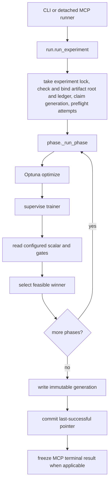

# Development

## Source checkout

```bash
git clone https://github.com/pszemraj/phasesweep.git
cd phasesweep
pip install -e ".[dev,wandb,mlflow]"
```

The development extra includes MCP and Hydra for integration checks, pytest-xdist for local parallel tests, and setuptools-scm for the release-version regression; the optional W&B and MLflow extras exercise the installed SDKs. The live MLflow server tests also need full `mlflow` at the client's version, as in the [MLflow example](mlflow.md#run-the-cpu-example-locally), and skip without it. Run Python-dependent commands in the environment where you installed the project.

To install unreleased `main` without an editable checkout:

```bash
pip install git+https://github.com/pszemraj/phasesweep.git
```

## Quality gates

During iteration, run the mandatory checks and tests for the changed subsystem. Use the parallel fast lane below for broader coverage; reserve the complete suite for qualification. Run the repository checks sequentially:

```bash
pytest tests/test_ledger_contract.py tests/test_error_routing.py tests/test_ledger_read_paths.py
pytest --collect-only
ruff check .
ruff format --check .
mypy src
```

> [!IMPORTANT]
> Run `pytest` by itself, with no concurrent lint or type check: process-supervision and timeout tests are timing-sensitive.

### Latest local gate results

Qualification on 2026-10-20 ran the two non-live lanes sequentially, with pytest isolated from other checks.

| Gate | Result |
| --- | --- |
| Parallel fast lane, two workers | 2,564 passed in 155.15 seconds |
| Serial integration and signal lane | 460 passed, 1 skipped in 802.38 seconds |
| Contract tests, the three modules above | 109 passed in 2.17 seconds |
| Whole-suite collection | 3,025 selected of 3,027 collected; two live tests excluded |
| Ruff lint | Passed |
| Ruff format check | Passed; 189 files formatted |
| mypy | Passed; 80 source files |
| Mandatory commit hooks | Passed for all committed changes |

The existing skip is `test_absence_proof_tracks_a_real_child_pid_namespace`: its absence proof requires the host's initial PID namespace. Live-marked GPU and external-service tests were excluded. The Hugging Face recipe contract test reads synthetic trainer outputs without training or downloading a model.

### Real CUDA qualification

The 2026-10-20 [Enwik8 example](../examples/tiny_decoder_enwik8/README.md) check asked whether three learning rates could be ranked by mean final-checkpoint loss over two seeds, then replayed without retraining. It used the pinned trainer at `9c90a551`, one RTX 5090 (32 GB), PyTorch `2.13.0+cu130`, driver `595.91.07`, and W&B `0.28.0`. The fixed 27,403,008-parameter decoder used dimension 512, eight layers, eight heads, sequence length 512, batch size 16, bfloat16 autocast, Adam, zero weight decay, and gradient clipping at 1.0. Each of six trials trained for 300 optimizer steps: 1,800 steps and 14,745,600 training tokens in total.

Final-checkpoint validation used ten batches (81,920 tokens) from the example's held-out Enwik8 split. Seeds 7 and 19 supplied the repeats; matching seeds used matching validation samples across learning rates. The baseline was learning rate `0.001`.

| Learning rate | Mean final validation loss | Sample SD over two seeds |
| --- | --- | --- |
| **0.0003** | **1.835799** | 0.012816 |
| 0.001 | 2.041565 | 0.033261 |
| 0.003 | 2.735622 | 0.023171 |

The selected rate won under both seeds. The numeric-grid boundary advisory correctly identified that it was the smallest tested rate; this bounded check does not establish convergence or the optimum outside that interval. CUDA-event timing covered input fetch/transfer, forward, backward, clipping, and Adam, excluding periodic validation. After discarding 20 warmup steps, each trial retained 280 raw timing samples; per-trial medians ranged from 20.27 to 20.43 ms. Peak allocated memory was 2.632 GB, with 2.804 GB reserved, measured across upstream training setup, optimizer steps, and periodic validation, before final-checkpoint reload/evaluation. GPU clocks were unlocked.

All six saved checkpoints and Adam states independently confirmed step 300. Persisted group means and SDs matched the individual objectives; a completed dry run predicted zero launches, and actual replay preserved all six trial directories and measurement timestamps without launching a trainer. A guided GPT-6.1-sol agent on medium prepared the PhaseSweep configuration and checked persisted status and replay; the training setup and measurement wrapper were supplied. The live host inventory regression, `test_real_nvidia_smi_resolves_index_zero_to_a_uuid`, passed separately (one test, 0.07 seconds).

The temporary [W&B test project](https://wandb.ai/pszemraj/tmp-phasesweep-test-20261020), group `20261020-enwik8-lr-300step`, contains all six finished runs, source, loss histories, raw timings, and evaluation artifacts. API readback verified each run's CUDA identity, configuration, final metric, timing sample count, history, and artifact destination against the local records. No dataset contents or model checkpoints were uploaded. PhaseSweep selected these objectives through `json_envelope`; this experiment does not qualify its W&B extractor. Generated configs, logs, checkpoints, and measurement files stayed outside the worktree.

A separate workflow check gave a fresh GPT-6.1-sol agent on medium the user task of comparing learning rates with seed noise, inspecting saved results, and demonstrating resume, plus the standing environment and resource constraints. No experiment configuration, measurement wrapper, or CLI commands were supplied. It independently chose the bundled example's smaller 557,728-parameter decoder, three learning rates, three seeds, and 80 updates per trial, with local-only logging. It diagnosed the need for persistent storage and provenance, recovered an intentionally interrupted trial, completed nine successful trials, recomputed all nine final-checkpoint validation losses with an independent evaluation loop to within `1e-7`, and verified a completed replay launched no trainer. Its selected `0.001` learning rate was correctly flagged as within seed noise of `0.003`. This was a smaller workflow check than the 300-step CUDA qualification above.

### Git hooks

The [hook configuration](../.pre-commit-config.yaml) calls the tools installed in the active environment and builds none of its own, so commit from a shell with that environment active. The development extra provides `pre-commit` and `pathlint`; after installing it, enable the hooks once per clone:

```bash
pre-commit install
```

| Hook | Stage | Runs on |
| --- | --- | --- |
| `ruff check --fix`, `ruff format` | commit | changed Python files |
| `pathlint` | commit | changed `src/` and `tests/` Python files |
| module size | commit | changed `src/` and `tests/` Python files |
| typing escapes | commit | lines the commit adds to `src/` and `tests/` Python files |
| contract tests | commit | every commit |
| whole-suite collection | commit | every commit, collecting the whole suite |
| `mypy src` | push | the whole package |

Ruff checks public docstrings and function annotations, and mypy checks source typing; both also run in CI. When Ruff rewrites a file, stage the fix and commit again.

The [module-size hook](../scripts/check_module_size.sh) limits each touched source or test module to 2000 lines. The [typing-escapes hook](../scripts/check_typing_escapes.py) rejects `Any`, `typing.cast`, and `# type: ignore` on added or edited lines, including docstring type fields. Narrow values with `isinstance`, use `TypedDict` for known shapes and `Protocol` for external APIs, or use `phasesweep.runtime.json.JsonValue` / `JsonObject` for open JSON. Existing escapes must be fixed when their lines change.

`pre-commit run --all-files` runs the commit hooks over the whole tree; add `--hook-stage pre-push` for mypy. The hooks are a fast subset, and plain `pytest` remains the full gate.

### Source prose review

```bash
python scripts/sample_docstrings.py -n 30 --seed 42
python scripts/sample_docstrings.py --audit > prose-review.txt
```

The audit scans every source docstring (including attribute documentation) and comment, reporting narrative wording, repeated paragraphs of at least 20 words, and prose blocks of at least 120 words before API sections. It reports every candidate with its location and reason; it does not edit files or fail because of findings. Review the context before removing text: emphasis and length can describe useful contracts, and stale behavior claims require checking the implementation. Runtime strings such as field descriptions, CLI help and error messages are outside this scan. This is an optional local review tool, not a hook or CI check.

### Test tiers

Plain `pytest` runs the complete non-live qualification suite. For broader checks while iterating, use two process workers for the fast lane:

```bash
pytest -n 2 --dist loadfile -m "not live and not integration and not signals_own_pid" \
  --durations=25 --durations-min=1
```

`loadfile` keeps each test module in one worker. Test homes, caches, journals and host-lock directories use per-test temporary paths. Keep the worker count bounded; `-n auto` can overload process-launch and deadline checks.

Run the complementary lane serially, after the workers have exited:

```bash
pytest -m "not live and (integration or signals_own_pid)"
```

Together these lanes cover the same cases as plain `pytest`. The serial lane retains integration timing checks and every test that signals its own process, including self-signalling cases outside the integration tier. Run both lanes without concurrent lint, type checks or other validation. CI and mandatory hooks retain their existing serial collection and contract-test scope.

To inspect the cost of a qualification run:

```bash
pytest --durations=25 --durations-min=1
```

> [!NOTE]
> A `-m` on the command line *replaces* the `-m 'not live'` in `addopts` rather than adding to it, which is why both commands above spell out `not live`.

`@pytest.mark.live` tests use real host hardware or a live external service, so every run leaves them out unless `-m live` selects them. The W&B round trip in `tests/test_wandb_live.py` runs a two-phase W&B-only sweep with a pure-Python trainer. It checks the attempt-keyed remote captures, publication, inherited parameters, and a replay that reads no W&B state. It needs a project the current W&B credentials may write to, and skips without one:

```bash
PHASESWEEP_WANDB_ENTITY=YOUR_ENTITY PHASESWEEP_WANDB_PROJECT=YOUR_PROJECT \
  pytest -m live tests/test_wandb_live.py
```

A test is `@pytest.mark.integration` when it manages real processes, waits on wall-clock time, drives a multi-step durable recovery workflow, or is otherwise slow: its call phase takes at least one second. Everything else stays in the fast tier, including engine runs with quick trainers, such as `run_experiment` over an `echo` trainer, which spawn their subprocess inside the package.

Mark tests explicitly according to the rules above, including tests that call shared helpers. Use pytest's built-in duration report to identify slow cases. Durations are advisory; timing thresholds do not fail a run.

An autouse fixture, `guard_runner_signals` in `tests/conftest.py`, fails any test whose code would send a real signal to pytest, its parent, or either one's process group; a signal-0 liveness probe passes. A test that signals its own PID on purpose, to drive a shutdown handler, carries `@pytest.mark.signals_own_pid`, which lifts only that one target.

GitHub Actions intentionally has one Linux pull-request check job for Ruff linting, Ruff format checking, mypy, whole-suite collection, and the contract tests, all imported from `src/` without building the package. That test step runs on one Python version and stays within about 20 seconds; the full suite stays local to control CI cost. Live tests remain opt-in.

The supported Optuna range is `>=4.6,<4.10`. PhaseSweep's local storage and read-only inspection behavior depends on that range, and the position-seeded TPE and CMA-ES samplers override private Optuna names that `tests/test_draw_positions.py::test_the_optuna_internals_the_position_samplers_build_on_exist` pins; do not widen it without targeted validation.

The W&B reader supports `>=0.28,<0.29`. Tests exercise that SDK's summary decoding and error behavior with controlled responses, plus supervised worker fixtures for deadlines, cleanup faults, and recovery; only the live W&B round trip reaches the service. Input tests use the real Hydra 1.3 parser and entrypoint; rendering itself has no Hydra runtime dependency.

### Shared test setup

Use `tests/conftest.py` for isolation fixtures, model builders and trial records; `tests/experiments.py` for dictionary-based YAML configuration; `tests/ledger_fixtures.py` for golden publications and journal mutations; `tests/mcp_helpers.py` and `tests/recovery_helpers.py` for MCP and recovery setup; and `tests/tracking_helpers.py` for shared tracking fakes and experiment setup. Import shared setup from these support modules rather than another test module. Keep assertions and scenario-specific malformed input or trainer programs with their tests.

## PyPI releases

Versions come from Git tags through setuptools-scm. The [`publish.yml` workflow](../.github/workflows/publish.yml) builds one wheel and one source distribution from the commit recorded by a published GitHub Release. The build restricts setuptools-scm's Git tag selection to that release's tag, so other tags on the same commit cannot determine the package version. It requires a stable `v`-prefixed PEP 440 tag whose commit is contained in `main`, then checks that both distributions contain the tag's normalized version and the project name `phasesweep`. GitHub prereleases are skipped, and prerelease version tags are rejected even for normal GitHub Releases.

Before the first upload, configure the pending publisher in [PyPI account publishing](https://pypi.org/manage/account/publishing/):

| Field | Value |
| --- | --- |
| PyPI project name | `phasesweep` |
| GitHub owner | `pszemraj` |
| GitHub repository | `phasesweep` |
| Workflow filename | `publish.yml` |
| Environment name | `pypi` |

The publishing job uses the GitHub environment `pypi` with no required reviewer. GitHub creates it on first use if it does not exist. Only this job has `id-token: write`; it uploads the validated distributions with short-lived OIDC credentials and attestations. No PyPI API-token secret is needed.

For each release:

1. Complete the local quality gates above and merge the changes into `main`.
2. Publish a normal GitHub Release with a new stable version tag, pointing to a commit that includes the publishing workflow. Keep release notes in GitHub Releases. Publishing starts the workflow; draft creation and tag pushes do not.
3. Check the workflow result and the [PyPI project](https://pypi.org/p/phasesweep): version, wheel, source distribution, README rendering, and attestations.

The first successful upload converts the pending publisher into the project's trusted publisher. Versions already uploaded to PyPI cannot be replaced; duplicate uploads fail visibly.

## Package map

- `phasesweep.config`: Pydantic Experiment models and strict YAML loading.
- `phasesweep.engine`: phase orchestration, fingerprints, local persistence, immutable generation publication, and read-only status.
- `phasesweep.evidence`: JSON, envelope, log, W&B, and MLflow extraction and gates.
- `phasesweep.reporting`: trainer-side JSON-envelope objective writer.
- `phasesweep.tracking`: MLflow run bindings, supervised controller operations, result delivery, and upload retries.
- `phasesweep.runtime`: subprocess supervision, GPU leases, locks, local storage URLs, and override rendering. Keep `runtime/supervisor.py` stdlib-only; see the [launch ordering](invariants.md#9-nothing-runs-before-its-process-identity-is-durable).
- `phasesweep.mcp`: catalog registry, stdio server, detached runner, durable run handles, frozen snapshots, and operator recovery.
- `phasesweep.cli`: Click command surface.

Common package-root calls are `load_experiment`, `run_experiment`, and `experiment_status`. Schema types are defined in `phasesweep.config.models` and `phasesweep.config.search`. Tests that need internals import direct modules under `engine`, `evidence`, `tracking`, `runtime`, or `mcp`.

Within `phasesweep.engine`, module ownership is intentionally direct:

| Responsibility | Modules |
| --- | --- |
| Experiment and phase orchestration | `run`, `phase` |
| Resume selection and continuation preflight | `resume`, `study_policy`, `guards` |
| Ledger storage: the only module that constructs Optuna storage | `ledger` |
| Locks and stale-attempt cleanup | `locking`, `attempts`, `cleanup` |
| Root ownership and retained evidence checks | `artifact_roots`, `evidence` |
| Paths, state records, and fingerprints | `paths`, `state`, `fingerprints` |
| Advisory confound verdicts on the ranked population, frozen at selection | `confound` |
| Publication and read-only views | `generation`, `publication`, `publication_validation`, `read` |

`mcp.recovery.recover_run` implements [operator recovery](mcp.md#run-state-and-recovery); the CLI owns its arguments and rendering.

See [durability invariants](invariants.md) for storage, publication, and process ordering.

The ordinary control flow is:



## Test map

- `tests/test_e2e.py`: complete experiment and `--from-phase` replay.
- `tests/test_config.py`, `tests/test_param_validation.py`, and `tests/test_overrides.py`: Experiment validation, composition, parameter domains, and retained input boundaries.
- `tests/test_extractors.py`, `tests/test_trial_evidence.py`, and `tests/test_trial_launch.py`: scalar evidence, shared W&B captures, gates, supervised trials, and durable input verification.
- `tests/test_mlflow.py` and `tests/test_mlflow_terminal_delivery.py`: native history selection, run bindings, shared captures, and terminal delivery retries.
- `tests/test_mlflow_integration.py`: both ownership modes against a temporary HTTP server, stopped-server replay, worker cleanup, and delivery retries.
- `tests/test_fingerprint.py`, `tests/test_runtime_behavior.py`, `tests/test_publication_transaction.py`, and `tests/test_engine_read.py`: continuation, current-format publication, and read-only views.
- `tests/test_interrupted_trials.py`, `tests/test_draw_positions.py`, and `tests/test_rerun_real_runs.py`: interrupted outcomes and their reruns, draw positions and sampler resume, and real runs stopped by SIGINT, SIGKILL, and deadlines.
- `tests/test_storage_urls.py`, `tests/test_locking.py`, `tests/test_filesystem_layout.py`, and `tests/test_format_cutover.py`: local storage, locks, format checks, and output layout.
- `tests/test_ledger_contract.py`, `tests/test_ledger_read_paths.py`, `tests/test_error_routing.py`: the storage chokepoint, read paths and recovery inspection against the golden ledger fixture, operator-action routing.
- `tests/test_mcp_*.py`: catalog validation, run state, frozen snapshots, detached launch, status, cancellation, and recovery.
- `tests/test_init.py`, `tests/test_fake_train.py` and `tests/test_reporting.py`: template creation and runs, the toy trainer's seed noise, catalog scaffolding, and result rendering.

## Tracked TODOs

- TODO(mcp): Replace the private FastMCP strict-schema patch when the SDK exposes a tested public closed-input-schema API; keep behavior-level request validation as the safety net until then.
- TODO(runtime): Design an explicit completion-budget mode only if its attempt accounting, failure cap, and timeout semantics are specified separately.
- TODO(runtime): Add a deliberately scoped generation-pruning command only if it preserves the current last-successful pointer and all cited winner provenance.
