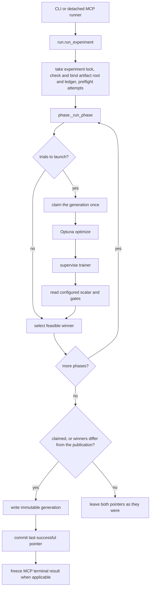

# Development

## Source checkout

```bash
git clone https://github.com/pszemraj/phasesweep.git
cd phasesweep
pip install -e ".[dev,wandb,mlflow]"
```

The development extra includes MCP and Hydra for integration checks, pytest-xdist for local parallel tests, and setuptools-scm for the release-version regression; the optional W&B and MLflow extras exercise the installed SDKs. The MLflow server tests in `tests/test_mlflow_integration.py` (marked `integration`) start a local tracking server and need full `mlflow` at the client's version, as in the [MLflow example](mlflow.md#run-the-cpu-example-locally); they skip without it. Run Python-dependent commands in the environment where you installed the project. `python -m phasesweep` runs the same command line when the console script is not on `PATH`.

To install unreleased `main` without an editable checkout:

```bash
pip install git+https://github.com/pszemraj/phasesweep.git
```

## Quality gates

During iteration, run the mandatory checks and tests for the changed subsystem. Complete qualification uses [both non-live lanes](#test-tiers). Run the repository checks sequentially:

```bash
pytest tests/test_ledger_contract.py tests/test_error_routing.py tests/test_ledger_read_paths.py
pytest --collect-only
ruff check .
ruff format --check .
mypy src
bash scripts/check_module_size.sh
```

> [!IMPORTANT]
> Within this checkout, run one test lane at a time and keep `pytest` separate from lint and type checks: process-supervision and timeout tests are timing-sensitive. Bounded test overlap with other projects is allowed.

### Git hooks

The [hook configuration](../.pre-commit-config.yaml) calls the tools installed in the active environment and builds none of its own, so commit from a shell with that environment active. The development extra provides `pre-commit` and `pathlint`; after installing it, enable the hooks once per clone:

```bash
pre-commit install
```

| Hook | Stage | Runs on |
| --- | --- | --- |
| `ruff check --fix`, `ruff format` | pre-commit | changed Python files |
| `pathlint check` | pre-commit | changed `src/` and `tests/` Python files |
| module size | pre-commit | changed `src/` and `tests/` Python files |
| typing escapes | pre-commit | lines the commit adds to `src/` and `tests/` Python files |
| review-provenance tags | pre-commit | changed `src/` and `tests/` Python files |
| contract tests | pre-commit | every commit |
| whole-suite collection | pre-commit | every commit, collecting the whole suite |
| `mypy src` | pre-push | the whole package |

Ruff checks public docstrings and function annotations, and mypy checks source typing; both also run in CI. When Ruff rewrites a file, stage the fix and commit again.

The [module-size hook](../scripts/check_module_size.sh) limits each touched source or test module to 2000 lines. The [typing-escapes hook](../scripts/check_typing_escapes.py) rejects `Any`, `typing.cast`, and `# type: ignore` on added or edited lines, including docstring type fields. Narrow values with `isinstance`, use `TypedDict` for known shapes and `Protocol` for external APIs, or use `phasesweep.runtime.json.JsonValue` / `JsonObject` for open JSON. Existing escapes must be fixed when their lines change. The review-provenance hook rejects `review vN`, `PR #N`, `reviewer N`, `blocker N`, `gap hunt`, `pre-vN` and `finding X1` in comments and docstrings; state the reason in place and leave provenance to git history.

`pre-commit run --all-files` runs the commit hooks over the whole tree; `pre-commit run --all-files --hook-stage pre-push` runs the push hook, `mypy src`, alone.

### Source prose review

```bash
python scripts/sample_docstrings.py -n 30 --seed 42
python scripts/sample_docstrings.py --audit > prose-review.txt
```

The audit scans every source docstring (including attribute documentation) and comment, reporting narrative wording, repeated paragraphs of at least 20 words, and prose blocks of at least 120 words before API sections. It reports every candidate with its location and reason; it does not edit files or fail because of findings. Review the context before removing text: emphasis and length can describe useful contracts, and stale behavior claims require checking the implementation. Runtime strings such as field descriptions, CLI help and error messages are outside this scan. This is an optional local review tool, not a hook or CI check.

### Test tiers

Complete non-live qualification runs the parallel lane, including integration tests, followed by the serial self-signalling lane. Use a bounded worker count, for example:

```bash
pytest -n 2 --dist worksteal -m "not live and not signals_own_pid" \
  --durations=25 --durations-min=1
```

`worksteal` balances tests across workers. Test homes, caches, journals and host-lock directories use per-test temporary paths. Keep the worker count bounded; `-n auto` can overload process-launch and deadline checks. For fast iteration, add `and not integration` to the parallel marker expression.

Run only the complementary self-signalling lane serially, after this checkout's parallel lane exits:

```bash
pytest -m "not live and signals_own_pid"
```

Both lanes run on Linux and macOS. Tests that require real Linux procfs or PID namespaces skip on macOS; native macOS identity tests require a macOS host. Synthetic providers exercise parsing and routing across hosts, while native identity and MPS lease tests cover macOS host paths. Together these lanes cover the same cases as plain `pytest`, so qualification needs no duplicate full serial pass. Only tests that signal their own runner require the serial lane within this checkout.

If tests fail under contention, wait for an idle machine and rerun only the failing node IDs serially. Do not rerun the whole suite. Add the duration-report options shown above to either lane to inspect its runtime.

> [!NOTE]
> A `-m` on the command line *replaces* the `-m 'not live'` in `addopts` rather than adding to it, which is why both commands above spell out `not live`.

`@pytest.mark.live` tests use real host hardware or a live external service, so every run leaves them out unless `-m live` selects them. The W&B round trip in `tests/test_wandb_live.py` runs a two-phase W&B-only sweep with a pure-Python trainer. It checks the attempt-keyed remote captures, publication, inherited parameters, and a replay that reads no W&B state. It needs the W&B SDK installed and credentials that may write to the project you name, and skips when `PHASESWEEP_WANDB_ENTITY` or `PHASESWEEP_WANDB_PROJECT` is unset; `PHASESWEEP_WANDB_BASE_URL` selects another W&B server:

```bash
PHASESWEEP_WANDB_ENTITY=YOUR_ENTITY PHASESWEEP_WANDB_PROJECT=YOUR_PROJECT \
  pytest -m live tests/test_wandb_live.py
```

A test is `@pytest.mark.integration` when it manages real processes, waits on wall-clock time, drives a multi-step durable recovery workflow, or is otherwise slow: its call phase takes at least one second. Everything else stays in the fast tier, including engine runs with quick trainers, such as `run_experiment` over an `echo` trainer, which spawn their subprocess inside the package.

Mark tests explicitly according to the rules above, including tests that call shared helpers. Use pytest's built-in duration report to identify slow cases. Durations are advisory; timing thresholds do not fail a run.

An autouse fixture, `guard_runner_signals` in `tests/conftest.py`, fails any test whose code would send a real signal to pytest, its parent, or either one's process group; a signal-0 liveness probe passes. A test that signals its own PID on purpose, to drive a shutdown handler, carries `@pytest.mark.signals_own_pid`, which lifts only that one target.

GitHub Actions runs one Linux job on pull requests: Ruff linting, Ruff format checking, mypy, the module-size check, whole-suite collection, and the contract tests, with the tests importing from `src/` and no package build. That test step runs on one Python version and stays within about 20 seconds; the full suite stays local to control CI cost. Live tests are opt-in.

The supported Optuna range is `>=4.6,<4.10`. PhaseSweep's local storage and read-only inspection behavior depends on that range, and the position-seeded TPE and CMA-ES samplers override private Optuna names that `tests/test_draw_positions.py::test_the_optuna_internals_the_position_samplers_build_on_exist` pins; do not widen it without targeted validation.

The W&B reader supports `>=0.28,<0.29`. Tests exercise that SDK's summary decoding and error behavior with controlled responses, plus supervised worker fixtures for deadlines, cleanup faults, and recovery; only the live W&B round trip reaches the service. Input tests use the real Hydra 1.3 parser and entrypoint; rendering itself has no Hydra runtime dependency.

### Shared test setup

Use `tests/conftest.py` for isolation fixtures, model builders and trial records; `tests/experiments.py` for dictionary-based YAML configuration; `tests/ledger_fixtures.py` for golden publications and journal mutations; `tests/mcp_helpers.py` and `tests/recovery_helpers.py` for MCP and recovery setup; and `tests/tracking_helpers.py` for shared tracking fakes and experiment setup. Import shared setup from these support modules rather than another test module. Keep assertions and scenario-specific malformed input or trainer programs with their tests. Helpers that other modules import have public names.

The golden ledger fixture under `tests/fixtures/ledgers` is committed output of a real run. Regenerate it when a persisted format changes; the [fixture guide](../tests/fixtures/ledgers/README.md) gives the command and what churns.

## PyPI releases

Versions come from Git tags through setuptools-scm. The [`publish.yml` workflow](../.github/workflows/publish.yml) builds one wheel and one source distribution from the commit recorded by a published GitHub Release. The build restricts setuptools-scm's Git tag selection to that release's tag, so other tags on the same commit cannot determine the package version. It requires a stable `v`-prefixed PEP 440 tag whose commit is contained in `main`, then checks that both distributions contain the tag's normalized version and the project name `phasesweep`. GitHub prereleases are skipped, and prerelease version tags are rejected even for normal GitHub Releases.

PyPI trusts this publisher for the `phasesweep` project, configured in [PyPI account publishing](https://pypi.org/manage/account/publishing/):

| Field | Value |
| --- | --- |
| PyPI project name | `phasesweep` |
| GitHub owner | `pszemraj` |
| GitHub repository | `phasesweep` |
| Workflow filename | `publish.yml` |
| Environment name | `pypi` |

The publishing job uses the GitHub environment `pypi` with no required reviewer. GitHub creates it on first use if it does not exist. Only this job has `id-token: write`; it uploads the validated distributions with short-lived OIDC credentials and attestations. No PyPI API-token secret is needed.

For each release:

1. Complete the local quality gates above and merge the changes into `main`.
2. Publish a normal GitHub Release with a new stable version tag, pointing to a commit that includes the publishing workflow. Keep release notes in GitHub Releases. Publishing starts the workflow; draft creation and tag pushes do not.
3. Check the workflow result and the [PyPI project](https://pypi.org/p/phasesweep): version, wheel, source distribution, README rendering, and attestations.

Versions already uploaded to PyPI cannot be replaced; duplicate uploads fail visibly.

## Package map

- `phasesweep.config`: Pydantic Experiment models, strict YAML loading, and shared config `--set` path edits (`run_overrides`).
- `phasesweep.engine`: phase orchestration, fingerprints, local persistence, immutable generation publication, and read-only status.
- `phasesweep.evidence`: JSON, envelope, log, W&B, and MLflow extraction and gates.
- `phasesweep.reporting`: trainer-side JSON-envelope objective writer.
- `phasesweep.tracking`: MLflow run bindings, the `phasesweep mlflow-run` trainer launcher, supervised controller operations, result delivery, and upload retries.
- `phasesweep.runtime`: subprocess supervision, GPU leases, locks, local storage URLs, and override rendering. Keep `runtime/supervisor.py` stdlib-only; see the [launch ordering](invariants.md#9-nothing-runs-before-its-process-identity-is-durable).
- `phasesweep.mcp`: catalog registry, stdio server, detached runner, durable run handles, frozen snapshots, and operator recovery.
- `phasesweep.cli`: Click command surface.
- `phasesweep.errors`: the shared operator-facing error taxonomy and the operator steps behind the `fix:` lines.
- `phasesweep.examples`: the toy trainers `fake_train` and `mlflow_train` that the templates and examples run.
- Packaged data: `templates/` (the `init` templates), `config_reference.yaml` (parsed by `config/reference.py`, which expands its shared blocks into every key path for `explain`, `explain_config`, typo suggestions and validation hints), and `mcp/agent_prompt.md` (served to MCP clients).

The configuration reference is written by hand. `tests/test_config_reference.py` compares its expanded key paths, variants, types and defaults with the schema. It does not validate prose about bounds, units or interactions.

Its first header block is the title, and the second is the general notes that `phasesweep explain --notes` prints and `explain_config` returns without a key, so keep that block to what someone writing a config acts on. A `# ---------- Title ----------` banner, at any indent, starts a section, and the comment block right after it, ending at a blank line, is the section's rules, which `explain` prints before the section's keys. A column-0 `TitleCase:` line below the Shared blocks banner defines a shared block, described by the comment lines directly above it. A signature that names blocks, such as `JsonExtractor | WandbExtractor (required)`, expands each block's fields below that key, tagged by the block's `type` field, and `<<: Name` merges a block's fields at its indent. The parser rejects an unknown or unused block and a comment block it cannot attach to a key, a section head or a block.

Common package-root calls are `load_experiment`, `run_experiment`, `experiment_status` and `report_objective`. Schema types are defined in `phasesweep.config.models` and `phasesweep.config.search`. Tests that need internals import direct modules under `engine`, `evidence`, `tracking`, `runtime`, or `mcp`.

Within `phasesweep.engine`, responsibilities map to modules as follows:

| Responsibility | Modules |
| --- | --- |
| Experiment and phase orchestration | `run`, `phase` |
| Trial launch, objective extraction and worker threads | `trial`, `workers` |
| Samplers and trial identity | `optuna` |
| Winner selection and repeat groups | `selection`, `repeats` |
| Dry-run planning and run.log progress lines | `preview`, `progress` |
| Artifact serialization and generation provenance | `artifacts`, `provenance` |
| Typed engine failures | `errors` |
| Resume selection and continuation preflight | `resume`, `study_policy`, `guards` |
| Ledger storage: the only module that constructs Optuna storage | `ledger` |
| Locks and stale-attempt cleanup | `locking`, `attempts`, `cleanup` |
| Root ownership and retained evidence checks | `artifact_roots`, `evidence` |
| Paths, state records, and fingerprints | `paths`, `state`, `fingerprints` |
| Advisory confound verdicts on the ranked population, frozen at selection | `confound` |
| Publication and read-only views | `generation`, `publication`, `publication_validation`, `read` |

`mcp.recovery.recover_run` implements [operator recovery](mcp.md#run-state-and-recovery); the CLI owns its arguments and rendering.

See [durability invariants](invariants.md) for storage, publication, and process ordering.

The ordinary control flow is:



## Test map

The principal test groups and what each covers:

- `tests/test_e2e.py`: complete experiment and `--from-phase` replay.
- `tests/test_config.py`, `tests/test_param_validation.py`, and `tests/test_overrides.py`: Experiment validation, composition, parameter domains, and retained input boundaries.
- `tests/test_run_overrides.py`: shared `--set` key syntax, created-key notes, derived-config validation and study inspection with overrides.
- `tests/test_config_reference.py` and `tests/test_explain.py`: the configuration reference against the schema, its parser's shared blocks and section rules, and `phasesweep explain`.
- `tests/test_extractors.py`, `tests/test_trial_evidence.py`, and `tests/test_trial_launch.py`: scalar evidence, shared W&B captures, gates, supervised trials, and durable input verification.
- `tests/test_attempt_lifecycle.py` and `tests/test_process_supervision.py`: lifecycle parsing, process identity and launch ordering, descendant cleanup, and guardian completion evidence.
- `tests/test_mlflow.py` and `tests/test_mlflow_terminal_delivery.py`: native history selection, run bindings, shared captures, and terminal delivery retries.
- `tests/test_mlflow_integration.py`: both ownership modes against a temporary HTTP server, stopped-server replay, worker cleanup, and delivery retries.
- Storage, publication, recovery, interrupted trials and sampler resume: owning code and representative tests are listed by [durability invariant](invariants.md).
- `tests/test_mcp_*.py`: catalog validation, run state, frozen snapshots, detached launch, status, cancellation, and recovery.
- `tests/test_init.py`, `tests/test_fake_train.py` and `tests/test_reporting.py`: template creation and runs, the toy trainer's seed noise, catalog scaffolding, and the objective-envelope writer (`report_objective` and `report-objective`).

## Tracked TODOs

- TODO(mcp): Replace the private FastMCP strict-schema patch when the SDK exposes a tested public closed-input-schema API; keep behavior-level request validation as the safety net until then.
- TODO(runtime): Design an explicit completion-budget mode only if its attempt accounting, failure cap, and timeout semantics are specified separately.
- TODO(runtime): Add a deliberately scoped generation-pruning command only if it preserves the current last-successful pointer and all cited winner provenance.

## Declined requests

These have been requested and declined. Check this list before proposing one again, and reopen an item only with a reason its entry does not already answer.

- **Reading or migrating trees and ledgers written in an older format.** PhaseSweep is still unstable and does not support backward compatibility until it stabilizes. Ledger and artifact format changes bump their record schemas and the respective study or artifact-root stamp; frozen MCP snapshot changes bump the MCP state-format marker. Older data is refused as an unsupported format with a fix line, and the checkout that produced it can still inspect it.
- **Advice for removed config keys** such as `allow_seed_search`. A removed key fails as an unknown key, like any other; configs that use one stay on the revision that accepted it.
- **An `await_run` limit above 600 seconds, or a streaming watch tool.** MCP tool calls are request and response, and clients bound how long one may block. An agent repeats `await_run` with the same `run_id`; [MCP](mcp.md) gives the loop.
- **Importing trials from another experiment or a changed study.** A changed study fingerprint means the recorded trials answered a different question. Derive the new configuration with `run --set` under a new `experiment` name and run it.
- **An audit-only mode for seed or repeat phases that publishes no winner.** `repeats` already publishes each group's spread with the winner, and a phase that publishes nothing would be a second phase kind for the same need.
- **A launch queue that chains sweeps.** A scheduler is outside a single-node sweep tool. An agent waits on the blocking run with `await_run` and launches the next one.
- **Per-item paired bootstrap.** This needs per-example evaluation data that PhaseSweep never collects. The tie warning reports the gap, the combined SE and each group's params; a phase's `cost_key` can advise a cheaper configuration within one standard error from repeat-level objectives without changing selection.
- **Cost tiebreak for near ties.** Selection ranks the configured objective and keeps its draw-position tiebreak. `cost_key` advises a cheaper configuration within the winning mean's standard error; it does not select a different winner or alter inherited parameters.
- **Visiting grid configurations in listed order.** A seeded configuration shuffle gives a partial or deadline-truncated search a spread across the space instead of one corner. Each configuration's repeat values stay consecutive in their listed order, so the shuffle does not scatter repeat groups.
- **Rewriting raw package files and PyPI metadata to pin documentation URLs.** Those static files link to `main`; the installed `explain` and `init` surfaces select release-tag links at read time. Build-time rewriting would add a second link mechanism and a build hook solely to change the raw-file view; the installed surfaces already provide the version-aware links.
- **A nonzero exit for an accepted incomplete winner or pending MLflow uploads.** Both are configured successes: an incomplete winner is published only under `allow_incomplete_on_timeout`, and its `WINNER` line says `INCOMPLETE`; pending uploads end with a closing line that points to `sync-tracking`.
- **Shorter trial directory names.** `trials.csv` and `status --trials` are the interfaces for scripts; the directory name carries the generation and attempt IDs that keep attempts apart.
- **Reporting a name missing from `mlflow_required` as a gate failure rather than an objective read error.** The gate and the objective read one shared capture, and a finished run that lacks a required name fails that capture at once, so the trial fails either way; the error names the missing key and lists the run's keys of that kind.
- **Restricting `record_env` to `true` and `false`.** It is a plain boolean, and every boolean key accepts the same YAML forms.
- **Treating a key that overrides a `<<:` merge as a duplicate key.** Keys written in a mapping win over merged ones under standard YAML merge semantics. A key written twice in one mapping, or a second `<<`, is still rejected.
- **Dropping the experiment-level `trainer_config` check because each phase's composition check repeats it.** The experiment-level check names the `trainer_config` key the override format cannot carry; the phase check only reports that composition failed for that phase.
- **A separate `slow` test marker with a counted budget.** `integration` is the slow tier: a test whose call phase takes at least one second carries it, and fast focused runs leave it out.
- **One shared failure boundary for the `json_equals`, `json_scalar_bound` and JSON `artifact_size` gates.** Each handler's read-and-report block is four lines and converts a different value. A shared boundary needs a new exception type or a union return, which adds more indirection than the three copies cost.
