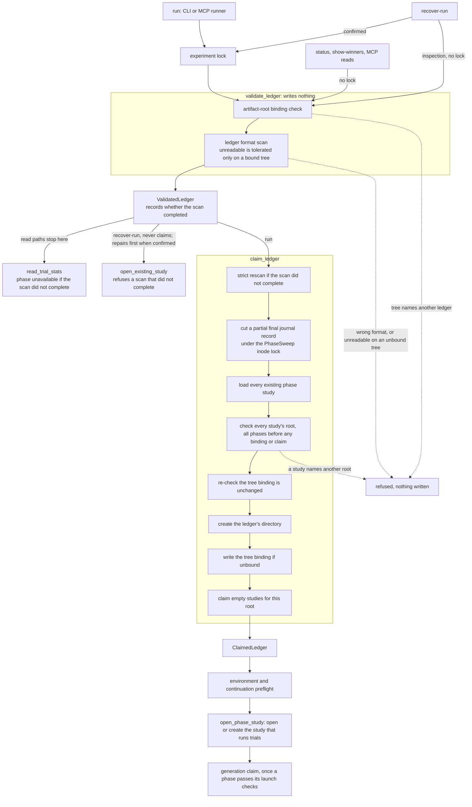

# Durability invariants

The experiment lock serializes local ledger mutations. Artifact-root and format checks precede claims, durable outcome records precede terminal trial states, and generation validation precedes the publication-pointer commit. No trial or detached-runner code runs before its process identity is durable, and operator recovery identifies processes from durable attempt and run records.

## Invariants

Module paths below drop the `phasesweep.` prefix; test paths are relative to the repository root.

### Lock and ledger order

Every path into the ledger passes through `engine.ledger`, and for the configured ledger the handle each step returns is the proof the earlier steps ran; `open_registry_study`, which opens the ledger an attempt-registry entry recorded, takes no handle and scans and repairs that ledger itself. The diagram shows where each caller enters and where it must stop.

`engine.ledger` alone constructs Optuna storage. Read paths use validated snapshots; live study creation requires a claimed ledger. [Development](development.md#quality-gates) describes the contract checks.

#### 1. Mutations hold the experiment lock

A run, and a `recover-run` the operator confirms, hold the experiment lock before they write the artifact tree or the ledger or read anything such a write depends on; only a run's fresh-tree checks (invariant 11) read earlier. `sync-tracking` holds it too: it retires tracking attempts and writes the tracking tree, reading the ledger only through `validate_ledger` and `read_phase_trials`.

macOS's root-owned `/var` and `/tmp` aliases address the same host-lock files as their physical paths; operator-controlled symlink components remain refused.

**Held by:** `runtime.files.lock_dir`, `engine.locking._experiment_lock`, `engine.run._run_experiment_outcome`, `mcp.recovery.recover_run`, `tracking.publication.sync_tracking`

**Tests:** `tests/test_locking.py::test_run_experiment_holds_experiment_lock_for_duration`, `tests/test_locking.py::test_macos_system_temp_aliases_share_physical_host_locks`

#### 2. Validation writes nothing

`validate_ledger` checks the artifact-root binding, then scans the ledger format, and writes nothing; on a bound tree an unreadable scan is tolerated and recorded on the handle, and on an unbound tree it is refused.

Readers skip an incomplete final journal record without writing. Before opening storage for mutation, claims, registry recovery, and confirmed operator recovery repair that record under the experiment lock and the journal inode lock. Repair rescans after acquiring the journal lock, saves a permission-preserving timestamped backup, truncates only the incomplete tail, fsyncs, and replays the result. A malformed record before the tail is corruption and remains unchanged.

Every PhaseSweep append and repair locks the journal inode. Writers wait without a deadline; repair waits at most 30 seconds. Kernel locks release on process exit and coordinate hard-linked names as well as resolved symlinks. Repair truncates through its locked descriptor and checks that the pathname still names that inode. Failure to acquire the lock or make the backup refuses with `RESTORE_LEDGER`. Growth or pathname replacement under the lock refuses with `RETRY`, without truncating or unlocking the replacement.

**Held by:** `engine.ledger.validate_ledger`, `_journal_records`, `_JournalLock` and `_repair_incomplete_journal_record`

**Tests:** `tests/test_ledger_read_paths.py::test_read_path_never_constructs_file_backed_storage_or_writes_bytes`, `tests/test_format_cutover.py::test_writers_repair_a_partial_final_journal_record`, `tests/test_format_cutover.py::test_journal_hard_link_names_share_lock_and_repair`, `tests/test_format_cutover.py::test_repair_refuses_a_journal_that_grew_under_its_lock`

The scan treats a missing journal file as an absent ledger after config loading restricts `storage` to `null`, `auto`, or a `journal:///` URL (`config.models.Experiment._storage_is_local`, tested by `tests/test_storage_urls.py::test_non_journal_storage_is_refused_at_config_load`).

#### 3. Only a claimed ledger runs trials

Only a `ClaimedLedger` can open a study that runs new trials, and `claim_ledger` rescans strictly before it trusts a scan that did not complete. Opening a phase study that exists loads it and appends nothing to the journal; only an absent study is created.

**Held by:** `engine.ledger.claim_ledger`, `open_phase_study` and `open_preview_study`

**Tests:** `tests/test_format_cutover.py::test_live_openers_reject_unvalidated_storage`, `tests/test_format_cutover.py::test_claim_ledger_binds_tree_then_returns_bound_handle`, `tests/test_format_cutover.py::test_reopening_phase_studies_appends_no_journal_records`

#### 4. Both ownership directions agree before any binding or claim

The tree binding must name this ledger and every existing phase study must name this root, checked for all phases before anything is bound or claimed; only the repair of a partial final journal record, which changes nothing a reader sees, comes earlier.

**Held by:** `engine.artifact_roots._check_artifact_root_binding`, `_artifact_root_claim_needed` and `engine.ledger.claim_ledger`

**Tests:** `tests/test_fingerprint.py::test_second_workdir_is_rejected_and_leaves_the_bound_root_untouched`, `tests/test_fingerprint.py::test_refused_multi_phase_binding_claims_nothing`

#### 5. The tree is bound before any study

`claim_ledger` writes the tree binding before it claims any study, so a crash between the two cannot leave a study naming a tree that does not name its ledger. Before the binding it creates the ledger's parent directory, so a ledger path that cannot hold a file fails while the tree is still unbound and the path can be corrected.

**Held by:** `engine.ledger.claim_ledger` and `engine.artifact_roots._write_artifact_root_binding`

**Tests:** `tests/test_format_cutover.py::test_claim_ledger_writes_tree_binding_before_claiming_studies`, `tests/test_format_cutover.py::test_claim_ledger_creates_ledger_parent_but_validate_does_not`, `tests/test_format_cutover.py::test_unwritable_ledger_directory_fails_before_the_tree_is_bound`

#### 6. Read paths construct and write nothing

`read_status`, `read_result`, `read_trial_tables`, CLI `status` (with or without `--trials`) and `show-winners`, the MCP result snapshot, and `run --dry-run` build no file-backed storage and write no bytes. Status reads report a phase whose format scan did not complete as unavailable rather than counting its trials. A dry run reads all phase studies from one journal capture, applies the launch's claim and preflight checks in the launch's order, and renders its command on an in-memory study. [Inspection commands](runtime.md#inspection-commands) describes its refusals, limitations, and fresh preview when the ledger is unreadable.

**Held by:** `engine.read.read_status`, `read_result` and `read_trial_tables`; `engine.ledger.read_trial_stats`, `read_phase_trials` and `read_phase_studies`; `engine.preview._preview_ledger`; `mcp.snapshots.capture_result_snapshot`

**Tests:** `tests/test_ledger_read_paths.py::test_read_path_never_constructs_file_backed_storage_or_writes_bytes`, `tests/test_format_cutover.py::test_inconclusive_scan_on_a_bound_tree_never_reports_unchecked_counts`, `tests/test_dry_run_recorded_trials.py::test_dry_run_reads_the_journal_once_however_many_phases_there_are`

#### 7. Recovery validates before it opens

Recovery validates the binding and the format before it opens any study, never claims, refuses a study bound to another artifact root before it reaps anything, and refuses an unsupported ledger or an incomplete scan with the bytes unchanged. A confirmed recovery holds the experiment lock and is about to write, so it repairs a journal whose last line is partial, as a run's claim does; inspection reads past that line as Optuna does and writes nothing.

**Held by:** `mcp.recovery._load_recovery_studies`, `engine.ledger.open_existing_study` and `engine.artifact_roots._check_study_artifact_root`

**Tests:** `tests/test_ledger_read_paths.py::test_read_path_never_constructs_file_backed_storage_or_writes_bytes`, `tests/test_stale_reaper.py::test_recovery_refuses_a_study_bound_to_another_artifact_root`

### Attempts and trial outcomes

#### 8. Attempts are registered before launch

The attempt registry is scanned before anything else in the continuation preflight, and each attempt is durably registered before its trainer is launched. Each entry records the producing phase and study names and an absolute storage locator, so the registry still resolves the attempt after a phase rename, a storage-URL change, or a change of working directory.

**Held by:** `engine.attempts._preflight_active_attempts` and `_register_active_attempt`; `runtime.files.storage_recovery_locator`

**Tests:** `tests/test_stale_reaper.py::test_unpersistable_attempt_refuses_to_launch_its_trainer`, `tests/test_stale_reaper.py::test_renamed_phase_cannot_hide_stale_trainer_from_recovery`, `tests/test_stale_reaper.py::test_storage_change_cannot_hide_stale_attempt_from_recovery`

#### 9. Nothing runs before its process identity is durable

Trainer code and its environment execute only after the process identity is durable. The standalone stdlib supervisor starts by file path under `python -I -S` with only `PATH`. Command, environment, and cwd cross its pipe after `process_identity.json` is written; EOF before acknowledgement exits without launching the trainer.

The MCP runner starts under `-P -s` in the private server state directory, with Python startup-path overrides removed and user-site imports disabled. A durable handle is created before `Popen`, replaced by the runner's receipt after it persists its process identity, and confirmed through a ready/ack handshake. The receipt requires a boot id and PID namespace. The runner receives the project path as `--cwd`, entering it only after its receipt is persisted and the handshake completes. Its durable handle reserves the run across server restarts, preventing a duplicate launch.

**Held by:** `runtime.process.run_supervised`, `_spawn_blocked_supervisor` and `_sanitized_supervisor_env`; `runtime.supervisor._read_launch_payload`; `mcp.tools.PhaseSweepMCP._spawn` and `_pending_handle`; `mcp.runner.main`

**Tests:** `tests/test_process_supervision.py::test_hard_parent_death_before_identity_commit_never_starts_trainer`, `tests/test_process_supervision.py::test_supervisor_never_imports_poisoned_modules_from_pythonpath`, `tests/test_mcp_launch.py::test_spawned_runner_cannot_execute_project_local_code`, `tests/test_mcp_runner.py::test_runner_enters_the_project_directory_after_its_identity_is_durable`

#### 10. Lifecycle states that skip signalling are written only on proof

Recovery signals nothing for an attempt only on a durable lifecycle state that proves no process can remain, so each such state is written only once its proof exists; a state written early lets recovery skip a live process group. `allocated` is written before the attempt is registered, before its trial attributes make it discoverable, and before it waits for a GPU, so with no process identity beside it, it means no launch began. `launching` is written before `Popen`, so a spawned supervisor whose identity write failed never reads as `allocated`. The trial-directory attribute is set before `launch_trial`, so a `RUNNING` trial without it launched nothing. `exited` with confirmed cleanup is written only once the whole process group is proven gone, or when no supervisor was spawned at all, and `process_identity.json` stays beside it. Every other state falls through to identity validation and fails closed.

**Held by:** `engine.phase._execute_objective`, `runtime.process.run_supervised`, `engine.attempts._attempt_process_resolution` and `engine.cleanup._reap_stale_trials`

**Tests:** `tests/test_trial_launch.py::test_trial_directory_and_allocated_lifecycle_precede_launch`, `tests/test_process_supervision.py::test_identity_write_failure_marks_launch_before_popen`, `tests/test_stale_reaper.py::test_exited_attempt_recovers_without_signalling`

#### 11. Only work claims a generation, after every check that could refuse it

A generation exists only for an invocation that [launches a trial or publishes winners that differ from the current publication](runtime.md#timeouts-cleanup-and-continuation). Every check that can refuse a launch finishes before the claim: environment preflight and the continuation preflight run before any phase, and each phase's resume, cohort, SDK, GPU, budget and tracking-target checks run before that phase claims the generation, ahead of its first trial-target write and any attempt registration. A run that launched nothing compares its winners with the validated publication and claims only when they differ or nothing validates as published. The claim writes the namespace and its provenance before it moves the current pointer to `running`, so a crash never leaves that pointer naming a missing generation.

**Held by:** `engine.run._run_experiment_outcome`, `engine.phase._run_phase`, `engine.generation.InvocationGeneration.claim` and `engine.generation._publication_holds`

**Tests:** `tests/test_generation_claim.py::test_a_refused_run_leaves_no_generation_and_both_pointers_as_they_were`, `tests/test_generation_claim.py::test_a_replay_of_the_published_winners_writes_no_generation`, `tests/test_generation_claim.py::test_a_replay_publishes_a_generation_when_nothing_is_published`

On an existing tree, `claim_ledger` runs before environment preflight, so these checks guard the generation and the attempts, not the ledger claim. On a fresh tree, `run_experiment` checks the reached phases' launch environments and any `--from-phase` winners before it takes the lock, so those refusals create no tree.

#### 12. A persistent study holds one environment cohort

A persistent study holds trials from one semantic trainer environment, as defined by the [trainer contract](config.md#trainer-contract). The config fingerprint leaves ambient values out and relies on the cohort check to prevent ranking incomparable trials together. Each trial records the tracked environment mapping and its SHA-256 digest. The digest is the first attribute written on each allocated trial, before the abort check and any lifecycle or registry write. `_run_phase` also records it on the study as an allocation context before Optuna allocates, covering a trial that dies before its first attribute. Before another allocation into a populated study, both continuation preflight and `_run_phase` refuse differing digests or a trial whose digest is neither recorded nor covered by an allocation context. Per-trial `PHASESWEEP_*` and GPU bindings are applied after the digest is taken, and `CUDA_VISIBLE_DEVICES` stays out of the base inherited environment, so neither splits a cohort.

**Held by:** `engine.trial._environment_identity`, `engine.study_policy._record_allocation_context` and `_validate_environment_cohort`, `engine.phase._execute_objective` and `engine.fingerprints._execution_identity`

**Tests:** `tests/test_fingerprint.py::test_changed_semantic_inherited_value_rejects_topup_before_allocation`, `tests/test_stale_reaper.py::test_allocation_context_covers_first_environment_write_failure`, `tests/test_runtime_behavior.py::test_parallel_abort_stamps_environment_before_stopping_a_queued_trial`

#### 13. No terminal trial without its outcome record

No Optuna trial reaches a terminal state before its durable outcome record is written; a failed outcome write leaves the trial `RUNNING` for recovery. The failure reaches the operator once, as a retryable storage outage, after the optimize loop drains, whatever `n_jobs` is. Recovery writes the trial's outcome, `interrupted` unless its objective had recorded a failure or a fatal error, and the cleanup-recovery ledger before it commits `FAIL`.

**Held by:** `engine.phase._record_outcome`, `_objective` and `_run_phase`; `engine.attempts._fail_stale_running_trial`

**Tests:** `tests/test_runtime_behavior.py::test_persistent_outcome_write_failure_leaves_trial_running_until_recovery`, `tests/test_runtime_behavior.py::test_parallel_outcome_write_failure_surfaces_without_orphan_terminal_rows`, `tests/test_stale_reaper.py::test_reaper_reports_storage_failures_after_cleanup`, `tests/test_interrupted_trials.py::test_stale_recovery_records_interrupted_unless_the_objective_recorded_a_failure`

#### 14. An abort is recorded with the outcome that trips it

A phase abort is written in the same record as the outcome that trips it, and replay honors the first abort recorded after the recovery boundary. A later success resets the failure streak but never a recorded abort, and a changed `max_consecutive_failures` governs new work only, never recorded outcomes: lowering it retires nothing and records no abort. Only the current config retires a recorded abort, by the rules in [continuation](runtime.md#timeouts-cleanup-and-continuation); an unsafe-cleanup abort stays until cleanup recovery has run (invariant 16). Retiring writes the recovery record before any new work, in the same write that accepts the current `n_trials`, which is the accepted target when only the limit was raised, and the failure count starts again from zero. An interrupted recovery therefore keeps its authorization and the old target never runs it. An interrupted outcome, stale recovery's included, leaves the streak unchanged, so an interruption never trips an abort.

**Held by:** `engine.phase._record_outcome`; `engine.study_policy._load_phase_policy_state`, `_config_retires_abort` and `_record_recovery_boundary`

**Tests:** `tests/test_abort_recovery.py::test_changing_the_failure_limit_never_reinterprets_recorded_outcomes`, `tests/test_abort_recovery.py::test_raised_failure_limit_retires_a_streak_abort_while_trials_remain`, `tests/test_abort_recovery.py::test_interrupted_recovery_keeps_the_raised_target_authorization`

#### 15. An unreadable ledger means cleanup is uncertain

A ledger that cannot be read never lets a stale trial's cleanup read as confirmed: the stale-trial reaper refuses with `ProcessCleanupUncertainError` and preflight marks the cleanup report uncertain. An attempt-registry entry whose recorded ledger cannot be read stays registered for a later retry once its process is resolved, so its trial's `FAIL` is never dropped. A journal's partial final record does not make it unreadable: the registry opener repairs it first, as invariant 2 ("Validation writes nothing") describes, and reads the attempt as it would on a healthy journal.

**Held by:** `engine.cleanup._reap_stale_trials`, `engine.attempts._registry_attempt_fail_stale_trial` and `engine.guards._preflight_existing_studies`

**Tests:** `tests/test_stale_reaper.py::test_registry_storage_failure_marks_cleanup_report_uncertain`, `tests/test_stale_reaper.py::test_registry_retains_attempt_when_journal_snapshot_is_unreadable`, `tests/test_stale_reaper.py::test_registry_reads_its_attempt_after_repairing_a_partial_journal_record`

#### 16. Unconfirmed cleanup stops new work until recovery proves it

A process group whose cleanup is not confirmed stops all further work until recovery proves it gone, because the leaked group may still hold its GPU and other resources. The trainer check runs while the trial still holds its GPU lease and records a phase-fatal abort before the lease is released, so no queued worker can launch onto the leaked group. `UnsafeProcessCleanupError`, raised for a trainer or for an evidence or tracking worker, is not a `TrialExecutionError` and is never in Optuna's `catch` tuple, so no such trial is committed as an ordinary failure while the phase continues. The trial's outcome records the `unsafe_process_cleanup` policy, and its attempt-registry entry outlives its terminal state. Only the study's cleanup-recovery ledger, written when the next run's preflight or a confirmed `recover-run` proves the group gone, retires the entry; raising `n_trials` does not. While that recovery is pending, the refusal the abort leaves, a dry run's included, names it and only then a larger `n_trials`.

**Held by:** `engine.phase._execute_objective`, `_objective` and `_settle_finished_trial`; `engine.attempts._resolve_attempt` and `_record_cleanup_recovery`; `engine.study_policy._awaits_cleanup_recovery`

**Tests:** `tests/test_runtime_behavior.py::test_unsafe_cleanup_is_never_an_ordinary_trial_failure`, `tests/test_process_supervision.py::test_uncertain_cleanup_aborts_without_reusing_gpu_and_preserves_csv[parallel-fatal-slot-stops-queued-gpu-worker]`, `tests/test_runtime_behavior.py::test_unsafe_cleanup_blocks_topup_until_recovery`

#### 17. A GPU lease holds the card the trainer binds until its group exits

A GPU lease excludes the physical card the trainer actually uses for as long as any process in the trainer's group can run on it. Host locks key on the card's canonical identity from the `nvidia-smi` inventory, so a numeric index and its UUID contend for one lock. A trainer handed numeric tokens always gets `CUDA_DEVICE_ORDER=PCI_BUS_ID`, overriding a configured value, because those indices were locked in PCI order and another order could bind a different card. Apple silicon's discovered MPS device uses `gpu_mps.lock` without assigning CUDA visibility; the trainer selects its compute backend. The lease descriptors pass to the supervisor guardian, which stays outside the trainer's process group, keeps them until the whole group is gone, and closes them in the trainer child before `exec`, so the exclusion survives an orchestrator hard exit.

**Held by:** `runtime.gpu.GpuPool.acquire`, `GpuDevice.lock_identity` and `_bind_lock_identities`; `engine.trial.launch_trial`; `runtime.supervisor.main` and `_close_trainer_fds`

**Tests:** `tests/test_gpu_pool.py::test_index_and_uuid_share_one_host_lock`, `tests/test_trial_launch.py::test_launch_trial_cuda_environment`, `tests/test_gpu_pool.py::test_gpu_lease_survives_orchestrator_hard_exit`

### Publication

#### 18. Publication is a transaction

The generation's own summary and winners are read back and validated before `last_successful_generation.yaml` commits, a failure before the commit leaves the prior pointer authoritative, and shutdown signals are absorbed until the commit lands. Without timed signal waits, main-thread absorption keeps Python deferral active while queued kernel signals are delivered, then restores the caller's exact mask before leaving deferral; worker absorption observes pending signals without consuming them, leaving delivery to the main thread. The pointer commits before its generation's lifecycle record, so it can be the only proof that generation committed; the record is written before the pointer moves off it, and if that write fails the pointer stays. Once the pointer commits, nothing after it reclassifies the publication: each post-commit step logs and swallows its own failure, `BaseException` included, and a directory fsync after the rename never raises.

**Held by:** `engine.generation._publish_generation`, `_validate_generation_publishable`, `_record_superseded_publication` and `_log_on_failure`; `runtime.shutdown.absorb_shutdown_signals`; `runtime.files.fsync_directory`

**Tests:** `tests/test_publication_transaction.py::test_shutdown_signal_during_publication_is_absorbed_until_committed`, `tests/test_publication_transaction.py::test_directory_fsync_failure_after_pointer_rename_still_publishes`, `tests/test_publication_transaction.py::test_control_flow_exception_from_postcommit_record_write_cannot_downgrade_success`, `tests/test_shutdown.py::test_worker_absorption_without_timed_wait_leaves_signal_for_main_handler`

#### 19. A published result is read once

Validation reads each artifact in the represented generation once, refusing symlinks and paths outside the generations root, and returns what it read. Carried winners are embedded in that generation; older publication files are not required. Selection and resume verify trial evidence directly. `show-winners`, `read_status`, `read_result`, the MCP result snapshot and winner reads, and a `--from-phase` resume all show or build on those bytes; none reopens a published artifact by path. A generation that is not the validated publication, such as a pinned, unfinished, or failed one, is read from its files under the permissive read contract. A `--from-phase` resume, whether a run, a dry run, or an MCP launch, refuses a recorded publication that does not validate or cannot be read, with `PublicationIntegrityError` or `PublicationAccessError`; only a tree that never published reads as having no winner yet.

Summary and winner artifacts live only under `generations/<id>/`; the last-success pointer names that namespace, and `show-winners` prints its directory. Publication writes no experiment-root summary or phase-root winner copies.

**Held by:** `engine.publication_validation._validate_generation_manifest`, `engine.read._represented_winners`, `engine.artifacts._load_winner` and `engine.resume._published_for_resume`

**Tests:** `tests/test_publication_transaction.py::test_published_reads_consume_the_bytes_validation_read`, `tests/test_publication_transaction.py::test_unusable_publication_is_refused_for_resume_never_read_as_absent`

#### 20. A result read describes one generation in its own terms

One status or result read uses one generation's recorded labels and publication facts. `engine.read` captures the current and last-success pointers once; CLI inspection chooses the latest existing namespace from that capture, while explicit generation pins stay pinned. `read_status` takes every published identity, winner, and summary fact from the validated publication, capturing trial counts only afterwards, so a publication that lands mid-read is counted with its trials. A caller that reports status and winners read from the tree together uses `read_result`, never separate status and winner reads. A published result's metric name and goal, objective-evidence assurance, and phase plan come from the represented generation's own summary and winner files, never the current config. Winners are enumerated under `result_phase_plan`, so a renamed phase neither hides its winner nor reads as missing, and `result_context` and `published_config_matches_current` say which config supplied the labels. CLI `show-winners`, the MCP result snapshot, `get_run_results`, and tracking rebuilds keep both rules.

CLI commands locate a study through the same config-relative `--set` overrides and refuse a missing study directory with its path. Inspection represents the latest claimed generation when available, marks unpublished winners explicitly, and retains the publication's integrity refusal. `show-winners` takes an unpublished generation's metric name, phase annotations and argparse base from its saved config snapshot, so current-config edits cannot relabel saved measurements.

Catalog-backed MCP reads expose `catalog_status` separately from frozen scientific facts. A refused catalog reload preserves the last valid catalog, marks reads stale and reports the operator remedy.

**Held by:** `engine.read._read_generation_selection`, `_read_status` and `read_result`; `cli.show_winners`; `mcp.snapshots.capture_result_snapshot`; `mcp.tools.PhaseSweepMCP._refresh_registry` and `_catalog_status`; `tracking.publication._save_generation_intents`

**Tests:** `tests/test_engine_status_shape.py::test_inspection_uses_one_current_pointer_capture`, `tests/test_engine_read.py::test_published_result_is_not_reinterpreted_by_config_drift`, `tests/test_engine_read.py::test_published_result_keeps_its_own_phase_plan_after_a_rename`, `tests/test_run_overrides.py::test_unpublished_winners_keep_the_producing_config_metadata`, `tests/test_mcp_catalog_reload.py::test_invalid_edit_keeps_reads_and_refuses_launch_until_fixed`, `tests/test_mlflow_terminal_delivery.py::test_rebuilt_winner_references_keep_the_generation_graph`

#### 21. An unusable publication never reads as absent

Only a missing pointer file means nothing was published. A last-success pointer that exists but whose publication cannot be validated reads as `failed`, or `permission_denied` when a read is refused, and carries no validated publication. Every consumer that would act on "nothing published" refuses instead, on every storage backend, `storage: null` included: a run's claim refuses before any write and `run --dry-run` refuses as that run would, `status` and `show-winners` report the verdict and exit non-zero, MCP reads expose no winners, a `--from-phase` resume refuses as invariant 19 ("A published result is read once") describes, and recovery refuses to reconcile a prepared publication.

**Held by:** `engine.publication._resolve_publication_pointer`, `_unresolvable_pointer` and `raise_for_unusable_publication`; `engine.artifact_roots._check_published_phase_studies`; `engine.resume._published_for_resume`

**Tests:** `tests/test_publication_transaction.py::test_corrupt_publication_is_reported_as_failed_not_absent`, `tests/test_publication_transaction.py::test_dangling_last_success_pointer_is_corrupt_and_blocks_rerun`, `tests/test_publication_transaction.py::test_memory_run_refuses_a_corrupt_publication_before_any_write`

### MCP runs

#### 22. A PID alone is never authority

A process is identified by PID, start time, boot id, and PID namespace together, and a differing boot id settles a reboot without signalling anything. On Linux a namespace is its inode plus the start time of its PID 1, because the kernel reuses a freed namespace's inode within seconds. macOS uses the separate `darwin` PID space, native `libproc` start times in exact microseconds, and `kern.bootsessionuuid`; a Linux identity cannot match it. A live PID or saved group leader with unreadable or mismatched start time never authorizes signalling. macOS group existence uses `killpg(pgid, 0)` and retains leases while the group remains visible. During termination it nonblockingly reaps an exited leader only when it is this process's child, then still requires group absence; other parents' children remain untouched. A PID recorded in another PID namespace names an unrelated process here, so it is never probed or signalled. Only the host's initial namespace can prove such processes gone, from the recorded PIDs and process groups at every nesting level; anywhere else, or when a process there cannot be ruled out, cleanup refuses with `ForeignPidNamespaceError`, which names any blocking host process and gives no manual `kill` advice. A stale attempt is signalled through one procedure, whichever source found it: the attempt registry, a stale `RUNNING` trial, or a terminal trial that recorded cleanup uncertainty. Recovery inspection names each discovered process group and its liveness; only a matching live process-birth identity permits a termination promise, while an unverified or mismatched birth requires verification before signalling.

**Held by:** `runtime.reaper.is_same_live_process`, `_stored_pgid_is_reused_group_leader`, `same_pid_namespace`, `recorded_process_blocker` and `cleanup_stale_trial_process`; `runtime.darwin.read_process_info`; `engine.attempts._resolve_attempt`

**Tests:** `tests/test_darwin_process.py::test_darwin_saved_group_leader_requires_exact_starttime`, `tests/test_pid_namespace.py::test_cleanup_stale_trial_process_refuses_foreign_namespace_without_signalling`, `tests/test_pid_namespace.py::test_a_reused_inode_with_another_pid_1_start_time_is_foreign`, `tests/test_mcp_recovery.py::test_recovery_preview_names_trial_group_liveness`

#### 23. A dead runner stays live until recovery decides

A dead runner with no terminal status stays in the live set until `recover-run` decides; liveness alone never concludes a run. The one exception is a runner from a boot that has ended: no process survives that boot, so the run reads `failed` without a signal. Failure remediation names a runner's missing final status or stale heartbeat and retains the diagnosis after recovery; an ended host boot is identified without requesting process cleanup. Deriving state writes nothing, so a read tool never creates or removes a marker: the writers that must reserve cleanup (cancel, failed-spawn cleanup, `recover-run`) persist their own marker, and a marker that a later status or boot supersedes is read as inert. A runner recorded in a PID namespace the server cannot observe is neither alive nor dead: it stays live on durable evidence alone, is never reaped, probed, or signalled, and `cancel_run` and `recover-run` refuse it. Its stale heartbeat only makes agent reports and launch refusals ask for operator recovery; it changes no state and drives no write, signal, or recovery. When the host's initial namespace proves its processes gone, it reads as a dead runner that needs recovery, never as terminal, because that proof says nothing of its trials and a later reader may be unable to repeat it; only `recover-run` settles the run, and the status it writes outlives any later proof.

**Held by:** `mcp.runs.RunStore.observe` and `runner_view`; `mcp.runner._RunnerHeartbeat`; `mcp.recovery.recover_run`; `mcp.tools.PhaseSweepMCP._run_payload` and `_run_failure_payload`

**Tests:** `tests/test_mcp_runs.py::test_dead_runner_without_status_stays_live_until_recovery_evidence`, `tests/test_pid_namespace.py::test_a_stale_heartbeat_asks_for_recovery_without_settling_the_run`, `tests/test_pid_namespace.py::test_absent_runner_reads_as_a_dead_runner_that_needs_recovery`, `tests/test_mcp_recovery.py::test_earlier_boot_runner_without_status_never_reads_later_shared_results`

### Errors and fixtures

#### 24. Wraps keep the operator's remediation

Operator-facing errors carry a remediation action, preserved by wrapping. Aggregated refusals use the action every collected refusal shares, or `INSPECT_LOGS` when the actions differ or any collected error names none. CLI errors and MCP failure payloads render next steps from shared action phrases; exception strings retain the diagnostic. Unconfirmed cleanup also requires recovery. A recovery refusal directs the operator to a repair or confirmed recovery rather than repeating the same inspection.

**Held by:** `errors.PhaseSweepError.rewrap`, `errors.OPERATOR_STEPS`, `engine.guards._raise_collected_errors` and `mcp.runner._cleanup_steps`

**Tests:** `tests/test_error_routing.py::test_raise_sites_route_their_declared_action`, `tests/test_error_routing.py::test_runner_payload_follows_the_routed_steps`, `tests/test_stale_reaper.py::test_mixed_preflight_errors_keep_cleanup_uncertainty_actionable`

#### 25. Refusals are tested against a real ledger

Read-only inspection is exercised against a ledger produced by the public API while a storage-construction guard rejects file-backed storage. Fixture setup and regeneration are documented in [development](development.md#shared-test-setup).

**Held by:** `tests/fixtures/make_ledger_fixtures.py` and `tests/ledger_fixtures.py::forbid_file_backed_storage`

**Tests:** `tests/test_ledger_read_paths.py::test_current_fixture_carries_this_release_format`, `tests/test_ledger_read_paths.py::test_required_ledger_fixtures_are_present`

### Selection

#### 26. A confound verdict never joins a fingerprint or gets read as clean

The confound block is computed once per selection and frozen onto the winner; `n/a` means a check could not run and must never be rendered or counted as `ok`. In a repeats phase it ranks complete groups, lists them as `ranked_groups`, and the validator requires the winner's `repeats` members to be one of them. No downstream phase fingerprint depends on any block's content, so an observation can never invalidate a study or block a top-up, and a top-up that reselects the same trial for a larger ranked population publishes a fresh block rather than reusing the old one. A `--from-phase` resume carries the parent winner's block verbatim. The block belongs to the generation's `phases/<phase>/winner.yaml`, which the generation manifest covers: an edited verdict there fails `publication_integrity` like any other tampered artifact.

**Held by:** `engine.confound._assess_population` and `_validate_confound_block`; `engine.fingerprints._phase_fingerprint`; `engine.publication_validation._validate_generation_manifest`

**Tests:** `tests/test_confound.py::test_confound_block_never_moves_a_downstream_fingerprint`, `tests/test_confound.py::test_published_block_is_manifest_covered`, `tests/test_confound.py::test_top_up_reselection_publishes_a_fresh_block_for_its_larger_population`

#### 27. A repeat group is fixed once complete and its last member names it

A repeat group holds exactly one trial per repeat value: under grid its key is the trial's params without the repeat key, and under seeded random it is also the configuration slot, the trial's draw position divided by R and rounded down, so a later top-up can add groups but never a member to a complete one. An interrupted trial belongs to no group; its rerun has the same params and position, so it takes the trial's place, and a complete group has no interrupted member to rerun. A failed member that a persistent grid retry replaced leaves its group to the retry in the same way. The [winner's scalar fields](runtime.md#repeat-groups) describe the group's highest-numbered member, so a winning group cites the generation that ran its last member. Manifest validation re-derives the reduced metric, spread and observed means from the members and requires the snapshot's repeat key, reducer and exactly one member per repeat value. It reads no trial evidence; selection and resume verify every member's evidence directly.

**Held by:** `engine.repeats.group_key`, `ranked_group`, `_validate_repeats_block` and `evidence_members`; `engine.selection._rank_groups`; `engine.evidence._verify_winner_evidence`

**Tests:** `tests/test_selector.py::test_repeats_tie_goes_to_the_group_with_the_lowest_member_draw_position`, `tests/test_trial_evidence.py::test_group_winner_verifies_every_member_evidence`, `tests/test_repeats_runtime.py::test_carried_repeat_winner_reads_without_older_publication`, `tests/test_rerun_real_runs.py::test_seeded_random_repeats_rerun_a_chain_of_interruptions`

### Budget and reruns

#### 28. An interrupted trial never consumes the budget; its parameters rerun before any new draw

A trial is [interrupted](runtime.md#interrupted-trials-rerun) when its recorded outcome is `interrupted`. Every budget, progress, completion and status count reads that one predicate, so an interrupted trial never counts toward `n_trials`, and `remaining` includes the reruns a phase owes. The next run that reaches the phase, after the allocation context and before the optimize loop, adds one Optuna `WAITING` trial for each interrupted trial no trial names as its source, carrying the source's params, distributions and system attributes and naming the source in `phasesweep_rerun_of`, all in one creation record. Optuna's `ask` claims `WAITING` trials before it creates any, so reruns run first under any `n_jobs`. A rerun that is interrupted in turn gets its own rerun, and a source is never rescheduled. The same step schedules the failed-cell retries a persistent grid's raised `n_trials` permits ([sampler rules](config.md#search-spaces-and-samplers)); their sources are failed, not interrupted, so they stay counted toward `n_trials`. Once a shutdown handler names its signal no trainer starts, and under `n_jobs` above 1 the main thread waits for every worker to record its own trial before the run's reconciliation may reap one, so a trial a shutdown interrupts carries the signal as its cause.

**Held by:** `engine.state._trial_interrupted`, `engine.optuna._trial_count_state`, `engine.study_policy._record_reruns`, `engine.phase._refuse_launch_during_shutdown` and `engine.workers._await_worker_trials`

**Tests:** `tests/test_interrupted_trials.py::test_an_interrupted_trial_is_counted_apart_and_never_toward_the_target`, `tests/test_interrupted_trials.py::test_each_interrupted_trial_gets_exactly_one_waiting_rerun_carrying_its_draw`, `tests/test_interrupted_trials.py::test_a_shutdown_waits_for_parallel_workers_to_record_their_own_trials`

#### 29. A seeded phase draws by position, so an interruption never repeats or skips a draw

Every trial has a draw position: a trial that is not a rerun takes the number of non-rerun trials numbered below it, and a rerun takes its source's. A position never changes once its trial exists, and the non-rerun positions are exactly `0..M-1`, so the set of draws never depends on where or how often a phase was interrupted. Grid gives each position the point at the index of its seeded shuffle and never stops a study early; seeded random, TPE and CMA-ES seed every process-local random choice from the seed, the study name, the position and a label, and CMA-ES restores its optimizer from the newest generation. [Reproducibility across workers](runtime.md#interrupted-trials-rerun) depends on the sampler's scheduling constraints.

**Held by:** `engine.optuna._draw_positions`, `_position_seed`, `_PositionGridSampler`, `_PositionRandomSampler`, `_PositionTPESampler` and `_PositionCmaEsSampler`

**Tests:** `tests/test_draw_positions.py::test_grid_covers_every_point_once_across_interruptions`, `tests/test_draw_positions.py::test_model_samplers_resume_exactly_as_an_uninterrupted_run`, `tests/test_draw_positions.py::test_model_samplers_top_up_exactly_as_one_larger_run`, `tests/test_draw_positions.py::test_cmaes_restores_the_newest_generation_not_the_highest_numbered_snapshot`
