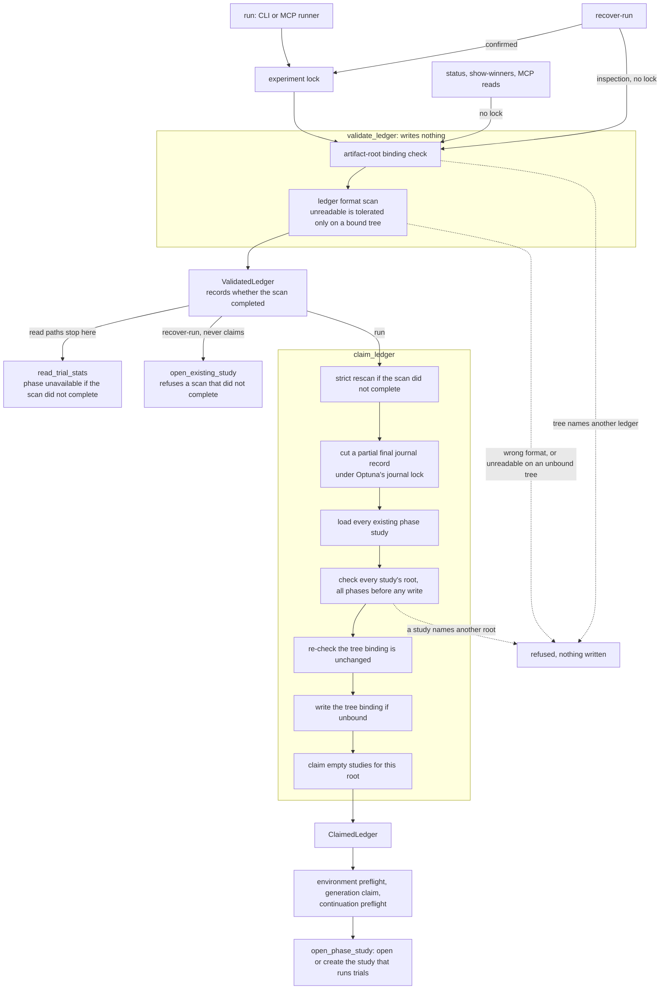

# Durability invariants

The experiment lock serializes local ledger mutations. Artifact-root and format checks precede claims, durable outcome records precede terminal trial states, and generation validation precedes the publication-pointer commit. Operator recovery identifies processes from durable attempt and run records.

> [!IMPORTANT]
> Error text is authoritative, and a wrap preserves the operator's remediation. Never fix a failing test by weakening a message match or an ordering assertion.

## Invariants

Module paths below drop the `phasesweep.` prefix; test paths are relative to the repository root.

### Lock and ledger order

Every path into the ledger passes through `engine.ledger`, and the handle each step returns is the proof the earlier steps ran. The diagram shows where each caller enters and where it must stop.

`engine.ledger` is the only module that constructs Optuna storage; no other module imports its private names. No module constructs sqlite3, SQLAlchemy, or Optuna RDB storage. `tests/test_ledger_contract.py` parses every package module and compares banned references against two ratchets for equality. Both `_LEGACY_SITES` and `_LEGACY_PRIVATE_IMPORTS` are empty, so any new site outside the ledger module fails. [Development](development.md#quality-gates) describes the contract-test hooks and CI.

#### 1. Mutations hold the experiment lock

A run, and a `recover-run` the operator confirms, hold the experiment lock before they read or write the artifact tree or the ledger.

**Held by:** `engine.locking._experiment_lock`, entered as the outermost durable-state context in `engine.run._run_experiment_outcome`, and in `mcp.recovery.recover_run` only when the operator confirms\
**Test:** `tests/test_locking.py::test_run_experiment_holds_experiment_lock_for_duration`

#### 2. Validation writes nothing

`validate_ledger` checks the artifact-root binding, then scans the ledger format, and writes nothing; on a bound tree an unreadable scan is tolerated and recorded on the handle, and on an unbound tree it is refused.

A journal ledger's last line that lacks its newline or does not decode is skipped exactly as Optuna's reader skips it, so status, winners, and the result snapshot report the complete records. Removing that line changes nothing any reader sees, and appending after it would glue the next record onto it, so every path about to write repairs it before any live open: a run's claim, the registry opener, and a confirmed recovery, each under the experiment lock. Recovery inspection holds no lock and leaves it alone. The repair takes Optuna's `JournalFileSymlinkLock`, the lock every Optuna append takes, whatever experiment or process it comes from, so while it is held no append is in flight. It scans the journal again under that lock, so an append that finished while the lock was awaited is never cut, and no offset read before the lock is ever used. It then copies the journal to `<journal>.<UTC stamp>.bak` beside it, created no more permissive than the journal, checks the size is unchanged, truncates after the last complete record, fsyncs, and replays the result before releasing the lock. Optuna's own `acquire` can wait forever on a lock a killed writer left behind, so the repair takes the lock itself (`engine.ledger._JournalLock`) and gives up after 30 seconds. Optuna 4.2 and later also remove a lock whose journal a waiting writer has seen unchanged for 30 seconds, which a repair of a large journal can outlast, so the repair refreshes the journal's modification time before each attempt and every second while it holds the lock. It creates the lock symlink under a private name and hard-links it into place, keeping the private name until release, so it truncates only while its own lock is in place and never removes a lock it did not take. The lock is a symlink named `<journal>.lock` that points at the journal, so every journal path, for Optuna's backend and the repair alike, comes from `runtime.files.journal_file_path`, which resolves symlinks: a relative target would dangle, and a symlinked alias would name a second lock that excludes nothing. A journal with a second hard-linked name has the same problem and is refused before any backup. A repair that cannot take the lock within its wait, write the backup, or truncate leaves the journal as it was and refuses with `RESTORE_LEDGER`, naming a lock left behind. A journal that grew under the lock is left untruncated, and a lock another process took over is left in place; both are refused with `RETRY`. A malformed record that another record follows is corruption, not an interrupted append, and is refused with `RESTORE_LEDGER` and the bytes unchanged.

**Held by:** `engine.ledger.validate_ledger`, running `engine.artifact_roots._check_artifact_root_binding` before `engine.ledger._scan_ledger_format` and returning a `ValidatedLedger` whose `format_verified` and `format_scan_failure` record the outcome; `engine.ledger._journal_records` for the tolerated line and `engine.ledger._repair_incomplete_journal_record` for the repair, called by `claim_ledger`, `open_registry_study`, and confirmed recovery\
**Tests:** `tests/test_format_cutover.py::test_validate_ledger_on_a_fresh_root_creates_nothing`, `tests/test_format_cutover.py::test_unverified_handle_records_the_gap_and_opens_nothing_live`, `tests/test_ledger_read_paths.py::test_read_path_never_constructs_file_backed_storage_or_writes_bytes`, `tests/test_engine_read.py::test_journal_partial_final_record_reads_as_optuna_does_and_is_repaired_before_writes`, `tests/test_engine_read.py::test_journal_malformed_record_before_its_end_never_means_absent`, `tests/test_format_cutover.py::test_writers_repair_a_partial_final_journal_record`, `tests/test_format_cutover.py::test_repair_leaves_an_append_that_finished_while_it_awaited_the_lock`, `tests/test_format_cutover.py::test_repair_waits_for_a_journal_lock_another_writer_holds`, `tests/test_format_cutover.py::test_repair_refuses_a_journal_lock_that_is_never_released`, `tests/test_format_cutover.py::test_journal_writers_and_repair_lock_the_journals_real_path`, `tests/test_format_cutover.py::test_repair_through_a_symlink_alias_is_excluded_by_the_real_names_writer`, `tests/test_format_cutover.py::test_repair_truncates_only_while_holding_the_journal_lock`, `tests/test_format_cutover.py::test_journal_lock_appears_only_after_the_journal_changes`, `tests/test_format_cutover.py::test_repair_never_truncates_under_or_releases_a_lock_another_process_took_over`, `tests/test_format_cutover.py::test_waiting_optuna_writer_never_takes_over_a_long_repairs_journal_lock`, `tests/test_format_cutover.py::test_repair_backup_is_no_more_permissive_than_the_journal`, `tests/test_format_cutover.py::test_repair_refuses_a_journal_with_another_hard_linked_name`, `tests/test_format_cutover.py::test_repair_refuses_a_journal_that_grew_under_its_lock`, `tests/test_format_cutover.py::test_repair_that_cannot_write_beside_the_journal_leaves_it_unchanged`

The scan may treat a missing journal file as an absent ledger only because config load already refused every other storage form: `storage` other than `null`, `auto`, or a `journal:///` URL is refused at config load (`config.models.Experiment._storage_is_local`, tested by `tests/test_storage_urls.py::test_non_journal_storage_is_refused_at_config_load`).

#### 3. Only a claimed ledger runs trials

Only a `ClaimedLedger` can open a study that runs new trials, and `claim_ledger` rescans strictly before it trusts a scan that did not complete.

**Held by:** `engine.ledger.claim_ledger` returning `ClaimedLedger`; `engine.ledger.open_phase_study`, which raises `TypeError` for any other handle; `engine.ledger.open_preview_study`, which is in-memory and serves dry runs\
**Tests:** `tests/test_format_cutover.py::test_live_openers_reject_unvalidated_storage`, `tests/test_format_cutover.py::test_claim_ledger_binds_tree_then_returns_bound_handle`, `tests/test_format_cutover.py::test_claim_rescans_an_unverified_ledger_before_discovery`, `tests/test_ledger_contract.py::test_storage_constructors_are_called_only_in_the_ledger_module`

#### 4. Both ownership directions agree before any write

The tree binding must name this ledger and every existing phase study must name this root, checked for all phases before anything is written.

**Held by:** `engine.artifact_roots._check_artifact_root_binding` in `validate_ledger`, then `engine.artifact_roots._artifact_root_claim_needed` for every loaded study and a re-check of the binding in `claim_ledger`\
**Tests:** `tests/test_fingerprint.py::test_second_workdir_is_rejected_and_leaves_the_bound_root_untouched`, `tests/test_fingerprint.py::test_refused_multi_phase_binding_claims_nothing`

#### 5. The tree is bound before any study

`claim_ledger` writes the tree binding before it claims any study, so a crash between the two cannot leave a study naming a tree that does not name its ledger. Its first write, before the binding, creates the ledger's parent directory, so a ledger path that cannot hold a file fails while the tree is still unbound and the path can be corrected.

**Held by:** `engine.ledger.claim_ledger`, creating the ledger's parent directory, then calling `engine.artifact_roots._write_artifact_root_binding` before its `_claim_study_artifact_root` loop\
**Tests:** `tests/test_format_cutover.py::test_claim_ledger_writes_tree_binding_before_claiming_studies`, `tests/test_format_cutover.py::test_claim_ledger_creates_ledger_parent_but_validate_does_not`, `tests/test_format_cutover.py::test_unwritable_ledger_directory_fails_before_the_tree_is_bound`

#### 6. Read paths construct and write nothing

`read_status`, `read_winners`, `read_result`, `read_trial_tables`, CLI `status` (with or without `--trials`) and `show-winners`, and the MCP result snapshot build no file-backed storage, write no bytes, and report a phase whose format scan did not complete as unavailable rather than counting its trials.

**Held by:** `engine.ledger.validate_ledger` and `engine.ledger.read_trial_stats` or `engine.ledger.read_phase_trials`, under `engine.read.read_status`, `engine.read.read_winners`, `engine.read.read_trial_tables` (and so CLI `status --trials`), and `mcp.snapshots.capture_result_snapshot`\
**Tests:** `tests/test_ledger_read_paths.py::test_read_path_never_constructs_file_backed_storage_or_writes_bytes`, `tests/test_format_cutover.py::test_inconclusive_scan_on_a_bound_tree_never_reports_unchecked_counts`

#### 7. Recovery validates before it opens

Recovery validates the binding and the format before it opens any study, never claims, refuses a study bound to another artifact root before it reaps anything, and refuses an unsupported ledger or an incomplete scan with the bytes unchanged. A confirmed recovery holds the experiment lock and is about to write, so it repairs a journal whose last line is partial, as a run's claim does; inspection reads past that line as Optuna does and writes nothing.

**Held by:** `mcp.recovery._load_recovery_studies`, through `engine.ledger.validate_ledger`, then, when confirmed, `engine.ledger.repair_incomplete_journal_record`, and then `engine.ledger.open_existing_study`, which refuses a handle whose scan did not complete, with `engine.artifact_roots._check_study_artifact_root` on every opened study\
**Tests:** `tests/test_ledger_read_paths.py::test_recovery_inspect_never_writes_to_a_golden_ledger`, `tests/test_format_cutover.py::test_unverified_handle_records_the_gap_and_opens_nothing_live`, `tests/test_stale_reaper.py::test_recovery_refuses_a_study_bound_to_another_artifact_root`, `tests/test_format_cutover.py::test_writers_repair_a_partial_final_journal_record`

### Attempts and trial outcomes

#### 8. Attempts are registered before launch

The attempt registry is scanned before anything else in the continuation preflight, and each attempt is durably registered before its trainer is launched.

**Held by:** `engine.attempts._preflight_active_attempts`, run first by `engine.guards._preflight_existing_studies`; then `engine.attempts._register_active_attempt`, called in `engine.phase` before the GPU lease and the launch\
**Test:** `tests/test_stale_reaper.py::test_unpersistable_attempt_refuses_to_launch_its_trainer`

#### 9. Preflight finishes before the claims it guards

Environment preflight finishes before the generation claim, and the continuation preflight finishes before the generation is marked running or any attempt is registered.

**Held by:** `engine.run._run_experiment_outcome`, which calls `_preflight_missing_reached_phase_environments` before `engine.generation._claim_generation`, then `engine.guards._preflight_existing_studies`, `engine.resume._preflight_skipped_winners`, and `engine.resume._preflight_reached_fingerprint` before the running state\
**Test:** `tests/test_runtime_behavior.py::test_existing_tree_preflights_missing_reached_phase_before_claim_or_topup`

`claim_ledger` runs before environment preflight, and the generation claim runs before the continuation chain, so the chain guards the running state and the attempts, not either claim.

#### 10. No terminal trial without its outcome record

No Optuna trial reaches a terminal state before its durable outcome record is written; a failed outcome write leaves the trial `RUNNING` for recovery.

**Held by:** `engine.phase._record_outcome`, which writes the outcome attribute before any terminal transition and raises `engine.phase._TrialOutcomeUnrecordedAbort` when it cannot\
**Test:** `tests/test_runtime_behavior.py::test_persistent_outcome_write_failure_leaves_trial_running_until_recovery`

#### 11. An abort is recorded with the outcome that trips it

A phase abort is written in the same record as the outcome that trips it, and replay honors the first abort recorded after the recovery boundary. A later success resets the failure streak but never a recorded abort, and a changed `max_consecutive_failures` governs new work only, never recorded outcomes. Recovering from an abort accepts the raised `n_trials` in the same record that retires the abort, so an interrupted recovery keeps its authorization and the old target never runs it.

**Held by:** `engine.phase._record_outcome`, which writes the record `engine.phase._PhaseExecution.abort_decision` returns with the outcome; `engine.study_policy._load_phase_policy_state`, which replays it; `engine.phase._resume_phase`, which applies the current limit only before new work; `engine.study_policy._record_recovery_boundary`, whose record `engine.study_policy._accepted_trial_target` reads as an accepted target\
**Tests:** `tests/test_runtime_behavior.py::test_parallel_failure_threshold_uses_completion_order`, `tests/test_abort_recovery.py::test_changing_the_failure_limit_never_reinterprets_recorded_outcomes`, `tests/test_abort_recovery.py::test_interrupted_recovery_keeps_the_raised_target_authorization`

#### 12. An unreadable ledger means cleanup is uncertain

A ledger that cannot be read makes cleanup uncertain, never confirmed, and the attempt stays registered for a later retry. A journal's partial final record does not make it unreadable: the registry opener repairs it first, as invariant 2 ("Validation writes nothing") describes, and reads the attempt as it would on a healthy journal.

**Held by:** `engine.cleanup._reap_stale_trials`, which raises `ProcessCleanupUncertainError`; `engine.attempts._registry_attempt_fail_stale_trial`, which opens through `engine.ledger.open_registry_study` and retains the entry when storage is unreachable; `engine.guards._preflight_existing_studies`, which marks the cleanup report uncertain\
**Tests:** `tests/test_stale_reaper.py::test_registry_storage_failure_marks_cleanup_report_uncertain`, `tests/test_stale_reaper.py::test_registry_retains_attempt_when_journal_snapshot_is_unreadable`, `tests/test_stale_reaper.py::test_registry_reads_its_attempt_after_repairing_a_partial_journal_record`

### Publication

#### 13. Publication is a transaction

The generation's own summary and winners are read back and validated before `last_successful_generation.yaml` commits, a failure before the commit leaves the prior pointer authoritative, and shutdown signals are absorbed until the commit lands. The pointer commits before its generation's lifecycle record, so it can be the only proof that generation committed; the record is written before the pointer moves off it, and if that write fails the pointer stays.

**Held by:** `engine.generation._publish_generation`, running inside `runtime.shutdown.absorb_shutdown_signals`, with `engine.generation._validate_generation_publishable` before the pointer write and `engine.generation._record_superseded_publication` before the pointer moves\
**Tests:** `tests/test_publication_transaction.py::test_shutdown_signal_during_publication_is_absorbed_until_committed`, `tests/test_publication_transaction.py::test_next_publication_records_the_generation_whose_record_was_lost`, `tests/test_publication_transaction.py::test_unwritable_record_for_the_superseded_generation_keeps_the_prior_pointer`

#### 14. A published result is read once

Validation reads every published artifact once, refusing symlinks and paths outside the generations root, and returns what it read. `show-winners`, `read_status`, `read_winners`, `read_result`, the MCP result snapshot and winner reads, and a `--from-phase` resume all show or build on those bytes; none reopens a published artifact by path. A generation that is not the validated publication, such as a pinned, unfinished, or failed one, is read from its files under the permissive read contract. A `--from-phase` resume, whether a run, a dry run, or an MCP launch, refuses a recorded publication that does not validate or cannot be read, with `PublicationIntegrityError` or `PublicationAccessError`; only a tree that never published reads as having no winner yet.

**Held by:** `engine.publication_validation._validate_generation_manifest`, returning the `ValidatedPublication` that `engine.publication.PublicationPointer.validated` carries, consumed by `engine.read._represented_winners`, `cli._show_experiment_winners`, and `engine.artifacts._load_winner`; `engine.resume._published_for_resume`, which turns an unusable verdict into a refusal for the run preflight, the dry run, and the MCP launch gate\
**Tests:** `tests/test_publication_transaction.py::test_published_reads_consume_the_bytes_validation_read`, `tests/test_publication_transaction.py::test_unusable_publication_is_refused_for_resume_never_read_as_absent`, `tests/test_mcp_launch.py::test_resume_refuses_an_unusable_publication_instead_of_reporting_no_winner`

### MCP runs

#### 15. A PID alone is never authority

A process is identified by PID, start time, boot id, and PID namespace together, and a differing boot id settles a reboot without signalling anything. A namespace is its inode plus the start time of its PID 1, because the kernel reuses a freed namespace's inode within seconds. A PID recorded in another PID namespace names an unrelated process here, so it is never probed or signalled. Only the host's initial namespace can prove such processes gone, from the recorded PIDs and process groups at every nesting level; anywhere else, or when a process there cannot be ruled out, cleanup refuses with `ForeignPidNamespaceError`, which names any blocking host process and gives no manual `kill` advice. A stale attempt is signalled through one procedure, whichever source found it: the attempt registry, a stale `RUNNING` trial, or a terminal trial that recorded cleanup uncertainty.

**Held by:** `runtime.reaper.identity_from_earlier_boot`, `runtime.reaper.same_pid_namespace`, `runtime.reaper.recorded_process_blocker`, `mcp.runs.RunStore.runner_view`, `runtime.reaper.is_same_live_process`, `runtime.reaper.cleanup_stale_trial_process`, whose only caller is `engine.attempts._resolve_attempt`\
**Tests:** `tests/test_mcp_runs.py::test_state_reserves_recovery_on_pid_reuse_mismatch`, `tests/test_stale_reaper.py::test_cleanup_stale_trial_process_accepts_prior_boot_without_signalling`, `tests/test_pid_namespace.py::test_cleanup_stale_trial_process_refuses_foreign_namespace_without_signalling`, `tests/test_pid_namespace.py::test_a_reused_inode_with_another_pid_1_start_time_is_foreign`, `tests/test_pid_namespace.py::test_an_unreadable_candidate_blocks_only_for_its_exact_numbers`, `tests/test_attempt_resolution.py::test_only_resolve_attempt_signals_a_stale_process_group`

#### 16. A dead runner stays live until recovery decides

A dead runner with no terminal status stays in the live set until `recover-run` decides; liveness alone never concludes a run. The one exception is a runner from a boot that has ended: nothing from that boot survived, and a boot never comes back, so the run reads `failed` without a signal. Deriving state writes nothing, so a read tool never creates or removes a marker: the writers that must reserve cleanup (cancel, failed-spawn cleanup, `recover-run`) persist their own marker, and a marker that a later status or boot supersedes is read as inert. A runner recorded in a PID namespace the server cannot observe is neither alive nor dead: it stays live on durable evidence alone, is never reaped, probed, or signalled, and `cancel_run` and `recover-run` refuse it. When the host's initial namespace proves its processes gone, it reads as a dead runner that needs recovery, never as terminal, because that proof says nothing of its trials and a later reader may be unable to repeat it; only `recover-run` settles the run, and the status it writes outlives any later proof.

**Held by:** `mcp.runs.RunStore.state`, `mcp.runs.RunStore._marker_reserves`, `mcp.runs.RunStore.runner_view`, and `mcp.runs.RunStore.recovery_required`, resolved only by `mcp.recovery.recover_run`\
**Tests:** `tests/test_mcp_runs.py::test_dead_runner_without_status_stays_live_until_recovery_evidence`, `tests/test_pid_namespace.py::test_foreign_namespace_runner_reads_running_and_writes_nothing`, `tests/test_pid_namespace.py::test_absent_runner_reads_as_a_dead_runner_that_needs_recovery`, `tests/test_pid_namespace.py::test_a_blocker_between_reads_never_reads_failed_and_never_unsettles_a_run`, `tests/test_pid_namespace.py::test_recover_run_settles_an_absent_runner_without_signalling`, `tests/test_pid_namespace.py::test_cancel_refuses_foreign_namespace_without_signalling_or_marker`

### Errors and fixtures

#### 17. Wraps keep the operator's remediation

Every operator-facing error declares one remediation, and a wrap preserves it instead of replacing it with the wrapper's own advice. Alternatives route the one that keeps the operator's existing work, repairs of which none suffices alone route to reading the logs, and retrying what failed after a repair is implied. A preflight that collects several refusals routes the remediation they share, or reading the logs when they disagree. `recover-run` never routes a refusal back to itself except to a confirmed run, so `RunRecoveryError` defaults to reading the logs. An MCP run's failure payload takes its next steps only from the action, so no error type gives the agent advice of its own; unconfirmed cleanup adds recover-run after the repair.

**Held by:** `errors.OperatorAction`, `errors.PhaseSweepError.default_action` with the `action` each instance carries, `errors.PhaseSweepError.rewrap`, `mcp.runner._OPERATOR_STEPS`, `mcp.runner._cleanup_steps`\
**Tests:** `tests/test_error_routing.py::test_every_operator_error_declares_its_action`, `tests/test_error_routing.py::test_raise_sites_route_their_declared_action`, `tests/test_error_routing.py::test_runner_payload_follows_the_routed_steps`

#### 18. Refusals are tested against a real ledger

Refusals are tested against a ledger produced by the public API, and read paths run under a patch that records and raises on any file-backed storage construction.

**Held by:** `tests/fixtures/make_ledger_fixtures.py`, `tests/ledger_fixtures.py::forbid_file_backed_storage`\
**Tests:** `tests/test_ledger_read_paths.py::test_current_fixture_carries_this_release_format`, `tests/test_ledger_read_paths.py::test_required_ledger_fixtures_are_present`, `tests/test_ledger_read_paths.py::test_every_ledger_fixture_is_documented`

### Selection

#### 19. A confound verdict never joins a fingerprint or gets read as clean

The confound block is computed once per selection and frozen onto the winner; `n/a` means a check could not run and must never be rendered or counted as `ok`. In a repeats phase it ranks complete groups, lists them as `ranked_groups`, and the validator requires the winner's `repeats` members to be one of them. No downstream phase fingerprint depends on any block's content, so an observation can never invalidate a study or block a top-up, and a top-up that reselects the same trial for a larger ranked population publishes a fresh block rather than reusing the old one. A `--from-phase` resume carries the parent winner's block verbatim. The block's authoritative copy is the generation's `phases/<phase>/winner.yaml`, which the generation manifest covers: an edited verdict there fails `publication_integrity` like any other tampered artifact. The per-phase `winner.yaml` projection is never read back.

**Held by:** `engine.confound._assess_population`, `engine.confound._validate_check` refusing an `n/a` record without a `reason`, `engine.fingerprints._phase_fingerprint`, which never reads `engine.state.Winner.confound`, and `engine.publication_validation._validate_generation_manifest`, which calls `engine.confound._validate_confound_block`\
**Tests:** `tests/test_confound.py::test_verdicts_are_three_distinct_values_and_not_checked_is_never_ok`, `tests/test_confound.py::test_confound_block_never_moves_a_downstream_fingerprint`, `tests/test_confound.py::test_published_block_is_manifest_covered`, `tests/test_confound.py::test_top_up_reselection_publishes_a_fresh_block_for_its_larger_population`, `tests/test_confound.py::test_inheriting_phases_are_warned_and_from_phase_carries_the_block`, `tests/test_repeats.py::test_repeats_block_and_confound_groups_agree_on_the_winning_group`

#### 20. A repeat group is fixed once complete and its last member names it

A repeat group holds exactly one trial per repeat value: under grid its key is the trial's params without the repeat key, and under seeded random it is also the configuration slot `trial_number // R`, so a later top-up can add groups but never a member to a complete one. The winner's scalar fields describe the group's highest-numbered member, so a winning group cites the generation that ran its last member; that generation saw the group complete, and because exact ties go to the group with the lowest member trial number, it selected the same winner. A carried winner's source check therefore holds without a repeats-specific path, and every member's evidence is verified wherever the winner's is.

**Held by:** `engine.repeats.group_key`, `engine.repeats.ranked_group` naming the group by its last member, `engine.selection._rank_groups`, `engine.repeats._validate_repeats_block`, called by `engine.publication_validation._validate_generation_manifest`, and `engine.repeats.evidence_members`, iterated by `engine.evidence._verify_winner_objective_evidence` and `engine.evidence._verify_skipped_winner_evidence`\
**Tests:** `tests/test_timeouts.py::test_group_completed_after_partial_timeout_publishes_from_completing_generation`, `tests/test_selector.py::test_seeded_random_duplicate_configs_rank_as_separate_slots`, `tests/test_selector.py::test_repeats_tie_goes_to_lowest_group_and_highest_member_names_it`, `tests/test_trial_evidence.py::test_group_winner_verifies_every_member_evidence`, `tests/test_repeats_runtime.py::test_carried_group_winner_must_agree_on_repeats`

## Detached-run recovery rationale

A dead runner without terminal status may still have trials being reaped, so invariant 16 ("A dead runner stays live until recovery decides") keeps its capacity slot occupied until `recover-run` decides from durable evidence. Invariant 7 ("Recovery validates before it opens") governs that recovery's ledger access. Process identity includes the boot id because PID and `/proc` start time can both be reused after reboot, and the PID namespace because the same numbers name unrelated processes in another one; an unknown boot id or PID namespace on either side refuses to signal.

### Persisted spawned handle

A detached runner outlives its parent by design. If the server restarts with no handle on disk, it has no record of that runner, and a second `launch_run` spawns a duplicate sweep against the same ledger. The handle is created before `Popen`, replaced by the runner's own receipt once the runner has persisted its identity, and confirmed through a ready/ack handshake, so no child ever exists without a durable handle naming it.

**Held by:** `mcp.run_control.RunControl._spawn`, `mcp.run_control.RunControl._terminate_failed_spawn`, and `mcp.run_control.RunControl._pending_handle`; `mcp.runner._persist_spawned_handle` refuses to persist a runner receipt without a boot id or PID namespace.
