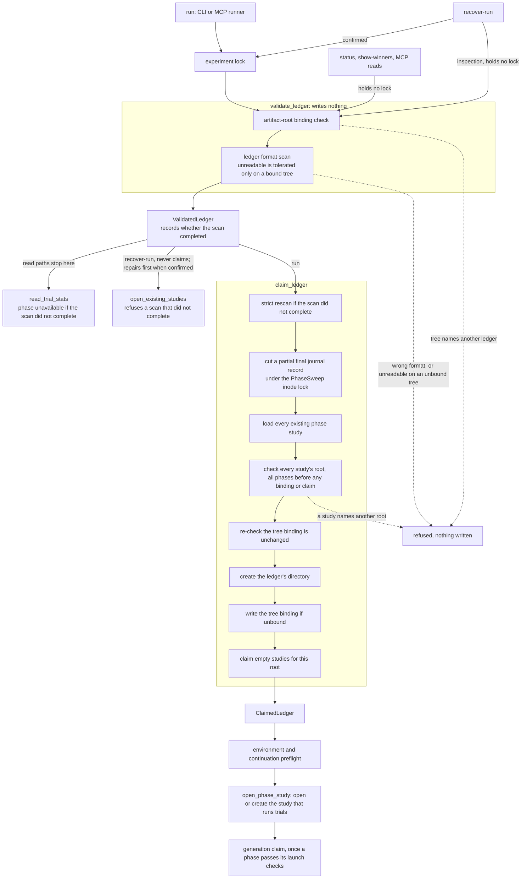

# Durability invariants

The experiment lock serializes local ledger mutations. Artifact-root and format checks precede claims, durable outcome records precede terminal trial states, and generation validation precedes the publication-pointer commit. No trial or detached-runner code runs before its process identity is durable, and operator recovery identifies processes from durable attempt and run records.

## Invariants

Module paths below drop the `phasesweep.` prefix; test paths are relative to the repository root.

### Lock and ledger order

`engine.ledger` alone constructs Optuna storage. Its configured-ledger handles prove the preceding checks ran. `open_registry_study` instead validates and repairs the ledger named by a registered attempt. [Development](development.md#quality-gates) describes the contract checks.

#### 1. Mutations hold the experiment lock

Runs, confirmed `recover-run`, and `sync-tracking` hold the same experiment lock before writes and the reads they depend on. Fresh-tree run checks are the exception ([invariant 11](#11-only-work-claims-a-generation-after-every-check-that-could-refuse-it)). `sync-tracking` validates the binding and format before retiring tracking attempts or writing the tracking tree, and reads trials through that validated handle.

The status lock probe controls resume advice only. Both status formats retain trial data and the publication verdict when the probe fails. On macOS, root-owned `/var` and `/tmp` aliases share the physical path's host locks. Operator-controlled symlinks are refused. See [storage and locks](runtime.md#storage-and-locks) for lock path requirements.

**Held by:** `cli._status_can_suggest_resume`, `runtime.files.lock_dir`, `engine.locking._experiment_lock`, entered as the outermost durable-state context in `engine.run._run_experiment_outcome`, in `mcp.recovery.recover_run` only when the operator confirms, and in `tracking.publication.sync_tracking` inside `runtime.shutdown.signal_handler_scope` for its whole body: `engine.ledger.validate_ledger` first, then tracking-only attempt resolution, record rebuilds, and deliveries

**Tests:** `tests/test_engine_status_shape.py::test_status_keeps_running_trials_visible_when_lock_probe_fails`, `tests/test_locking.py::test_run_experiment_holds_experiment_lock_for_duration`, `tests/test_locking.py::test_macos_system_temp_aliases_share_physical_host_locks`, `tests/test_mlflow_terminal_delivery.py::test_sync_refuses_a_tree_of_another_format_as_run_does_and_writes_nothing`

#### 2. Validation writes nothing

`validate_ledger` checks the artifact-root binding, then scans the ledger format, and writes nothing; on a bound tree an unreadable scan is tolerated and recorded on the handle, and on an unbound tree it is refused.

Readers skip an incomplete final journal record without writing. Before opening storage for mutation, claims, registry recovery, and confirmed operator recovery repair that record under the experiment lock and the journal inode lock. Repair rescans after acquiring the journal lock, saves a permission-preserving timestamped backup, truncates only the incomplete tail, fsyncs, and replays the result. A malformed record before the tail is corruption and remains unchanged.

Every PhaseSweep append and repair locks the journal inode. Writers wait without a deadline; repair waits at most 30 seconds. Kernel locks release on process exit and coordinate hard-linked names as well as resolved symlinks. Repair truncates through its locked descriptor and checks that the pathname still names that inode. Failure to acquire the lock or make the backup refuses with `RESTORE_LEDGER`. Growth or pathname replacement under the lock refuses with `RETRY`, without truncating or unlocking the replacement.

**Held by:** `engine.ledger.validate_ledger`, running `engine.artifact_roots._check_artifact_root_binding` before `engine.ledger._scan_ledger_format` and returning a `ValidatedLedger` whose `format_verified` and `format_scan_failure` record the outcome; `engine.ledger._journal_records` for the tolerated line, `engine.ledger._JournalLock` for writer and repair exclusion and `engine.ledger._repair_incomplete_journal_record` for the repair, called by `claim_ledger`, `open_registry_study`, and confirmed recovery

**Tests:** `tests/test_format_cutover.py::test_validate_ledger_on_a_fresh_root_creates_nothing`, `tests/test_format_cutover.py::test_unverified_handle_records_the_gap_and_opens_nothing_live`, `tests/test_ledger_read_paths.py::test_read_path_never_constructs_file_backed_storage_or_writes_bytes`, `tests/test_engine_read.py::test_journal_partial_final_record_reads_as_optuna_does_and_is_repaired_before_writes`, `tests/test_engine_read.py::test_journal_malformed_record_before_its_end_never_means_absent`, `tests/test_format_cutover.py::test_writers_repair_a_partial_final_journal_record`, `tests/test_format_cutover.py::test_repair_leaves_an_append_that_finished_while_it_awaited_the_lock`, `tests/test_format_cutover.py::test_repair_waits_for_a_journal_lock_another_writer_holds`, `tests/test_format_cutover.py::test_repair_refuses_a_journal_lock_that_is_never_released`, `tests/test_format_cutover.py::test_journal_writers_and_repair_lock_the_journals_real_path`, `tests/test_format_cutover.py::test_repair_through_a_symlink_alias_is_excluded_by_the_real_names_writer`, `tests/test_format_cutover.py::test_repair_truncates_only_while_holding_the_journal_lock`, `tests/test_format_cutover.py::test_journal_writer_wait_is_unbounded_and_does_not_change_mtime`, `tests/test_format_cutover.py::test_repair_never_truncates_under_or_releases_a_lock_another_process_took_over`, `tests/test_format_cutover.py::test_waiting_optuna_writer_never_takes_over_a_long_repairs_journal_lock`, `tests/test_format_cutover.py::test_repair_backup_is_no_more_permissive_than_the_journal`, `tests/test_format_cutover.py::test_journal_hard_link_names_share_lock_and_repair`, `tests/test_format_cutover.py::test_repair_refuses_a_journal_that_grew_under_its_lock`, `tests/test_format_cutover.py::test_repair_that_cannot_write_beside_the_journal_leaves_it_unchanged`

The scan treats a missing journal file as an absent ledger after config loading restricts `storage` to `null`, `auto`, or a `journal:///` URL (`config.models.Experiment._storage_is_local`, tested by `tests/test_storage_urls.py::test_non_journal_storage_is_refused_at_config_load`).

#### 3. Only a claimed ledger runs trials

Only a `ClaimedLedger` can open a study that runs new trials, and `claim_ledger` rescans strictly before it trusts a scan that did not complete. Opening a phase study that exists loads it and appends nothing to the journal; only an absent study is created.

**Held by:** `engine.ledger.claim_ledger` returning `ClaimedLedger`; `engine.ledger.open_phase_study`, which raises `TypeError` for any other handle; `engine.ledger.open_preview_study`, which is in-memory and serves dry runs; `engine.ledger._build_phase_study`, which both openers call

**Tests:** `tests/test_format_cutover.py::test_live_openers_reject_unvalidated_storage`, `tests/test_format_cutover.py::test_claim_ledger_binds_tree_then_returns_bound_handle`, `tests/test_format_cutover.py::test_claim_rescans_an_unverified_ledger_before_discovery`, `tests/test_ledger_contract.py::test_storage_constructors_are_called_only_in_the_ledger_module`, `tests/test_format_cutover.py::test_reopening_phase_studies_appends_no_journal_records`

#### 4. Both ownership directions agree before any binding or claim

The tree binding must name this ledger and every existing phase study must name this root, checked for all phases before anything is bound or claimed; only the repair of a partial final journal record, which changes nothing a reader sees, comes earlier.

Config disclosure, auto storage and engine artifact paths derive the same root by resolving the workdir before appending the experiment name. Ownership and lock identities also resolve the experiment leaf, so symlink aliases share one namespace.

**Held by:** `runtime.files.artifact_root_path`, used by `config.models.experiment_disclosures`, `config.models.Experiment.resolved_storage` and `engine.paths._experiment_dir`; `engine.paths._artifact_root_identity` for ownership and lock identity; `engine.artifact_roots._check_artifact_root_binding` in `validate_ledger`, then `engine.artifact_roots._artifact_root_claim_needed` for every loaded study and a re-check of the binding in `claim_ledger`

**Tests:** `tests/test_fingerprint.py::test_second_workdir_is_rejected_and_leaves_the_bound_root_untouched`, `tests/test_fingerprint.py::test_refused_multi_phase_binding_claims_nothing`, `tests/test_config_paths.py::test_auto_storage_follows_anchored_workdir`, `tests/test_cli.py::test_validate_and_dry_run_disclose_the_trainer_cwd`, `tests/test_locking.py::test_output_lock_resolves_symlinked_experiment_leaf`

#### 5. The tree is bound before any study

`claim_ledger` writes the tree binding before it claims any study, so a crash between the two cannot leave a study naming a tree that does not name its ledger. Before the binding it creates the ledger's parent directory, so a ledger path that cannot hold a file fails while the tree is still unbound and the path can be corrected.

**Held by:** `engine.ledger.claim_ledger`, creating the ledger's parent directory, then calling `engine.artifact_roots._write_artifact_root_binding` before its `_claim_study_artifact_root` loop

**Tests:** `tests/test_format_cutover.py::test_claim_ledger_writes_tree_binding_before_claiming_studies`, `tests/test_format_cutover.py::test_claim_ledger_creates_ledger_parent_but_validate_does_not`, `tests/test_format_cutover.py::test_unwritable_ledger_directory_fails_before_the_tree_is_bound`

#### 6. Read paths construct and write nothing

`read_status`, `read_result`, `read_trial_tables`, CLI `status` (with or without `--trials`) and `show-winners`, the MCP result snapshot, `validate` when it reads recorded attempts for a fixed-configuration target above one or an above-matrix grid target, and `run --dry-run` build no file-backed storage and write no bytes. Status reads report a phase whose format scan did not complete as unavailable rather than counting its trials. CLI status, plain or with `--trials`, reports invalid failure-policy state as a per-phase diagnosis and preserves the trial counts or rows, publication verdict and other phases' advice. `engine.read.inspect_status`, `engine.read.read_trial_tables` and `cli.status` enforce the advisory boundary, covered by `tests/test_run_overrides.py::test_malformed_phase_policy_keeps_status_yaml_and_other_refusals`. A dry run reads all phase studies from one journal capture, applies the launch's claim and preflight checks in the launch's order, and renders its command on an in-memory study. [Inspection commands](runtime.md#inspection-commands) describes its refusals, limitations, and fresh preview when the ledger is unreadable.

Numeric metadata follows each consumer's error contract even when a JSON integer exceeds the float range. Publication validators reject unusable metrics, repeats and observations through publication errors; permissive winner reads omit malformed results, and optional trial-table cells become `None`. Selection excludes trials with unusable constraints, while strict resume reports a winner error. `engine.publication_validation._validate_generation_manifest`, `engine.repeats._finite_number`, `engine.state._validate_observed_block`, `engine.read._winner_view`, `runtime.json.float_or_none`, `engine.selection._eligible` and `engine.artifacts._load_winner` enforce these boundaries. The malformed-publication and strict-resume regressions in `tests/test_publication_transaction.py`, repeat validation in `tests/test_repeats_runtime.py`, observed-value validation in `tests/test_observe.py`, pinned reads and trial-table projection in `tests/test_engine_read.py`, and constraint selection in `tests/test_selector.py` cover them.

Recovery applies the same boundary to elapsed time: `runtime.process.read_attempt_lifecycle` reports an unrepresentable duration through its malformed-record `ValueError`, while `engine.state._completed_trainer_duration` treats unusable recorded trainer time as incomplete completion evidence. `tests/test_attempt_lifecycle.py::test_read_attempt_lifecycle_rejects_every_malformed_shape` and `tests/test_engine_state.py::test_completed_trainer_duration_requires_representable_time` cover the lifecycle file and reopened trial metadata.

**Held by:** `engine.ledger.validate_ledger` and `engine.ledger.read_trial_stats` or `engine.ledger.read_phase_trials`, under `engine.read.read_status`, `engine.read.read_result`, `engine.read.read_trial_tables` (and so CLI `status --trials`), and `mcp.snapshots.capture_result_snapshot`; `engine.ledger.read_phase_studies`, under `engine.preview._preview_ledger` for a dry run and `engine.preview.validate_trial_targets` for CLI validation

**Tests:** `tests/test_ledger_read_paths.py::test_read_path_never_constructs_file_backed_storage_or_writes_bytes`, `tests/test_format_cutover.py::test_inconclusive_scan_on_a_bound_tree_never_reports_unchecked_counts`, `tests/test_dry_run_recorded_trials.py::test_unreadable_trial_data_previews_a_fresh_phase_and_says_so`, `tests/test_dry_run_recorded_trials.py::test_dry_run_reads_the_journal_once_however_many_phases_there_are`

#### 7. Recovery validates before it opens

Recovery validates the binding and format before opening any study and checks each study's root before reaping. It never claims. An unsupported format or incomplete scan leaves the ledger unchanged. Confirmation repairs a partial final record under the locks in [invariant 2](#2-validation-writes-nothing). Inspection ignores that record without writing.

**Held by:** `mcp.recovery._load_recovery_studies`, through `engine.ledger.validate_ledger`, then, when confirmed, `engine.ledger.repair_incomplete_journal_record`, and then `engine.ledger.open_existing_studies`, which opens every study of a phase, including one the current config no longer addresses, and refuses a handle whose scan did not complete, with `engine.artifact_roots._check_study_artifact_root` on every opened study

**Tests:** `tests/test_ledger_read_paths.py::test_read_path_never_constructs_file_backed_storage_or_writes_bytes` (the `mcp-recover-inspect` case checks unchanged bytes without banning storage construction), `tests/test_format_cutover.py::test_unverified_handle_records_the_gap_and_opens_nothing_live`, `tests/test_stale_reaper.py::test_recovery_refuses_a_study_bound_to_another_artifact_root`, `tests/test_format_cutover.py::test_writers_repair_a_partial_final_journal_record`

### Attempts and trial outcomes

#### 8. Attempts are registered before launch

The attempt registry is scanned before anything else in the continuation preflight, and each attempt is durably registered before its trainer is launched. Each trainer entry records the producing phase and study names and an absolute storage locator, so the registry still resolves the attempt after a phase rename, a storage-URL change, or a change of working directory. Managed MLflow setup uses `tracking.session.call_tracking` for both creation and lookup. Each worker owns its lifecycle and cleanup. The trainer stays allocated until launch, so recovery retries a draw interrupted during setup or the GPU wait (`tests/test_mlflow_terminal_delivery.py::test_managed_creation_before_launch_recovers_the_unlaunched_draw`).

**Held by:** `engine.attempts._preflight_active_attempts`, run first by `engine.guards._preflight_existing_studies`; then `engine.attempts._register_active_attempt`, called in `engine.phase` before the GPU lease and the launch, which freezes the locator from `runtime.files.storage_recovery_locator` into the entry

**Tests:** `tests/test_stale_reaper.py::test_unpersistable_attempt_refuses_to_launch_its_trainer`, `tests/test_stale_reaper.py::test_renamed_phase_cannot_hide_stale_trainer_from_recovery`, `tests/test_stale_reaper.py::test_storage_change_cannot_hide_stale_attempt_from_recovery`, `tests/test_stale_reaper.py::test_relative_registry_storage_recovers_from_the_registration_cwd`

#### 9. Nothing runs before its process identity is durable

Trainer code and its environment execute only after the process identity is durable. The standalone stdlib supervisor starts by file path under `python -I -S` with only `PATH`. Command, environment, and cwd cross its pipe after `process_identity.json` is written; EOF before acknowledgement exits without launching the trainer. The identity and lifecycle record live in the attempt's own directory, `<phase>/attempts/<attempt-id>/` (`engine.paths._attempt_dir`), beside the trial directory rather than in it, so a trainer that clears its output directory cannot delete the record recovery depends on.

The MCP runner starts by file path under `python -P` in the private server state directory, with Python startup-path overrides removed, so neither its script directory, the project directory nor `PYTHONPATH` reaches `sys.path` before its identity is durable; it keeps the server's user-site setting, adding `-s` exactly when the server runs with the user site disabled, so the runner imports the PhaseSweep the server imported; a W&B or MLflow worker keeps its controller's setting the same way. A durable handle is created before `Popen`, replaced by the runner's receipt after it persists its process identity, and confirmed through a ready/ack handshake. The receipt requires a boot id and PID namespace. The runner receives the project path as `--cwd`, entering it only after its receipt is persisted and the handshake completes. Its durable handle reserves the run across server restarts, preventing a duplicate launch.

**Held by:** `runtime.process._spawn_blocked_supervisor`, `runtime.process._sanitized_supervisor_env`, and `runtime.process._supervisor_script_path`; `runtime.process.run_supervised`, which writes the identity with `runtime.process._write_process_identity` before `runtime.process._encode_launch_payload` crosses the pipe; `runtime.supervisor._read_launch_payload` and `runtime.supervisor._run_trainer`, which exits 75 on EOF without `exec`; `mcp.tools.PhaseSweepMCP._pending_handle` and `mcp.runs.RunStore.prepare_launch` before `mcp.tools.PhaseSweepMCP._spawn`, which revalidates its private state directory before spawning, launches `mcp.runner.RUNNER_SCRIPT_PATH` as `python -P <script>`, with `-s` first when `sys.flags.no_user_site` is set, as `runtime.remote_worker.run_worker` launches a worker, and with `mcp.tools._runner_env`, which drops only `mcp.tools._PRE_IMPORT_CODE_ENV_VARS`, and fails the launch with `mcp.errors.RunnerExitedBeforeReceiptError` when the runner exits before its receipt; `mcp.tools.PhaseSweepMCP._terminate_failed_spawn`; `mcp.runner.main`, which enters the project directory only after `mcp.runner._persist_spawned_handle` and `mcp.runner._complete_launch_handshake`

**Tests:** `tests/test_trial_launch.py::test_supervisor_imports_only_its_stdlib_allowlist`, `tests/test_process_supervision.py::test_spawn_blocked_supervisor_launch_argv_and_env`, `tests/test_process_supervision.py::test_supervisor_never_imports_poisoned_modules_from_pythonpath`, `tests/test_process_supervision.py::test_hard_parent_death_before_identity_commit_never_starts_trainer`, `tests/test_mcp_launch.py::test_launch_hardens_runner_interpreter_flags_and_environment`, `tests/test_runtime_behavior.py::test_sdk_worker_ignores_the_user_site_exactly_when_its_controller_does`, `tests/test_mcp_launch.py::test_runner_that_exits_before_its_receipt_names_its_exit_code`, `tests/test_mcp_launch.py::test_launch_spawns_runner_in_neutral_dir_and_passes_project_cwd`, `tests/test_mcp_launch.py::test_spawned_runner_cannot_execute_project_local_code`, `tests/test_mcp_runner.py::test_runner_enters_the_project_directory_after_its_identity_is_durable`, `tests/test_mcp_runner.py::test_runner_persists_identity_even_when_the_project_directory_is_gone`

#### 10. Lifecycle states that skip signalling are written only on proof

A durable lifecycle state authorizes recovery to skip process-identity cleanup only when it proves no process can remain. `allocated` is written before registration, trial discovery and GPU waiting, so without a process identity beside it, no launch began. `launching` precedes `Popen`, and the trial-directory attribute precedes `launch_trial`, so an undiscovered trial cannot hide a launch. The payload crosses only after `process_identity.json` is written, so `launching` with no identity file beside it means no worker received its payload: recovery acts on it only under the experiment lock, which proves the controller that held the payload pipe is dead, and a supervisor that reads end-of-file instead of a payload exits without running the trainer. Recovery therefore settles that attempt without signalling and without writing `exited`; a trainer that had already finished keeps its recorded result, and a trainer attempt records `interrupted` and reruns. An identity file that exists at all, even empty, partial or another attempt's, still requires identity validation. `exited` with confirmed cleanup is written only once the whole group and every descendant the guardian adopted are proven gone or no supervisor was spawned; `process_identity.json` stays beside it. When the controller was killed, the process identity also names its guardian by PID and birth time before the payload crosses. Recovery verifies its boot and PID namespace, requires readable owning storage before requesting any signal, and waits for a live matching guardian's durable verdict. The trainer group may be empty while the guardian still holds adopted helpers. If the guardian cannot confirm cleanup in the allotted time or exits without a usable verdict, that recovery pass stays unresolved. Every other state requires identity validation.

Cleanup requires proof that every member has exited. On Linux the guardian is a child subreaper, so the members are the trainer group's processes and the guardian's own children: the root and every descendant whose parent died first, such as a rank torchrun started in a session of its own. The group is checked first; then `waitpid(-1, WNOHANG)` reaps every exited child and says whether any is left, and procfs only lists the adopted children's PIDs so they can be named and signalled. That order is race-free: a group with no live member gains none, and the kernel re-parents a dying process's children to the guardian before that process reads as exited. While the root runs, the guardian's wait reaps each adopted child as it exits, so none is left a zombie. SIGTERM and SIGKILL go to the trainer group and to each member's own group, and a member adopted only after its launcher was killed gets SIGKILL at first sight within the same grace. On Linux a group member has exited in procfs state `X` or in state `Z` with only its own thread listed in `/proc/<pid>/task`. Other threads can still run after the leader calls `pthread_exit`. An unreadable thread listing counts as live. The per-thread states are unnecessary because exited threads leave the listing. macOS counts zombies as exited when checking members.

A live guardian persists `terminating` with `ended_by` `cancelled` (SIGTERM: shutdown, a deadline cap, abort or recovery) or `timed_out` (SIGUSR1: the per-trial timeout) before forwarding the cancellation. That record survives a later zero exit and still requires cleanup proof. Every other `ended_by` is written on proof: `trainer`, the only ending with a return code, when the root exited by itself; `not_started` when the launch child wrote to the close-on-exec exec pipe before `execve`, so a trainer that itself exits 75 stays `trainer`; `guardian_lost` when the controller found the guardian gone without a verdict. The guardian reaps the exited root during group cleanup, including without procfs. If the guardian dies, the controller takes over within the existing deadline without signalling the dead guardian's PID; it can signal only the recorded group, so a descendant outside that group re-parents to init and is no longer tracked. Supervision saves cancellation intent before directly cleaning a trainer whose guardian exited. A completed group keeps its result. Once the trainer root has exited, cancellation no longer applies: the guardian ignores it, gives the rest of the group its helper settle, then terminates and names whatever is still running, and both supervised cleanup and stale recovery use the same guardian-exit allowance: that settle plus the SIGTERM grace plus a margin for the guardian's polling and scans. A guardian unable to save intent withholds signals and retains the lease. See [interrupted trials](runtime.md#interrupted-trials-rerun) for the operator behavior.

Process-lifetime signal installation and repair register the PhaseSweep handler before unblocking shutdown signals, so queued signals cannot reach a replaced host handler. `runtime.shutdown.install_signal_handlers` and `runtime.shutdown._reassert_process_lifetime_handlers` enforce this order; `tests/test_shutdown.py::test_deferred_sigterm_exits_without_deadlocking` covers signals queued before installation, inherited masks and critical sections.

The guardian's survivor diagnostics reach `run.log` and, after a zero exit, the recorded trial failure reason. `runtime.supervisor._describe_members` limits each entry to the PID and the executable basename when available. `tests/test_guardian_settle.py::test_survivor_description_omits_command_arguments` checks this with a credential-shaped helper argument.

Every command that can start a trainer or an evidence or tracking worker owns the shutdown signals while it can: `phasesweep run` and the MCP runner for the whole process through `runtime.shutdown.install_signal_handlers`, `sync-tracking` and a confirmed `recover-run` through `runtime.shutdown.signal_handler_scope`, entered in `tracking.publication.sync_tracking` and `mcp.recovery.recover_run`. SIGTERM, SIGINT or SIGHUP then stops the registered workers before the command exits with 128 plus the signal number, instead of killing the controller and leaving its guardian and worker running; `tests/test_tracking_closeout.py::test_a_ctrl_c_during_sync_tracking_says_what_stays_pending_and_exits_130` and `tests/test_mcp_recovery_tracking.py::test_a_shutdown_signal_during_recover_run_stops_its_worker_and_prints_the_command_that_finishes` cover the scoped commands.

**Held by:** `engine.phase._execute_objective`, which writes `allocated` through `runtime.process.write_attempt_lifecycle` before registration, discovery and GPU waiting; `runtime.process.run_supervised`, which writes `launching` before spawning and cancellation intent before cleaning a trainer whose guardian exited; `runtime.shutdown._shutdown_handler`, `runtime.process._kill_group` and `runtime.reaper._terminate_process_groups`, which retain guardian process objects, request their cancellation while alive and directly clean trainer groups after guardian death; `runtime.supervisor.main`, which writes cancellation intent before signalling and completion after group cleanup, reaps adopted children as they exit while it waits for the root through `runtime.supervisor._wait_for_root`, ignores SIGTERM and SIGUSR1 once the root has exited, reaping it in the handler and ending that wait when the request lands before its own wait reaps it, and waits `runtime.supervisor._HELPER_SETTLE_SECONDS` after every root exit but a cancellation, and `runtime.supervisor._wait_for_group_exit`, which reaps the owned root before probing the group and, while terminating, signals each member's group through `runtime.supervisor._signal_members`, including members adopted on the way; `runtime.supervisor._become_subreaper`, which makes the guardian adopt the trainer's orphaned descendants on Linux; `runtime.supervisor._trainer_alive`, which asks `runtime.supervisor._trainer_group_alive` (deciding unreadable entries through `runtime.supervisor._unreadable_member`) and then `runtime.supervisor._children_remain`, and lists adopted children through `runtime.supervisor._adopted_children`; `runtime.supervisor._reap_remaining_group`, which names survivors through `runtime.supervisor._trainer_alive` and `runtime.supervisor._describe_members` before terminating them; `runtime.reaper.guardian_exit_timeout`, the settle plus the SIGTERM grace plus `runtime.reaper._GUARDIAN_EXIT_MARGIN_SECONDS`, which `runtime.process._wait_for_guardian_exit`, the confirmation window of `runtime.reaper._terminate_process_groups` and `runtime.reaper._stop_stale_guardian` allow; `runtime.process._trial_process_identity` records the guardian, `runtime.reaper.stale_trial_process_decision` verifies it before choosing cleanup, and `engine.attempts._resolve_attempt` reads the guardian’s exit record before advancing; `runtime.reaper._has_exited` for the controller and its stdlib-only copy `runtime.supervisor._has_exited` for the guardian, which hold the member rule; `runtime.process._record_attempt_exited`, which retains completion evidence and an ending already recorded; `runtime.supervisor._trainer_started`, which reads the exec pipe; `engine.attempts._attempt_process_resolution`, `engine.attempts._record_process_resolution`, `engine.attempts._resolve_attempt` and `engine.cleanup._reap_stale_trials`, which require identity cleanup unless lifecycle evidence proves it unnecessary; `engine.attempts._recover_completed_trial`, which accepts a finished trainer's result only from an `exited` or `payload_withheld` slot

**Tests:** `tests/test_trial_launch.py::test_trial_directory_and_allocated_lifecycle_precede_launch`, `tests/test_trial_launch.py::test_guardian_sigkill_interrupts_its_trial_which_reruns_in_place`, `tests/test_process_supervision.py::test_identity_write_failure_marks_launch_before_popen`, `tests/test_process_supervision.py::test_unexpected_status_read_failure_preserves_cleanup_evidence[deadline-cleanup-uncertain]`, `tests/test_process_supervision.py::test_run_supervised_preserves_identity_and_records_terminal_lifecycle[clean-exit]`, `tests/test_stale_reaper.py::test_prelaunch_allocated_attempt_recovers_without_identity`, `tests/test_stale_reaper.py::test_exited_attempt_recovers_without_signalling`, `tests/test_attempt_lifecycle.py::test_read_attempt_lifecycle_rejects_every_malformed_shape`, `tests/test_attempt_lifecycle.py::test_attempt_process_resolution_table`, `tests/test_interrupted_launch.py::test_finished_trainer_keeps_its_result_when_its_evidence_worker_never_got_a_payload`, `tests/test_interrupted_launch.py::test_trainer_whose_payload_never_crossed_is_interrupted_and_rerun`, `tests/test_interrupted_launch.py::test_recover_run_preview_names_a_withheld_payload_and_changes_nothing`, `tests/test_interrupted_launch.py::test_launching_with_any_identity_file_keeps_the_strict_read`, `tests/test_interrupted_trials.py::test_a_shutdown_waits_for_parallel_workers_to_record_their_own_trials`, `tests/test_interrupted_trials.py::test_completed_orphan_evidence_survives_runner_sigkill`, `tests/test_interrupted_trials.py::test_guardian_cancellation_preserves_evidence_and_lease`, `tests/test_process_supervision.py::test_cleanup_retains_cancellation_after_guardian_dies_before_final_publication`, `tests/test_attempt_endings.py::test_each_ending_leaves_its_own_record`, `tests/test_process_supervision.py::test_terminate_process_groups_reports_per_group_verdicts`, `tests/test_shutdown.py::test_cleanup_takes_over_when_guardian_dies_in_final_confirmation`, `tests/test_thread_group_liveness.py::test_guardian_terminates_a_leader_exited_descendant`, `tests/test_thread_group_liveness.py::test_dead_unreaped_zombie_still_counts_as_gone`, `tests/test_thread_group_liveness.py::test_zombie_without_a_thread_listing_is_live_only_while_it_may_still_run`, `tests/test_guardian_settle.py::test_a_helper_that_exits_within_the_settle_keeps_the_roots_exit`, `tests/test_guardian_settle.py::test_a_persistent_child_is_terminated_after_the_settle_and_named`, `tests/test_guardian_settle.py::test_the_settle_is_outside_the_trial_budget`, `tests/test_guardian_settle.py::test_cancellation_after_root_exit_does_not_cut_the_settle_short`, `tests/test_guardian_settle.py::test_cancellation_between_root_exit_and_reap_keeps_the_finished_result`, `tests/test_guardian_settle.py::test_the_guarded_shutdown_window_covers_the_settle`, `tests/test_guardian_settle.py::test_the_guarded_shutdown_window_allows_what_the_guardian_exit_wait_allows`, `tests/test_guardian_settle.py::test_a_shutdown_during_the_settle_keeps_the_finished_result_for_the_next_run`, `tests/test_guardian_settle.py::test_restart_during_the_settle_keeps_the_killed_controllers_finished_trial`, `tests/test_guardian_settle.py::test_a_killed_launchers_session_escaped_child_holds_the_lease_until_terminated`, `tests/test_guardian_settle.py::test_a_session_escaped_helper_that_exits_within_the_settle_keeps_the_roots_exit`, `tests/test_guardian_settle.py::test_a_refused_subreaper_leaves_only_the_roots_group_watched`, `tests/test_guardian_settle.py::test_cancellation_kills_a_session_escaped_child_once_its_launcher_is_killed`, `tests/test_guardian_settle.py::test_the_next_trial_waits_for_the_rank_a_killed_launcher_left`, `tests/test_guardian_settle.py::test_orphans_that_exit_while_the_root_runs_are_reaped_at_once`, `tests/test_guardian_settle.py::test_an_orphan_that_exits_while_a_helper_keeps_the_group_alive_is_reaped_at_once`, `tests/test_guardian_settle.py::test_a_cancellation_after_root_exit_ends_the_wait_while_an_adopted_child_runs`, `tests/test_process_supervision.py::test_guardian_decides_an_unreadable_process_by_getpgid`, `tests/test_process_supervision.py::test_guardian_counts_its_children_by_waitpid`, `tests/test_process_supervision.py::test_guardian_asks_about_adopted_children_after_the_group`, `tests/test_process_supervision.py::test_in_band_guardian_wait_reports_uncertainty_instead_of_hanging`

#### 11. Only work claims a generation, after every check that could refuse it

Launch and continuation preflight run before any phase starts. Generation claims follow reached-phase environment and cohort checks, trainer cwd and program checks, continuation and resume checks, and per-phase SDK, GPU, budget and tracking-target checks. A run and its dry run refuse a reached study in one order, from one function: its recorded config first, then its target, then its launch preflight. These failures precede the first trial-target write and attempt registration. A phase that inherits is addressed by the composed inherited values and CLI argument order its trainer receives. A parent renamed, reordered or replaced by one supplying equivalent inputs keeps the study. Changed inputs address another study. Local fixed, sampled and repeat keys replace the corresponding inherited values while keeping their CLI insertion positions. A study addressed this way is known only once its parents have winners, so its checks run when the run reaches it, before it launches work. A dry run whose parent winners are stand-ins previews such a phase as a new study and warns, and carries unresolved values through a replay to later phases. Config validation, `mcp check` on launch-enabled entries, and launch preflight distinguish denied from missing trainer directories and defer inconclusive program checks to the shell. A replay claims only if its winners differ or no publication validates. The namespace and provenance are durable before the `running` pointer names them. See [continuation](runtime.md#timeouts-cleanup-and-continuation) for refusal and replay behavior.

**Held by:** `engine.study_policy._launch_preflight`, the one launch preflight every caller below runs; `engine.study_policy._reached_study_refusals`, which checks each reached study through `engine.fingerprints._verify_recorded_identity`, then its target, then its launch preflight, for `engine.guards._preflight_existing_studies` and the dry run's `engine.preview._refuse_as_a_launch_would`, which also runs `engine.resume._preflight_missing_reached_phase_environments` first; `engine.run.run_experiment`, which on a fresh tree runs `engine.resume._preflight_skipped_winners` and `engine.resume._preflight_missing_reached_phase_environments` before the lock; `engine.run._run_experiment_outcome`, which picks the id with `engine.generation._new_generation_id`, runs `engine.resume._preflight_missing_reached_phase_environments` on an existing tree, `engine.guards._preflight_existing_studies`, `engine.evidence._validate_selection_evidence`, `engine.resume._reject_fixed_targets_without_study`, `engine.resume._preflight_skipped_winners`, and `engine.resume._preflight_reached_fingerprint` with nothing claimed, records a failure and reconciles the studies only for a claimed generation, and reports the failure stage `execution` through `engine.run._failure_stage` only for one; `engine.phase._run_phase`, which opens the study `engine.fingerprints.phase_study_name` addresses from `engine.fingerprints._inherited_override_payload` shared with `engine.phase._composed_overrides`, and calls `engine.generation.InvocationGeneration.claim` after `engine.phase._resume_phase` verifies it through `engine.fingerprints._verify_fingerprint` and after the launch checks; `engine.run._run_experiment_inner`, which claims at publication only when `engine.generation._publication_holds` finds no matching publication; `engine.generation.InvocationGeneration.save_winner`, which holds winners until the claim, and `engine.preview._replayed_phase_preview`, which carries unconfirmed inherited values through a dry-run replay

**Tests:** `tests/test_generation_claim.py::test_a_refused_run_leaves_no_generation_and_both_pointers_as_they_were`, `tests/test_fingerprint_refusals.py::test_a_renamed_parent_that_supplies_the_same_values_keeps_the_childs_study`, `tests/test_inherited_study_address.py::test_a_changed_parent_winner_runs_the_child_in_a_new_study_and_a_reverted_one_reuses_the_old`, `tests/test_inherited_study_address.py::test_inherited_cli_order_addresses_only_trials_that_ran_in_that_order`, `tests/test_inherited_study_address.py::test_inheritance_order_reuses_studies_with_equivalent_trainer_inputs`, `tests/test_inherited_study_address.py::test_reordering_fixed_cli_arguments_refuses_existing_results`, `tests/test_inherited_study_address.py::test_a_running_trial_in_a_study_the_config_no_longer_addresses_is_settled`, `tests/test_generation_claim.py::test_an_aborted_run_keeps_its_generation_and_the_refused_reruns_add_none`, `tests/test_generation_claim.py::test_a_replay_of_the_published_winners_writes_no_generation`, `tests/test_generation_claim.py::test_a_replay_publishes_a_generation_when_nothing_is_published`, `tests/test_generation_claim.py::test_an_mcp_replay_succeeds_without_a_generation_and_a_refusal_still_reports`, `tests/test_runtime_behavior.py::test_existing_tree_preflights_missing_reached_phase_before_claim_or_topup`, `tests/test_grid_edge_warning.py::test_grown_parent_keeps_trials_and_checks_the_winner_before_child_work`, `tests/test_dry_run_recorded_trials.py::test_a_top_up_of_a_changed_phase_is_refused_as_a_changed_study_first`, `tests/test_dry_run_recorded_trials.py::test_a_top_up_under_another_environment_is_refused_for_the_environment_first`, `tests/test_runtime_behavior.py::test_failure_stage_and_reconciliation_follow_whether_the_generation_was_claimed`, `tests/test_mcp_failure_stage.py::test_fingerprint_refusal_on_an_existing_tree_reports_preflight`, `tests/test_trial_evidence.py::test_topup_refuses_a_candidate_whose_evidence_left_the_tree`, `tests/test_launch_preflight.py::test_fresh_tree_refuses_a_missing_program_before_creating_anything`, `tests/test_launch_preflight.py::test_fresh_tree_refuses_a_missing_trainer_directory_before_creating_anything`, `tests/test_launch_preflight.py::test_resume_refuses_a_vanished_trainer_directory_without_recording_a_trial`, `tests/test_launch_preflight.py::test_relative_path_entry_resolves_against_the_trainer_directory`, `tests/test_mcp_check.py::test_catalog_reports_a_definite_trainer_directory_refusal`, `tests/test_interrupted_trials.py::test_unreadable_tracker_leaves_finished_training_pending_until_it_answers`

On existing trees these checks guard the generation, since `claim_ledger` precedes environment preflight. Preflight recovery precedes target and environment checks and can defer them while tracker evidence keeps the remaining work unknown. On fresh trees the reached phases' launch environments and skipped winners are checked before locking, so a refusal creates no tree.

#### 12. A persistent study holds one environment cohort

A persistent study holds trials from one semantic trainer environment, as defined by the [trainer contract](config.md#trainer-contract). The config fingerprint leaves ambient values out and relies on the cohort check to prevent ranking incomparable trials together. Each trial records the tracked environment mapping and its SHA-256 digest. The digest is the first attribute written on each allocated trial, before the abort check and any lifecycle or registry write. `_run_phase` also records it on the study as an allocation context before Optuna allocates, covering a trial that dies before its first attribute. Before another allocation into a populated study, both continuation preflight and `_run_phase` refuse differing digests or a trial whose digest is neither recorded nor covered by an allocation context, and the dry run refuses the same top-up instead of previewing it. The cohort check runs first in the launch preflight, so a changed `PATH` reads as a cohort refusal that shows both values, not as a missing trial program. Per-trial `PHASESWEEP_*` and GPU bindings are applied after the digest is taken, and `CUDA_VISIBLE_DEVICES` stays out of the base inherited environment, so neither splits a cohort.

**Held by:** `engine.trial._environment_identity`; `engine.study_policy._record_allocation_context`, called by `engine.phase._run_phase` before the optimize loop; `engine.phase._execute_objective`, which stamps `engine.state.TRAINER_ENV_DIGEST_ATTR` first and `engine.state.TRAINER_ENV_ATTR` beside it; `engine.study_policy._validate_environment_cohort`, called through `engine.study_policy._launch_preflight` from `engine.study_policy._reached_study_refusals`, for `engine.guards._preflight_existing_studies` and the dry run's `engine.preview._refuse_as_a_launch_would`, and from `engine.phase._run_phase`; `config.models.BASE_INHERITED_ENV`; `engine.fingerprints._execution_identity`, which leaves ambient values out

**Tests:** `tests/test_fingerprint.py::test_changed_semantic_inherited_value_rejects_topup_before_allocation`, `tests/test_runtime_behavior.py::test_parallel_abort_stamps_environment_before_stopping_a_queued_trial`, `tests/test_stale_reaper.py::test_allocation_context_covers_first_environment_write_failure`, `tests/test_fingerprint.py::test_identical_semantic_environment_resumes_persistent_study`, `tests/test_environment_cohort_refusal.py::test_inherit_all_does_not_split_the_cohort_on_an_untracked_ambient_variable`, `tests/test_environment_cohort_refusal.py::test_environment_mutation_names_each_difference[changed-timezone]`, `tests/test_launch_preflight.py::test_dry_run_refuses_a_top_up_under_another_environment_cohort`, `tests/test_launch_preflight.py::test_cohort_refusal_comes_before_the_program_check`

#### 13. No terminal trial without its outcome record

A durable outcome precedes every terminal Optuna state. When a persistent study cannot confirm a write of trainer exit evidence, extracted results, or the outcome, the phase leaves the trial `RUNNING` and stops new launches. After workers drain, the run reports the failed operation and its cause. Once the ledger is writable, recovery settles the attempt before allocating new work. An in-memory study has no retained trial to resume. The outcome holds the verdict, its exact finite scalar when measured, and any abort ([invariant 14](#14-an-abort-is-recorded-with-the-outcome-that-trips-it)). A rejection carries no scalar and commits as `FAIL` even if an earlier extraction wrote evidence attributes. Recovery verifies retained measurements and replays the exact scalar, including infeasible measurements. Changed or missing file evidence blocks publication until restored.

A completed trainer's exit code and duration are saved before extraction reuses its process slot. Shutdown or refusal to start an evidence worker retains the completed trainer and its registry entry for resume. An unanswered tracker read keeps persistent evidence pending unless a definite failure outranks it. A W&B missing-key or not-written failure requires an answered lookup at the deadline, including a reply received during the reporting reserve. Launch stops, existing workers drain, and `TrackingTargetUnavailableError` surfaces unless unconfirmed cleanup outranks it ([invariant 16](#16-unconfirmed-cleanup-stops-new-work-until-recovery-proves-it)). Reconciliation skips a second lookup. Recovery tries once per pass and blocks new trials until evidence is available. Confirmed operator recovery settles the run and reports the pending count. In-memory trials instead fail with the tracker's reason. See [trial execution and evidence](runtime.md#trial-execution-and-evidence) for the polling contract.

When recovering an unrecorded result, extraction uses the producing evidence source and query with the current invocation's MLflow polling controls. `engine.trial.record_trial_result` replaces optional evidence from earlier extraction, so the winner, trial table and MLflow projection omit values absent from the accepted result (`tests/test_observe.py::test_retry_replaces_optional_trial_results`). The outcome and cleanup-recovery record precede the terminal transition. Live and recovered evidence rejections write the outcome and abort before the separate diagnostic. A failure before that outcome can retry extraction. After it, a rejection survives an interrupted diagnostic. Recovery persists interruption before signalling a surviving trainer, preventing a later zero exit from establishing success. Recovery preserves a recorded failure or fatal error. Without a recorded verdict, confirmed trainer success proceeds to evidence recovery without retraining, and a trainer whose lifecycle record or ledger exit says it failed by itself is recorded `failure` through `engine.attempts._record_unfinished_trial_outcome`, with the producing phase's abort decision, as `engine.trial._trainer_failure_reason` decides for the live shutdown sites too (`tests/test_attempt_endings.py::test_a_crash_whose_runner_was_killed_is_recovered_as_a_failure_that_trips_the_streak`, `tests/test_attempt_endings.py::test_a_crash_keeps_its_failure_when_a_ctrl_c_lands_in_the_helper_settle`, `tests/test_attempt_endings.py::test_a_reboot_leaves_its_launching_attempt_interrupted`). See [interrupted trials](runtime.md#interrupted-trials-rerun) for how recovery treats other exits and interruptions.

**Held by:** `engine.phase._persist_trial_evidence`, `engine.phase._record_outcome` and `engine.phase._execute_objective`, which leave an unrecorded trial or a persistent study's unreadable result `RUNNING` through `engine.phase._TrialLeftRunning`, and `engine.phase._run_phase`, which raises the error it carries after workers drain unless `engine.phase._PhaseExecution.record_fatal` let a peer's `ProcessCleanupUncertainError` replace it; `evidence.evaluation._capture_wandb` and `evidence.evaluation._capture_mlflow`, which raise `EvidenceUnreadableError` only when the tracker gave no answer, and `engine.trial.extract_trial_result`, which marks a result unreadable only when every failure in it is; `engine.phase._execute_objective` and `engine.phase._objective`, which retain trainer metadata across extraction shutdown; `engine.progress._warn_deferred_extraction`, which logs retained training and resume advice once per attempt in a process, or that an in-memory study lost it; `runtime.supervisor.main` and `runtime.process._record_attempt_exited`, which retain guardian completion evidence; `engine.state._completed_trainer_duration`, which prefers trainer metadata over the reused slot's lifecycle; `engine.attempts._record_recovery_interruption`, invoked before termination by `engine.attempts._registry_attempt_fail_stale_trial` and `engine.cleanup._reap_stale_trials`; `engine.attempts._recover_completed_trial`, which defers completed evidence while shutdown is being serviced or once a pass has found the tracker unreadable, and otherwise saves trainer metadata before extraction, defers a result whose evidence is unreadable, then records result, outcome and cleanup recovery before telling `COMPLETE`, or `FAIL` with a rejected result's failure as its outcome; `engine.run._run_experiment_outcome`, which refuses new work through `engine.attempts._pending_evidence_refusal` after preflight leaves evidence pending and seeds reconciliation after a live `TrackingTargetUnavailableError` so it reads no tracker; `mcp.recovery._recover_trial_evidence`, which reports the pending count without refusing; `engine.attempts._fail_stale_running_trial`, which verifies recorded measurements through `engine.evidence._EvidenceVerification.verify_trial` and replays the recorded verdict after confirmed cleanup

**Tests:** `tests/test_runtime_behavior.py::test_persistent_outcome_write_failure_leaves_trial_running_until_recovery`, `tests/test_runtime_behavior.py::test_parallel_outcome_write_failure_surfaces_without_orphan_terminal_rows`, `tests/test_stale_reaper.py::test_reaper_reports_storage_failures_after_cleanup`, `tests/test_interrupted_trials.py::test_stale_recovery_records_interrupted_unless_the_objective_recorded_a_failure`, `tests/test_interrupted_trials.py::test_completed_orphan_evidence_survives_runner_sigkill` (`sdk-interrupt`, `sdk-interrupt-parallel`, `interrupt-extraction-signal`, `interrupt-intent`, `interrupt-termination`), `tests/test_interrupted_trials.py::test_unreadable_tracker_leaves_finished_training_pending_until_it_answers`, `tests/test_interrupted_trials.py::test_in_memory_run_fails_a_trial_whose_tracker_is_unreadable_and_promises_nothing`, `tests/test_interrupted_trials.py::test_in_memory_sweep_keeps_its_finished_trials_when_the_tracker_turns_unreadable`, `tests/test_interrupted_trials.py::test_shutdown_during_extraction_promises_kept_training_only_with_persistent_storage`, `tests/test_interrupted_trials.py::test_unconfirmed_cleanup_outranks_a_parallel_trial_left_running`, `tests/test_interrupted_trials.py::test_recovery_defers_a_killed_runs_finished_trial_while_its_tracker_is_unreadable`, `tests/test_interrupted_trials.py::test_finished_training_whose_tracker_answers_a_failure_fails_once`, `tests/test_interrupted_trials.py::test_recovered_evidence_failure_survives_a_journal_write_failure`, `tests/test_run_log.py::test_trial_write_error_reports_cause_and_storage_specific_recovery`, `tests/test_extractors.py::test_wandb_capture_is_unreadable_only_when_wandb_gave_no_answer`, `tests/test_wandb_summary_lag.py::test_an_outage_after_an_incomplete_summary_proves_nothing_missing`, `tests/test_wandb_summary_lag.py::test_a_finished_summary_missing_a_key_fails_only_at_the_deadline`, `tests/test_extractors.py::test_mlflow_capture_is_unreadable_only_when_mlflow_gave_no_answer`, `tests/test_extractors.py::test_a_definite_gate_failure_outranks_an_unreadable_one`, `tests/test_mcp_failure_stage.py::test_an_unreadable_tracker_stops_the_live_run_and_refuses_the_next_at_preflight`

#### 14. An abort is recorded with the outcome that trips it

The first abort after the recovery boundary is authoritative and is written with the outcome that trips it; a streak abort stands while its streak, judged under the current bounds ([invariant 35](#35-bounds-are-judged-when-results-are-read-never-stored)), still reaches its recorded count. After a write error, the completion lock prevents sequence reuse until a journal check distinguishes a matching outcome (count once), an absent outcome (retry), and unreadable or conflicting evidence (defer). Duplicate sequences make replay, recovery and preview refuse without changing either record.

In-flight peers may trip an abort while another trial awaits tracker evidence. Interrupted outcomes leave the streak unchanged, and a later success resets the streak without clearing the abort. Live and recovered outcomes use the same decision, with recovery using the producing limit and settlement order. A recovered abort blocks publication like a live one, but recovery can trip the limit at a different point if settlement order differs from trainer completion order. The current config only affects new outcomes or retires an abort under the [continuation rules](runtime.md#timeouts-cleanup-and-continuation). Unsafe cleanup requires [invariant 16](#16-unconfirmed-cleanup-stops-new-work-until-recovery-proves-it) first. Retirement records the accepted target and resets the streak in one write before new work. After an interruption that authorization survives, and only the new accepted target can continue it. An accepted partial decision at its original target takes precedence over a failure-streak refusal on replay and in both status formats.

**Held by:** `engine.phase._record_outcome`, which writes the record `engine.phase._PhaseExecution.abort_decision` returns with the outcome; `engine.attempts._record_stale_trial_outcome`, which writes a recovered verdict with the abort `engine.phase._abort_decision` returns, the decision `engine.phase._PhaseExecution.abort_decision` also makes; `engine.study_policy._next_consecutive_failures`, which moves the streak only for a failure, a fatal error or a success; `engine.study_policy._load_phase_policy_state`, which replays the ordered outcomes validated by `engine.state._unique_trial_outcomes`; `engine.phase._judge_recorded_phase`, called by `engine.phase._resume_phase` and by the dry-run preview, which asks `engine.study_policy._config_retires_abort` whether the current `n_trials` or limit retires the recorded abort and otherwise refuses with the advice of `engine.study_policy._recovery_advice`; `engine.study_policy._record_recovery_boundary`, whose record `engine.study_policy._accepted_trial_target` reads as an accepted target; `engine.study_policy._at_accepted_partial_target`, the precedence check shared by `engine.phase._judge_recorded_phase` and `engine.read._status_phase_refusal`

**Tests:** `tests/test_abort_recovery.py::test_parallel_outcome_write_with_lost_acknowledgment`, `tests/test_runtime_behavior.py::test_parallel_failure_threshold_uses_completion_order`, `tests/test_interrupted_trials.py::test_tracker_outage_preserves_a_parallel_peers_failure_limit_abort`, `tests/test_abort_recovery.py::test_changing_the_failure_limit_never_reinterprets_recorded_outcomes`, `tests/test_abort_recovery.py::test_raised_failure_limit_retires_a_streak_abort_while_trials_remain`, `tests/test_abort_recovery.py::test_raised_failure_limit_leaves_an_abort_with_no_trials_left`, `tests/test_abort_recovery.py::test_raised_failure_limit_does_not_retire_a_fatal_abort`, `tests/test_grid_failure_retry.py::test_raised_failure_limit_runs_only_the_cells_an_infeasible_streak_left_unrun`, `tests/test_abort_recovery.py::test_interrupted_recovery_keeps_the_raised_target_authorization`, `tests/test_dry_run_recorded_trials.py::test_failure_limit_met_with_work_remaining_is_refused_as_a_run_refuses`, `tests/test_interrupted_trials.py::test_stale_recovery_records_interrupted_unless_the_objective_recorded_a_failure`, `tests/test_interrupted_trials.py::test_an_interruption_between_two_failures_leaves_the_streak_at_two`, `tests/test_interrupted_trials.py::test_a_trainer_that_fails_while_a_shutdown_is_serviced_keeps_its_own_failure`, `tests/test_interrupted_trials.py::test_a_recovered_verdict_trips_the_failure_limit_as_a_live_one_does`, `tests/test_interrupted_trials.py::test_recovery_refuses_duplicate_sequences_without_erasing_outcomes`, `tests/test_dry_run_recorded_trials.py::test_status_respects_accepted_partial_replay_before_reporting_a_failure_limit`

#### 15. An unreadable ledger means cleanup is uncertain

A ledger that cannot be read never lets a stale trial's cleanup read as confirmed: the stale-trial reaper refuses with `ProcessCleanupUncertainError` and preflight marks the cleanup report uncertain. A registered live trainer is not signalled until its owning ledger can preserve interruption intent. Its entry stays registered while storage is unavailable, including when its process has already exited, so terminal settlement is never dropped. Reads and writes needed to record a recovery outcome or cleanup ledger share the `StudyStorageUnavailableError` boundary and retain state for retry. A journal's partial final record does not make it unreadable: the registry opener repairs it first, as invariant 2 describes.

**Held by:** `engine.cleanup._reap_stale_trials`, which raises `ProcessCleanupUncertainError`; `engine.attempts._registry_attempt_fail_stale_trial`, which opens the owning ledger through `engine.ledger.open_registry_study` before permitting termination; `engine.attempts._record_stale_trial_outcome` and `engine.attempts._record_cleanup_recovery`, which route required ledger reads and writes; `engine.guards._preflight_existing_studies`, which marks the cleanup report uncertain

**Tests:** `tests/test_stale_reaper.py::test_registry_storage_failure_marks_cleanup_report_uncertain`, `tests/test_stale_reaper.py::test_registry_retains_attempt_when_journal_snapshot_is_unreadable`, `tests/test_stale_reaper.py::test_registry_reads_its_attempt_after_repairing_a_partial_journal_record`, `tests/test_stale_reaper.py::test_reaper_reports_storage_failures_after_cleanup`

#### 16. Unconfirmed cleanup stops new work until recovery proves it

Unconfirmed trainer cleanup records a phase-fatal `unsafe_process_cleanup` outcome before the GPU lease is released, blocking queued launches. Optuna catches `TrialExecutionError` only, so `UnsafeProcessCleanupError` from a trainer, evidence worker or tracking worker cannot become an ordinary trial failure. The offending attempt stays registered even after a terminal trial state. A prelaunch tracking worker keeps its own entry, leaving the trainer draw recoverable ([invariant 8](#8-attempts-are-registered-before-launch)). Only the study's cleanup-recovery record retires the trial's entry after the group is proven gone. [Continuation](runtime.md#timeouts-cleanup-and-continuation) describes the retry advice and its ordering.

**Held by:** `engine.phase._execute_objective`, which checks cleanup inside `runtime.gpu.GpuPool.acquire` and calls `engine.phase._PhaseExecution.record_fatal`; `engine.phase._objective`, which records the `fatal` outcome with the `unsafe_process_cleanup` policy; `engine.phase._run_phase`, whose `catch` tuple holds only `TrialExecutionError`; `errors.UnsafeProcessCleanupError`; `engine.phase._settle_finished_trial`, which keeps the entry while `engine.attempts._trial_requires_cleanup_recovery` holds; `engine.cleanup._recover_cleanup_uncertain_trials` and `engine.attempts._record_cleanup_recovery`, which write `engine.state.CLEANUP_RECOVERED_TRIALS_ATTR`, called from `engine.guards._preflight_existing_studies` and `mcp.recovery._recover_trial_evidence`; `engine.attempts._resolve_attempt`, which raises when `runtime.reaper.cleanup_stale_trial_process` cannot confirm the group gone, judging each member by `runtime.reaper._has_exited`; `engine.study_policy._awaits_cleanup_recovery`, which `engine.study_policy._recovery_advice` consults to name that recovery and `engine.study_policy._recovery_action` to route to it, for the live abort in `engine.phase._finish_phase` and the refusal in `engine.selection._prior_phase_abort_error` alike, which `engine.selection._phase_refusal` returns to `run` and to `status`

**Tests:** `tests/test_runtime_behavior.py::test_unsafe_cleanup_is_never_an_ordinary_trial_failure`, `tests/test_process_supervision.py::test_uncertain_cleanup_aborts_without_reusing_gpu_and_preserves_csv[parallel-fatal-slot-stops-queued-gpu-worker]`, `tests/test_runtime_behavior.py::test_unsafe_cleanup_blocks_topup_until_recovery`, `tests/test_thread_group_liveness.py::test_leader_exited_group_is_signalled_then_reported_gone`

#### 17. A GPU lease holds the card the trainer binds until everything it started exits

The lease keys on the physical card's canonical identity from `nvidia-smi`, so an index and its UUID contend for one lock. Numeric tokens force `CUDA_DEVICE_ORDER=PCI_BUS_ID` to bind the card actually locked. MPS uses one host lock without assigning CUDA visibility. See [GPU isolation](runtime.md#gpu-isolation) for the binding rules. The guardian stays outside the trainer group, passes no lease descriptors through the trainer's `exec`, and retains them until every group member and every descendant it adopted exits ([invariant 10](#10-lifecycle-states-that-skip-signalling-are-written-only-on-proof)), even if the orchestrator is killed. The [tiny decoder example](../examples/tiny_decoder_enwik8/README.md) uses that lease through final checkpoint evaluation and objective reporting in the trainer process.

**Held by:** `runtime.gpu.GpuDevice.lock_identity`, `runtime.gpu.GpuDevice.lock_name`, and `runtime.gpu._bind_lock_identities`; `runtime.gpu.GpuPool.acquire`, which yields the lease descriptors; `engine.trial.launch_trial`, which forces `CUDA_DEVICE_ORDER` for numeric tokens and forwards the descriptors to `runtime.process.run_supervised`; `runtime.process._spawn_blocked_supervisor`, which passes them to the guardian; `runtime.supervisor.main`, `runtime.supervisor._close_trainer_fds`, `runtime.supervisor._become_subreaper`, `runtime.supervisor._trainer_group_alive` with `runtime.supervisor._has_exited`, and `runtime.reaper._group_member_pids` with `runtime.reaper._has_exited`

**Tests:** `tests/test_gpu_macos.py::test_mps_policies_share_a_host_lease_without_cuda_visibility`, `tests/test_gpu_pool.py::test_index_and_uuid_share_one_host_lock`, `tests/test_trial_launch.py::test_launch_trial_cuda_environment[numeric-forces-lock-compatible-order]`, `tests/test_trial_launch.py::test_launch_trial_forwards_gpu_lease_fds`, `tests/test_gpu_pool.py::test_gpu_lease_survives_orchestrator_hard_exit`, `tests/test_trial_launch.py::test_launch_trial_cuda_environment`, `tests/test_process_supervision.py::test_proc_scan_scopes_unreadable_entries_to_the_target_group`, `tests/test_process_supervision.py::test_guardian_proc_scan_ignores_only_proven_unrelated_entries`, `tests/test_thread_group_liveness.py::test_leader_exited_process_is_live_to_reaper_and_guardian`, `tests/test_thread_group_liveness.py::test_guardian_terminates_a_leader_exited_descendant`, `tests/test_guardian_settle.py::test_a_killed_launchers_session_escaped_child_holds_the_lease_until_terminated`; example objective reporting in `examples/tiny_decoder_enwik8/run_trial.py::_write_result` is checked by `tests/test_tiny_decoder_example.py::test_run_trial_publishes_attempt_scoped_final_checkpoint_result`.

### Publication

#### 18. Publication is a transaction

The generation's own summary and winners are read back and validated before `last_successful_generation.yaml` commits, a failure before the commit leaves the prior pointer authoritative, and shutdown signals are absorbed until the commit lands. Without timed signal waits, main-thread absorption keeps Python deferral active while queued kernel signals are delivered, then restores the caller's exact mask before leaving deferral; worker absorption observes pending signals without consuming them, leaving delivery to the main thread. The pointer commits before its generation's lifecycle record, so it can be the only proof that generation committed; the record is written before the pointer moves off it, and if that write fails the pointer stays. Once the pointer commits, nothing after it reclassifies the publication: each post-commit step logs and swallows its own failure, `BaseException` included, and a directory fsync after the rename never raises.

**Held by:** `engine.generation._publish_generation`, running inside `runtime.shutdown.absorb_shutdown_signals`, with `engine.generation._validate_generation_publishable` and a required sidecar's `engine.run.PublicationHook.prepare` before the pointer write and `engine.generation._record_superseded_publication` before the pointer moves; `engine.generation._log_on_failure` around every post-commit step; `runtime.files.fsync_directory`

**Tests:** `tests/test_shutdown.py::test_absorption_without_timed_wait_preserves_nested_mask_and_shutdown`, `tests/test_shutdown.py::test_worker_absorption_without_timed_wait_leaves_signal_for_main_handler`, `tests/test_publication_transaction.py::test_shutdown_signal_during_publication_is_absorbed_until_committed`, `tests/test_publication_transaction.py::test_next_publication_records_the_generation_whose_record_was_lost`, `tests/test_publication_transaction.py::test_unwritable_record_for_the_superseded_generation_keeps_the_prior_pointer`, `tests/test_publication_transaction.py::test_publication_sidecar_observes_the_pointer_commit_boundary`, `tests/test_publication_transaction.py::test_directory_fsync_failure_after_pointer_rename_still_publishes`, `tests/test_publication_transaction.py::test_control_flow_exception_from_postcommit_record_write_cannot_downgrade_success`

#### 19. A published result is read once

Validation refuses symlinks and paths outside the generations root, reads each artifact once, and returns those bytes to inspection, MCP snapshotting and `--from-phase` resume. The winner and its summary must name the same valid trial directory. Carried winners are embedded, so validating the represented generation needs no older publication. Selection and resume still verify trial evidence directly. Unfinished, failed and pinned generations outside the validated publication use permissive file reads. The resume gate used by `run`, its dry run and MCP launch raises `PublicationIntegrityError` for invalid publication evidence or `PublicationAccessError` when permissions prevent validation.

The pointer names the only namespace containing the summary and winners, `generations/<id>/`. See [output layout](runtime.md#output-layout) for artifact paths.

**Held by:** `engine.generation._publish_generation`; `engine.publication_validation._validate_generation_manifest`, returning the `ValidatedPublication` that `engine.publication.PublicationPointer.validated` carries, consumed by `engine.read._represented_winners`, `cli.show_winners`, and `engine.artifacts._load_winner`; `engine.resume._published_for_resume`, which turns an unusable verdict into a refusal for the run preflight, the dry run, and the MCP launch gate

**Tests:** `tests/test_filesystem_layout.py::test_run_experiment_writes_summary_at_namespaced_path`, `tests/test_publication_transaction.py::test_published_reads_consume_the_bytes_validation_read`, `tests/test_publication_transaction.py::test_unusable_publication_is_refused_for_resume_never_read_as_absent`, `tests/test_mcp_launch.py::test_resume_refuses_an_unusable_publication_instead_of_reporting_no_winner`

#### 20. A result read preserves each winner's producing semantics

`engine.read` captures the current and last-success pointers once. `read_status` resolves all published facts from the validated publication before capturing trial counts. A caller reporting pinned status and winners together uses `read_result` to share that capture. Each phase's winner and evidence kind use the producing generation's semantics. `result_phase_plan` supplies the producing phase names, so renaming a phase in the current config preserves its published winner under its original name. Explicit generation pins and frozen MCP results remain tied to that generation.

CLI inspection and MCP `experiment_status` use the same `require_study` boundary. A failed later generation cannot hide an earlier published winner. [Inspection commands](runtime.md#inspection-commands) describes overrides, fallback winners and per-phase historical labels.

CLI, engine and frozen MCP views compare against the producing phase prefix. Unpublished winners and completed-trial recovery share a producing-snapshot loader which validates and parses the exact bytes covered by the SHA-256 in `reproducibility.json`. Absent, unreadable, invalid or mismatched snapshots require artifact repair.

Trainer readiness is independent of catalog loading. The [catalog contract](mcp.md#the-catalog) describes when lost trainer directories cause entry failures and how reads and launches respond. Any failed entry forces reload on every call, including startup with a partial catalog, so a fix can take effect without a file edit. `inspect_experiment` returns a path-free error for a failed id while reads by run id and `get_latest_run` remain available. Failed-id cancellation requires launch-time permission and permission from every entry with that id, including a previously loaded duplicate's declared action.

**Held by:** `engine.read._read_generation_selection` and `engine.read._read_status`, which resolve publication once before trial counts and address each inheriting phase's study from the latest winners of that one capture (`engine.read._latest_study_names`), which `engine.read.inspect_status` then judges, so `status` never resolves the pointers a second time; `engine.read.read_result`, `engine.read._winner_view` and `engine.read.require_study`; `engine.fingerprints._experiment_semantic_fingerprint`, which selects the producing phase prefix for `_recorded_config_matches` and `mcp.snapshots.capture_result_snapshot`; `_recorded_config_matches`, shared by engine views, `cli.show_winners` and `mcp.tools.PhaseSweepMCP._snapshot_status_payload`; `engine.provenance._load_generation_experiment`, which reads the producing snapshot's recorded SHA-256 and fixed path before loading through `config.io.load_experiment_snapshot`, shared with MCP and verifying the exact bytes parsed; `engine.paths._generation_config_snapshot_path` and `engine.paths._generation_reproducibility_path`, shared with the writer `engine.provenance._write_generation_provenance`; `mcp.redaction.winners_payload`, which takes labels from the status payload; `tracking.publication._save_generation_intents`, which reads the validated generation's phase graph; `mcp.tools.PhaseSweepMCP._refresh_registry` and `_catalog_status`, projected through `mcp.server.CatalogStatusPayload`; `mcp.registry.Registry.load`, which keeps failed entries in `failures` under `collect_errors`, and `Registry.unchanged_on_disk`, which never reports a registry with failures unchanged; `mcp.tools.PhaseSweepMCP.__init__`, which starts such a registry in the refused state; `mcp.tools.PhaseSweepMCP._cancel_allowed`, which reads a failed id's declared permission through `mcp.registry.Registry.failed_entry_allows_cancel`, decided in `Registry.load` from the verdict of every entry with that id

**Tests:** `tests/test_publication_transaction.py::test_read_status_single_captures_the_published_pointer`, `tests/test_engine_status_shape.py::test_inspection_uses_one_current_pointer_capture`, `tests/test_engine_status_shape.py::test_status_counts_a_child_in_the_study_its_parents_latest_winner_addresses`, `tests/test_engine_read.py::test_read_status_captures_trial_data_after_resolving_the_publication_pointer`, `tests/test_engine_read.py::test_published_result_is_not_reinterpreted_by_config_drift`, `tests/test_engine_read.py::test_published_result_keeps_its_own_phase_plan_after_a_rename`, `tests/test_engine_read.py::test_config_agreement_uses_the_producing_phase_prefix`, `tests/test_mcp_read_tools.py::test_published_results_keep_their_own_metric_after_a_catalog_metric_edit`, `tests/test_mcp_read_tools.py::test_mcp_run_reads_redact_downgraded_persistent_ledger`, `tests/test_mcp_read_tools.py::test_published_winner_survives_a_catalog_phase_rename`, `tests/test_cli.py::test_show_winners_renders_historical_annotations_on_config_drift`, `tests/test_run_overrides.py::test_derived_run_writes_its_overrides_to_the_config_snapshot`, `tests/test_run_overrides.py::test_study_reads_name_the_missing_directory`, `tests/test_run_overrides.py::test_show_winners_reads_unpublished_phase_results`, `tests/test_run_overrides.py::test_unpublished_winners_keep_the_producing_config_metadata`, `tests/test_run_overrides.py::test_unpublished_winner_discloses_semantic_config_drift`, `tests/test_run_overrides.py::test_unpublished_snapshot_damage_uses_the_artifact_error_route`, `tests/test_interrupted_trials.py::test_completed_orphan_evidence_survives_runner_sigkill` including its `altered-snapshot` and `mcp-altered-snapshot` cases, `tests/test_mlflow_terminal_delivery.py::test_rebuilt_winner_references_keep_the_generation_graph`, `tests/test_mcp_catalog_reload.py::test_invalid_edit_keeps_reads_and_refuses_launch_until_fixed`, `tests/test_mcp_catalog_reload.py::test_changed_state_dir_refuses_launch_and_keeps_the_original_store`, `tests/test_mcp_catalog_reload.py::test_startup_with_a_failed_entry_serves_the_rest_and_refuses_launch_until_fixed`, `tests/test_mcp_registry.py::test_collecting_load_records_failed_entries_and_serves_the_rest`, `tests/test_mcp_call.py::test_mcp_call_serves_the_entries_that_load_when_one_fails`, `tests/test_mcp_cancel.py::test_cancel_of_an_entry_that_failed_to_load_follows_its_declared_permission`, `tests/test_engine_status_shape.py::test_inspection_uses_one_current_pointer_capture`, `tests/test_run_overrides.py::test_published_winner_survives_a_failed_later_generation`

#### 21. An unusable publication never reads as absent

Only a missing pointer file means nothing was published. A last-success pointer that exists but whose publication cannot be validated reads as `failed`, or `permission_denied` when a read is refused, and carries no validated publication. Every consumer that would act on "nothing published" refuses instead, on every storage backend, `storage: null` included: a run's claim refuses before any write and `run --dry-run` refuses as that run would, `status` and `show-winners` report the verdict and exit non-zero, MCP reads expose no winners and, for a run with no failure of its own, carry a failure with the operator's step, a `--from-phase` resume refuses as invariant 19 ("A published result is read once") describes, and recovery refuses to reconcile a prepared publication.

**Held by:** `engine.publication._resolve_publication_pointer` and `engine.publication._unresolvable_pointer`; `engine.artifact_roots._check_published_phase_studies`, which refuses for every storage backend inside `engine.ledger.claim_ledger` and the dry run's `engine.preview._refuse_as_a_launch_would`; `engine.read._read_status`, which reports `publication_integrity` and no published facts; `cli.show_winners` and `engine.publication.raise_for_unusable_publication`; `mcp.tools.PhaseSweepMCP.winners`, which exposes no winners for `failed`, `permission_denied`, or `unknown`; `mcp.failures.response_failure`, which reports `publication_corrupt` or `publication_unreadable`; `engine.resume._published_for_resume`; `mcp.recovery._publication_recovery_action`

**Tests:** `tests/test_publication_transaction.py::test_corrupt_publication_is_reported_as_failed_not_absent`, `tests/test_publication_transaction.py::test_dangling_last_success_pointer_is_corrupt_and_blocks_rerun`, `tests/test_publication_transaction.py::test_memory_run_refuses_a_corrupt_publication_before_any_write`, `tests/test_publication_transaction.py::test_memory_run_refuses_an_unreadable_publication_before_any_write`, `tests/test_cli.py::test_status_and_show_winners_report_a_corrupt_publication_and_exit_nonzero`, `tests/test_mcp_read_tools.py::test_mcp_winners_hide_unusable_live_publications`, `tests/test_mcp_read_tools.py::test_unusable_publication_carries_the_operators_step`

### MCP runs

#### 22. A PID alone is never authority

Process identity combines PID, start time, boot id and PID namespace. Linux uses the namespace inode and the start time of its PID 1 to survive inode reuse. macOS uses the `darwin` PID space, exact `libproc` start times and `kern.bootsessionuuid`, checks group existence with `killpg(pgid, 0)`, and reaps an exited leader only if it is this process's child. Group absence remains necessary. A reboot or host proof of foreign-namespace absence permits settlement without signals. Only the initial namespace can establish that absence across every recorded nesting level. Unreadable identity refuses cleanup. Lack of host proof for foreign-namespace processes raises `ForeignPidNamespaceError` with any blocking host process and no manual signalling advice. Numeric runner PID and PGID guidance is limited to the initial namespace. See [PID namespaces](mcp.md#pid-namespaces) and [operator recovery](mcp.md#run-state-and-recovery) for stop and inspection steps.

Registry, stale `RUNNING` and cleanup-uncertain terminal attempts all use one reaper decision. Preview reports an attempt once and lets stricter study inspection replace registry advice. Confirmation reevaluates the decision before signalling and reports a termination only when its before-termination callback ran. A matching process-birth identity or verified stored PGID after leader exit can authorize a signal. A reused group leader is spared. A manual trial check uses `pgrep -a -g` in the sweep's namespace because children can outlive the leader. A possible live runner's manual stop names its positive PID and verifies its run id by command line. For a runner proven gone, even with an unfinished snapshot, cancellation names recovery instead of a signal.

**Held by:** `runtime.darwin.read_process_info`, `runtime.darwin.read_boot_session_uuid`, `runtime.reaper._stored_pgid_is_reused_group_leader`, `runtime.reaper.identity_from_earlier_boot`, `runtime.reaper.same_pid_namespace`, `runtime.reaper.recorded_process_blocker`, `mcp.errors._host_runner_numbers` in `mcp.errors.live_runner_step`, `mcp.errors.runner_stop_step`; `mcp.tools.PhaseSweepMCP._runner_stop_step`, which calls `runner_stop_step` only when `mcp.runs.RunStore.runner_may_be_alive` holds; `runtime.reaper.group_members_command`, `mcp.runs.RunStore.runner_view`, `runtime.reaper.is_same_live_process`, `runtime.reaper.stale_trial_process_decision` and `runtime.reaper.cleanup_stale_trial_process`, whose only caller is `engine.attempts._resolve_attempt`

**Tests:** `tests/test_mcp_runner.py::test_runner_cancel_records_cancelled`, `tests/test_mcp_e2e.py::test_launch_then_cancel_from_restarted_server_then_relaunch`, `tests/test_stale_reaper.py::test_kill_stale_group_escalates_to_sigkill`, `tests/test_darwin_process.py::test_unreadable_or_reused_darwin_pid_never_authorizes_signals`, `tests/test_darwin_process.py::test_darwin_saved_group_leader_requires_exact_starttime`, `tests/test_darwin_process.py::test_native_darwin_identity_survives_reader_restart`, `tests/test_mcp_runs.py::test_state_reserves_recovery_on_pid_reuse_mismatch`, `tests/test_stale_reaper.py::test_cleanup_stale_trial_process_accepts_prior_boot_without_signalling`, `tests/test_pid_namespace.py::test_cleanup_stale_trial_process_refuses_foreign_namespace_without_signalling`, `tests/test_pid_namespace.py::test_a_reused_inode_with_another_pid_1_start_time_is_foreign`, `tests/test_pid_namespace.py::test_an_unreadable_candidate_blocks_only_for_its_exact_numbers`, `tests/test_interrupted_trials.py::test_recovery_preview_names_trial_group_liveness`, `tests/test_mcp_recovery.py::test_registered_trial_recovery_counts_match_preflight_and_ledger`, `tests/test_mcp_cancel.py::test_cancel_refusal_gives_no_pid_number_from_a_container_namespace`, `tests/test_mcp_cancel.py::test_cancel_refusal_for_a_dead_runner_names_recovery_not_a_signal`, `tests/test_stale_reaper.py::test_reaper_keeps_uncertain_cleanup_actionable`, `tests/test_error_routing.py::test_unusable_attempt_entry_gets_the_process_check_and_the_deletion`

#### 23. A dead runner stays live until recovery decides

Within one boot a dead runner without terminal status keeps its slot until recovery settles its trials. Earlier-boot runners read as failed without process cleanup. A reader never writes a cleanup marker. Cancel, failed-spawn cleanup and operator recovery write their own markers, which a later status or boot can supersede. An unobservable runner stays reserved on durable evidence alone and its PID is never probed or signalled. A stale heartbeat adds recovery advice to reads and launch refusals without changing persisted state. Host proof of absence identifies a dead runner that still requires recovery, since it does not settle the trials. The status recovery writes remains authoritative even if a later reader cannot reproduce the host proof. See [MCP recovery](mcp.md#run-state-and-recovery) for responses and the [heartbeat contract](mcp.md#pid-namespaces).

Stored MCP result snapshots retain their captured scientific facts and counts. When recovery settles a captured `EVIDENCE_PENDING` attempt, finalization uses that exact attempt's actual `COMPLETE`, `INFEASIBLE`, `FAIL` or `INTERRUPTED` state. It refuses a missing terminal state and changes only the captured row's counts; later trials and winners remain outside the historical snapshot.

**Held by:** `mcp.runs.RunStore.observe` and `mcp.runs.RunStore.runner_view`, resolved only by `mcp.recovery.recover_run`; `mcp.runner._RunnerHeartbeat`, which `mcp.runner.main` starts before `mcp.runner._persist_spawned_handle` and stops only after the terminal status is written; `mcp.runs.RunStore._runner_heartbeat_stale`, which `RunStore.observe` reads only for an unobservable runner and reports as `RunObservation.runner_heartbeat_stale` without changing `state` or `recovery_required`; `mcp.tools.PhaseSweepMCP._run_payload` and `mcp.tools.PhaseSweepMCP.launch`, which fold it into the reported `recovery_required` and the busy and capacity refusals; `mcp.failures.run_failure_payload`, which names a missing final status or stale heartbeat and directs operator recovery, and identifies an ended host boot without requesting process cleanup; `mcp.recovery._recover_trial_evidence`, which attributes recovered states by attempt, phase, trial number and generation, and `mcp.snapshots.finalize_result_snapshot`, which applies them only to captured RUNNING rows

**Tests:** `tests/test_mcp_runs.py::test_dead_runner_without_status_stays_live_until_recovery_evidence`, `tests/test_pid_namespace.py::test_an_observable_runner_is_judged_by_its_process_not_its_heartbeat`, `tests/test_pid_namespace.py::test_only_a_runner_still_owing_its_final_status_is_judged_by_its_heartbeat`, `tests/test_pid_namespace.py::test_runner_heartbeat_starts_before_launch_ready_and_refreshes_until_exit`, `tests/test_pid_namespace.py::test_foreign_namespace_runner_reads_running_and_writes_nothing`, `tests/test_pid_namespace.py::test_a_stale_heartbeat_asks_for_recovery_without_settling_the_run`, `tests/test_pid_namespace.py::test_absent_runner_reads_as_a_dead_runner_that_needs_recovery`, `tests/test_pid_namespace.py::test_a_blocker_between_reads_never_reads_failed_and_never_unsettles_a_run`, `tests/test_pid_namespace.py::test_recover_run_settles_an_absent_runner_without_signalling`, `tests/test_pid_namespace.py::test_cancel_refuses_foreign_namespace_without_signalling_or_marker`, `tests/test_mcp_recovery.py::test_operator_recovery_clears_no_status_cleanup_uncertainty`, `tests/test_mcp_recovery.py::test_earlier_boot_runner_without_status_never_reads_later_shared_results`, `tests/test_mcp_result_snapshot.py::test_pending_snapshot_uses_actual_recovered_state_without_changing_frozen_counts`

### Errors and fixtures

#### 24. Wraps keep the operator's remediation

Wrapping preserves the operator action and concrete remediation. A refusal shared by every study is raised unchanged when its type and message agree. The aggregate uses `INSPECT_LOGS` when actions differ and counts an error without an action as `INSPECT_LOGS`. It lists each distinct remediation once in collection order, falling back to the action's step for errors without an explicit remediation. CLI and MCP share `errors.operator_step`, while exception strings contain only diagnostics. Phase aborts record the instruction once in `run.log`.

A valid terminal failure takes precedence over cancellation's cleanup marker. Without terminal status the saved diagnosis remains visible from another PID namespace and survives recovery. A failed cancellation uses the same refusal and remediation as status and directs the operator to recovery without retrying cancellation. A live-runner refusal in `recover-run` uses the same host identity guidance as cancellation ([invariant 22](#22-a-pid-alone-is-never-authority)). Recovery refusals name repair or confirmed recovery rather than repeating inspection. See [MCP recovery](mcp.md#run-state-and-recovery) for the operator flow.

**Held by:** `errors.OperatorAction`, `errors.PhaseSweepError.default_action` with the `action` each instance carries, `errors.PhaseSweepError.rewrap`, `engine.guards._raise_collected_errors`, `errors.OPERATOR_STEPS`, `errors.operator_step`, `cli._operational_error_text`, `mcp.runner._routed_next_steps`, `engine.phase._run_phase`, `mcp.runner._cleanup_steps`, `mcp.tools.PhaseSweepMCP.cancel`, `mcp.errors.live_runner_step`, `mcp.recovery._live_runner_refusal`, `mcp.failures.run_failure_payload`, `mcp.runs.RunStore.mark_cleanup_uncertain`

**Tests:** `tests/test_error_routing.py::test_every_operator_error_declares_its_action`, `tests/test_error_routing.py::test_raise_sites_route_their_declared_action`, `tests/test_error_routing.py::test_runner_payload_follows_the_routed_steps`, `tests/test_error_routing_mcp.py::test_raise_sites_route_their_declared_action`, `tests/test_error_routing_mcp.py::test_runner_payload_follows_the_routed_steps`, `tests/test_error_routing_mcp.py::test_surviving_runner_refusal_names_the_runner_and_the_host_step`, `tests/test_launch_preflight.py::test_resume_reports_an_experiment_wide_refusal_once_with_its_fix`, `tests/test_stale_reaper.py::test_mixed_preflight_errors_keep_cleanup_uncertainty_actionable`, `tests/test_mcp_cancel.py::test_dead_runner_cancel_retains_the_status_failure_for_other_namespaces`, `tests/test_mcp_cancel.py::test_terminal_cleanup_failure_precedes_the_cancellation_marker`, `tests/test_mcp_cancel.py::test_live_cancellation_reservation_preserves_a_runner_failure`

#### 25. Refusals are tested against a real ledger

Read-only inspection uses a public-API ledger fixture and a guard that rejects file-backed storage construction. See [shared test setup](development.md#shared-test-setup).

**Held by:** `tests/fixtures/make_ledger_fixtures.py`, `tests/ledger_fixtures.py::forbid_file_backed_storage`

**Tests:** `tests/test_ledger_read_paths.py::test_read_path_never_constructs_file_backed_storage_or_writes_bytes`, `tests/test_ledger_read_paths.py::test_current_fixture_carries_this_release_format`, `tests/test_ledger_read_paths.py::test_required_ledger_fixtures_are_present`, `tests/test_ledger_read_paths.py::test_every_ledger_fixture_is_documented`

### Selection

#### 26. A confound verdict never joins a fingerprint or gets read as clean

The confound block is computed once per selection and frozen onto the winner; `n/a` means a check could not run and must never be rendered or counted as `ok`. In a repeats phase it ranks complete groups, lists them as `ranked_groups`, and the validator requires the winner's `repeats` members to be one of them. No downstream phase fingerprint depends on any block's content, so an observation can never invalidate a study or block a top-up, and a top-up that reselects the same trial for a larger ranked population publishes a fresh block rather than reusing the old one. A `--from-phase` resume carries the parent winner's block verbatim. The block belongs to the generation's `phases/<phase>/winner.yaml`, which the generation manifest covers: an edited verdict there fails `publication_integrity` like any other tampered artifact.

Readers take the recorded verdicts as they are and never re-judge one against its evidence, so a later change to a check's rule leaves every published block readable. The validator checks only what readers index: the block's keys and `schema_version`, the winner among `ranked_trials`, `ranked_groups` as null or lists of at least two trial numbers, each verdict one of the three values, a nonempty `reason` on every `n/a`, survivorship always checked, and the types of the evidence fields the summary and the MCP snapshot read.

The code-revision check includes every generation in a ranked rerun's chain back to the attempt that opened its recorded training directory. It reads the same directory lineage from the ledger as launch and recovery.

The optional cost advisory and overlap details use the same recorded ranked-group population as the represented winner, including on replay and after adding `cost_key` to a published study. Complete groups added by a later failed or unfinished top-up do not join an earlier winner's comparison. The tie check, the overlap details and the cost window share one noise band, the sd pooled over that population, so a phase has one noise estimate; the cost window is that sd over the root of the winner's group size, and equal costs prefer the better objective, then trial order. MCP redacts its parameter-bearing text under the winner visibility policy.

**Held by:** `engine.confound._assess_population` and `engine.selection._ranked_revision_sources`, `engine.confound._validate_confound_block`, whose `_checked_record` and `_reason` refuse an `n/a` record without a `reason` and return each recorded verdict unchanged, `engine.fingerprints._phase_fingerprint`, which never reads `engine.state.Winner.confound`, and `engine.publication_validation._validate_generation_manifest`, which calls `engine.confound._validate_confound_block`; `engine.repeats.noise_band`, which `engine.confound._group_tie`, `engine.selection.tie_group_comparisons` and `engine.selection._cost_advisory` each call on the whole ranked population; `engine.selection._cost_advisory`, called by selection and, through `engine.read.winner_advisories`, by reads; `engine.selection._ranked_code_revisions`, which reads each ranked generation's recorded trainer revision for `engine.confound._code_revision_check` and reports a missing or invalid record as `unreadable` instead of raising, so the check discloses mixed revisions and never refuses selection, a resume or a top-up; `mcp.snapshots.capture_result_snapshot` and `mcp.redaction.winners_payload`, which freezes and redacts overlap details derived only from the recorded ranked-group trial identities through `engine.read.winner_advisories`

**Tests:** `tests/test_confound.py::test_verdicts_are_three_distinct_values_and_not_checked_is_never_ok`, `tests/test_confound.py::test_validator_reads_recorded_verdicts_without_rejudging_them`, `tests/test_confound.py::test_validator_rejects_malformed_blocks`, `tests/test_confound.py::test_confound_block_never_moves_a_downstream_fingerprint`, `tests/test_confound.py::test_published_block_is_manifest_covered`, `tests/test_confound.py::test_top_up_reselection_publishes_a_fresh_block_for_its_larger_population`, `tests/test_confound.py::test_inheriting_phases_keep_verdicts_without_repeating_warnings`, `tests/test_repeats.py::test_repeats_block_and_confound_groups_agree_on_the_winning_group`, `tests/test_confound.py::test_repeats_tie_pools_the_spread_of_every_ranked_group`, `tests/test_confound.py::test_code_revision_never_flags_one_generation_or_an_identical_clean_commit`, `tests/test_confound.py::test_code_revision_flags_what_cannot_be_shown_equal_and_never_raises`, `tests/test_code_revision.py::test_a_ranked_generation_without_a_readable_record_reads_as_unreadable`, `tests/test_code_revision.py::test_a_top_up_under_another_commit_is_disclosed_on_the_winner`, `tests/test_grid_edge_warning.py::test_cost_advisory_uses_the_pooled_standard_error_and_keeps_the_winner`, `tests/test_grid_edge_warning.py::test_cost_advisory_breaks_cost_ties_by_objective_then_trial_order`, `tests/test_grid_edge_warning.py::test_cost_key_added_after_publication_is_visible_on_reads_and_replay`, `tests/test_grid_edge_warning.py::test_repeat_advisories_keep_the_selected_population_after_failed_top_up`, `tests/test_mcp_redaction.py::test_winners_payload_applies_visible_params_policy` `tests/test_code_revision.py::test_ranked_rerun_discloses_prior_training_in_its_directory` pins that every generation in a ranked rerun's chain is disclosed, including an attempt stopped before launch, and `tests/test_code_revision.py::test_ranked_revision_sources_read_every_generation_in_the_rerun_chain` pins the chain read through `engine.trial_dirs._rerun_directory_sources`.

#### 27. A repeat group is fixed once complete and its last member names it

A repeat group holds exactly one trial per repeat value: under grid its key is the trial's params without the repeat key, and under seeded random it is also the configuration slot, the trial's draw position divided by R and rounded down, so a later top-up can add groups but never a member to a complete one. An interrupted trial belongs to no group; its rerun has the same params and position, so it takes the trial's place, and a complete group has no interrupted member to rerun. A failed member that a persistent grid retry replaced leaves its group to the retry in the same way. The [winner's scalar fields](runtime.md#repeat-groups) describe the group's highest-numbered member, so a winning group cites the generation that ran its last member. Manifest validation re-derives the reduced metric, spread and observed means from the members and requires the snapshot's repeat key, reducer and exactly one member per repeat value. It reads no trial evidence; selection and resume verify every member's evidence directly.

**Held by:** `engine.repeats.group_key`, keyed by `engine.optuna._draw_positions`, `engine.repeats.ranked_group` naming the group by its last member, `engine.selection._rank_groups`, which skips interrupted and replaced trials, `engine.repeats._validate_repeats_block` and `engine.repeats._check_repeats_axis`, called by `engine.publication_validation._validate_generation_manifest`, and `engine.repeats.evidence_members`, iterated by `engine.evidence._verify_winner_evidence`

**Tests:** `tests/test_timeouts.py::test_group_completed_after_partial_timeout_publishes_from_completing_generation`, `tests/test_selector.py::test_seeded_random_duplicate_configs_rank_as_separate_slots`, `tests/test_selector.py::test_repeats_tie_goes_to_lowest_group_and_highest_member_names_it`, `tests/test_selector.py::test_repeats_tie_goes_to_the_group_with_the_lowest_member_draw_position`, `tests/test_trial_evidence.py::test_group_winner_verifies_every_member_evidence`, `tests/test_repeats_runtime.py::test_carried_repeat_winner_reads_without_older_publication`, `tests/test_grid_failure_retry.py::test_partly_failed_grid_retries_the_failed_cell_only`, `tests/test_rerun_real_runs.py::test_seeded_random_repeats_rerun_a_chain_of_interruptions`

### Budget and reruns

#### 28. An interrupted trial never consumes the budget; its parameters rerun before any new draw

Budget, progress, completion and status all use the recorded `interrupted` outcome, so `remaining` includes the reruns due. After recording the allocation context and before optimization, the engine creates one Optuna `WAITING` trial for each interrupted trial without a rerun. Its single creation record copies params, distributions and system attributes and tags the source with `phasesweep_rerun_of`. Optuna claims these trials before new draws at any `n_jobs`, and another interruption starts another link in the chain. [Invariant 33](#33-an-interrupted-trials-rerun-continues-in-its-directory-alone-and-is-scored-only-from-files-its-own-attempt-wrote) says where a rerun runs. The same mechanism schedules [persistent grid retries](config.md#search-spaces-and-samplers), whose failed sources still count toward the target.

Shutdown prevents new trainer launches, records its signal as the cause for stopped trainers, and drains parallel workers before reconciliation. An error that Optuna's own cleanup raises over a shutdown, such as the `UnboundLocalError` from its tell, still leaves the phase as that shutdown. Each worker settles its interruption or preserves completed evidence under [invariant 13](#13-no-terminal-trial-without-its-outcome-record). See [interrupted trials](runtime.md#interrupted-trials-rerun) for status and rerun behavior.

**Held by:** `engine.state._trial_interrupted`, `engine.optuna._trial_count_state`, `engine.optuna._finished_trial_count`, `engine.read._trial_table`, which carries that count and the uncounted states into the `status --trials` heading, `engine.run._phase_counts` and `engine.state.PhaseCounts.counted`, which carry the same count into the run's closing summary, `engine.study_policy._rerun_sources`, `engine.study_policy._record_reruns`, called by `engine.phase._run_phase`; `runtime.shutdown.servicing_shutdown_signal`, read by `engine.phase._refuse_launch_during_shutdown` and `runtime.process.run_supervised`; `runtime.shutdown.interruption_cause`, the recorded cause, which names the signal as the interrupt line does; `engine.workers._await_worker_trials`; `runtime.shutdown.shutdown_raised_over`, which `engine.phase._run_phase` applies to an exception leaving `study.optimize`

**Tests:** `tests/test_interrupted_trials.py::test_an_interrupted_trial_is_counted_apart_and_never_toward_the_target`, `tests/test_trial_table_progress.py::test_an_interrupted_trial_is_named_beside_the_progress_it_does_not_add_to`, `tests/test_run_report.py::test_phase_counts_keep_an_interrupted_trial_out_of_the_counted_and_earlier_totals`, `tests/test_run_report_summary.py::test_summary_counts_the_trials_toward_n_trials_and_names_interrupted_ones_apart`, `tests/test_interrupted_trials.py::test_each_interrupted_trial_gets_exactly_one_waiting_rerun_carrying_its_draw`, `tests/test_interrupted_trials.py::test_an_interrupted_rerun_gets_its_own_rerun_and_its_source_is_not_rescheduled`, `tests/test_interrupted_trials.py::test_a_stale_trial_reruns_its_own_draw_before_any_new_one`, `tests/test_rerun_real_runs.py::test_grid_reruns_points_interrupted_by_sigint_and_sigkill`, `tests/test_rerun_real_runs.py::test_fixed_configuration_killed_mid_trial_reruns_its_one_attempt`, `tests/test_rerun_real_runs.py::test_phase_deadline_interrupts_a_trial_that_reruns_once_the_phase_continues`, `tests/test_interrupted_trials.py::test_no_trainer_starts_while_a_shutdown_is_serviced`, `tests/test_interrupted_trials.py::test_a_shutdown_waits_for_parallel_workers_to_record_their_own_trials`, `tests/test_shutdown.py::test_a_launch_while_a_shutdown_is_serviced_starts_no_process`, `tests/test_shutdown.py::test_the_recorded_cause_names_the_signal_as_the_interrupt_line_does`, `tests/test_gpu_pool.py::test_shutdown_wakes_a_lease_wait_blocked_on_a_busy_local_slot`, `tests/test_shutdown_during_tell.py::test_a_shutdown_is_found_through_either_link_of_a_chain`, `tests/test_shutdown_during_tell.py::test_run_experiment_raises_the_shutdown_optuna_raised_over`, `tests/test_shutdown_during_tell.py::test_sigint_during_optuna_tell_exits_130_and_the_rerun_completes`

#### 29. A seeded phase draws by position, so an interruption never repeats or skips a draw

A new draw takes the number of new draws below it in trial order, and a rerun takes its source's position. Positions never change, and new draws occupy exactly `0..M-1`. Grid shuffles configurations by seed, keeps repeat values consecutive in configured order, and never stops the study early. A grid's `grid_id` is the draw position, an index into a cell order layered over the study's recorded search spaces ([invariant 34](#34-a-search-space-only-grows-and-growth-never-moves-a-recorded-draw)). Seeded random, TPE and CMA-ES seed process-local choices from the seed, study name, position and a label. CMA-ES restores its newest optimizer generation. See [interrupted trials](runtime.md#interrupted-trials-rerun) for reproducibility limits across workers.

**Held by:** `engine.optuna._draw_positions`, `engine.optuna._position_seed`, `engine.optuna._PositionGridSampler`, `engine.optuna._PositionRandomSampler`, `engine.optuna._PositionTPESampler`, `engine.optuna._PositionCmaEsSampler`

**Tests:** `tests/test_draw_positions.py::test_positions_count_new_draws_and_give_each_rerun_its_source_position`, `tests/test_draw_positions.py::test_grid_covers_every_point_once_across_interruptions`, `tests/test_draw_positions.py::test_seeded_random_draws_the_same_set_however_it_is_interrupted`, `tests/test_draw_positions.py::test_model_samplers_resume_exactly_as_an_uninterrupted_run`, `tests/test_draw_positions.py::test_model_samplers_top_up_exactly_as_one_larger_run`, `tests/test_draw_positions.py::test_model_samplers_resume_under_two_workers_drawing_by_position`, `tests/test_draw_positions.py::test_cmaes_restores_the_newest_generation_not_the_highest_numbered_snapshot`, `tests/test_rerun_real_runs.py::test_model_samplers_resume_real_runs_exactly`, `tests/test_rerun_real_runs.py::test_model_samplers_top_up_real_runs_exactly`

#### 30. Managed run status follows the retained attempt outcome

MLflow evidence comes only from the run bound to the attempt. Terminal delivery applies a retained outcome after confirmed cleanup, overriding a conflicting managed-run status from the trainer and leaving trainer-owned statuses alone. A pending persistent trial or a persistent attempt missing from its ledger remains unresolved. An in-memory invocation can end a pending attempt with its own status after cleanup. If it died outright, rebuilding uses the unpublished generation's summary status once the attempt registry entry is retired. `sync-tracking` does not prove trainer cleanup. See [result delivery and recovery](mlflow.md#result-delivery-and-recovery) for the delivery and rebuild rules.

Delivery has one core, the one `sync-tracking` runs, and each pass of it stops at the first request MLflow does not answer. A run with trials to run runs the core for every ended generation twice: right after the target check that binds its summary run, before its first trial, and at closeout, which first saves the run's own records and sends them after the ended generations' records still pending, so the outcomes an earlier run left go first, and a record MLflow refuses holds back none of the run's own; a run with no trial to run, such as a replay, runs it once, at closeout, and a confirmed `recover-run` runs it for every generation when reconciling trial cleanup. The core stages records locally first and makes its first request only when something is pending, after the run's target check or a resolution, which binds no summary run. A run that failed before its target check, a run whose target check got no answer, and a run that is shutting down only save their records at closeout for the next run; a shutdown during a pass stops it without a warning, as MLflow was not what failed, and the closing lines, which count both of the run's passes, are logged however its delivery ends, a shutdown or an upload worker whose cleanup is unconfirmed included, whenever the run delivered or settled something for earlier runs or leaves something pending. Confirmed `recover-run` sets the cleanup marker before persisting run cleanup records or finalizing the snapshot and keeps it until delivery ends. It writes a missing runner status only after delivery. An earlier boot still reads as failed, with cleanup confirmed at the next launch. After mirroring is interrupted, recovery confirms the registered upload workers are gone before finalizing a committed publication's snapshot. See [MCP recovery](mcp.md#run-state-and-recovery) for an unconfirmed worker's effect on recovery.

Target resolution, pending creation searches and delivery workers belong to the invoking generation, or to the run being recovered, so later cleanup is attributed there. A `sync-tracking` worker belongs to the record it is handling. `tracking.publication.sync_tracking` uses `engine.attempts._preflight_active_attempts` to confirm all registered tracking workers are gone before synchronizing records, even with `--generation`, since a worker can be registered under a different generation from its record (`tests/test_mlflow_terminal_delivery.py::test_scoped_sync_confirms_workers_from_other_generations_before_retrying`). Recovery settles trials in the ledger and saves no MLflow record; delivery rebuilds the missing records of every ended generation it covers from the ledger and lifecycle records, including the summary records of earlier bound, unpublished generations and the recovered run's own. Published generations and existing records keep their own sources. A config whose target is not the recorded one saves nothing and logs a warning. An unreadable or malformed terminal record leaves its outcome unresolved. Target, save or upload failures with confirmed worker cleanup leave work pending for the next run or `sync-tracking` and allow local recovery to succeed.

`tracking.session.resolve_pending_creations` searches for late runs in ended generations after worker cleanup and stops at the first search MLflow does not answer. Only a successful empty search of the original experiment, started after the creation window, can retire an unmatched intent. Earlier misses and failed searches leave it pending. Bindings and creation intents are located by their generation's tracking directory before any payload is read. A scoped sync ignores other generations' bindings and creations, and its unreadable creations remain visible to `tracking.publication.delivery_status` and are named by the sync refusal. Tests cover this in `tests/test_mlflow_terminal_delivery.py::test_scoped_sync_reads_only_its_generations_attempt_records`, and cover late attempt and summary creations in `tests/test_mlflow_terminal_delivery.py::test_managed_creation_before_launch_recovers_the_unlaunched_draw` and `tests/test_mlflow_terminal_delivery.py::test_interrupted_summary_creation_is_reconciled`.

A recovered tracking worker's cleanup receipt commits before its registry entry is retired. Recovery accepts an intact, private receipt from the same generation or for an operation the runner reported as cleanup-uncertain. An unreadable, malformed or misfiled receipt cannot establish cleanup. See [MLflow result delivery and recovery](mlflow.md#result-delivery-and-recovery) for the receipt location and retry procedure.

**Held by:** `tracking.mlflow._capture`, `tracking.mlflow._publish`, `tracking.publication._unaccepted_projection`, `tracking.publication._save_attempt_intents`, which applies an ended invocation's status only to a finished trial or, in an in-memory study, a RUNNING one or one the ledger no longer holds and no registry entry names, `tracking.publication._rebuild_attempt_intents`, which passes an in-memory, unpublished generation the status `tracking.publication._ended_status` shares with `tracking.publication._save_ended_summaries`, and `tracking.publication._save_intent`; `engine.attempts._fail_stale_running_trial` and `engine.attempts._registry_attempt_fail_stale_trial`, which settle trials in the ledger and save no record; `tracking.publication._stage_outstanding`, which checks nothing remote and is reached only after `tracking.publication._target_recorded`, and saves summary-run records through `tracking.publication._save_ended_summaries` and the projection `tracking.publication._save_failed` shares, `tracking.publication._save_failure_summary`; `engine.phase._run_phase`, which calls `tracking.publication.deliver_ended_generations` only when `tracking.session.require_tracking_target` reports that it bound the run's summary run, once per run, with the run's `tracking.session.DeliveryTally` that `engine.run` creates and hands on to `tracking.publication.deliver_closeout`, called from `engine.run._mirror_publication` and the failed run's terminal delivery, which saves the run's own records through `tracking.publication._save_published` or `tracking.publication._save_failed`, stops that tally sending for a run that failed before its target check, found its tracker silent or is shutting down, and otherwise lets it send again whatever the earlier pass met, and hands the records to `tracking.publication.deliver_ended_generations`, also called from `mcp.recovery.recover_run`; that registers the workers it starts under the caller's generation through `tracking.publication._deliver_outstanding`, the core it shares with `tracking.publication.sync_tracking`, which stages before its first request, resolves the target through `tracking.session.require_tracking_target` for a caller that made no check, and sends a run's own records after the ended generations' records, each generation's summary record last as `tracking.publication._records` orders them; that core's `tracking.publication._send` and `tracking.session.resolve_pending_creations` hand each failed request to `tracking.session.DeliveryTally.note_failure`, which stops the shared tally sending at the first failure `tracking.session.gave_no_answer` places in `tracking.session.NO_ANSWER`, or quietly at a failure `runtime.shutdown.servicing_shutdown_signal` places during a shutdown, and keeps a refusal MLflow answered once however many passes meet it, an unanswered search also skipping the uploads, and `tracking.publication._send` turns any other upload failure into a pending record. Pending publication recovery uses `mcp.recovery._recover_trial_evidence` and the generation filter in `engine.attempts._preflight_active_attempts` before snapshot finalization. `engine.attempts._preflight_active_attempts` writes the receipt through `engine.attempts._write_tracking_cleanup_receipt` before retiring the entry. `engine.attempts._tracking_cleanup_receipts` validates it for `mcp.recovery._recover_trial_evidence`.

**Tests:** `tests/test_mlflow_terminal_delivery.py::test_publish_applies_the_owned_run_outcome`, `tests/test_mlflow_terminal_delivery.py::test_unusable_generation_record_leaves_mlflow_outcomes_unresolved`, `tests/test_mlflow_terminal_delivery.py::test_sync_leaves_superseded_publication_unresolved_when_its_record_cannot_be_read`, `tests/test_mlflow_terminal_delivery.py::test_failed_invocation_leaves_a_pending_trials_managed_run_open_only_when_persistent`, `tests/test_mlflow_terminal_delivery.py::test_recovery_delivers_the_outcome_it_records_for_a_pending_trial`, `tests/test_mlflow_terminal_delivery.py::test_a_killed_runs_summary_run_is_finished_by_recovery_never_by_itself`, `tests/test_mlflow_terminal_delivery.py::test_a_killed_in_memory_sweeps_attempt_runs_end_with_its_summary_run`, `tests/test_mlflow_terminal_delivery.py::test_only_an_in_memory_generation_ends_an_attempt_its_ledger_lost`, `tests/test_mlflow_terminal_delivery.py::test_a_run_with_another_mlflow_target_saves_no_recovered_outcome`, `tests/test_mlflow_terminal_delivery.py::test_recovery_sends_nothing_to_a_tracker_that_is_down`, `tests/test_mlflow_terminal_delivery.py::test_a_reachable_tracker_receives_recovered_outcomes_after_its_check`, `tests/test_mlflow_terminal_delivery.py::test_sync_rebuilds_a_generation_whose_record_a_post_commit_crash_lost`, `tests/test_mlflow_terminal_delivery.py::test_failure_projection_outage_preserves_error_and_retries`, `tests/test_mlflow_terminal_delivery.py::test_an_upload_workers_unconfirmed_cleanup_is_not_charged_to_the_recovered_attempt`, `tests/test_mlflow_terminal_delivery.py::test_a_run_killed_before_delivering_a_recovered_outcome_leaves_it_for_sync`, `tests/test_mlflow_terminal_delivery.py::test_the_run_that_confirms_an_attempts_cleanup_finishes_its_managed_run`, `tests/test_tracking_closeout.py::test_the_next_run_delivers_an_interrupted_runs_pending_records`, `tests/test_tracking_closeout.py::test_each_delivery_pass_sends_earlier_records_first_and_stops_at_the_first_unanswered_request`, `tests/test_tracking_closeout.py::test_the_closing_lines_account_for_every_creation_and_record_the_sending_lines_name`, `tests/test_tracking_closeout.py::test_a_ctrl_c_while_trials_upload_stops_delivery_without_blaming_mlflow`, `tests/test_tracking_closeout.py::test_a_silent_search_names_a_creation_record_whatever_its_generation_id_holds`, `tests/test_mlflow_terminal_delivery.py::test_each_summary_record_is_sent_after_the_records_of_its_generation`, `tests/test_tracking_closeout.py::test_a_shutdown_requests_nothing_more_and_still_counts_what_stays_pending`, `tests/test_mlflow.py::test_a_shutdown_ends_a_delivery_pass_without_blaming_mlflow`, `tests/test_tracking_closeout.py::test_a_run_refused_before_its_target_check_never_waits_on_the_tracker`, `tests/test_tracking_closeout.py::test_a_different_target_sends_nothing_and_the_original_config_delivers`, `tests/test_mlflow.py::test_a_creation_search_without_an_answer_ends_the_pass`, `tests/test_tracking_closeout.py::test_a_run_warns_once_about_what_mlflow_refuses_in_both_its_passes`, `tests/test_mcp_recovery_tracking.py::test_recover_run_finishes_the_mlflow_run_of_each_trial_it_settles`, `tests/test_mcp_recovery_tracking.py::test_recover_run_ends_the_summary_run_of_a_run_killed_between_trials`, `tests/test_mcp_recovery_tracking.py::test_recover_run_leaves_outcomes_pending_while_mlflow_is_down`, `tests/test_mcp_recovery_tracking.py::test_recover_run_and_mcp_status_say_what_keeps_a_refused_record_pending`, `tests/test_mcp_recovery_tracking.py::test_an_upload_worker_recover_run_cannot_confirm_leaves_the_run_for_another_pass`, `tests/test_mcp_recovery_tracking.py::test_a_recover_run_killed_before_its_uploads_end_is_settled_by_one_more_pass`, `tests/test_mcp_recovery_tracking.py::test_the_printed_steps_clear_a_run_whose_worker_sent_an_earlier_outcome`, `tests/test_mcp_recovery_tracking.py::test_the_printed_steps_clear_a_recovery_whose_target_check_worker_was_lost`, `tests/test_mcp_recovery_tracking.py::test_recover_run_cleans_worker_before_finalizing_pending_publication`, `tests/test_mlflow_integration.py::test_managed_failed_trial_overrides_the_trainer_run_status`, `tests/test_mlflow_integration.py::test_failed_trainer_http_summary_delivery_and_sync`, `tests/test_mcp_recovery.py::test_tracking_entry_outlives_a_failed_receipt_write`, `tests/test_mcp_recovery.py::test_tracking_receipt_of_another_generation_is_evidence_only_when_reported`, `tests/test_mcp_recovery.py::test_damaged_tracking_receipt_is_not_cleanup_evidence`

### MCP responses

#### 31. A response that requires recovery carries its step

Every response reporting `recovery_required: true` carries an operator remediation. `get_run_results` for the same run carries it too. An existing `recover-run` step is preserved. Otherwise an unresolved launch or unconfirmed cleanup becomes `cleanup_uncertain` and an unfinished snapshot becomes `result_snapshot_unavailable`, preserving a recorded failure under `cause`. Reads compose this from durable evidence without writing. A failing cancellation stores only its diagnosis. See [MCP recovery](mcp.md#run-state-and-recovery) for the response contract.

**Held by:** `mcp.failures.response_failure` and `mcp.failures._recovery_failure`, called by `mcp.tools.PhaseSweepMCP._run_payload`, `mcp.tools.PhaseSweepMCP.winners` and `mcp.tools.PhaseSweepMCP.cancel`; `mcp.failures.run_failure_payload`, the diagnosis a failing cancellation raises and stores

**Tests:** `tests/test_mcp_stop_steps.py::test_a_run_that_requires_recovery_names_the_operators_step`, `tests/test_mcp_stop_steps.py::test_a_cancel_that_leaves_recovery_names_the_operators_step`

### Local evidence

#### 32. A trial is scored only from files inside its own trial directory or its attempt's captured streams

PhaseSweep reads a trial's objective, constraints, observations, gate values and digests only from a file that resolves inside that trial's directory, except `stdout.log` and `stderr.log`, which must resolve inside the attempt directory that holds the captured streams (`evidence.evaluation.trial_file`). Config load refuses absolute, `..`, NUL and empty paths and normalizes the rest, so `./stdout.log` is `stdout.log` and a symlink is the only way out, and trials whose links named one shared file would all be scored from whichever trainer wrote it last. In a reused directory, a value file that fails the attempt's freshness check raises `evidence.evaluation.StaleEvidenceError`, and a trainer log that passes it is scored from every line, the earlier attempts' included. An I/O error inspecting a file before launch leaves that value unavailable after the trainer runs. A missing target or symlink loop names no prior file. A link whose target is missing or is not the kind of file required names the link and its target in the failure of every extractor and gate alike: `evidence.evaluation.attempt_file` refuses with it, and a gate that locates its path unchecked reports it through `evidence.evaluation.unusable_link`, which applies the same rule. A link that stays inside the trial directory still reads, and a missing file keeps each reader's own not-found handling. An objective, constraint or gate value outside the attempt fails the trial, live and in recovery, with the refusal as its reason; an observation outside it is omitted with a warning; selection preflight and winner verification refuse a recorded objective source or trainer input that now resolves outside, so selection, publication and resume stop. `required_file` and `artifact_size` on a file or directory read no value and keep following links. The check runs once before each read and is a reproducibility rule, not a security boundary. See [objective evidence](config.md#objective-evidence-constraints-and-gates) for the trainer's side.

**Held by:** `evidence.evaluation.trial_file`, the one resolver of a configured path for every extractor, gate and verification, which sends a name `evidence.models.is_captured_stream` accepts to the attempt directory (the same test keeps it out of `evidence.baseline._value_paths`) and any other to `evidence.evaluation.attempt_file`, which guards evidence containment; `evidence.evaluation.load_json_value` (used by `json`, `json_equals`, `json_scalar_bound` and JSON `artifact_size`) and `evidence.evaluation._extract_log_regex`, which check values against `TrialContext.baseline`; `evidence.evaluation._extract_json_envelope` and `evidence.evaluation._sha256`, which use the same resolver; `evidence.evaluation._trial_json_read_errors`, which keeps the refusal's text as the extractor failure; `engine.trial._observe`, which omits a refused observation; `engine.evidence._verify_objective_source_evidence` and `engine.evidence._verify_trainer_input_evidence`, reached from `engine.evidence._validate_selection_evidence` and `engine.evidence._verify_winner_evidence`

**Tests:** `tests/test_resume_in_place.py::test_a_rewritten_value_file_is_fresh_and_an_untouched_one_is_stale`, `tests/test_resume_in_place.py::test_a_resumed_log_is_scored_from_every_line`, `tests/test_attempt_local_evidence.py::test_trials_that_link_one_shared_result_both_fail_and_publish_no_winner`, `tests/test_attempt_local_evidence.py::test_files_inside_the_attempt_still_read`, `tests/test_attempt_local_evidence.py::test_every_extractor_refuses_a_file_outside_the_trial`, `tests/test_attempt_local_evidence.py::test_unusable_checkpoint_link_names_the_target_in_evidence_failures`, `tests/test_attempt_local_evidence.py::test_every_value_gate_refuses_a_file_outside_the_trial`, `tests/test_attempt_local_evidence.py::test_presence_and_size_gates_keep_following_links`, `tests/test_attempt_local_evidence.py::test_an_observation_outside_the_trial_is_omitted_with_a_warning`, `tests/test_attempt_local_evidence.py::test_a_trainer_file_named_stdout_log_is_not_the_captured_stream`, `tests/test_resume_in_place.py::test_a_json_objective_over_stdout_reads_and_verifies_the_captured_stream`, `tests/test_resume_in_place.py::test_a_dotted_captured_stream_spelling_scores_the_captured_stream`, `tests/test_attempt_local_evidence.py::test_verification_refuses_evidence_replaced_by_an_outside_link_with_identical_bytes`

#### 33. A trial's rerun continues in its directory, alone, and is scored only from files its own attempt wrote

A rerun follows strictly earlier trial numbers to the attempt that opened its training directory and reuses that attempt's `{trial_dir}`, `{trial_id}` and `{run_name}` while the directory is available. It launches only after the most recent source that recorded the directory has `exited` with cleanup confirmed, is `allocated` with no process identity, or recovery has recorded its cleanup. If the directory is missing or a symlink cannot be followed to a directory, the rerun warns, leaves the original path alone and opens a fresh directory under its own trial and attempt names. The recorded opener bounds the ancestry used by later reruns, recovery, MLflow history and code revisions. An interruption before writing the directory record leaves earlier checkpoints available to the next rerun. Confirmed cleanup keeps two live processes from writing one trial directory.

Before the trainer starts in a reused directory, the attempt records in `evidence_baseline.json` where each configured value path resolves and the size, modification time, inode change time and hard-link count of the regular file there. A recorded file counts as fresh when its size or modification time changes, or its inode change time changes while its hard-link count stays the same. This metadata comparison is a heuristic because other inode changes can also update change time. A file at a target that held none at launch was created by the attempt. An unfamiliar target counts when its modification time is newer than the baseline file's modification time, or when its inode change time is at least as recent. This assumes the trial and attempt directories share a clock and allows a write in the same clock tick as the baseline. The same record serves live extraction and orphan recovery. Recovery without the record cannot accept the result. Captured streams need no record because every attempt has its own. An MLflow metric's history is the rerun's run merged by step over the runs of the earlier attempts in the directory, each newer attempt replacing the previous history from its first logged step onward; the rerun must have logged the metric itself, the capture names every run it read, and winner verification requires each earlier run's binding to still match its attempt's record. A W&B run is the trial's: every attempt in the directory logs to the run named by the attempt that opened it, that attempt with `WANDB_RESUME=never` and a rerun with `allow`. A rerun's record also holds its launch time, and its read counts the run only once the summary's `_timestamp` is later, so the state and summary an earlier attempt left neither fail nor score the rerun; winner verification requires the capture to name the directory's opener. For a resumed native min/max objective, a trainer progress axis logged with every measurement identifies the suffix replaced by a rerun.

**Held by:** `engine.trial_dirs._trial_dir_for_attempt` binds the reused directory for launch and shares lineage with selection through `engine.trial_dirs._rerun_directory_sources`, which `engine.evidence._earlier_attempts` also walks to name the earlier attempts for the live launch in `engine.phase` and for recovery in `engine.attempts._recover_completed_trial`. `evidence.evaluation._capture_mlflow` sends their bindings to `tracking.mlflow._capture`, which merges histories through `evidence.mlflow.merge_histories`; `engine.evidence._verify_trial_evidence_dir` checks the named earlier bindings. `engine.trial.launch_trial` captures the baseline through `evidence.baseline.write_evidence_baseline`, and `engine.attempts._recover_completed_trial` reads it during recovery. The JSON and log readers share `evidence.evaluation._require_fresh` to judge the resolved target. `engine.trial.launch_trial` binds `WANDB_RUN_ID` and `WANDB_RESUME` from the directory's opener, `engine.paths._trial_dir_opener` names the same run for `engine.attempts._recover_completed_trial` and `engine.evidence._verify_trial_evidence_dir`, and `evidence.wandb._poll_wandb_summary` judges the run through `evidence.wandb._logged_since`.

**Tests:** `tests/test_wandb_resume.py::test_a_rerun_resumes_its_trials_wandb_run_and_is_scored_from_it`, `tests/test_wandb_resume.py::test_a_rerun_that_logs_nothing_fails_as_not_written_by_this_attempt`, `tests/test_wandb_resume.py::test_recovery_after_a_runner_kill_reads_the_reruns_trial_run`, `tests/test_wandb_summary_lag.py::test_a_reruns_read_waits_out_the_state_its_earlier_attempt_left`, `tests/test_wandb_summary_lag.py::test_a_rerun_replaces_the_observed_training_suffix_for_native_extrema`, `tests/test_resume_in_place.py::test_a_killed_runs_trial_resumes_its_checkpoint_in_the_next_run`, `tests/test_resume_in_place.py::test_rerun_uses_the_previous_directory_when_it_is_available`, `tests/test_resume_in_place.py::test_recovery_of_an_interrupted_directory_reset`, `tests/test_resume_in_place.py::test_rerun_directory_rejects_a_source_that_is_not_earlier`, `tests/test_resume_in_place.py::test_tracking_and_code_revision_ancestry_stop_at_the_directory_opener`, `tests/test_resume_in_place.py::test_a_rerun_that_rewrites_no_result_fails_as_not_written_by_this_attempt`, `tests/test_resume_in_place.py::test_log_regex_reads_only_the_reruns_own_stdout`, `tests/test_resume_in_place.py::test_a_rewritten_value_file_is_fresh_and_an_untouched_one_is_stale`, `tests/test_resume_in_place.py::test_a_same_size_copy_preserving_mtime_is_fresh`, `tests/test_resume_in_place.py::test_a_retargeted_link_uses_change_time_when_modification_time_is_inconclusive`, `tests/test_resume_in_place.py::test_a_resumed_trials_mlflow_objective_reads_its_attempts_merged_history`, `tests/test_resume_in_place.py::test_each_attempt_delivers_its_own_mlflow_run`, `tests/test_resume_in_place.py::test_rerun_can_replace_an_unresolvable_observation`, `tests/test_resume_in_place.py::test_a_rerun_refuses_a_directory_whose_source_cleanup_is_unconfirmed`, `tests/test_resume_in_place.py::test_parallel_reruns_each_use_their_own_sources_directory`, `tests/test_resume_in_place.py::test_a_reruns_winner_verifies_in_its_owners_directory`, `tests/test_search_space_growth.py::test_failed_old_cell_retries_above_the_grown_size`, `tests/test_resume_in_place.py::test_in_memory_runs_never_reuse_a_directory`, `tests/test_interrupted_trials.py::test_completed_orphan_evidence_survives_runner_sigkill`

#### 34. A search space only grows, and growth never moves a recorded draw

A populated phase study continues under a changed config only when nothing but `search_space` changed and every changed key only gains values, judged by JSON text under the phase's sampler; anything else is refused, a removal naming what it dropped. The identity record (`phasesweep_phase_identity`) holds the fingerprint, its payload and every search space with the draw position it took effect at, rounded up to a whole configuration under repeats, in one write. A newest space no trial was drawn under may be replaced. A grid assigns position `p` the cell at index `p` of an order that keeps every earlier position's cell and appends a seeded shuffle of the grown grid's other cells, so `grid_id`, failed-cell retries and reruns stay on their cells. A grid's numeric choices register with Optuna as an int or float range, because Optuna's journal refuses a changed categorical in the writing process and drops the param when another process replays it. Seeded random and TPE may grow a single-value range to a stepped range when the new lattice includes that value. Seeded random draws each configuration from the space in effect at its first position. Before a full grown grid can launch, its target must cover finished attempts, mandatory reruns and every undrawn cell. Only the remaining budget can add failed-cell retries. The dry run judges without writing. See [search spaces](config.md#search-spaces-and-samplers).

**Held by:** `engine.fingerprints._judge_identity`, `engine.growth._search_space_growth`, `engine.grid_order.grid_cell_order`, `engine.optuna._PositionGridSampler`, `engine.optuna._grid_axis_kind`, `engine.optuna._distribution_at`, `engine.state._recorded_identity`, `engine.study_policy._validate_grown_grid_target`, `engine.study_policy._scheduled_reruns`

**Tests:** `tests/test_search_space_growth.py::test_grown_grid_runs_exactly_the_added_cells`, `tests/test_search_space_growth.py::test_grown_grid_resumed_after_sigkill_covers_each_new_cell_once`, `tests/test_search_space_growth.py::test_interrupted_old_cell_reruns_in_place_before_the_grown_cells`, `tests/test_search_space_growth.py::test_failed_old_cell_retries_above_the_grown_size`, `tests/test_search_space_growth.py::test_grown_numeric_choices_survive_replay_by_another_worker`, `tests/test_search_space_growth.py::test_int_to_float_choice_is_a_removal`, `tests/test_search_space_growth.py::test_dropping_a_value_refuses_and_names_it`, `tests/test_search_space_growth.py::test_unused_growth_reverts_without_refusal`, `tests/test_search_space_growth.py::test_reverting_unused_growth_preserves_override_types`, `tests/test_search_space_growth.py::test_dry_run_of_grown_phase_leaves_the_journal_unchanged`, `tests/test_search_space_growth.py::test_partly_drawn_repeat_slot_keeps_its_range_after_growth`, `tests/test_search_space_growth.py::test_range_superset_rules`, `tests/test_search_space_growth.py::test_singleton_float_range_grows_when_its_value_is_on_the_new_lattice`, `tests/test_search_space_growth.py::test_full_grid_growth_reserves_new_cells_after_spent_retries`, `tests/test_search_space_growth.py::test_full_grid_growth_runs_earlier_cells_an_abort_left_undrawn`

#### 35. Bounds are judged when results are read, never stored

The ledger records what a trial measured, its metric value and each constraint's value, and a measured trial's outcome is a `success` whatever the bounds say. Whether the values satisfy `metric.min`, `metric.max` and each constraint's bounds is decided by one function of the recorded values and the current config wherever a trial is read: selection, every state count and table, `trials.csv`, the run log, MCP snapshots, the MLflow mirror's `phasesweep.feasible`, and the failure streak, which counts a success outside the bounds as a failure. A streak abort stands only while its streak, so judged, still reaches the count it recorded. The bounds are outside the phase fingerprint, so correcting one re-judges the recorded trials instead of retraining them, and inside the experiment fingerprint a publication records, so a winner selected under other bounds is not replayed as current. A skip compares the current bounds with the validated publication snapshot and requires the affected phase to be reached for reselection. Recorded counts that integrity checks compare against a recount (`measured_trials` in a publication or an accepted partial decision) count measured trials, which no bound changes.

**Held by:** `engine.bounds.bound_violations` and `engine.bounds.trial_bound_violations`, the one judge; `engine.optuna._trial_count_state`, the judged state, beside the bound-free `engine.optuna._trial_run_state`; `engine.selection._eligible`; `engine.study_policy._counted_outcome`, used by `engine.study_policy._load_phase_policy_state`, `engine.phase._record_outcome` and `engine.attempts._record_stale_trial_outcome`; `engine.fingerprints._experiment_reading`, which leaves out `engine.fingerprints._BOUND_KEYS` that `engine.fingerprints._experiment_semantic_fingerprint` adds back; `engine.resume._accept_skipped_winner`, which compares `engine.bounds.selection_bounds` with the validated publication; `engine.optuna._measured_trial_count`

**Tests:** `tests/test_bound_edits.py::test_loosening_a_bound_publishes_from_the_recorded_trials_and_clears_the_streak_abort`, `tests/test_bound_edits.py::test_tightening_a_bound_replaces_a_winner_it_rules_out_without_retraining`, `tests/test_bound_edits.py::test_from_phase_requires_reselection_when_bounds_change`, `tests/test_fingerprint_metric_fields.py::test_bounds_judge_results_so_only_a_published_result_records_them`, `tests/test_runtime_behavior.py::test_metric_outside_bounds_is_complete_and_infeasible`

#### 36. A changed reading setting re-reads kept evidence and never retrains

A phase's study is addressed by its namespace and a digest of its inherited values, inherited CLI argument order and reading settings (the metric's extractor and goal, the constraint list with each extractor, the phase's gates). Every caller locates a current study through that digest. A published winner records the exact study that selected it. A run that reaches a phase whose addressed study records no identity fills it, before anything launches, from the phase's study with the same inherited values and CLI argument order whose training identity the current config continues. Before copying, it records the source, trial cutoff and the study attributes and identity at that cutoff. Trials are appended in number order, a trial whose trainer exited 0 with a success or failure outcome is read again through the same after-the-fact reader recovery uses, under the current settings and its attempt's own evidence baseline, and the identity is written last. An accepted partial timeout keeps its outcome boundary and recounts measurements under the new settings at that boundary. Launch preflight leaves an unfinished fill to the phase, which keeps the recorded source boundary and appends the trials still missing. No trainer launches during a fill. An attempt that shared its directory with a later launch in any reading study can supply attempt-bound evidence and shared values that predate its completion. The file read checks inode change time and the W&B summary read checks the last logged row's timestamp. Grid retry ceilings count measured draw positions and continue to charge every finished attempt against the target.

**Held by:** `engine.fingerprints.phase_study_name` and `engine.fingerprints.reading_settings`; `engine.reread.fill_source`, which judges a candidate with `engine.fingerprints._judge_record` on its record under the current reading settings; `engine.reread.fill_study`, which writes the schema stamp first and the identity last; `engine.attempts.read_finished_attempt`, shared with `engine.attempts._recover_completed_trial`; `engine.phase._run_phase`, which fills before `engine.phase._resume_phase`; `engine.resume._preflight_reached_fingerprint`, which skips a study without an identity; `engine.preview._preview_phase`, which plans zero launches at a fill's accepted partial timeout boundary and leaves winner selection to the run; `engine.reread.pending_reread`, which `engine.read._pending_rereads` reports to `status` and `status --trials`, and whose `statement` `engine.read._phase_status_payloads` carries into the MCP run status as `reread_pending`, from the studies `engine.ledger.read_trial_stats` captured for the counts.

**Tests:** `tests/test_reread.py::test_a_misspelled_key_is_corrected_by_re_reading_every_finished_trial`, `tests/test_reread.py::test_reread_attributes_results_to_their_attempt_and_keeps_the_retry_budget`, `tests/test_reread.py::test_reread_does_not_score_a_file_overwritten_from_another_reading_study`, `tests/test_wandb_summary_lag.py::test_reread_only_accepts_a_shared_summary_logged_during_the_attempt`, `tests/test_reread.py::test_a_fill_killed_part_way_is_finished_by_the_next_run`, `tests/test_reread.py::test_an_interrupted_fill_keeps_its_source_trials_when_other_studies_grow`, `tests/test_reread.py::test_evidence_deleted_since_fails_only_its_trial_with_the_readers_reason`, `tests/test_reread.py::test_a_child_follows_its_re_read_parent_from_its_own_study`, `tests/test_reread.py::test_a_changed_trainer_beside_a_changed_reader_is_refused_not_retrained`, `tests/test_reread.py::test_status_names_the_run_that_fills_a_phase_before_it_runs`, `tests/test_reread.py::test_a_dry_run_says_it_would_re_read_and_writes_nothing`, `tests/test_mcp_read_tools.py::test_run_status_says_a_phase_with_no_trials_waits_to_re_read_its_kept_evidence`
