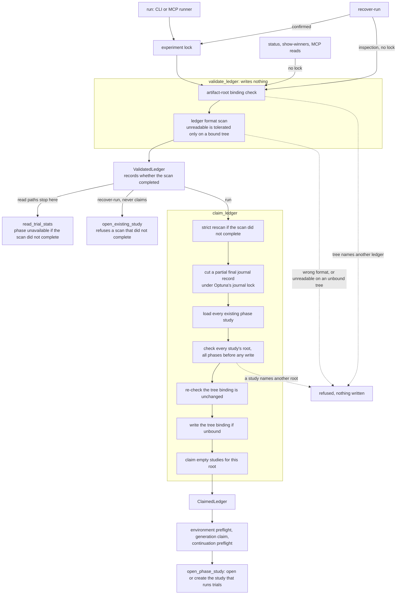

# Durability invariants

The experiment lock serializes local ledger mutations. Artifact-root and format checks precede claims, durable outcome records precede terminal trial states, and generation validation precedes the publication-pointer commit. No trial or detached-runner code runs before its process identity is durable, and operator recovery identifies processes from durable attempt and run records.

## Invariants

Module paths below drop the `phasesweep.` prefix; test paths are relative to the repository root.

### Lock and ledger order

Every path into the ledger passes through `engine.ledger`, and the handle each step returns is the proof the earlier steps ran. The diagram shows where each caller enters and where it must stop.

`engine.ledger` alone constructs Optuna storage. Read paths use validated snapshots; live study creation requires a claimed ledger. [Development](development.md#quality-gates) describes the contract checks.

#### 1. Mutations hold the experiment lock

A run, and a `recover-run` the operator confirms, hold the experiment lock before they read or write the artifact tree or the ledger. `sync-tracking` holds it too: it retires tracking attempts and writes the tracking tree, reading the ledger only through `validate_ledger` and `read_phase_trials`.

**Held by:** `engine.locking._experiment_lock`, entered as the outermost durable-state context in `engine.run._run_experiment_outcome`, in `mcp.recovery.recover_run` only when the operator confirms, and in `tracking.publication.sync_tracking` inside `runtime.shutdown.signal_handler_scope` for its whole body: tracking-only attempt resolution, record rebuilds, and deliveries\
**Test:** `tests/test_locking.py::test_run_experiment_holds_experiment_lock_for_duration`

#### 2. Validation writes nothing

`validate_ledger` checks the artifact-root binding, then scans the ledger format, and writes nothing; on a bound tree an unreadable scan is tolerated and recorded on the handle, and on an unbound tree it is refused.

Readers skip an incomplete final journal record without writing. Before opening storage for mutation, claims, registry recovery, and confirmed operator recovery repair that record under the experiment lock and Optuna's journal lock. Repair rescans after acquiring the journal lock, saves a permission-preserving timestamped backup, truncates only the incomplete tail, fsyncs, and replays the result. A malformed record before the tail is corruption and remains unchanged.

The journal lock has a 30-second acquisition deadline. Its holder refreshes the journal mtime every second to prevent Optuna's stale-lock takeover during repair and checks ownership before truncation and release. All callers resolve the journal's real path; journals with additional hard links are refused. Failure to acquire the lock or make the backup refuses with `RESTORE_LEDGER`. Growth under the lock or lost lock ownership refuses with `RETRY`, without truncation or removal of another process's lock.

**Held by:** `engine.ledger.validate_ledger`, running `engine.artifact_roots._check_artifact_root_binding` before `engine.ledger._scan_ledger_format` and returning a `ValidatedLedger` whose `format_verified` and `format_scan_failure` record the outcome; `engine.ledger._journal_records` for the tolerated line and `engine.ledger._repair_incomplete_journal_record` for the repair, called by `claim_ledger`, `open_registry_study`, and confirmed recovery\
**Tests:** `tests/test_format_cutover.py::test_validate_ledger_on_a_fresh_root_creates_nothing`, `tests/test_format_cutover.py::test_unverified_handle_records_the_gap_and_opens_nothing_live`, `tests/test_ledger_read_paths.py::test_read_path_never_constructs_file_backed_storage_or_writes_bytes`, `tests/test_engine_read.py::test_journal_partial_final_record_reads_as_optuna_does_and_is_repaired_before_writes`, `tests/test_engine_read.py::test_journal_malformed_record_before_its_end_never_means_absent`, `tests/test_format_cutover.py::test_writers_repair_a_partial_final_journal_record`, `tests/test_format_cutover.py::test_repair_leaves_an_append_that_finished_while_it_awaited_the_lock`, `tests/test_format_cutover.py::test_repair_waits_for_a_journal_lock_another_writer_holds`, `tests/test_format_cutover.py::test_repair_refuses_a_journal_lock_that_is_never_released`, `tests/test_format_cutover.py::test_journal_writers_and_repair_lock_the_journals_real_path`, `tests/test_format_cutover.py::test_repair_through_a_symlink_alias_is_excluded_by_the_real_names_writer`, `tests/test_format_cutover.py::test_repair_truncates_only_while_holding_the_journal_lock`, `tests/test_format_cutover.py::test_journal_lock_appears_only_after_the_journal_changes`, `tests/test_format_cutover.py::test_repair_never_truncates_under_or_releases_a_lock_another_process_took_over`, `tests/test_format_cutover.py::test_waiting_optuna_writer_never_takes_over_a_long_repairs_journal_lock`, `tests/test_format_cutover.py::test_repair_backup_is_no_more_permissive_than_the_journal`, `tests/test_format_cutover.py::test_repair_refuses_a_journal_with_another_hard_linked_name`, `tests/test_format_cutover.py::test_repair_refuses_a_journal_that_grew_under_its_lock`, `tests/test_format_cutover.py::test_repair_that_cannot_write_beside_the_journal_leaves_it_unchanged`

The scan may treat a missing journal file as an absent ledger only because config load already refused every other storage form: `storage` other than `null`, `auto`, or a `journal:///` URL is refused at config load (`config.models.Experiment._storage_is_local`, tested by `tests/test_storage_urls.py::test_non_journal_storage_is_refused_at_config_load`).

#### 3. Only a claimed ledger runs trials

Only a `ClaimedLedger` can open a study that runs new trials, and `claim_ledger` rescans strictly before it trusts a scan that did not complete.

**Held by:** `engine.ledger.claim_ledger` returning `ClaimedLedger`; `engine.ledger.open_phase_study`, which raises `TypeError` for any other handle; `engine.ledger.open_preview_study`, which is in-memory and serves dry runs\
**Tests:** `tests/test_format_cutover.py::test_live_openers_reject_unvalidated_storage`, `tests/test_format_cutover.py::test_claim_ledger_binds_tree_then_returns_bound_handle`, `tests/test_format_cutover.py::test_claim_rescans_an_unverified_ledger_before_discovery`, `tests/test_ledger_contract.py::test_storage_constructors_are_called_only_in_the_ledger_module`

#### 4. Both ownership directions agree before any write

The tree binding must name this ledger and every existing phase study must name this root, checked for all phases before anything is written.

**Held by:** `engine.artifact_roots._check_artifact_root_binding` in `validate_ledger`, then `engine.artifact_roots._artifact_root_claim_needed` for every loaded study and a re-check of the binding in `claim_ledger`\
**Tests:** `tests/test_fingerprint.py::test_second_workdir_is_rejected_and_leaves_the_bound_root_untouched`, `tests/test_fingerprint.py::test_refused_multi_phase_binding_claims_nothing`

#### 5. The tree is bound before any study

`claim_ledger` writes the tree binding before it claims any study, so a crash between the two cannot leave a study naming a tree that does not name its ledger. Its first write, before the binding, creates the ledger's parent directory, so a ledger path that cannot hold a file fails while the tree is still unbound and the path can be corrected.

**Held by:** `engine.ledger.claim_ledger`, creating the ledger's parent directory, then calling `engine.artifact_roots._write_artifact_root_binding` before its `_claim_study_artifact_root` loop\
**Tests:** `tests/test_format_cutover.py::test_claim_ledger_writes_tree_binding_before_claiming_studies`, `tests/test_format_cutover.py::test_claim_ledger_creates_ledger_parent_but_validate_does_not`, `tests/test_format_cutover.py::test_unwritable_ledger_directory_fails_before_the_tree_is_bound`

#### 6. Read paths construct and write nothing

`read_status`, `read_result`, `read_trial_tables`, CLI `status` (with or without `--trials`) and `show-winners`, the MCP result snapshot, and `run --dry-run` build no file-backed storage, write no bytes, and report a phase whose format scan did not complete as unavailable rather than counting its trials. A dry run reads every phase's study from one capture of the journal and applies the launch's own claim and preflight checks to those read-only snapshots, in the launch's order, so it makes most of the refusals a launch makes and replays as a launch would; [runtime behavior](runtime.md#inspection-commands) lists the ones it leaves out. It renders its example command on an in-memory study with no storage. A ledger it cannot read is previewed as fresh, with a warning.

**Held by:** `engine.ledger.validate_ledger` and `engine.ledger.read_trial_stats` or `engine.ledger.read_phase_trials`, under `engine.read.read_status`, `engine.read.read_result`, `engine.read.read_trial_tables` (and so CLI `status --trials`), and `mcp.snapshots.capture_result_snapshot`; `engine.ledger.read_phase_studies`, under `engine.preview._preview_ledger` for a dry run\
**Tests:** `tests/test_ledger_read_paths.py::test_read_path_never_constructs_file_backed_storage_or_writes_bytes`, `tests/test_format_cutover.py::test_inconclusive_scan_on_a_bound_tree_never_reports_unchecked_counts`, `tests/test_dry_run_recorded_trials.py::test_unreadable_trial_data_previews_a_fresh_phase_and_says_so`, `tests/test_dry_run_recorded_trials.py::test_dry_run_reads_the_journal_once_however_many_phases_there_are`

#### 7. Recovery validates before it opens

Recovery validates the binding and the format before it opens any study, never claims, refuses a study bound to another artifact root before it reaps anything, and refuses an unsupported ledger or an incomplete scan with the bytes unchanged. A confirmed recovery holds the experiment lock and is about to write, so it repairs a journal whose last line is partial, as a run's claim does; inspection reads past that line as Optuna does and writes nothing.

**Held by:** `mcp.recovery._load_recovery_studies`, through `engine.ledger.validate_ledger`, then, when confirmed, `engine.ledger.repair_incomplete_journal_record`, and then `engine.ledger.open_existing_study`, which refuses a handle whose scan did not complete, with `engine.artifact_roots._check_study_artifact_root` on every opened study\
**Tests:** `tests/test_ledger_read_paths.py::test_recovery_inspect_never_writes_to_a_golden_ledger`, `tests/test_format_cutover.py::test_unverified_handle_records_the_gap_and_opens_nothing_live`, `tests/test_stale_reaper.py::test_recovery_refuses_a_study_bound_to_another_artifact_root`, `tests/test_format_cutover.py::test_writers_repair_a_partial_final_journal_record`

### Attempts and trial outcomes

#### 8. Attempts are registered before launch

The attempt registry is scanned before anything else in the continuation preflight, and each attempt is durably registered before its trainer is launched. Each entry records the producing phase and study names and an absolute storage locator, so the registry still resolves the attempt after a phase rename, a storage-URL change, or a change of working directory.

**Held by:** `engine.attempts._preflight_active_attempts`, run first by `engine.guards._preflight_existing_studies`; then `engine.attempts._register_active_attempt`, called in `engine.phase` before the GPU lease and the launch, which freezes the locator from `runtime.files.storage_recovery_locator` into the entry\
**Tests:** `tests/test_stale_reaper.py::test_unpersistable_attempt_refuses_to_launch_its_trainer`, `tests/test_stale_reaper.py::test_renamed_phase_cannot_hide_stale_trainer_from_recovery`, `tests/test_stale_reaper.py::test_storage_change_cannot_hide_stale_attempt_from_recovery`, `tests/test_stale_reaper.py::test_relative_registry_storage_recovers_from_the_registration_cwd`

#### 9. Nothing runs before its process identity is durable

Trainer code and its environment execute only after the process identity is durable. The standalone stdlib supervisor starts by file path under `python -I -S` with only `PATH`. Command, environment, and cwd cross its pipe after `process_identity.json` is written; EOF before acknowledgement exits without launching the trainer.

The MCP runner starts under `-P -s` in the private server state directory, with Python startup-path overrides removed and user-site imports disabled. It receives the project path as `--cwd`, entering it only after its spawned handle is persisted and the launch handshake completes.

**Held by:** `runtime.process._spawn_blocked_supervisor`, `runtime.process._sanitized_supervisor_env`, and `runtime.process._supervisor_script_path`; `runtime.process.run_supervised`, which writes the identity with `runtime.process._write_process_identity` before `runtime.process._encode_launch_payload` crosses the pipe; `runtime.supervisor._read_launch_payload` and `runtime.supervisor._run_trainer`, which exits 75 on EOF without `exec`; `mcp.tools.PhaseSweepMCP._spawn` with `mcp.tools._runner_env`, `mcp.tools._PRE_IMPORT_CODE_ENV_VARS`, and `mcp.tools.PhaseSweepMCP._neutral_spawn_cwd`; `mcp.runner.main`, which enters the project directory only after `mcp.runner._persist_spawned_handle` and `mcp.runner._complete_launch_handshake`\
**Tests:** `tests/test_trial_launch.py::test_supervisor_imports_only_its_stdlib_allowlist`, `tests/test_process_supervision.py::test_spawn_blocked_supervisor_launch_argv_and_env`, `tests/test_process_supervision.py::test_supervisor_never_imports_poisoned_modules_from_pythonpath`, `tests/test_process_supervision.py::test_hard_parent_death_before_identity_commit_never_starts_trainer`, `tests/test_mcp_launch.py::test_launch_hardens_runner_interpreter_flags_and_environment`, `tests/test_mcp_launch.py::test_launch_spawns_runner_in_neutral_dir_and_passes_project_cwd`, `tests/test_mcp_launch.py::test_spawned_runner_cannot_execute_project_local_code`, `tests/test_mcp_runner.py::test_runner_enters_the_project_directory_after_its_identity_is_durable`, `tests/test_mcp_runner.py::test_runner_persists_identity_even_when_the_project_directory_is_gone`

#### 10. Lifecycle states that skip signalling are written only on proof

Recovery signals nothing for an attempt only on a durable lifecycle state that proves no process can remain, so each such state is written only once its proof exists; a state written early lets recovery skip a live process group. `allocated` is written before the attempt is registered, before its trial attributes make it discoverable, and before it waits for a GPU, so with no process identity beside it, it means no launch began. `launching` is written before `Popen`, so a spawned supervisor whose identity write failed never reads as `allocated`. The trial-directory attribute is set before `launch_trial`, so a `RUNNING` trial without it launched nothing. `exited` with confirmed cleanup is written only once the whole process group is proven gone, or when no supervisor was spawned at all, and `process_identity.json` stays beside it. Every other state falls through to identity validation and fails closed.

**Held by:** `engine.phase._execute_objective`, which writes `allocated` through `runtime.process.write_attempt_lifecycle` before `engine.attempts._register_active_attempt`, the trial attributes, and the GPU wait, and sets `engine.state.TRIAL_DIR_ATTR` before `engine.trial.launch_trial`; `runtime.process.run_supervised`, which writes `launching` before `runtime.process._spawn_blocked_supervisor` and calls `runtime.process._record_attempt_exited` only when cleanup is confirmed; read by `engine.attempts._attempt_process_resolution`, `engine.attempts._resolve_attempt`, and `engine.cleanup._reap_stale_trials`, which resolves no process for a trial without the trial-directory attribute\
**Tests:** `tests/test_trial_launch.py::test_trial_directory_and_allocated_lifecycle_precede_launch`, `tests/test_process_supervision.py::test_identity_write_failure_marks_launch_before_popen`, `tests/test_process_supervision.py::test_unexpected_status_read_failure_preserves_cleanup_evidence[deadline-cleanup-uncertain]`, `tests/test_process_supervision.py::test_run_supervised_preserves_identity_and_records_terminal_lifecycle[clean-exit]`, `tests/test_stale_reaper.py::test_prelaunch_allocated_attempt_recovers_without_identity`, `tests/test_stale_reaper.py::test_exited_attempt_recovers_without_signalling`

#### 11. Preflight finishes before the claims it guards

Environment preflight finishes before the generation claim, and the continuation preflight finishes before the generation is marked running or any attempt is registered.

**Held by:** `engine.run._run_experiment_outcome`, which calls `_preflight_missing_reached_phase_environments` before `engine.generation._claim_generation`, then `engine.guards._preflight_existing_studies`, `engine.evidence._validate_selection_evidence`, `engine.resume._reject_bound_descendant_topups`, `engine.resume._preflight_skipped_winners`, and `engine.resume._preflight_reached_fingerprint` before the running state\
**Tests:** `tests/test_runtime_behavior.py::test_existing_tree_preflights_missing_reached_phase_before_claim_or_topup`, `tests/test_trial_evidence.py::test_topup_refuses_a_candidate_whose_evidence_left_the_tree`

`claim_ledger` runs before environment preflight, and the generation claim runs before the continuation chain, so the chain guards the running state and the attempts, not either claim.

#### 12. A persistent study holds one environment cohort

A persistent study holds trials from one semantic trainer environment. The config fingerprint deliberately leaves ambient values out and relies on this check, so trials from two environments in one study would be ranked against each other as if they were comparable. The cohort covers the base variables, the `inherit_env` list names, the `env` entries and the W&B and MLflow variables PhaseSweep composes from config, without the `passthrough_env` names and the built-in `TMPDIR`; `inherit_env: all` covers the same names as `none` and inherits every other variable untracked, so shell state such as `SHLVL` cannot split a study. Each trial records that tracked environment in plain text, as a name-to-value mapping, and the environment digest is the SHA-256 of it. The digest is the first attribute written on each allocated trial, before the abort check and any lifecycle or registry write, and `_run_phase` also records it on the study as an allocation context before Optuna allocates, so a trial that dies between allocation and its first attribute still belongs to a known cohort. Before another trial is allocated into a populated study, both the continuation preflight and `_run_phase` refuse a study whose recorded digests differ from this invocation's, or that holds a trial whose digest is neither on the trial nor covered by an allocation context. The refusal shows each variable that differs with its old and new value, and each added or removed name with its value, from the mapping the latest trial of the other cohort recorded; a credential belongs in `passthrough_env`, which the mapping leaves out. Per-trial `PHASESWEEP_*` and GPU bindings are applied after the digest is taken, and `CUDA_VISIBLE_DEVICES` stays out of the base inherited environment, so neither splits a cohort.

**Held by:** `engine.trial._environment_identity`; `engine.study_policy._record_allocation_context`, called by `engine.phase._run_phase` before the optimize loop; `engine.phase._execute_objective`, which stamps `engine.state.TRAINER_ENV_DIGEST_ATTR` first and `engine.state.TRAINER_ENV_ATTR` beside it; `engine.study_policy._validate_environment_cohort`, called from `engine.guards._preflight_existing_studies` and `engine.phase._run_phase`; `config.models.BASE_INHERITED_ENV`; `engine.fingerprints._execution_identity`, which leaves ambient values out\
**Tests:** `tests/test_fingerprint.py::test_changed_semantic_inherited_value_rejects_topup_before_allocation`, `tests/test_runtime_behavior.py::test_parallel_abort_stamps_environment_before_stopping_a_queued_trial`, `tests/test_stale_reaper.py::test_allocation_context_covers_first_environment_write_failure`, `tests/test_fingerprint.py::test_identical_semantic_environment_resumes_persistent_study`, `tests/test_environment_cohort_refusal.py::test_inherit_all_does_not_split_the_cohort_on_an_untracked_ambient_variable`, `tests/test_environment_cohort_refusal.py::test_environment_mutation_names_each_difference[changed-timezone]`

#### 13. No terminal trial without its outcome record

No Optuna trial reaches a terminal state before its durable outcome record is written; a failed outcome write leaves the trial `RUNNING` for recovery. The failure reaches the operator once, as a retryable storage outage, after the optimize loop drains, whatever `n_jobs` is. Recovery writes the trial's outcome, `interrupted` unless its objective had recorded a failure or a fatal error, and the cleanup-recovery ledger before it commits `FAIL`.

**Held by:** `engine.phase._record_outcome`, which writes the outcome attribute before any terminal transition and raises `engine.phase._TrialOutcomeUnrecordedAbort` when it cannot; `engine.phase._objective`, whose first handler re-raises that abort untouched; `engine.phase._run_phase`, which converts it to `StudyStorageUnavailableError` once, after the optimize loop drains; `engine.attempts._fail_stale_running_trial`, which writes the outcome `engine.state._stale_recovery_outcome` chooses and the cleanup-recovery ledger before recovery commits `FAIL`\
**Tests:** `tests/test_runtime_behavior.py::test_persistent_outcome_write_failure_leaves_trial_running_until_recovery`, `tests/test_runtime_behavior.py::test_parallel_outcome_write_failure_surfaces_without_orphan_terminal_rows`, `tests/test_stale_reaper.py::test_reaper_reports_storage_failures_after_cleanup`, `tests/test_interrupted_trials.py::test_stale_recovery_records_interrupted_unless_the_objective_recorded_a_failure`

#### 14. An abort is recorded with the outcome that trips it

A phase abort is written in the same record as the outcome that trips it, and replay honors the first abort recorded after the recovery boundary. A later success resets the failure streak but never a recorded abort, and a changed `max_consecutive_failures` governs new work only, never recorded outcomes. An interrupted outcome, stale recovery's included, leaves the streak unchanged, so an interruption never trips an abort. Recovering from an abort accepts the raised `n_trials` in the same record that retires the abort, so an interrupted recovery keeps its authorization and the old target never runs it.

**Held by:** `engine.phase._record_outcome`, which writes the record `engine.phase._PhaseExecution.abort_decision` returns with the outcome; `engine.study_policy._next_consecutive_failures`, which moves the streak only for a failure, a fatal error or a success; `engine.study_policy._load_phase_policy_state`, which replays it; `engine.phase._judge_recorded_phase`, called by `engine.phase._resume_phase` and by the dry-run preview, which applies the current limit only before new work; `engine.study_policy._record_recovery_boundary`, whose record `engine.study_policy._accepted_trial_target` reads as an accepted target\
**Tests:** `tests/test_runtime_behavior.py::test_parallel_failure_threshold_uses_completion_order`, `tests/test_abort_recovery.py::test_changing_the_failure_limit_never_reinterprets_recorded_outcomes`, `tests/test_abort_recovery.py::test_interrupted_recovery_keeps_the_raised_target_authorization`, `tests/test_dry_run_recorded_trials.py::test_failure_limit_met_with_work_remaining_is_refused_as_a_run_refuses`, `tests/test_interrupted_trials.py::test_stale_recovery_records_interrupted_unless_the_objective_recorded_a_failure`, `tests/test_interrupted_trials.py::test_an_interruption_between_two_failures_leaves_the_streak_at_two`, `tests/test_interrupted_trials.py::test_a_trainer_that_fails_while_a_shutdown_is_serviced_is_interrupted_not_failed`

#### 15. An unreadable ledger means cleanup is uncertain

A ledger that cannot be read makes cleanup uncertain, never confirmed, and the attempt stays registered for a later retry. A journal's partial final record does not make it unreadable: the registry opener repairs it first, as invariant 2 ("Validation writes nothing") describes, and reads the attempt as it would on a healthy journal.

**Held by:** `engine.cleanup._reap_stale_trials`, which raises `ProcessCleanupUncertainError`; `engine.attempts._registry_attempt_fail_stale_trial`, which opens through `engine.ledger.open_registry_study` and retains the entry when storage is unreachable; `engine.guards._preflight_existing_studies`, which marks the cleanup report uncertain\
**Tests:** `tests/test_stale_reaper.py::test_registry_storage_failure_marks_cleanup_report_uncertain`, `tests/test_stale_reaper.py::test_registry_retains_attempt_when_journal_snapshot_is_unreadable`, `tests/test_stale_reaper.py::test_registry_reads_its_attempt_after_repairing_a_partial_journal_record`

#### 16. Unconfirmed cleanup stops new work until recovery proves it

A process group whose cleanup is not confirmed stops all further work until recovery proves it gone, because the leaked group may still hold its GPU and other resources. The trainer check runs while the trial still holds its GPU lease and records a phase-fatal abort before the lease is released, so no queued worker can launch onto the leaked group. `UnsafeProcessCleanupError`, raised for a trainer or for an evidence or tracking worker, is not a `TrialExecutionError` and is never in Optuna's `catch` tuple, so no such trial is committed as an ordinary failure while the phase continues. The trial's outcome records the `unsafe_process_cleanup` policy, and its attempt-registry entry outlives its terminal state. Only the study's cleanup-recovery ledger, written when the next run's preflight or a confirmed `recover-run` proves the group gone, retires the entry; raising `n_trials` does not. A stale-process cleanup that cannot confirm the group gone never advances state.

**Held by:** `engine.phase._execute_objective`, which checks cleanup inside `runtime.gpu.GpuPool.acquire` and calls `engine.phase._PhaseExecution.record_fatal`; `engine.phase._objective`, which records the `fatal` outcome with the `unsafe_process_cleanup` policy; `engine.phase._run_phase`, whose `catch` tuple holds only `TrialExecutionError`; `errors.UnsafeProcessCleanupError`; `engine.phase._settle_finished_trial`, which keeps the entry while `engine.attempts._trial_requires_cleanup_recovery` holds; `engine.cleanup._recover_cleanup_uncertain_trials` and `engine.attempts._record_cleanup_recovery`, which write `engine.state.CLEANUP_RECOVERED_TRIALS_ATTR`, called from `engine.guards._preflight_existing_studies` and `mcp.recovery._recover_trial_evidence`; `engine.attempts._resolve_attempt`, which raises when `runtime.reaper.cleanup_stale_trial_process` cannot confirm the group gone\
**Tests:** `tests/test_runtime_behavior.py::test_unsafe_cleanup_is_never_an_ordinary_trial_failure`, `tests/test_process_supervision.py::test_uncertain_cleanup_aborts_without_reusing_gpu_and_preserves_csv[parallel-fatal-slot-stops-queued-gpu-worker]`, `tests/test_runtime_behavior.py::test_unsafe_cleanup_blocks_topup_until_recovery`

#### 17. A GPU lease holds the card the trainer binds until its group exits

A GPU lease excludes the physical card the trainer actually uses for as long as any process in the trainer's group can run on it; otherwise two trainers share one card and neither measurement means what it claims. Host locks key on the card's canonical identity from the `nvidia-smi` inventory, so a numeric index and its UUID contend for one lock. A trainer handed numeric tokens always gets `CUDA_DEVICE_ORDER=PCI_BUS_ID`, overriding a configured value, because those indices were locked in PCI order and another order could bind a different card. The lease descriptors pass to the supervisor guardian, which stays outside the trainer's process group, keeps them until the whole group is gone, and closes them in the trainer child before `exec`, so the exclusion survives an orchestrator hard exit.

**Held by:** `runtime.gpu.GpuDevice.lock_identity`, `runtime.gpu.GpuDevice.lock_name`, and `runtime.gpu._bind_lock_identities`; `runtime.gpu.GpuPool.acquire`, which yields the lease descriptors; `engine.trial.launch_trial`, which forces `CUDA_DEVICE_ORDER` for numeric tokens and forwards the descriptors to `runtime.process.run_supervised`; `runtime.process._spawn_blocked_supervisor`, which passes them to the guardian; `runtime.supervisor.main` and `runtime.supervisor._close_trainer_fds`\
**Tests:** `tests/test_gpu_pool.py::test_numeric_index_and_uuid_token_lock_the_same_physical_gpu`, `tests/test_trial_launch.py::test_launch_trial_cuda_environment[numeric-forces-lock-compatible-order]`, `tests/test_trial_launch.py::test_launch_trial_forwards_gpu_lease_fds`, `tests/test_gpu_pool.py::test_gpu_lease_survives_orchestrator_hard_exit`

### Publication

#### 18. Publication is a transaction

The generation's own summary and winners are read back and validated before `last_successful_generation.yaml` commits, a failure before the commit leaves the prior pointer authoritative, and shutdown signals are absorbed until the commit lands. The pointer commits before its generation's lifecycle record, so it can be the only proof that generation committed; the record is written before the pointer moves off it, and if that write fails the pointer stays. Once the pointer commits, nothing after it reclassifies the publication: each post-commit step logs and swallows its own failure, `BaseException` included, and a directory fsync after the rename never raises.

**Held by:** `engine.generation._publish_generation`, running inside `runtime.shutdown.absorb_shutdown_signals`, with `engine.generation._validate_generation_publishable` and a required sidecar's `engine.run.PublicationHook.prepare` before the pointer write and `engine.generation._record_superseded_publication` before the pointer moves; `engine.generation._log_on_failure` around every post-commit step; `runtime.files.fsync_directory`\
**Tests:** `tests/test_publication_transaction.py::test_shutdown_signal_during_publication_is_absorbed_until_committed`, `tests/test_publication_transaction.py::test_next_publication_records_the_generation_whose_record_was_lost`, `tests/test_publication_transaction.py::test_unwritable_record_for_the_superseded_generation_keeps_the_prior_pointer`, `tests/test_publication_transaction.py::test_required_publication_sidecar_failure_prevents_pointer_commit`, `tests/test_publication_transaction.py::test_directory_fsync_failure_after_pointer_rename_still_publishes`, `tests/test_publication_transaction.py::test_control_flow_exception_from_postcommit_record_write_cannot_downgrade_success`

#### 19. A published result is read once

Validation reads each artifact in the represented generation once, refusing symlinks and paths outside the generations root, and returns what it read. Carried winners are embedded in that generation; older publication files are not required. Selection and resume verify trial evidence directly. `show-winners`, `read_status`, `read_result`, the MCP result snapshot and winner reads, and a `--from-phase` resume all show or build on those bytes; none reopens a published artifact by path. A generation that is not the validated publication, such as a pinned, unfinished, or failed one, is read from its files under the permissive read contract. A `--from-phase` resume, whether a run, a dry run, or an MCP launch, refuses a recorded publication that does not validate or cannot be read, with `PublicationIntegrityError` or `PublicationAccessError`; only a tree that never published reads as having no winner yet.

**Held by:** `engine.publication_validation._validate_generation_manifest`, returning the `ValidatedPublication` that `engine.publication.PublicationPointer.validated` carries, consumed by `engine.read._represented_winners`, `cli._show_experiment_winners`, and `engine.artifacts._load_winner`; `engine.resume._published_for_resume`, which turns an unusable verdict into a refusal for the run preflight, the dry run, and the MCP launch gate\
**Tests:** `tests/test_publication_transaction.py::test_published_reads_consume_the_bytes_validation_read`, `tests/test_publication_transaction.py::test_unusable_publication_is_refused_for_resume_never_read_as_absent`, `tests/test_mcp_launch.py::test_resume_refuses_an_unusable_publication_instead_of_reporting_no_winner`

#### 20. A result read describes one generation in its own terms

One status or result read describes one generation, labelled the way that generation recorded it; mixing two publications, or relabelling one with the current config, misreports historical numbers or hides a published winner. `read_status` resolves the last-success pointer once and takes every identity, winner, and summary fact from that resolution, capturing trial counts only afterwards, so a publication that lands mid-read is counted with its trials. A caller that reports status and winners read from the tree together uses `read_result`, never separate status and winner reads. A published result's metric name and goal, objective-evidence assurance, and phase plan come from the represented generation's own summary and winner files, never the current config. Winners are enumerated under `result_phase_plan`, so a renamed phase neither hides its winner nor reads as missing, and `result_context` and `published_config_matches_current` say which config supplied the labels. CLI `show-winners`, the MCP result snapshot, `get_run_results`, and tracking rebuilds keep both rules.

**Held by:** `engine.read._read_status`, which calls `engine.publication._resolve_publication_pointer` once and then `engine.ledger.read_trial_stats`; `engine.read.read_result` and `engine.read._winner_view`; `cli._show_experiment_winners`, which renders the validated generation's phase plan; `mcp.snapshots.capture_result_snapshot`; `mcp.tools.PhaseSweepMCP.winners` and `mcp.redaction.winners_payload`, which take their labels from the status payload; `tracking.publication._save_generation_intents`, which reads the phase graph from the generation's validated artifacts\
**Tests:** `tests/test_publication_transaction.py::test_read_status_single_captures_the_published_pointer`, `tests/test_engine_read.py::test_read_status_captures_trial_data_after_resolving_the_publication_pointer`, `tests/test_engine_read.py::test_published_result_is_not_reinterpreted_by_config_drift`, `tests/test_engine_read.py::test_published_result_keeps_its_own_phase_plan_after_a_rename`, `tests/test_mcp_read_tools.py::test_published_results_keep_their_own_metric_after_a_catalog_metric_edit`, `tests/test_mcp_read_tools.py::test_published_winner_survives_a_catalog_phase_rename`, `tests/test_cli.py::test_show_winners_renders_historical_annotations_on_config_drift`, `tests/test_mlflow_terminal_delivery.py::test_rebuilt_winner_references_keep_the_generation_graph`

#### 21. An unusable publication never reads as absent

Only a missing pointer file means nothing was published. A last-success pointer that exists but whose publication cannot be validated reads as `failed`, or `permission_denied` when a read is refused, and carries no validated publication. Every consumer that would act on "nothing published" refuses instead: a run's claim refuses before any write, `status` and `show-winners` report the verdict and exit non-zero, MCP reads expose no winners, a `--from-phase` resume refuses as invariant 19 ("A published result is read once") describes, and recovery refuses to reconcile a prepared publication. A caller told "nothing published" could re-run over the tree and advance the pointer past evidence that still needs operator attention.

**Held by:** `engine.publication._resolve_publication_pointer` and `engine.publication._unresolvable_pointer`; `engine.artifact_roots._check_published_phase_studies`, which refuses inside `engine.ledger.claim_ledger`; `engine.read._read_status`, which reports `publication_integrity` and no published facts; `cli._show_experiment_winners` and `engine.publication.raise_for_unusable_publication`; `mcp.tools.PhaseSweepMCP.winners`, which exposes no winners for `failed`, `permission_denied`, or `unknown`; `engine.resume._published_for_resume`; `mcp.recovery._publication_recovery_action`\
**Tests:** `tests/test_publication_transaction.py::test_corrupt_publication_is_reported_as_failed_not_absent`, `tests/test_publication_transaction.py::test_dangling_last_success_pointer_is_corrupt_and_blocks_rerun`, `tests/test_cli.py::test_status_and_show_winners_report_a_corrupt_publication_and_exit_nonzero`, `tests/test_mcp_read_tools.py::test_mcp_winners_hide_unusable_live_publications`

### MCP runs

#### 22. A PID alone is never authority

A process is identified by PID, start time, boot id, and PID namespace together, and a differing boot id settles a reboot without signalling anything. A namespace is its inode plus the start time of its PID 1, because the kernel reuses a freed namespace's inode within seconds. A PID recorded in another PID namespace names an unrelated process here, so it is never probed or signalled. Only the host's initial namespace can prove such processes gone, from the recorded PIDs and process groups at every nesting level; anywhere else, or when a process there cannot be ruled out, cleanup refuses with `ForeignPidNamespaceError`, which names any blocking host process and gives no manual `kill` advice. A stale attempt is signalled through one procedure, whichever source found it: the attempt registry, a stale `RUNNING` trial, or a terminal trial that recorded cleanup uncertainty.

**Held by:** `runtime.reaper.identity_from_earlier_boot`, `runtime.reaper.same_pid_namespace`, `runtime.reaper.recorded_process_blocker`, `mcp.runs.RunStore.runner_view`, `runtime.reaper.is_same_live_process`, `runtime.reaper.cleanup_stale_trial_process`, whose only caller is `engine.attempts._resolve_attempt`\
**Tests:** `tests/test_mcp_runs.py::test_state_reserves_recovery_on_pid_reuse_mismatch`, `tests/test_stale_reaper.py::test_cleanup_stale_trial_process_accepts_prior_boot_without_signalling`, `tests/test_pid_namespace.py::test_cleanup_stale_trial_process_refuses_foreign_namespace_without_signalling`, `tests/test_pid_namespace.py::test_a_reused_inode_with_another_pid_1_start_time_is_foreign`, `tests/test_pid_namespace.py::test_an_unreadable_candidate_blocks_only_for_its_exact_numbers`, `tests/test_attempt_resolution.py::test_only_resolve_attempt_signals_a_stale_process_group`

#### 23. A dead runner stays live until recovery decides

A dead runner with no terminal status stays in the live set until `recover-run` decides; liveness alone never concludes a run. The one exception is a runner from a boot that has ended: nothing from that boot survived, and a boot never comes back, so the run reads `failed` without a signal. Deriving state writes nothing, so a read tool never creates or removes a marker: the writers that must reserve cleanup (cancel, failed-spawn cleanup, `recover-run`) persist their own marker, and a marker that a later status or boot supersedes is read as inert. A runner recorded in a PID namespace the server cannot observe is neither alive nor dead: it stays live on durable evidence alone, is never reaped, probed, or signalled, and `cancel_run` and `recover-run` refuse it. When the host's initial namespace proves its processes gone, it reads as a dead runner that needs recovery, never as terminal, because that proof says nothing of its trials and a later reader may be unable to repeat it; only `recover-run` settles the run, and the status it writes outlives any later proof.

**Held by:** `mcp.runs.RunStore.observe` and `mcp.runs.RunStore.runner_view`, resolved only by `mcp.recovery.recover_run`\
**Tests:** `tests/test_mcp_runs.py::test_dead_runner_without_status_stays_live_until_recovery_evidence`, `tests/test_pid_namespace.py::test_foreign_namespace_runner_reads_running_and_writes_nothing`, `tests/test_pid_namespace.py::test_absent_runner_reads_as_a_dead_runner_that_needs_recovery`, `tests/test_pid_namespace.py::test_a_blocker_between_reads_never_reads_failed_and_never_unsettles_a_run`, `tests/test_pid_namespace.py::test_recover_run_settles_an_absent_runner_without_signalling`, `tests/test_pid_namespace.py::test_cancel_refuses_foreign_namespace_without_signalling_or_marker`

### Errors and fixtures

#### 24. Wraps keep the operator's remediation

Operator-facing errors carry a remediation action, preserved by wrapping. Aggregated refusals use their shared action, or `INSPECT_LOGS` when actions differ. CLI errors and MCP failure payloads render next steps from shared action phrases; exception strings retain the diagnostic. Unconfirmed cleanup also requires recovery. A recovery refusal directs the operator to a repair or confirmed recovery rather than repeating the same inspection.

**Held by:** `errors.OperatorAction`, `errors.PhaseSweepError.default_action` with the `action` each instance carries, `errors.PhaseSweepError.rewrap`, `errors.OPERATOR_STEPS`, `mcp.runner._cleanup_steps`\
**Tests:** `tests/test_error_routing.py::test_every_operator_error_declares_its_action`, `tests/test_error_routing.py::test_raise_sites_route_their_declared_action`, `tests/test_error_routing.py::test_runner_payload_follows_the_routed_steps`

#### 25. Refusals are tested against a real ledger

Refusals are tested against a ledger produced by the public API, and read paths run under a patch that records and raises on any file-backed storage construction.

**Held by:** `tests/fixtures/make_ledger_fixtures.py`, `tests/ledger_fixtures.py::forbid_file_backed_storage`\
**Tests:** `tests/test_ledger_read_paths.py::test_current_fixture_carries_this_release_format`, `tests/test_ledger_read_paths.py::test_required_ledger_fixtures_are_present`, `tests/test_ledger_read_paths.py::test_every_ledger_fixture_is_documented`

### Selection

#### 26. A confound verdict never joins a fingerprint or gets read as clean

The confound block is computed once per selection and frozen onto the winner; `n/a` means a check could not run and must never be rendered or counted as `ok`. In a repeats phase it ranks complete groups, lists them as `ranked_groups`, and the validator requires the winner's `repeats` members to be one of them. No downstream phase fingerprint depends on any block's content, so an observation can never invalidate a study or block a top-up, and a top-up that reselects the same trial for a larger ranked population publishes a fresh block rather than reusing the old one. A `--from-phase` resume carries the parent winner's block verbatim. The block's authoritative copy is the generation's `phases/<phase>/winner.yaml`, which the generation manifest covers: an edited verdict there fails `publication_integrity` like any other tampered artifact. The per-phase `winner.yaml` projection is never read back.

**Held by:** `engine.confound._assess_population`, `engine.confound._validate_check` refusing an `n/a` record without a `reason`, `engine.fingerprints._phase_fingerprint`, which never reads `engine.state.Winner.confound`, and `engine.publication_validation._validate_generation_manifest`, which calls `engine.confound._validate_confound_block`\
**Tests:** `tests/test_confound.py::test_verdicts_are_three_distinct_values_and_not_checked_is_never_ok`, `tests/test_confound.py::test_confound_block_never_moves_a_downstream_fingerprint`, `tests/test_confound.py::test_published_block_is_manifest_covered`, `tests/test_confound.py::test_top_up_reselection_publishes_a_fresh_block_for_its_larger_population`, `tests/test_confound.py::test_inheriting_phases_are_warned_and_from_phase_carries_the_block`, `tests/test_repeats.py::test_repeats_block_and_confound_groups_agree_on_the_winning_group`

#### 27. A repeat group is fixed once complete and its last member names it

A repeat group holds exactly one trial per repeat value: under grid its key is the trial's params without the repeat key, and under seeded random it is also the configuration slot, the trial's draw position divided by R and rounded down, so a later top-up can add groups but never a member to a complete one. An interrupted trial belongs to no group; its rerun has the same params and position, so it takes the trial's place, and a complete group has no interrupted member to rerun. The winner's scalar fields describe the group's highest-numbered member, so a winning group cites the generation that ran its last member; selection and resume verify every member's trial evidence directly.

**Held by:** `engine.repeats.group_key`, keyed by `engine.optuna._draw_positions`, `engine.repeats.ranked_group` naming the group by its last member, `engine.selection._rank_groups`, which skips interrupted trials, `engine.repeats._validate_repeats_block`, called by `engine.publication_validation._validate_generation_manifest`, and `engine.repeats.evidence_members`, iterated by `engine.evidence._verify_winner_objective_evidence` and `engine.evidence._verify_skipped_winner_evidence`\
**Tests:** `tests/test_timeouts.py::test_group_completed_after_partial_timeout_publishes_from_completing_generation`, `tests/test_selector.py::test_seeded_random_duplicate_configs_rank_as_separate_slots`, `tests/test_selector.py::test_repeats_tie_goes_to_lowest_group_and_highest_member_names_it`, `tests/test_selector.py::test_repeats_tie_goes_to_the_group_with_the_lowest_member_draw_position`, `tests/test_trial_evidence.py::test_group_winner_verifies_every_member_evidence`, `tests/test_repeats_runtime.py::test_carried_repeat_winner_reads_without_older_publication`, `tests/test_rerun_real_runs.py::test_seeded_random_repeats_rerun_a_chain_of_interruptions`

### Budget and reruns

#### 28. An interrupted trial never consumes the budget; its parameters rerun before any new draw

A trial is interrupted when its recorded outcome is `interrupted`: a shutdown signal, a phase or run deadline, a phase abort that stops it before its trainer launched, or stale recovery of a trial whose objective recorded neither a failure nor a fatal error. Every budget, progress, completion and status count reads that one predicate, so an interrupted trial never counts toward `n_trials`, and `remaining` includes the reruns a phase owes. The next run that reaches the phase, after the allocation context and before the optimize loop, adds one Optuna `WAITING` trial for each interrupted trial no trial names as its source, carrying the source's params, distributions and system attributes and naming the source in `phasesweep_rerun_of`, all in one creation record. Optuna's `ask` claims `WAITING` trials before it creates any, so reruns run first under any `n_jobs`. A rerun that is interrupted in turn gets its own rerun, and a source is never rescheduled. Once a shutdown handler names its signal no trainer starts, and under `n_jobs` above 1 the main thread waits for every worker to record its own trial before the run's reconciliation may reap one, so a trial a shutdown interrupts carries the signal as its cause.

**Held by:** `engine.state._trial_interrupted`, `engine.optuna._trial_count_state`, `engine.optuna._finished_trial_count`, `engine.study_policy._rerun_sources`, `engine.study_policy._record_reruns`, called by `engine.phase._run_phase`; `runtime.shutdown.servicing_shutdown_signal`, read by `engine.phase._refuse_launch_during_shutdown` and `runtime.process.run_supervised`; `engine.workers._await_worker_trials`\
**Tests:** `tests/test_interrupted_trials.py::test_an_interrupted_trial_is_counted_apart_and_never_toward_the_target`, `tests/test_interrupted_trials.py::test_each_interrupted_trial_gets_exactly_one_waiting_rerun_carrying_its_draw`, `tests/test_interrupted_trials.py::test_an_interrupted_rerun_gets_its_own_rerun_and_its_source_is_not_rescheduled`, `tests/test_interrupted_trials.py::test_a_stale_trial_reruns_its_own_draw_before_any_new_one`, `tests/test_rerun_real_runs.py::test_grid_reruns_points_interrupted_by_sigint_and_sigkill`, `tests/test_rerun_real_runs.py::test_fixed_configuration_killed_mid_trial_reruns_its_one_attempt`, `tests/test_rerun_real_runs.py::test_phase_deadline_interrupts_a_trial_that_reruns_once_the_phase_continues`, `tests/test_interrupted_trials.py::test_no_trainer_starts_while_a_shutdown_is_serviced`, `tests/test_interrupted_trials.py::test_a_shutdown_waits_for_parallel_workers_to_record_their_own_trials`, `tests/test_shutdown.py::test_a_launch_while_a_shutdown_is_serviced_starts_no_process`, `tests/test_gpu_pool.py::test_shutdown_wakes_a_lease_wait_blocked_on_a_busy_local_slot`

#### 29. A seeded phase draws by position, so an interruption never repeats or skips a draw

Every trial has a draw position: a trial that is not a rerun takes the number of non-rerun trials numbered below it, and a rerun takes its source's. A position never changes once its trial exists, and the non-rerun positions are exactly `0..M-1`, so the set of draws never depends on where or how often a phase was interrupted. Grid gives each position the point at that index of its seeded shuffle and never stops a study early; seeded random, TPE and CMA-ES seed every process-local random choice from the seed, the study name, the position and a label, and CMA-ES restores its optimizer from the newest generation. Grid and seeded random draw what an uninterrupted run would at any `n_jobs`; seeded TPE and CMA-ES do at `n_jobs: 1`, given the same trial values, and above it still never repeat a draw.

**Held by:** `engine.optuna._draw_positions`, `engine.optuna._position_seed`, `engine.optuna._PositionGridSampler`, `engine.optuna._PositionRandomSampler`, `engine.optuna._PositionTPESampler`, `engine.optuna._PositionCmaEsSampler`\
**Tests:** `tests/test_draw_positions.py::test_positions_count_new_draws_and_give_each_rerun_its_source_position`, `tests/test_draw_positions.py::test_grid_covers_every_point_once_across_interruptions`, `tests/test_draw_positions.py::test_seeded_random_draws_the_same_set_however_it_is_interrupted`, `tests/test_draw_positions.py::test_model_samplers_resume_exactly_as_an_uninterrupted_run`, `tests/test_draw_positions.py::test_model_samplers_top_up_exactly_as_one_larger_run`, `tests/test_draw_positions.py::test_model_samplers_resume_under_two_workers_drawing_by_position`, `tests/test_draw_positions.py::test_cmaes_restores_the_newest_generation_not_the_highest_numbered_snapshot`, `tests/test_rerun_real_runs.py::test_model_samplers_resume_real_runs_exactly`, `tests/test_rerun_real_runs.py::test_model_samplers_top_up_real_runs_exactly`

## Detached-run recovery rationale

A dead runner without terminal status may still have trials being reaped, so invariant 23 ("A dead runner stays live until recovery decides") keeps its capacity slot occupied until `recover-run` decides from durable evidence. Invariant 7 ("Recovery validates before it opens") governs that recovery's ledger access. Process identity includes the boot id because PID and `/proc` start time can both be reused after reboot, and the PID namespace because the same numbers name unrelated processes in another one; an unknown boot id or PID namespace on either side refuses to signal.

### Persisted spawned handle

A detached runner outlives its parent by design. If the server restarts with no handle on disk, it has no record of that runner, and a second `launch_run` spawns a duplicate sweep against the same ledger. The handle is created before `Popen`, replaced by the runner's own receipt once the runner has persisted its identity, and confirmed through a ready/ack handshake, so no child ever exists without a durable handle naming it. What the runner may execute before that handle exists, through its interpreter flags, environment, and working directory, is invariant 9 ("Nothing runs before its process identity is durable").

**Held by:** `mcp.tools.PhaseSweepMCP._spawn`, `mcp.tools.PhaseSweepMCP._terminate_failed_spawn`, and `mcp.tools.PhaseSweepMCP._pending_handle`; `mcp.runner._persist_spawned_handle` refuses to persist a runner receipt without a boot id or PID namespace.
