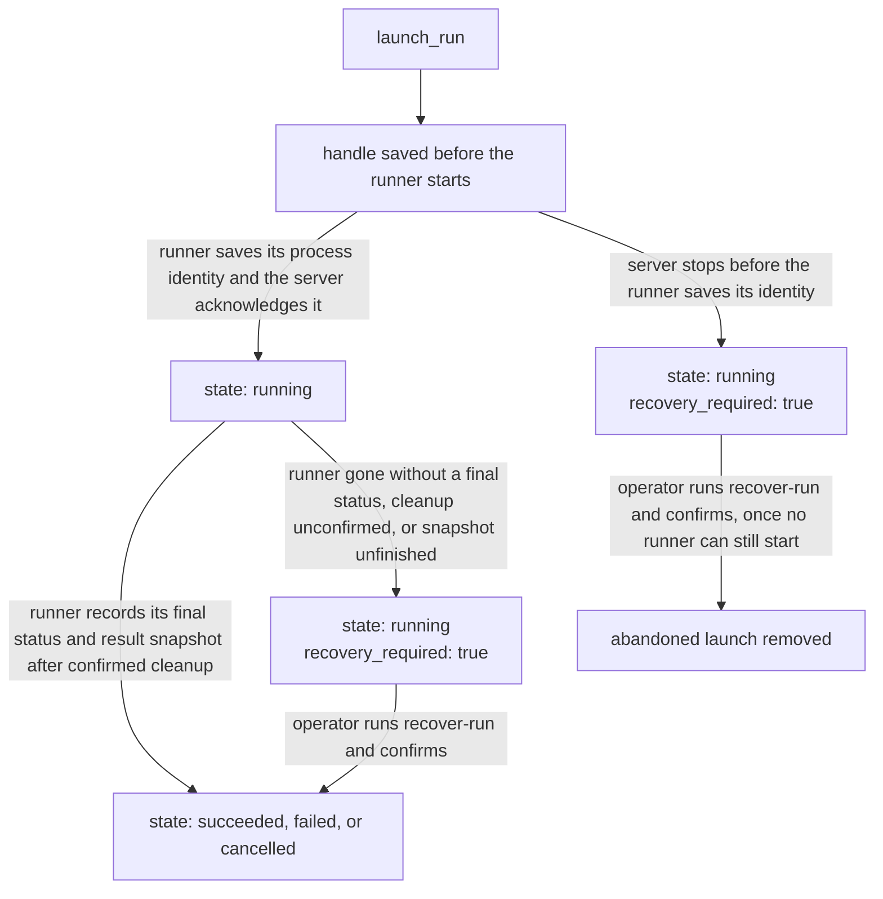

# MCP operator guide

The optional PhaseSweep MCP server exposes only experiments an operator has listed in a reviewed catalog. It launches detached local processes and stores durable run IDs, so a client disconnect or server restart does not end an approved run. PhaseSweep owns the server and catalog; each MCP client owns its own connection configuration and instructions. See [MCP setup](mcp_setup.md) for installation and client-owned configuration.

The server runs over local stdio and is supported on Linux. It needs readable `/proc` process start times and its own PID namespace to distinguish process reuse during cancellation and recovery.

## The catalog

The catalog maps opaque agent-visible IDs to operator-owned experiment YAML paths. Paths, commands, environments, storage URLs, and raw logs never appear in normal tool responses.

```yaml
state_dir: /absolute/path/to/phasesweep-mcp-state
max_concurrent_runs: 1
experiments:
  - id: tiny_lm
    config: /absolute/path/to/mcp_experiment.yaml
    cwd: /absolute/path/to/trainer-checkout
    description: Approved small local language-model sweep.
    allow:
      launch: false
      cancel: false
      from_phase: false
    visible_params: none
```

The catalog is a separate YAML configuration from the experiment. Both reject unknown fields and duplicate YAML keys. The server validates and freezes the catalog and referenced experiment configurations at startup. Restart the server after editing either; a changed experiment file is refused by launch until it is reloaded. An already detached run keeps its submitted configuration snapshot.

These are all accepted catalog fields. Entry paths expand `~`; relative `state_dir`, `experiments[].config` and `experiments[].cwd` paths resolve against the directory containing the catalog, independently of the server's launch directory.

| Key | Type and default | Behavior |
|---|---|---|
| `state_dir` | Path; required | Private durable handles, logs, audit entries and frozen snapshots. Startup and a successful `mcp check` provision and probe the directory; see the fresh-state rules below. |
| `max_concurrent_runs` | Integer ≥ 1; `1` | Maximum live sweeps across the shared `state_dir`, including other servers using that state. This does not set a phase's trial parallelism or assign GPUs. |
| `experiments` | Nonempty list of objects; required | Every entry must load successfully for server startup. Each engine output/study namespace must have one catalog entry; aliases are rejected. |
| `experiments[].id` | String; required | Unique case-sensitive agent-visible identifier matching `[A-Za-z0-9_-]+`, such as `tiny_lm`. It need not equal the experiment YAML's `experiment` name. |
| `experiments[].config` | Path; required | Existing experiment YAML file, kept operator-only. Its configuration must satisfy the detached-run storage/path rules below. |
| `experiments[].cwd` | Path or `null`; `null` | Existing detached-run working directory. Unset/null uses the resolved experiment file's parent directory. It also supplies the trainer's working directory when experiment `execution.cwd` is unset; an explicit `execution.cwd` takes precedence for the trainer, and a relative one resolves against the experiment file's directory, not this `cwd`. |
| `experiments[].description` | String, at most 500 characters; `""` | Purpose shown to the agent during catalog discovery; paths and secrets do not belong here. |
| `experiments[].allow` | Object; `{}` | Permission block with all child permissions false by default; omitting it leaves the entry read-only. |
| `experiments[].allow.launch` | Boolean; `false` | Permit detached launches for this entry; concurrency and experiment-busy checks still apply. |
| `experiments[].allow.cancel` | Boolean; `false` | Permit cancellation of this entry's active runs. Grant only the authority intended for the client. |
| `experiments[].allow.from_phase` | Boolean; `false` | Permit a launch with `from_phase`; also requires `allow.launch` and compatible earlier phase winners. It does not waive resume checks. |
| `experiments[].visible_params` | `none`, `all`, or list of strings; `none` | Control sampled winner parameter values returned to agents. An allowlist uses exact parameter names; surrounding whitespace is stripped, duplicate names removed and blank names rejected. Keep `none` unless exposing values is intended. |

MCP experiments must use a persistent local journal or `auto` ledger; in-memory and external-database storage are not durable detached-run targets. Relative `workdir`, journal and `execution.cwd` paths resolve against the experiment file's directory, as they do for the CLI, so the server, the detached runner and a CLI operator address the same artifact tree. Each run records that directory at launch and resolves its configuration snapshot against it.

Follow [MCP setup](mcp_setup.md) to create, review, and validate a catalog. To run the stdio server directly:

```bash
phasesweep mcp serve --catalog /absolute/path/to/catalog.yaml
```

## Fresh MCP state

`state_dir` is private, owner-only state for handles, logs, audit entries, and frozen terminal snapshots. A new path or an empty private directory can be initialized with the current format marker. The server refuses existing durable run data without that marker, or a malformed or unsupported marker, before changing the directory. There is no migration, adoption, or repair path for a refused directory: point `state_dir` at a fresh path instead.

## Tool workflow

Catalog operations use an experiment ID:

1. `list_experiments` discovers the reviewed catalog, using its cursor until there are no more pages.
2. `inspect_experiment(experiment_id)` returns an approved experiment's phase shape, metric descriptor, and permissions. It never launches work.
3. After explicit user authorization, `launch_run(experiment_id, from_phase?)` starts the detached run and returns its durable `run_id`.
4. `get_latest_run(experiment_id)` is the reconnection lookup when a client lost a run ID. It returns the newest handle for that catalog experiment, or `found: false` when no matching run exists.

Run lifecycle reads use a run ID only:

```text
get_run_status(run_id)
await_run(run_id, timeout_seconds)
get_run_results(run_id)
cancel_run(run_id)
```

Save the `run_id` returned by launch. To reconnect from another chat or after a client restart, call `get_latest_run(experiment_id)`, then use that returned `run.run_id` for status and results. Launch returns a top-level `run_id`, while reconnection nests it under `run`:

```json
{
  "experiment_id": "tiny_lm",
  "found": true,
  "run": {
    "run_id": "tiny_lm-0123456789abcdef0123456789abcdef",
    "state": "running",
    "started_at": "2026-01-01T00:00:00Z",
    "recovery_required": false,
    "runner_observable": true,
    "failure": null
  }
}
```

If it returns `found: false`, `run` is null and there is no run to resume. `await_run` is bounded server-side waiting; use it for monitoring rather than tight status polling. Never cancel a run or launch a replacement automatically.

`get_run_results` is run-specific. A plain `phasesweep run` can publish winners, but it does not create an MCP run record. Its results remain inspectable through `phasesweep status` and `phasesweep show-winners`; the server does not create handles for an arbitrary existing output tree.

## Reading status responses

Run status and results are path-free, strict structured payloads. They expose the run state, phase counts, winner presence, metric semantics, and only the sampled winner parameters allowed by `visible_params`. Composed fixed and inherited overrides are not returned.

For a terminal run, results come from the terminal snapshot captured for that run, not from a later mutable study. This keeps a run's observed outcome stable after another launch, a catalog edit, or a new publication. A terminal snapshot that is absent or unreadable remains unavailable; it is not reconstructed from the current ledger. Availability fields may be unknown when an observation was not possible and must not be treated as available.

Read provenance and labels together:

| Field | Interpretation |
| --- | --- |
| `represented_generation_id` | Generation whose winners and completeness the response describes; null when no generation can be represented. |
| `winner_generation` | Per-winner enum: `current_generation` was selected in the represented generation; `prior_generation` was carried from an earlier one; `unknown` means no represented generation is available for comparison. It is not a generation ID. |
| `result_context` | `represented_generation` uses that generation's recorded metric name, goal, and phase plan; `current_config` uses the loaded configuration when no recorded semantics are available. |
| `published_config_matches_current` | Whether the producing configuration matches the current catalog configuration. `false` means the historical labels may differ from the next run's; null does not establish a match. |

`get_run_results` measures `missing_phases` and `all_phases_have_winners` against the represented generation's plan. Report that context with the winners rather than relabeling historical results using an edited catalog. The config-match comparison is refreshed on terminal reads; the scientific facts stay frozen.

`publication_integrity` reports the publication validation recorded in the response. Terminal responses preserve snapshot-time validation and do not revalidate the current publication tree:

| Value | Meaning |
| --- | --- |
| `ok` | The publication passed validation for this view. |
| `absent` | No publication was recorded in this view. |
| `failed` | A recorded publication failed validation; it needs operator inspection. |
| `permission_denied` | The server process could not read the publishing tree for validation. |
| `unknown` | The run's terminal snapshot cannot establish an answer. |

For `failed`, `permission_denied`, and `unknown`, stop automated follow-up and report the condition.

Every winner carries frozen, advisory [confound verdicts](runtime.md#confound-verdicts). `flagged` lists checks whose verdict is `heterogeneous`; report each with its counts before relying on the winner or proposing a run whose phases inherit it. `evaluation_point` exposes `distinct_values` and `winner_value`; `tie` exposes `tied_trials`. `n/a` means a check could not run and must never be read as clean; `evaluation_point` is always `n/a` for `json` and `log_regex` objectives, which record no position, and all-false `objective_evidence` flags mean those identities are not enforced, not that they failed. Distinct `evaluation_point` positions are expected when the phase searches training length such as epochs or max steps. MCP exposes only enums and numbers from these checks; evidence strings such as the evaluation-axis config key stay private. The verdicts do not invalidate the result, and only the operator decides whether to re-run.

Also report a winner's `incomplete: true`: a wallclock timeout cut its phase short, so selection used a partial population. The confound checks do not cover this limitation.

`recovery_required: true` means cleanup, launch handoff, or snapshot finalization needs operator recovery. Agents should stop rather than guessing at process or result state; [run state and recovery](#run-state-and-recovery) shows where each case comes from.

`runner_observable: false` appears only while a run is `running` and its runner was recorded in another PID namespace than the server's. The server then cannot tell whether the runner is alive and cannot cancel it, so the run reads `running` from durable evidence alone. Agents keep monitoring, never call `cancel_run`, and tell the user if trial counts stop advancing; [PID namespaces](#pid-namespaces) explains the cause.

Winner results describe selected values, not convergence curves, robustness, causality, or unreturned trial history. Confound counts describe the population selection ranked, not the winner's robustness. Treat `<redacted>` values as deliberate catalog policy, not missing data.

The operator may configure MLflow, W&B, ordinary JSON, log, or envelope scoring. Frozen scientific result reads preserve the producing reader's assurance fields and need no tracking SDK, credentials, or remote access. W&B reads an exact finished-summary key from its managed attempt ID. MLflow reads native metric history from the verified bound run in its configured experiment; `last`, `min`, `max`, or exact `step` selects the within-trial observation. Both record the selected history position, without asserting the envelope's evaluation metadata or input-content guarantees. The trainer owns evaluation and aggregation; `metric.goal` ranks the selected trial scalars. Log reduction defaults to `last` and is independent of the ranking goal. Operators preparing native logging should follow [MLflow run ownership and Transformers integration](mlflow.md#choose-run-ownership) and the [trainer environment preflight](config.md#source-checkout-preflight).

The assurance flags `expected_step_declared` and `expected_step_value_bound` describe JSON-envelope metadata checks only. They remain false for MLflow even when `select: step` requires an exact native metric-history step. That selector does not establish the envelope's split, checkpoint, or evaluation-policy guarantees.

For MLflow, `get_run_status` and `await_run` report the run's own current local upload counts in `tracking_delivery`, separately from the frozen scientific outcome; `get_run_results` never reads them. Pending delivery does not invalidate an accepted score or winner, and a later retry can change those counts without changing the run snapshot. The operator can retry saved projections with the [MLflow delivery command](mlflow.md#result-delivery-and-recovery). This is an operator action, not agent recovery or a replacement run. Missing or null delivery information does not establish successful delivery.

## Run state and recovery

Each run has a UUID-bearing handle under `state_dir/runs/`, plus private log, saved-config, terminal-status, and recovery sidecar files under `state_dir/logs/`. The control-process log is separate from trainer `stdout.log` and `stderr.log`, which are inside the operator-owned experiment workdir.

The server records a process identity and coordinates launch across servers sharing one state directory. It retains an uncertain-cleanup reservation when it cannot prove a detached process group has stopped. Cancellation uses the saved identity and can require confirmation of cleanup; a stale PID alone is never considered authority to signal another process.

A run's reported `state` and `recovery_required` follow that durable evidence. Within one host boot, a run moves like this:



In both `recovery_required` cases the run still counts as running, so it keeps its concurrency slot and blocks another launch of the same experiment until `recover-run` settles it. A host reboot is the exception for a runner that died without a final status: its recorded boot proves nothing from that boot survived, so the run reads as `failed` without any signal being sent.

Operator recovery is deliberately a CLI operation, not an agent tool:

```bash
phasesweep mcp recover-run --state-dir /absolute/path/to/phasesweep-mcp-state --run-id <run-id>
```

Without `--confirm`, the command only inspects the run and reports the actions it would take. Read that report, then repeat the command with `--confirm` to perform them.

> [!WARNING]
> Do not delete run-handle files individually: a run history consists of its handle and matching log/status/config sidecars. Archive that complete set only between campaigns after the run is terminal and no recovery is required.

### PID namespaces

A PID and its start time identify a process only inside one PID namespace, so each saved process identity also records the namespace its numbers belong to, and the server records its own when it launches a runner. This matters when a sandbox, container, or other isolation gives different MCP server processes different views of the same state directory.

A run whose runner was recorded in another namespace is neither alive nor dead from here. It stays `running`, holds its concurrency slot, and reports `runner_observable: false`; the server never waits on, probes, or signals the numbers it recorded, because they name unrelated processes in its own namespace. `cancel_run` refuses it with nothing signalled, and `recover-run` refuses it with a message naming both namespaces. Act from the namespace that launched the run instead.

From the host's initial PID namespace, a recorded namespace that has no process left settles like a reboot: nothing in it can still hold a resource, so the run reads as `failed` and recovery clears it without a signal. The server proves that by finding no process in the recorded namespace after scanning all of `/proc`, and any process it cannot inspect, including another user's when `/proc` is mounted with `hidepid`, or a sandboxed one that is not dumpable, counts as possibly still in it. On such a host the namespace cannot be proven empty, and recovery from the initial namespace refuses with the blocking process named.

## Security boundary

The server does not accept configuration YAML, paths, commands, storage URLs, environment values, search ranges, sampler settings, gates, or safety waivers as tool input. Only the operator-authored catalog maps an experiment ID to a config. A catalog permission is not a grant to alter its config.

No tool returns raw trainer logs, result files, commands, storage locations, or unredacted fixed/inherited values. Keep secrets, private paths, and data identifiers out of searchable categorical choices unless exposing them is an intentional catalog decision.

> [!NOTE]
> Training still runs with the authority of the operator-authored command; MCP restricts agent inputs and outputs, not the trainer process itself.

Clients that support resources can read `phasesweep://catalog` for the first catalog page. The packaged `phasesweep_run_and_monitor` prompt supplies the same run-safety guidance as [the installed agent instructions](../src/phasesweep/mcp/agent_prompt.md).
