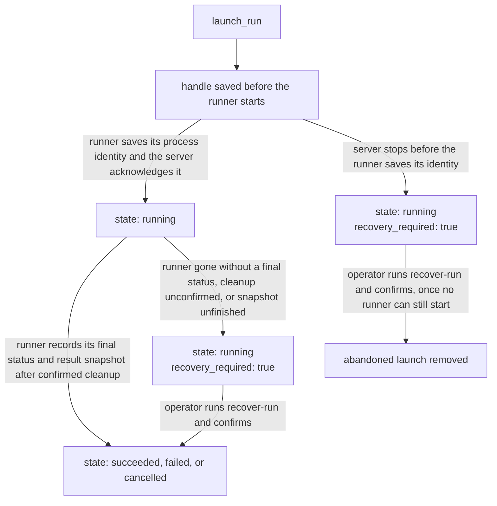

# MCP operator guide

The optional PhaseSweep MCP server exposes only experiments an operator has listed in a reviewed catalog. It launches detached local processes and stores durable run IDs, so a client disconnect or server restart does not end an approved run. PhaseSweep owns the server and catalog; each MCP client owns its own connection configuration and instructions. See [MCP setup](mcp_setup.md) for installation and client-owned configuration.

The server runs over local stdio and is supported on Linux. It needs readable `/proc` process start times and its own PID namespace, including the start time of that namespace's PID 1, to distinguish process reuse during cancellation and recovery. On a host whose `/proc` hides other users' processes (`hidepid`), exempt the operator through its `gid=` option, or the server and the trial launcher refuse to start.

## The catalog

The catalog maps opaque agent-visible IDs to operator-owned experiment YAML paths. Paths, commands, environments, storage URLs, and raw logs never appear in normal tool responses.

```yaml
state_dir: /absolute/path/to/phasesweep-mcp-state
max_concurrent_runs: 1
experiments:
  - id: tiny_lm
    config: /absolute/path/to/mcp_experiment.yaml
    cwd: /absolute/path/to/trainer-checkout
    description: Approved small local language-model sweep.
    allow:
      launch: false
      cancel: false
      from_phase: false
    visible_params: none
```

The catalog is a separate YAML configuration from the experiment. Both reject unknown fields and duplicate YAML keys. The server validates the catalog and the experiment configurations it lists at startup, and rereads them before the next tool call after either changes, so an added entry, a permission change or an edited experiment applies without a restart. A changed `state_dir` is the exception: the server keeps its runs in the state directory it started with, so it refuses launches until it is restarted. An edit that fails validation leaves reads on the last valid catalog and refuses launches until it is fixed; `phasesweep mcp check` shows why. The server's stderr log records each reload and each refused one. A detached run keeps the configuration snapshot it launched with.

These are all accepted catalog fields. Entry paths expand `~`; relative `state_dir`, `experiments[].config` and `experiments[].cwd` paths resolve against the directory containing the catalog, independently of the server's launch directory.

| Key | Type and default | Behavior |
|---|---|---|
| `state_dir` | Path; required | Private durable handles, logs, audit entries and frozen snapshots. Startup and a successful `mcp check` provision and probe the directory; see the fresh-state rules below. |
| `max_concurrent_runs` | Integer ≥ 1; `1` | Maximum live sweeps across the shared `state_dir`, including other servers using that state. This does not set a phase's trial parallelism or assign GPUs. |
| `experiments` | Nonempty list of objects; required | Every entry must load successfully for server startup or a reload. Each engine output/study namespace must have one catalog entry; aliases are rejected. |
| `experiments[].id` | String; required | Unique case-sensitive agent-visible identifier matching `[A-Za-z0-9_-]+`, such as `tiny_lm`. It need not equal the experiment YAML's `experiment` name. |
| `experiments[].config` | Path; required | Existing experiment YAML file, kept operator-only. Its configuration must satisfy the detached-run storage/path rules below. |
| `experiments[].cwd` | Path or `null`; `null` | Existing detached-run working directory. Unset/null uses the resolved experiment file's parent directory. It also supplies the trainer's working directory when experiment `execution.cwd` is unset; an explicit `execution.cwd` takes precedence for the trainer, and a relative one resolves against the experiment file's directory, not this `cwd`. |
| `experiments[].description` | String, at most 500 characters; `""` | Purpose shown to the agent during catalog discovery; paths and secrets do not belong here. |
| `experiments[].allow` | Object; `{}` | Permission block with all child permissions false by default; omitting it leaves the entry read-only. |
| `experiments[].allow.launch` | Boolean; `false` | Permit detached launches for this entry; concurrency and experiment-busy checks still apply. |
| `experiments[].allow.cancel` | Boolean; `false` | Permit cancellation of this entry's active runs. Grant only the authority intended for the client. |
| `experiments[].allow.from_phase` | Boolean; `false` | Permit a launch with `from_phase`; also requires `allow.launch` and compatible published winners for the earlier phases the remaining phases inherit. It does not waive resume checks. |
| `experiments[].visible_params` | `none`, `all`, or list of strings; `none` | Control sampled winner parameter values returned to agents. An allowlist uses exact parameter names; surrounding whitespace is stripped, duplicate names removed and blank names rejected. Keep `none` unless exposing values is intended. |

MCP experiments must use a persistent local journal or `auto` ledger; in-memory and external-database storage are not durable detached-run targets. Relative `workdir`, journal and `execution.cwd` paths resolve against the experiment file's directory, as they do for the CLI, so the server, the detached runner and a CLI operator address the same artifact tree. Each run records that directory at launch and resolves its configuration snapshot against it.

Follow [MCP setup](mcp_setup.md) to create, review, and validate a catalog. To run the stdio server directly:

```bash
phasesweep mcp serve --catalog /absolute/path/to/catalog.yaml
```

## Fresh MCP state

`state_dir` is private, owner-only state for handles, logs, audit entries, and frozen terminal snapshots. A new path or an empty private directory can be initialized with the current format marker. The server refuses existing durable run data without that marker, or a malformed or unsupported marker, before changing the directory. There is no migration, adoption, or repair path for a refused directory: point `state_dir` at a fresh path instead.

## Tool workflow

Catalog operations use an experiment ID, except `explain_config`:

1. `list_experiments` discovers the reviewed catalog, using its cursor until there are no more pages.
2. `inspect_experiment(experiment_id)` returns an approved experiment's phase shape, metric descriptor, and permissions. It never launches work.
3. After explicit user authorization, `launch_run(experiment_id, from_phase?)` starts the detached run and returns its durable `run_id`.
4. `get_latest_run(experiment_id)` is the reconnection lookup when a client lost a run ID. It returns the newest handle for that catalog experiment, or `found: false` when no matching run exists.
5. `explain_config(key?)` is for config-authoring help and needs no catalog entry. It returns the configuration reference for a key and every key below it, the same entries as `phasesweep explain` except that `phases` returns every entry below it where the CLI prints a compact index, or the top-level keys when `key` is omitted, together with the general notes of `phasesweep explain --notes` in `notes` (empty when a key was given). When `found` is false it lists the `closest` documented keys. It describes the schema, never an approved experiment's config, and returns no paths or values.

Run lifecycle reads use a run ID only:

```text
get_run_status(run_id)
await_run(run_id, timeout_seconds)
get_run_results(run_id)
cancel_run(run_id)
```

Save the `run_id` returned by launch. To reconnect from another chat or after a client restart, call `get_latest_run(experiment_id)`, then use that returned `run.run_id` for status and results. Launch returns a top-level `run_id`, while reconnection nests it under `run`:

```json
{
  "experiment_id": "tiny_lm",
  "found": true,
  "run": {
    "run_id": "tiny_lm-0123456789abcdef0123456789abcdef",
    "state": "running",
    "started_at": "2026-01-01T00:00:00Z",
    "recovery_required": false,
    "runner_observable": true,
    "failure": null
  }
}
```

If it returns `found: false`, `run` is null and there is no run to resume. Monitor with `await_run` rather than tight status polling: it defaults to a client-safe 20 seconds and accepts at most 600; request longer waits only when the client permits them. Repeat with the same `run_id` while running, including after `reason: phase_completed`; a phase winner is not terminal completion. Never cancel a run or launch a replacement automatically.

`get_run_results` is run-specific. A plain `phasesweep run` can publish winners, but it does not create an MCP run record. Its results remain inspectable through `phasesweep status` (add `--trials` for one row per trial) and `phasesweep show-winners`; the server does not create handles for an arbitrary existing output tree.

### Calling a tool from a shell

`phasesweep mcp call` runs one tool of a catalog in the calling process, without an MCP client, for scripting or debugging a tool call:

```bash
phasesweep mcp call list_experiments --catalog /absolute/path/to/catalog.yaml
phasesweep mcp call inspect_experiment --catalog /absolute/path/to/catalog.yaml '{"experiment_id": "tiny_lm"}'
```

The optional last argument is a JSON object of tool arguments and defaults to `{}`. The call goes through the server's own dispatch, so the strict input schema, redaction and [audit log](#audit-log) apply as for a connected client, except that its audit records read `transport: "cli"`, and the catalog's permissions are the only authority: `launch_run` here starts a real detached run. Exit code 0 prints the structured result as JSON on stdout. Exit code 1 prints the tool error on stderr, the same text a client receives in its `isError` result. Exit code 2 means an argument that is not a JSON object, a missing MCP extra, or a catalog that fails startup validation.

A `launch_run` call from a shell outside the host's initial PID namespace, such as a sandboxed agent shell, prints a warning: the runner belongs to that namespace and ends when it does, so launch a run that must last from a shell outside any sandbox (see [PID namespaces](#pid-namespaces)).

To wait on a run longer than one `await_run` call allows, repeat the call with the same `run_id` until the run stops running:

```bash
catalog=/absolute/path/to/catalog.yaml
run_id=tiny_lm-0123456789abcdef0123456789abcdef
while out=$(phasesweep mcp call await_run --catalog "$catalog" "{\"run_id\": \"$run_id\", \"timeout_seconds\": 600}"); do
  echo "$out" | jq -e '.run.state == "running" and (.run.recovery_required | not)' > /dev/null || break
done
echo "$out" | jq '.run'
```

The loop ends when the run reaches a terminal state, requires recovery, or a call fails; in the last case the error is already on stderr and `$out` is empty.

## Reading status responses

Run status and results are path-free, strict structured payloads. They expose the run state, phase counts, winner presence, metric semantics, and only the sampled winner parameters allowed by `visible_params`. Composed fixed and inherited overrides are not returned. When `trial_data_available` is false, `trials`, trial counters, `remaining_trials`, and `target_already_satisfied` are `null`; the configured `target_finished_trials` remains known. A confirmed empty study reports zero counts. `trials` counts each state under the same names as `phasesweep status`: `COMPLETE` is the trials that finished within every metric bound and constraint, and a trial that finished outside them counts as `INFEASIBLE`, which spends `n_trials` like `FAIL`. Those three states are the finished trials that `finished_trials_total`, `finished_trials_before_run` and `finished_trials_this_run` count. The counts include `INTERRUPTED`, trials a deadline, shutdown or orchestrator death cut short: they never count toward `n_trials`, and each [reruns](runtime.md#interrupted-trials-rerun) before any new draw, so `remaining_trials` includes those reruns. `attempts_this_run` counts every attempt the queried run's generation started, in any state, including any that a deadline, abort or shutdown stopped before their trainer launched; it is zero for a run that started none.

For a terminal run, results come from the terminal snapshot captured for that run, not from a later mutable study. This keeps a run's observed outcome stable after another launch, a catalog edit, or a new publication. A terminal snapshot that is absent or unreadable remains unavailable; it is not reconstructed from the current ledger. Availability fields may be unknown when an observation was not possible and must not be treated as available.

Read provenance and labels together:

| Field | Interpretation |
| --- | --- |
| `represented_generation_id` | Generation whose winners and completeness the response describes; null when no generation can be represented. |
| `run_wrote_generation` | Whether the queried run wrote its own generation; the `*_this_run` counts describe that generation and are zero when it wrote none. Null when the terminal snapshot is unavailable. |
| `winner_generation` | Per-winner enum: `represented_generation` was selected in the represented generation; `prior_generation` was carried from an earlier one; `unknown` means no represented generation is available for comparison. It is not a generation ID. |
| `result_context` | `represented_generation` uses that generation's recorded metric name, goal, and phase plan; `current_config` uses the loaded configuration when no recorded semantics are available. |
| `published_config_matches_current` | Whether the producing configuration matches the current catalog configuration. `false` means the historical labels may differ from the next run's; null does not establish a match. |

A run [writes a generation](runtime.md#timeouts-cleanup-and-continuation), named by its run ID, only when it launches a trial or publishes, and then represents that generation. A run that launches nothing because its winners equal the published ones writes no generation and succeeds: it represents the published generation that holds those winners, so `is_published` and `summary_present` are true, `run_wrote_generation` is false and its `*_this_run` counts are zero. A run refused before its first trial also writes no generation and represents none: `represented_generation_id` is null, and `is_published`, `summary_present` and `run_wrote_generation` are false.

A failed run's `failure.stage` follows the same claim. It is `preflight` while the run has not claimed its generation, so it launched no trial and wrote no generation, and `execution` once it has. A refusal such as a fingerprint mismatch, a lowered `n_trials`, a recorded abort, an unavailable tracking target, a busy experiment or an artifact-root conflict therefore reports `preflight`, in whichever phase it arises, unless an earlier phase of the same run already launched a trial. When process cleanup could not be confirmed, the failure's stage is `cleanup` and the original failure sits under `failure.cause` with its own stage.

A phase that ends without a trial inside every metric bound and constraint fails with one of three codes, read from its recorded trials. `trials_failed` means a trial counted `FAIL`, because its trainer exited nonzero, its objective could not be extracted, its metric was not finite or it failed a gate, or a failure streak that included one aborted the phase. `trials_infeasible` means the trainer ran but only `INFEASIBLE` trials kept the phase from a winner, either at the end of the phase or in the streak that aborted it. `replay_without_feasible_trial` means the phase's recorded trials already met `n_trials`, so the run launched no trial, and those trials hold no feasible one. A deadline that leaves no feasible trial reports `timeout` instead.

`get_run_results` measures `missing_phases` and `all_phases_have_winners` against the represented generation's plan. Report that context with the winners rather than relabeling historical results using an edited catalog. The config-match comparison is refreshed on terminal reads; the scientific facts stay frozen.

`publication_integrity` reports the publication validation recorded in the response. Terminal responses preserve snapshot-time validation and do not revalidate the current publication tree:

| Value | Meaning |
| --- | --- |
| `ok` | The publication passed validation for this view. |
| `absent` | No publication was recorded in this view. |
| `failed` | A recorded publication failed validation; it needs operator inspection. |
| `permission_denied` | The server process could not read the publishing tree for validation. |
| `unknown` | The run's terminal snapshot cannot establish an answer. |

For `failed`, `permission_denied`, and `unknown`, stop automated follow-up and report the condition.

Every winner carries frozen, advisory [confound verdicts](runtime.md#confound-verdicts). Report each `flagged` check with its counts before relying on the winner or proposing phases that inherit it. `evaluation_point` exposes `distinct_values` and `winner_value`; `survivorship` includes `incomplete_group`; `tie` exposes `tied_trials` and `within_noise`, counting groups in a repeats phase. Noise overlap is a heuristic, not a significance test. `n/a` means unchecked, never clean. Distinct evaluation positions are expected when searching training length; a `json_envelope` metric with `evaluation_axis: schedule_fraction` compares relative schedule completion instead and still flags a run that stopped early ([training-length comparison](config.md#training-length-comparison)). MCP returns only enums and numbers; evidence strings stay private. Only the operator decides whether to re-run. Also report `incomplete: true`: a wallclock timeout left a partial population, which the checks do not cover.

`observed` contains [report-only measurements](config.md#objective-evidence-constraints-and-gates), never reasons a winner won. With non-null `repeats`, `metric` is the group's reduced value: report it with `sd`, `min`, `max`, and `n`. The [repeat-group contract](runtime.md#repeat-groups) explains aggregation; MCP returns the reducer, spread and `member_trials`, but never the repeat key or values.

`recovery_required: true` means cleanup, launch handoff, or snapshot finalization needs operator recovery, or that a runner in another PID namespace stopped refreshing its [heartbeat](#pid-namespaces). Agents should stop rather than guessing at process or result state; [run state and recovery](#run-state-and-recovery) shows where each case comes from.

`runner_observable: false` appears only while a run is `running`, its runner was recorded in another PID namespace than the server's, and the server cannot prove that runner gone. The server then cannot tell whether the runner is alive and cannot cancel it, so the run reads `running` from durable evidence alone. Agents keep monitoring, never call `cancel_run`, and tell the user if trial counts stop advancing. With `recovery_required: true` as well, the runner's heartbeat has gone stale or its cleanup is uncertain: the runner has probably stopped, and the operator should check it and recover from a host shell. [PID namespaces](#pid-namespaces) explains the cause and the heartbeat.

Winner results describe selected values, not convergence curves, robustness, causality, or unreturned trial history. Confound counts describe the population selection ranked, not the winner's robustness. Treat `<redacted>` values as deliberate catalog policy, not missing data.

Frozen scientific reads preserve the producing reader's assurance fields and need no tracking SDK, credentials, or remote access. Follow the [objective evidence contract](config.md#objective-evidence-constraints-and-gates) when interpreting them: all-false flags for JSON/log sources mean identities are not enforced, not failed, and their `evaluation_point` is always `n/a`. W&B and MLflow record selected history positions; only envelopes validate evaluation metadata. `expected_step_declared` and `expected_step_value_bound` remain false for native MLflow exact-step selection. Trainer evaluation and observation selection are distinct from `metric.goal`, which ranks trial scalars.

For MLflow, `get_run_status` and `await_run` report the run's own current local upload counts in `tracking_delivery`, separately from the frozen scientific outcome; `get_run_results` never reads them. Pending delivery does not invalidate an accepted score or winner, and a later retry can change those counts without changing the run snapshot. The operator can retry saved projections with the [MLflow delivery command](mlflow.md#result-delivery-and-recovery). This is an operator action, not agent recovery or a replacement run. Missing or null delivery information does not establish successful delivery.

## Run state and recovery

Each run has a UUID-bearing handle under `state_dir/runs/`, plus private log, saved-config, terminal-status, heartbeat, and recovery sidecars under `state_dir/logs/`. This control-process log is separate from trainer logs and the engine's `run.log` in the experiment workdir. Operators can [follow progress](runtime.md#following-a-run) or run `phasesweep status CONFIG --trials`; tools do not return raw logs, and agents need separate authorization to open them.

The server records a process identity and coordinates launch across servers sharing one state directory. It retains an uncertain-cleanup reservation when it cannot prove a detached process group has stopped. Cancellation uses the saved identity and can require confirmation of cleanup; a stale PID alone is never considered authority to signal another process.

A run's reported `state` and `recovery_required` follow that durable evidence. Within one host boot, a run moves like this:



In both `recovery_required` cases the run still counts as running, so it keeps its concurrency slot and blocks another launch of the same experiment until `recover-run` settles it. Busy and capacity refusals direct these blockers to operator recovery; healthy blockers can be monitored with `await_run`. When runner liveness cannot be verified across PID namespaces, the refusal explains that uncertainty: it directs the operator to recover from a host shell once the runner's heartbeat is stale, and otherwise to inspect from there if durable progress stops. A host reboot is the exception for a runner that died without a final status: its recorded boot proves nothing from that boot survived, so the run reads as `failed` without any signal being sent.

Operator recovery is deliberately a CLI operation, not an agent tool. Its counts distinguish stale RUNNING trials reaped from cleanup confirmations for trials that were already terminal, including attempts reconciled through the registry:

```bash
phasesweep mcp recover-run --state-dir /absolute/path/to/phasesweep-mcp-state --run-id <run-id>
```

Without `--confirm`, the command only inspects the run and reports the actions it would take. Read that report, then repeat the command with `--confirm` to perform them.

> [!WARNING]
> Do not delete run-handle files individually: a run history consists of its handle and every `logs/` sidecar named after its run ID, such as its log, status, config, and heartbeat. Archive that complete set only between campaigns after the run is terminal and no recovery is required.

### PID namespaces

Runners and trials belong to the PID namespace that launched them; when a sandbox's namespace ends, so do its processes. A reader in another namespace cannot use the recorded PIDs to establish liveness or signal them. The run stays `running`, holds its slot, and reports `runner_observable: false`; cancellation and recovery refuse when they cannot establish cleanup. While the launching sandbox runs, an operator can cancel or recover from inside it.

The runner refreshes a heartbeat file under `state_dir/logs/` every 15 seconds, from before its process identity is saved until its final status is written. A reader that cannot observe the runner, finds no final status, and sees that heartbeat missing or more than 120 seconds old reports `recovery_required: true`: the runner has probably stopped, so the agent stops monitoring and the operator should check it and recover from a host shell. The run still reads `running` and keeps its slot, because a stale heartbeat is not proof of death; no read writes, signals, or recovers anything on the strength of it, and a reader that can check the recorded process, from the runner's own namespace or by a host shell's proof that it is gone, relies on that check instead. A host suspend pauses refreshes, so after resuming from one longer than two minutes the flag can read true for up to 15 seconds while the runner is alive; a later read clears it.

After that sandbox ends, run `recover-run` from a host shell outside any sandbox. The host's initial namespace can prove the recorded runner and stale trials gone without signalling across namespaces. A read proving only the runner gone reports `recovery_required: true`; only recovery checks trial cleanup and settles the run. If a host process blocks that proof, recovery names it: inspect it with the supplied `ps` command and retry after it exits. See [process identity](invariants.md#22-a-pid-alone-is-never-authority) and [dead-runner reservations](invariants.md#23-a-dead-runner-stays-live-until-recovery-decides) for the matching rules.

## Security boundary

The server does not accept configuration YAML, paths, commands, storage URLs, environment values, search ranges, sampler settings, gates, or safety waivers as tool input. Only the operator-authored catalog maps an experiment ID to a config. A catalog permission is not a grant to alter its config.

No tool returns raw trainer logs, a failed trial's reason (which quotes the last line of its `stderr.log`), result files, commands, storage locations, or unredacted fixed/inherited values. Keep secrets, private paths, and data identifiers out of searchable categorical choices unless exposing them is an intentional catalog decision.

> [!NOTE]
> Training still runs with the authority of the operator-authored command; MCP restricts agent inputs and outputs, not the trainer process itself.

Clients that support resources can read `phasesweep://catalog` for the first catalog page. The packaged `phasesweep_run_and_monitor` prompt supplies the same run-safety guidance as [the installed agent instructions](../src/phasesweep/mcp/agent_prompt.md).

### Audit log

`launch_run` and `cancel_run`, refused or not, append one JSON line to `audit.jsonl` in `state_dir`. A record holds a timestamp, the tool, its outcome (`success` or `error`), the safe arguments and resolved identifiers, small state summaries before and after (live-run count, run state), and for an error its type and redacted message. It holds no paths, commands, environment values, logs or sampled parameters. `session_id` is one random ID per server or `phasesweep mcp call` process. `transport` records how the call arrived, with a matching `actor`: `stdio` and `local-stdio` for a connected client served by `phasesweep mcp serve` or `phasesweep-mcp`, `cli` and `local-cli` for `phasesweep mcp call`. Filter on `transport` to tell an operator's shell call from a client session.
