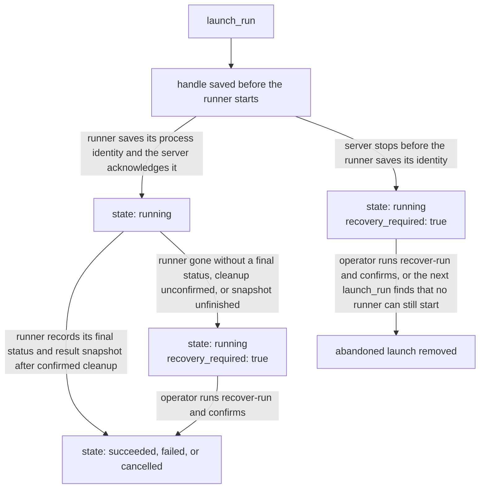

# MCP operator guide

The optional PhaseSweep MCP server exposes only experiments an operator has listed in a reviewed catalog. It launches detached local processes and stores durable run IDs, so a client disconnect or server restart does not end an approved run. See [MCP setup](mcp_setup.md) for installation and client-owned configuration, including [reaching the server over SSH](mcp_setup.md#over-ssh).

The server runs over local stdio on Linux and macOS. Cancellation and recovery use the trial launcher's [native process identity reads](runtime.md): exact process start time, boot identity and host PID namespace. Recovery uses that evidence to distinguish groups that are gone, safe to signal, or require operator inspection.

## The catalog

The catalog maps opaque agent-visible IDs to operator-owned experiment YAML paths.

```yaml
state_dir: /absolute/path/to/phasesweep-mcp-state
max_concurrent_runs: 1
experiments:
  - id: tiny_lm
    config: /absolute/path/to/mcp_experiment.yaml
    cwd: /absolute/path/to/trainer-checkout
    description: Approved small local language-model sweep.
    allow:
      launch: false
      cancel: false
      from_phase: false
    visible_params: none
```

The catalog and experiment YAML each reject unknown fields and duplicate keys. At startup the server validates both. If the catalog itself cannot be parsed or its `state_dir` is unusable, startup exits with code 2. If an individual experiment fails to load, the server prints its ID and remedy on stderr and serves the entries it could load. The failed ID still supports run reads, lookup and cancellation according to its catalog permissions. Inspection of that experiment and launches across the whole catalog are refused.

The server checks for edits before each tool call. A valid edit takes effect on that call. A detached run keeps its launch snapshot, subject to the cancellation and visibility rules below. An invalid edit leaves the last valid catalog available for reads and cancellation, blocks inspection of any entry whose config changed, and blocks all launches until the files validate. Run `phasesweep mcp check --catalog <catalog>` for the diagnostic. Changing `state_dir` requires a restart. Until then the server keeps the previous catalog and refuses launches.

Catalog-backed reads expose `catalog_status.stale`, `reload_refusal` (`invalid` or `state_dir_changed`) and a path-free `remediation` naming affected IDs. While stale, `list_experiments` reports `capabilities.launch: false` for every entry. A successful reload clears the flag. The server logs accepted and refused reloads on stderr.

These are all accepted catalog fields. Entry paths expand `~`; relative `state_dir`, `experiments[].config` and `experiments[].cwd` paths resolve against the directory containing the catalog, independently of the server's launch directory.

| Key | Type and default | Behavior |
|---|---|---|
| `state_dir` | Path; required | Private durable handles, logs, audit entries and frozen snapshots. Startup and a successful `mcp check` provision and probe the directory; see the fresh-state rules below. |
| `max_concurrent_runs` | Integer, at least 1; `1` | Maximum live sweeps across the shared `state_dir`, including other servers using that state. This does not set a phase's trial parallelism or assign GPUs. |
| `experiments` | Nonempty list of objects; required | Every entry must load for a reload to be accepted; at startup an entry that fails is skipped and launches stay refused, as described above. Each engine output/study namespace must have one catalog entry; aliases are rejected. |
| `experiments[].id` | String; required | Unique case-sensitive agent-visible identifier matching `[A-Za-z0-9_-]+`, such as `tiny_lm`. It need not equal the experiment YAML's `experiment` name. |
| `experiments[].config` | Path; required | Existing experiment YAML file, kept operator-only. Its configuration must satisfy the detached-run storage/path rules below. |
| `experiments[].cwd` | Path or `null`; `null` | Existing detached-run working directory. Unset/null uses the resolved experiment file's parent directory. It also supplies the trainer's working directory when experiment `execution.cwd` is unset. An explicit `execution.cwd` takes precedence for the trainer, with relative paths resolved against the experiment file's directory. An entry can still load and serve saved results after its separate `execution.cwd` disappears. If its detached-run directory disappears, the entry fails to load and the catalog becomes stale. Historical results remain readable by run ID with all parameters redacted for the failed entry. `mcp check` checks the trainer directory for launch-enabled entries, and a run requires it when it needs to start a trainer. |
| `experiments[].description` | String, at most 500 characters; `""` | Purpose shown to the agent during catalog discovery; paths and secrets do not belong here. |
| `experiments[].allow` | Object; `{}` | Permission block with all child permissions false by default; omitting it leaves the entry read-only. |
| `experiments[].allow.launch` | Boolean; `false` | Permit detached launches for this entry; concurrency and experiment-busy checks still apply. |
| `experiments[].allow.cancel` | Boolean; `false` | Permit cancellation of this entry's active runs. A run needs it both at launch and at cancellation: a later grant never reaches a run launched without it, a later revocation blocks it once the edited catalog loads, an id whose entry failed to load at server start keeps it only while every catalog entry with that id declares it, including one that loaded before its duplicate failed, and a run whose entry left the catalog keeps its launch-time value. The refusal of a running run names the operator's route instead: SIGTERM to the verified runner PID from a host shell, which the runner handles as cancellation, with the runner named as [every step names it](#pid-namespaces); once the runner has exited, as when a pending result snapshot keeps the run `running`, it names the run's `recover-run` step instead, since the recorded group may then lead another job's. |
| `experiments[].allow.from_phase` | Boolean; `false` | Permit a launch with `from_phase`; also requires `allow.launch` and compatible published winners for the earlier phases the remaining phases inherit. It does not waive resume checks. |
| `experiments[].visible_params` | `none`, `all`, or list of strings; `none` | Control sampled winner parameter values returned to agents. An allowlist uses exact parameter names; surrounding whitespace is stripped, duplicate names removed and blank names rejected. Keep `none` unless exposing values is intended. A run's results show a value only when both the policy at its launch and the current one allow it, and none once its entry leaves the catalog. |

MCP experiments need persistent storage, `auto` or a `journal:///` URL; the catalog rejects `storage: null`, whose in-memory study cannot be monitored or resumed across processes. Relative `workdir`, journal and `execution.cwd` paths resolve against the experiment file's directory, as they do for the CLI, so the server, the detached runner and a CLI operator address the same artifact tree. Each run records that directory at launch and resolves its configuration snapshot against it. The trainer's working directory is part of the study fingerprint, so a CLI run shares the MCP runs' study only when started from the entry's `cwd`, unless the experiment sets `execution.cwd`.

The detached runner is the server's own interpreter running PhaseSweep's runner script under `-P`, started in the server's private state directory, so no project-local code runs before it records its process identity. It inherits the environment of the launching process (the server as the MCP client started it, or the shell running `phasesweep mcp call`) without `PYTHONPATH`, `PYTHONHOME`, `PYTHONSTARTUP` and `PYTHONEXECUTABLE`, and keeps the server's user-site setting, adding `-s` when the server runs with the user site disabled (`-s` or `-I`), so it imports the PhaseSweep the server imported. The trainer's environment is composed from that under the [trainer contract](config.md#trainer-contract), so a trainer that needs `PYTHONPATH` gets it only from `env.PYTHONPATH`, and its programs resolve on the `PATH` the client starts the server with, unless the experiment's `env` sets `PATH`, which wins ([MCP setup](mcp_setup.md#3-configure-your-client)).

Follow [MCP setup](mcp_setup.md) to create, review, and validate a catalog and start the stdio server.

## Fresh MCP state

`state_dir` is private and owner-only. A new path or an empty private directory can be initialized with the current format marker. The server refuses existing durable run data without that marker, or with a marker that is unreadable or declares another format, before changing the directory. There is no migration, adoption, or repair path for a refused directory: point `state_dir` at a fresh path instead. The PhaseSweep version that wrote the refused directory still reads it.

## Tool workflow

When a user asks for PhaseSweep, call `get_guide` first. It returns the [agent instructions](../src/phasesweep/mcp/agent_prompt.md) as plain text. The packaged `phasesweep_run_and_monitor` prompt returns the same text.

Catalog operations use an experiment ID, except `explain_config`:

1. `list_experiments(limit?, cursor?)` discovers the reviewed catalog, 50 entries per page by default and at most 100; pass the returned `next_cursor` as `cursor` until it is null.
2. `inspect_experiment(experiment_id)` returns an approved experiment's phase shape, metric descriptor, and permissions. It never launches work.
3. After explicit user authorization, `launch_run(experiment_id, from_phase?)` starts the detached run and returns its durable `run_id`.
4. `get_latest_run(experiment_id)` is the reconnection lookup when a client lost a run ID. It returns the newest handle for that catalog experiment, or `found: false` with a null `run` when no matching run exists. Stop there if reconnecting. A missing handle does not authorize a replacement launch.
5. `explain_config(key?)` is for config-authoring help and needs no catalog entry. It returns the configuration reference for a key and every key below it, the same entries as `phasesweep explain` with the section rules and shared-block descriptions that govern them in `rules`, except that `phases` returns every entry below it where the CLI prints a compact index, or the top-level keys when `key` is omitted, together with the general notes of `phasesweep explain --notes` in `notes` (empty when a key was given). When `found` is false it lists the `closest` documented keys. It describes the schema, never an approved experiment's config, and returns no paths or values.

Run lifecycle reads use a run ID only:

```text
get_run_status(run_id)
await_run(run_id, timeout_seconds)
get_run_results(run_id)
cancel_run(run_id)
```

Launch returns a top-level `run_id`; `get_latest_run` nests it under `run`, and that `run.run_id` serves status and results after a reconnect:

```json
{
  "experiment_id": "tiny_lm",
  "catalog_status": {"stale": false, "reload_refusal": null, "remediation": null},
  "found": true,
  "run": {
    "run_id": "tiny_lm-0123456789abcdef0123456789abcdef",
    "state": "running",
    "started_at": "2026-01-01T00:00:00Z",
    "recovery_required": false,
    "runner_observable": true,
    "failure": null
  }
}
```

`await_run` defaults to a client-safe 20 seconds and accepts 5 to 600. Its response is the `get_run_status` payload plus `reason`, why the wait returned (`recovery_required`, `terminal`, `phase_completed` when a phase gained a winner, or `timeout`), and `changed`, true when the run state, recovery flag, trial counts or winner presence moved during the wait. Repeat it with the same `run_id` while running, including after `reason: phase_completed`; a phase winner is not terminal completion.

`cancel_run` sends SIGTERM to the runner's process group, waits up to 40 seconds, then sends SIGKILL. The wait covers a trial whose trainer had just exited: its helper processes get 10 seconds and leftovers a 10-second SIGTERM grace before the runner records its cancellation. A successful call returns the run's `state`, `cleanup_confirmed` (null when the run was already terminal) and `recovery_required`, with a `failure` naming the operator's step when `recovery_required` is true. Unconfirmed cleanup returns an MCP tool error with the same operator remedy as `get_run_status`. If cancellation cannot stop the runner, the saved remedy [names it](#pid-namespaces). If it is still running on the host, the operator must clear the cause there; a process in uninterruptible I/O ignores SIGKILL until the I/O ends. Then run `phasesweep mcp recover-run` from a host shell, review the preview, and repeat with `--confirm`. A run whose launch has not yet saved its process identity, or an unobservable runner with no recorded cleanup failure, is refused without signalling; see [PID namespaces](#pid-namespaces).

`get_run_results` is run-specific. A plain `phasesweep run` can publish winners, but it does not create an MCP run record. Its results remain inspectable through `phasesweep status` (add `--trials` for one row per trial) and `phasesweep show-winners`; the server does not create handles for an arbitrary existing output tree. Those CLI reads choose each phase's winner from the latest generation, falling back to its published winner when that generation has none, and label its source. MCP reads stay pinned to the requested run.

### Calling a tool from a shell

`phasesweep mcp call` runs one tool of a catalog in the calling process, without an MCP client, for scripting or debugging a tool call:

```bash
phasesweep mcp call list_experiments --catalog /absolute/path/to/catalog.yaml
phasesweep mcp call inspect_experiment --catalog /absolute/path/to/catalog.yaml '{"experiment_id": "tiny_lm"}'
```

The optional last argument is a JSON object of tool arguments and defaults to `{}`. The call goes through the server's own dispatch, so the strict input schema, redaction and [audit log](#audit-log) apply as for a connected client, except that its audit records read `transport: "cli"`, and the catalog's permissions are the only authority: `launch_run` here starts a real detached run. Exit code 0 prints the result on stdout: the structured result as JSON, or the text for `get_guide`. Exit code 1 prints the tool error on stderr, the same text a client receives in its `isError` result. Exit code 2 means a tool name `phasesweep mcp call --help` does not list, an argument that is not a JSON object, a missing MCP extra, or a catalog that cannot be loaded as a whole; an entry that fails alone is reported on stderr and the call runs against the entries that load, with `catalog_status.stale` true.

A `launch_run` call from a shell outside the host's initial PID namespace, such as a sandboxed agent shell, prints a warning: the runner belongs to that namespace and ends when it does, so launch a run that must last from a shell outside any sandbox (see [PID namespaces](#pid-namespaces)).

To wait on a run longer than one `await_run` call allows, repeat the call with the same `run_id` until the run stops running:

```bash
catalog=/absolute/path/to/catalog.yaml
run_id=tiny_lm-0123456789abcdef0123456789abcdef
while out=$(phasesweep mcp call await_run --catalog "$catalog" "{\"run_id\": \"$run_id\", \"timeout_seconds\": 600}"); do
  echo "$out" | jq -e '.run.state == "running" and (.run.recovery_required | not)' > /dev/null || break
done
echo "$out" | jq '.run'
```

The loop ends when the run reaches a terminal state, requires recovery, or a call fails; in the last case the error is already on stderr and `$out` is empty.

## Reading status responses

Run status and results expose the run state, phase counts, winner presence, metric semantics, and sampled winner parameters under the [visibility policy](#security-boundary). When `trial_data_available` is false, `trials`, trial counters, `remaining_trials`, and `target_already_satisfied` are `null`; the configured `target_finished_trials` remains known. A confirmed empty study reports zero counts. `trials` counts each state under the same names as [`phasesweep status`](runtime.md#inspection-commands). `COMPLETE`, `INFEASIBLE` and `FAIL` are the finished trials that `finished_trials_total`, `finished_trials_before_run` and `finished_trials_this_run` count. [`INTERRUPTED`](runtime.md#interrupted-trials-rerun) trials never count toward `n_trials`; each reruns before any new draw, `WAITING` counts those scheduled reruns, and `remaining_trials` includes them. `attempts_this_run` counts every attempt the queried run's generation started, in any state, including any that a deadline, abort or shutdown stopped before their trainer launched; it is zero for a run that started none.

For a terminal run, results come from the terminal snapshot captured for that run, not from a later mutable study. This keeps a run's observed outcome stable after another launch, a catalog edit, or a new publication. `catalog_status` describes the current catalog reload state separately from those frozen scientific facts. A terminal snapshot that is absent or unreadable remains unavailable; it is not reconstructed from the current ledger. Availability fields may be unknown when an observation was not possible and must not be treated as available.

Read provenance and labels together; the tool's output schema also describes every field:

| Field | Interpretation |
| --- | --- |
| `result_source` | `current_shared_study` for a live read of the shared study, `frozen_run_snapshot` for a terminal run's own snapshot, `terminal_snapshot_unavailable` for a stopped run without a readable snapshot, whose counts are then untrusted. |
| `current_generation_id`, `published_generation_id` | The current and last-success pointers at the live read or at snapshot capture; either can name another run's generation. |
| `represented_generation_id` | Generation whose winners and completeness the response describes; null when no generation can be represented. |
| `run_wrote_generation` | In status and results: whether the queried run wrote its own generation; the `*_this_run` counts describe that generation and are zero when it wrote none, and the winners of a run that wrote none are an earlier generation's. Null when the terminal snapshot is unavailable. |
| `winner_generation` | Per-winner enum comparing the source trial's generation: `represented_generation` belongs to the represented generation; `prior_generation` belongs to an earlier one; `unknown` means no represented generation is available for comparison. It is not a generation ID. |
| `winner_source` | The source kind, phase and trial number that supplied this winner. A carried winner does not establish that the requested run measured it again. |
| `result_context` | `represented_generation` uses that generation's recorded metric name, goal, and phase plan; `current_config` uses the loaded configuration when no recorded semantics are available. |
| `published_config_matches_current` | Whether the producing configuration matches the corresponding prefix of the current phase plan. Appended phases preserve agreement; changed producing phases or metric semantics do not. `false` marks historical labels; null does not establish a match. |

A run [writes a generation](runtime.md#timeouts-cleanup-and-continuation), named by its run ID, only when it launches a trial or publishes, and then represents that generation. A run that launches nothing because its winners equal the published ones writes no generation and succeeds: it represents the published generation that holds those winners, so `is_published` and `summary_present` are true, `run_wrote_generation` is false and its `*_this_run` counts are zero. A run refused before its first trial also writes no generation and represents none: `represented_generation_id` is null, and `is_published`, `summary_present` and `run_wrote_generation` are false.

A failed run's `failure.stage` follows the same claim. It is `preflight` while the run has not claimed its generation, so it launched no trial and wrote no generation, and `execution` once it has. A refusal such as a fingerprint mismatch, a lowered `n_trials`, a recorded abort, an unavailable tracking target, a busy experiment or an artifact-root conflict therefore reports `preflight`, in whichever phase it arises, unless an earlier phase of the same run already launched a trial. A finished trial whose tracker gave no answer about its evidence reports `tracking_unavailable`: at `execution` from the run that met the outage, and at `preflight` from each later run until the tracker answers; its training is kept either way. When process cleanup could not be confirmed, the failure's stage is `cleanup` and the original failure sits under `failure.cause` with its own stage.

A phase that ends without a trial inside every metric bound and constraint fails with one of three codes, read from its recorded trials. `trials_failed` means a trial counted `FAIL`, because its trainer exited nonzero, its objective could not be extracted, its metric was not finite or it failed a gate, or a failure streak that included one aborted the phase. `trials_infeasible` means the trainer ran but only `INFEASIBLE` trials kept the phase from a winner, either at the end of the phase or in the streak that aborted it. `replay_without_feasible_trial` means the phase's recorded trials already met `n_trials`, so the run launched no trial, and those trials hold no feasible one. A deadline that leaves no feasible trial reports `timeout` instead.

Besides `code`, `stage` and any `cause`, a `failure` carries `retryable`, the `actor` who must act (`agent` or `operator`) and a path-free `remediation`. For a recorded phase abort, report its applicable trial-target, failure-limit, search-space or cleanup steps; the same concrete advice appears in the CLI and engine `run.log`. The codes are `fingerprint_mismatch`, `artifact_root_conflict`, `study_schema_mismatch`, `storage_unavailable`, `tracking_unavailable`, `published_study_missing`, `trial_target_refused`, `launch_environment_invalid` (no trial could start: `execution.cwd` is not a directory, the trial command's program is not found, or the trainer environment cannot be composed; the `remediation` names the fix), `experiment_busy`, `trials_failed`, `trials_infeasible`, `replay_without_feasible_trial`, `timeout`, `cleanup_uncertain`, `cancelled`, `result_snapshot_unavailable` (set at read time for a stopped run without a readable snapshot), `publication_not_committed`, `publication_corrupt` and `publication_unreadable` (set at read time for a stopped run with no failure of its own when `publication_integrity` is `failed` or `permission_denied`) and `internal_error`.

`get_run_results` measures `missing_phases` and `all_phases_have_winners` against the represented generation's plan. The config-match comparison is refreshed on terminal reads; the scientific facts stay frozen.

`publication_integrity` reports the publication validation recorded in the response; `failed`, `permission_denied` and `unknown` withhold every winner. Terminal responses preserve snapshot-time validation and do not revalidate the current publication tree:

| Value | Meaning |
| --- | --- |
| `ok` | The publication passed validation for this view. |
| `absent` | No publication was recorded in this view. |
| `failed` | A recorded publication failed validation. A stopped run with no failure of its own reports `publication_corrupt`, which asks the operator to inspect and restore it; until then a new run of the experiment fails before its first trial. A run still running reports no failure for it. |
| `permission_denied` | The server process could not read the publishing tree for validation. A stopped run with no failure of its own reports `publication_unreadable`, which asks the operator to read it as the publishing user or restore read permission; until then a new run of the experiment fails before its first trial. A run still running reports no failure for it. |
| `unknown` | The run's terminal snapshot cannot establish an answer. The run reports `cleanup_uncertain` while its process cleanup requires recovery, and `result_snapshot_unavailable` otherwise, including for an unfinished snapshot that recovery completes. |

Every winner carries frozen, advisory [confound verdicts](runtime.md#confound-verdicts). `evaluation_point` exposes `axis`, `distinct_values`, `winner_value` and a `remedy` for the reader in use when positions differ. `survivorship` counts configurations as `ranked`, `infeasible`, `failed` and `untried`, and lists each failed one's latest attempt in `failed_trials`; `tie` exposes `tied_trials` and `within_noise`, counting groups in a repeats phase, the `pooled_sd` and `df` of the noise band the groups were compared against (null without repeats or with `reduce: median`), plus a `remedy` when it flags single trials, which carry no noise estimate. `tie_groups` lists the repeat configurations within that band with their representative trial, params, gap, `combined_se` (the pooled standard error of the difference between the two means) and `threshold` (the Student-t value at `df` times `combined_se`). Params follow `visible_params`; null means the retained trial details were unavailable at capture. The remaining trial evidence stays in the full winner record. `incomplete: true` means a wallclock timeout left a partial population, which the checks do not cover.

`observed` contains [report-only measurements](config.md#report-only-observations), never reasons a winner won. With non-null `repeats`, `metric` is the group's reduced value: report it with `sd`, `min`, `max`, and `n`. The [repeat-group contract](runtime.md#repeat-groups) explains aggregation; MCP returns the reducer, spread and `member_trials`, but never the repeat key or values.

With a configured [`cost_key`](config.md#repeats), a non-null `cost_advisory` identifies a cheaper complete feasible repeat group within one standard error of the winning mean, `pooled_sd / sqrt(n)` from the tie check's band. Parameter details appear only under `visible_params: all`; other policies return a generic advisory for operator inspection with `show-winners`. `cost_advisory_status` distinguishes an unset key (`not_configured`), missing or mismatched evidence (`unavailable`), a checked comparison with no cheaper qualifying group (`no_cheaper_configuration`), and an advisory (`available`). Terminal snapshots retain the advisory, status and overlapping group details captured for that run. Changing `cost_key` later can recompute advice through the CLI, but does not rewrite a terminal MCP snapshot.

`recovery_required: true` means cleanup, launch handoff, or snapshot finalization needs operator recovery, or that a runner in another PID namespace stopped refreshing its [heartbeat](#pid-namespaces). The response's `failure` then names the operator's step. [Run state and recovery](#run-state-and-recovery) shows where each case comes from.

`runner_observable: false` appears only while a run is `running`, its runner was recorded in another PID namespace than the server's, and the server cannot prove that runner gone; [PID namespaces](#pid-namespaces) explains the consequences and the heartbeat.

Frozen scientific reads need no tracking SDK, credentials, or remote access.

For MLflow, `get_run_status` and `await_run` report the run's current `tracking_delivery` counts separately from the frozen scientific outcome. `get_run_results` reads only the frozen result. Once a run with pending records has ended, `tracking_delivery.remedy` counts the pending records and unconfirmed run creations apart and names the operator's retry, `phasesweep sync-tracking CONFIG --generation RUN_ID` with the config the run launched with. The next launch with this config sends them too, right after its MLflow target check, before its first trial, when it has trials to run, and otherwise at its closeout. If MLflow refused a record, such as for a deleted run, that record stays pending until the cause given in its warning, in the engine's `run.log` in the experiment workdir when the run met it, or on the console of the operator's `recover-run` or retry, is fixed in MLflow. While the run is active it holds the experiment lock that retry needs. `tracking_delivery` is null when the run's launch config has no `mlflow` block or can no longer be read, so null does not establish delivery. See [result delivery and recovery](mlflow.md#result-delivery-and-recovery) for what counts as pending.

## Run state and recovery

Each run has a UUID-bearing handle under `state_dir/runs/`, plus private log, saved-config, terminal-status, heartbeat, and recovery sidecars under `state_dir/logs/`. This control-process log is separate from trainer logs and the engine's `run.log` in the experiment workdir. Operators can [follow progress](runtime.md#following-a-run) or run `phasesweep status CONFIG --trials` from the entry's `cwd`, with its `config` as CONFIG, since the trainer's directory is part of the study fingerprint; this table describes the current study. For historical winners read `get_run_results(run_id)`. Plain `phasesweep status CONFIG` reports the workdir and ledger path. Host-side trial tables and the ledger include values hidden by the catalog and require separate authorization for agent access. For trials launched by a particular run, filter the per-phase `trials.csv` in that workdir by `user_attr:phasesweep_generation_id` equal to its run ID.

The server records a process identity and coordinates launch across servers sharing one state directory. It retains an uncertain-cleanup reservation when it cannot prove a detached process group has stopped. Cancellation uses the saved identity and can require confirmation of cleanup; a stale PID alone is never considered authority to signal another process.

A run's reported `state` and `recovery_required` follow that durable evidence. Within one host boot, a run moves like this:



A run requiring recovery holds its concurrency slot and blocks another launch of the same experiment. Status and results return the operator's remedy in `failure`, with any underlying failure in `failure.cause`. A refused cancellation returns the same cleanup remedy and preserves the diagnosis for readers in other PID namespaces. Once cleanup is confirmed, reads retain the recorded failure and identify any missing results. For a runner-recorded `cleanup_uncertain` failure, reads report the settled cleanup with `recovery_required: false` once any snapshot recovery is finished. A successful run whose MLflow tracking worker has uncertain cleanup still exposes its published winners. Follow its remedy to sync tracking and confirm recovery.

If a runner never saved its identity, status points to `recover-run`, with which an operator can inspect or remove the abandoned preparation. The next permitted launch also removes it if the launch lease proves the runner can no longer start. Removing it preserves any runner log as `state_dir/logs/<run-id>.log.recovered`. If the runner exits while the server awaits its startup receipt, the launch call reports its exit code and records the run as failed. Read `state_dir/logs/<run-id>.log` for the runner's error. If the server imported PhaseSweep only through `PYTHONPATH`, install PhaseSweep for the server's interpreter so the runner can import it from its sanitized environment. Busy or capacity refusals name the blocking runs and their remedies. See [PID namespaces](#pid-namespaces) for an unobservable runner. After a host reboot, a runner from the earlier boot without a final status reads as failed.

Run recovery from an operator shell on the machine that holds the catalog. Confirmation reports the process groups terminated, trials settled, and each completed result kept by phase, trial and value. It reports how many trials remain pending if their tracker cannot answer. The next launch checks their evidence before training. If recovery already settled cleanup and the run has no immutable result snapshot, another `recover-run` reports that no further cleanup or result repair is available. Ctrl-C, SIGTERM or the SIGHUP of a dropped SSH session during a confirmed recovery stops the workers it started, prints `phasesweep: stopped. Rerun the same command to finish the recovery:` with the command on a line of its own, and exits 128 plus the signal number; the run stays reserved until that command finishes. See [interrupted trials](runtime.md#interrupted-trials-rerun).

With MLflow, recovery checks registered tracking workers before finalizing the snapshot and releasing the slot. If it cannot confirm worker cleanup while reading evidence, looking up a run or sending results, the command fails and leaves the run reserved for another pass, even when the runner wrote a status. After a reboot, the next launch checks the worker during preflight. Confirmation reports delivered and pending MLflow records. See [result delivery and recovery](mlflow.md#result-delivery-and-recovery) for how to send the remainder.

```bash
phasesweep mcp recover-run --state-dir /absolute/path/to/phasesweep-mcp-state --run-id <run-id>
```

Without `--confirm`, the command only inspects the run and reports the actions it would take. Each inspected trial process group is reported once, identified by its attempt, phase, trial, PID and PGID. The report says whether confirmation would terminate it if still alive, reconcile without signalling, or refuse cleanup. With persistent storage, waiting for an orphaned trainer to exit successfully lets recovery keep its result. The preview says so when confirmation would otherwise terminate it. It names a stored-PGID fallback when the original leader has exited or its PID was reused, and explicitly spares a group whose PGID has been reused by an unrelated leader. An earlier boot or host proof that foreign-namespace processes are absent requires no signal. Confirmation checks the process evidence again before acting. If the runner is still alive, the command refuses and names its PID and process group. Stop it with `cancel_run` if the run should end, or clear the cause on the host when cancellation could not stop it, then repeat the command.

> [!WARNING]
> Do not delete run-handle files individually: a run history consists of its handle and every `logs/` sidecar named after its run ID, such as its log, status, config, and heartbeat. Archive that complete set only between campaigns after the run is terminal and no recovery is required.

### PID namespaces

Runners and trials belong to the PID namespace that launched them; when a sandbox's namespace ends, so do its processes. A reader in another namespace cannot use the recorded PIDs to establish liveness or signal them. The run stays `running`, holds its slot, and reports `runner_observable: false`; cancellation and recovery refuse when they cannot establish cleanup. While the launching sandbox runs, an operator can cancel or recover from inside it. A step that names the runner to the operator gives its recorded PID and process group only when it is written in the host's initial namespace, where a host shell reads the same numbers; written in a container or sandbox it names the run id. Find the `runner.py --run-id <run-id>` command line in the host process list to identify the runner's PID.

The runner refreshes a heartbeat file under `state_dir/logs/` every 15 seconds, from before its process identity is saved until its final status is written. A reader that cannot observe the runner, finds no final status, and sees that heartbeat missing or more than 120 seconds old reports `recovery_required: true`: the runner has probably stopped, so the agent stops monitoring and the operator should check it and recover from a host shell. The run still reads `running` and keeps its slot, because a stale heartbeat is not proof of death; no read writes, signals, or recovers anything on the strength of it, and a reader that can check the recorded process, from the runner's own namespace or by a host shell's proof that it is gone, relies on that check instead. A host suspend pauses refreshes, so after resuming from one longer than two minutes the flag can read true for up to 15 seconds while the runner is alive; a later read clears it.

After that sandbox ends, run `recover-run` from a host shell outside any sandbox. The host's initial namespace can prove the recorded runner and stale trials gone without signalling across namespaces. A read proving only the runner gone reports `recovery_required: true`; only recovery checks trial cleanup and settles the run. If a host process blocks that proof, recovery names it: inspect it with the supplied `ps` command and retry after it exits. See [process identity](invariants.md#22-a-pid-alone-is-never-authority) and [dead-runner reservations](invariants.md#23-a-dead-runner-stays-live-until-recovery-decides) for the matching rules.

## Security boundary

Tools take catalog experiment IDs, run IDs and their documented control arguments; the operator-authored catalog maps experiments to configs.

No tool returns raw trainer logs, a failed trial's reason (which quotes the last line of its `stderr.log`), result files, commands, storage locations, or unredacted fixed/inherited values. Keep secrets, private paths, and data identifiers out of searchable categorical choices unless exposing them is an intentional catalog decision.

> [!NOTE]
> Training still runs with the authority of the operator-authored command; MCP restricts agent inputs and outputs, not the trainer process itself.

Clients that support resources can read `phasesweep://catalog` for the first catalog page.

### Audit log

Every `launch_run` and `cancel_run` call that passes the input schema, refused or not, appends one JSON line to `audit.jsonl` in `state_dir`. A record holds a timestamp, the tool, its outcome (`success` or `error`), the safe arguments and resolved identifiers, small state summaries before and after (live-run count, run state), and for an error its type and redacted message. It holds no paths, commands, environment values, logs or sampled parameters. `session_id` is one random ID per server or `phasesweep mcp call` process. `transport` records how the call arrived, with a matching `actor`: `stdio` and `local-stdio` for a connected client served by `phasesweep mcp serve` or `phasesweep-mcp`, `cli` and `local-cli` for `phasesweep mcp call`. Filter on `transport` to tell an operator's shell call from a client session.
