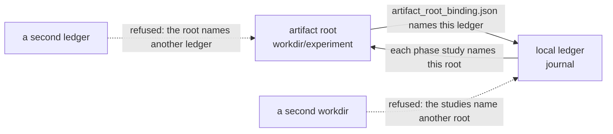

# Runtime behavior

PhaseSweep runs one ordered Experiment on a Linux or macOS host for a trusted researcher or team. It uses same-host file locks and process groups to serialize a persistent experiment and clean up trainer subprocesses. Every process identity records its boot, start time and PID namespace. Linux requires `/proc` to be the procfs of the orchestrator's own PID namespace, with that namespace's PID 1 readable; on hosts using `hidepid`, exempt the operator through its `gid=` option. macOS reads exact microsecond start times through native `libproc`, the boot UUID through `kern.bootsessionuuid`, and records the host PID space as `darwin`. Unreadable identities never authorize a stale-process signal. GPUs are optional; the core CLI can run CPU-only work.

## Output layout

For `workdir: ./runs` and `experiment: demo`, PhaseSweep writes under `runs/demo/` beside the config file:

```text
demo/
  .gitignore
  .ignore
  artifact_root_binding.json
  run.log
  study.journal                   # storage: auto
  generation.yaml
  last_successful_generation.yaml
  attempts/
  generations/
    <generation-id>/
      generation.yaml
      config.snapshot.yaml
      reproducibility.json
      summary.yaml
      phases/<phase>/winner.yaml
  <phase>/
    trials.csv
    trial_00000__<attempt-id>/  # {trial_dir} and PHASESWEEP_TRIAL_DIR, named by the attempt that opened it
      trainer_config.yaml       # yaml_file only
      overrides.json            # json_file only; nested trainer_config with overrides applied
      overrides_resolved.json
      result.json               # when produced by the trainer
    attempts/<attempt-id>/      # one per attempt: PhaseSweep's own records, never the trainer's
      attempt_lifecycle.json
      process_identity.json
      evidence_baseline.json    # resolved value paths, file freshness metadata, a rerun's launch time and the W&B destination the attempt launched with, recorded before the trainer starts
      command.txt
      stdout.log
      stderr.log
```

A trial directory holds what the trainer writes and the trial's input. Each attempt's own records sit beside it under `<phase>/attempts/<attempt-id>/`, so a trainer that clears its output directory cannot remove the process identity recovery depends on. `trials.csv` names both: the `attempt_dir` column and `user_attr:phasesweep_trial_dir`.

`last_successful_generation.yaml` points to the immutable generation that represents the latest successful result. Its `generation_id` locates `generations/<generation-id>/summary.yaml` and `generations/<generation-id>/phases/<phase>/winner.yaml`. The summary retains each winner's `observed`, `repeats` and `confound` blocks, plus the recorded top-level `trainer_config` under `override_format: argparse` ([trainer inputs](config.md#trainer-inputs)). Use the [inspection commands](#inspection-commands) to read published or unfinished results.

The root `generation.yaml` names the latest [generation](#timeouts-cleanup-and-continuation) and its `state`: `running`, `published`, `failed` or `publication_failed`. A failed invocation does not replace the last-success pointer. Each generation embeds its carried winners, so reading those records does not require the older generations they cite. Selection and resume verify retained trial evidence.

`trials.csv` is a snapshot of the phase's trials with sampled parameters and user attributes, including [`observe`](config.md#report-only-observations) readings as `user_attr:observed:<name>` and a rerun's source as `user_attr:phasesweep_rerun_of`. It uses the state labels of [`status --trials`](#inspection-commands), and a repeats phase adds `repeat_group` ([repeat groups](#repeat-groups)). Persistent sweeps refresh it periodically during training and at phase exit. Continuation preflight (including a replay) and confirmed [`recover-run`](mcp.md#run-state-and-recovery) refresh it from the addressed study after reconciling recorded trials, when the supplied phase matches the study's recorded semantics. This keeps a changed repeat configuration from relabeling recorded trials. With `storage: null`, PhaseSweep writes it at each trial's terminal callback. A winner's `completion` block records the counts checked against the publication. `finished_trials` counts `COMPLETE`, `INFEASIBLE` and `FAIL`. `measured_trials` counts `COMPLETE` and `INFEASIBLE`, the trials that measured their values, so no bound edit changes it.

`config.snapshot.yaml` is the executed configuration, including materialized defaults and the resolved invocation context. `reproducibility.json` is the shareable generation identity record. Its `code_revision` is the git commit of the trainer's working directory (`execution.cwd`, or the invocation directory when unset) and whether tracked files differ from it, or `null` outside a git work tree or when git fails. A resume never compares it and a changed commit is not refused; only the [`code_revision` confound check](#confound-verdicts) reads it, to say when ranked trials ran under different revisions. `show-winners` prints the publishing generation's as a `# publication code revision:` line, `unknown` for `null` and with `(dirty)` added when tracked files differed. A winner carried from an earlier generation was produced under that generation's revision, so its `# winner generation:` line adds the source generation's own revision in the same form, or `unreadable` when that generation's record is gone or invalid. [Continuation](#timeouts-cleanup-and-continuation) and winner validation use the retained trial and attempt records.

The generated `trainer_config.yaml` or `overrides.json` holds the trainer base with the effective overrides applied. For these file formats, `overrides_resolved.json` is an overrides-only audit record. For argparse and Hydra, it is the actual flattened input, merging the trainer base with effective overrides before command placeholders expand. Winner observations are empty when none were recorded; `repeats` is `null` outside a repeats phase.

MLflow stores each native attempt's run binding and creation intent under `tracking/<generation-id>/attempts/<attempt-id>/`. Its [delivery and recovery records](mlflow.md#result-delivery-and-recovery) live under `tracking/<generation-id>/delivery/` and `tracking/<generation-id>/cleanup-receipts/`.

W&B readers and MLflow workers remove their temporary directories after each operation. See [environment variables](#environment-variables) for the worker scratch location.

Nothing prunes the trial directories. A rerun of an interrupted or failed trial continues in its directory, and PhaseSweep never deletes what a trainer wrote, so disk use is roughly the finished trials times the per-trial output, plus the small per-attempt records under `attempts/`. The trainer [owns checkpoint selection](config.md#objective-evidence-constraints-and-gates), so have it bound its own checkpoints, for example by keeping only the last or the best. To free disk after a sweep, delete or move away the trial directories of trials that did not win: each keeps its recorded value and its rank, and `run`, its dry run and both `status` formats note the trials whose directory is gone. Keep each phase's winner's directory (`status --trials` names it), which a publication points at and every later run verifies; with it gone, every command refuses with its path until it is restored or the phase is renamed, which retrains that phase in a new study. Keep `attempts/`, which is small.

### Trust boundary

Logs, evidence, winners, resolved overrides and process identities use ordinary paths and permissions: new files follow umask, and replacements preserve existing modes. Process identity and lifecycle records use atomic replacement; lifecycle replacements have mode `0600`.

Private records inside the tree have these additional requirements:

| Path | Mode | PhaseSweep refuses to |
| --- | --- | --- |
| `generations/<generation-id>/config.snapshot.yaml` | `0600` | replace it unless the existing file is an owner-only regular file with no other hard links |
| `environment.json` in an attempt directory, written only when `execution.record_env` is set | `0600` | replace it under the same condition |
| `attempts/`, the attempt registry | `0700` directory of `0600` entries | read it through a symlink or with shared permissions |

The two files are owner-only while their directories keep ordinary permissions, so only the publishing user can fully validate a published tree: another user is refused as unable to read the publication, which is not corruption, until the publishing user re-reads it or read permission is restored. The same validated, no-follow path handling protects the runtime lock namespace and the MCP `state_dir`.

> [!WARNING]
> `config.snapshot.yaml` is private because it can contain command and environment values. PhaseSweep writes a `.gitignore` containing `*` and a `.ignore` that permits ripgrep searches, without replacing existing files. Keep generated outputs, ledgers, and MCP state out of commits yourself.

## Following a run

`phasesweep run` prints a report on stderr and leaves stdout empty. It opens with a banner naming the config, each phase's trial count, sampler, parallelism and GPU policy, the storage, tracker and workdir, and the absolute path of `run.log`, and it closes with a summary of each phase's trial counts and winner, the files the run wrote and the command that reads the result. In between, every phase start, trial, rerun, skipped phase and winner prints on a line of its own with the time, and so does each warning or error, wrapped to the terminal with every later line under the text after its `warning:` or `error:` label. The last line is `log: <path>`, printed after the summary, after a failure's `fix:` line and after an interrupt's resume hint whenever `run.log` exists. A path wider than the terminal, in the banner and here, breaks after a slash with the rest indented under it. The banner and the summary are printed on the console only.

`run.log` holds every progress line, warning, error and diagnostic message with its timestamp and logger name, including what the console leaves out, such as the trainer command of each trial and GPU and storage notes. Optuna logs only errors in both. `run --verbose` records PhaseSweep's debug messages and the traceback of a failure in `run.log` and leaves the console as it is.

`run --dry-run` prints no banner or summary, and shows every INFO line of PhaseSweep on the console, such as the GPU pool notes, as the time and the text. A line wider than the terminal wraps at spaces under its first, a path stays whole on a line of its own, and the indented example command is never wrapped, so it can be copied.

A shutdown signal prints one line naming it and what it stops, before the resume hint: `Interrupted (SIGINT): stopping 1 trial and waiting for it to exit.` while a trainer runs, or `Interrupted (SIGINT): no trial is running.` when it lands between trials, with any worker still running named after a semicolon, as in `Interrupted (SIGINT): no trial is running; stopping 1 MLflow request.`; the cleanup that follows is confirmed in `run.log` and warns on the console only when it is uncertain.

A failure-policy abort appears on the console once, as the error that ends the run (`phasesweep: Phase 'p' aborted: 3 consecutive failed/infeasible trials reached max_consecutive_failures=3. ...`) with its `fix:` line, after the trial line that triggered it. `run.log` also holds a `phase=p ABORTED: 3 consecutive failed/infeasible trials reached max_consecutive_failures=3.` line right after that trial's line. A failure the console already states in a trial's `reason:`, such as a missing objective file, is logged at INFO beside it and so stays out of the console.

On a 100-column terminal the starter prints:

```text
phasesweep run  phasesweep_starter

  config    starter.yaml
  phases    depth          2 trials  grid  1 at a time  gpu none
            learning_rate  2 trials  grid  1 at a time  gpu none
  storage   auto
  tracker   none
  workdir   runs/phasesweep_starter
  log       /home/you/project/runs/phasesweep_starter/run.log

13:14:45  depth          2 trials to run, 1 at a time
13:14:45  depth          trial 0  RUNNING  model.n_layers=8
13:14:46  depth          trial 0  COMPLETE  eval_loss 0.3  0.7s  1/2  model.n_layers=8
13:14:46  depth          trial 1  RUNNING  model.n_layers=6
13:14:47  depth          trial 1  COMPLETE  eval_loss 0.5  0.7s  2/2  model.n_layers=6
13:14:47  depth          winner: trial 0  eval_loss 0.3  model.n_layers=8
13:14:47  learning_rate  2 trials to run, 1 at a time
13:14:47  learning_rate  trial 0  RUNNING  optimizer.lr=0.0003
13:14:47  learning_rate  trial 0  COMPLETE  eval_loss 0.3  0.7s  1/2  optimizer.lr=0.0003
13:14:47  learning_rate  trial 1  RUNNING  optimizer.lr=0.0001
13:14:48  learning_rate  trial 1  COMPLETE  eval_loss 0.413822  0.7s  2/2  optimizer.lr=0.0001
13:14:48  learning_rate  winner: trial 0  eval_loss 0.3  optimizer.lr=0.0003

Finished in 3.0s: 2 phases, 4 trials, 0 from a previous run

  depth          2 complete
                 winner  trial 0  eval_loss 0.3  model.n_layers=8
                 runs/phasesweep_starter/depth/trial_00000__427a82a35fa741e9b821d63c678fb30e
  learning_rate  2 complete
                 winner  trial 0  eval_loss 0.3  optimizer.lr=0.0003
                 runs/phasesweep_starter/learning_rate/
                 trial_00000__1a74729fd30f4851ae3ac2cc9ab4ae74

Written under runs/phasesweep_starter
  generations/43ddc73d84534e679d13d41e93834d02/summary.yaml
  depth/trials.csv
  learning_rate/trials.csv

Next: phasesweep status starter.yaml --trials
log: /home/you/project/runs/phasesweep_starter/run.log
```

Under each phase's `winner` line, the summary names the winning trial's directory ([output layout](#output-layout)). For a repeat group it prints each member below their shared parent directory. The paths are dim on a terminal, break at slashes to fit, and are omitted for skipped phases. A flagged [confound check](#confound-verdicts) appears as `flagged: survivorship`, for example, with its label yellow on a terminal. A run that launches nothing and republishes nothing closes with one sentence instead of the summary, followed by the same `Next:` line: `Finished in 0.1s: nothing to run, 4 trials already finished, and generation <id> already publishes these winners.` The headline counts trials spent toward `n_trials`, including those an earlier run recorded, as in `2 phases, 6 trials, 4 from a previous run`. The phase line counts interrupted trials separately, as in `2 complete (1 interrupted)`.

`run.log` is the process-free progress stream. `tail -f <workdir>/<experiment>/run.log` follows a run from any shell, with no MCP server, no lock, and no PhaseSweep process of its own. Successive runs append to the file, so each opens with a line from the engine naming its experiment and process ID, plus its start phase under `--from-phase`, and a run that finishes normally closes with a `Run finished` line carrying the same process ID, the summary headline's counts and its elapsed time, so a start with no finish after it marks a run that failed or was interrupted; neither line reaches the console, and neither carries the command line or any `--set` value. Each report line is one record on the `phasesweep.report` logger, in the order things happen:

```text
2026-01-01 12:00:01 I phasesweep.engine.run Run started: experiment phasesweep_starter, pid 48213
2026-01-01 12:00:02 I phasesweep.report lr  4 trials to run, 1 of them a rerun, 1 at a time, 2 already finished
2026-01-01 12:00:02 I phasesweep.report lr  trial 3  RERUN of trial 2  reason: orchestrator interrupted by SIGINT
2026-01-01 12:00:02 I phasesweep.report lr  trial 3  RUNNING  gpu 0  lr=0.0003  resumes trial 2
2026-01-01 12:00:03 I phasesweep.report lr  trial 3  COMPLETE  eval_loss 0.3  0.4s  3/6  lr=0.0003  rerun of 2
2026-01-01 12:00:03 I phasesweep.report lr  trial 4  RUNNING  gpu 0  lr=0.001
2026-01-01 12:00:04 I phasesweep.report lr  trial 4  FAIL  0.5s  4/6  lr=0.001  reason: non-zero exit code 1; stderr: torch.OutOfMemoryError: CUDA out of memory. Tried to allocate 2.00 GiB
2026-01-01 12:00:09 I phasesweep.report lr  winner: trial 3  eval_loss 0.3  lr=0.0003
2026-01-01 12:00:09 I phasesweep.engine.run Run finished: experiment phasesweep_starter, pid 48213, 1 phase, 6 trials, 2 from a previous run, 8.1s
```

The phase start line counts the trials still to run, the parallelism, the trials already finished and the reruns it schedules, the last two only when nonzero. Its trial count includes [reruns](#interrupted-trials-rerun). A phase with nothing left says `nothing to run` and that it replays its recorded result. Each rerun the run schedules gets a `RERUN` line naming the trial it reruns and the first line of that trial's cause, and the rerun's trial line ends with `rerun of N`; a rerun an earlier run queued but never started counts in the phase start line without a new `RERUN` line.

A trial prints a `RUNNING` line as its trainer starts, once it holds its GPU lease, so a trial still queued for a device prints nothing yet. The line names the devices the trainer sees as `gpu <ids>`, left out when the phase leases none, and the sampled configuration; a rerun that [continues an interrupted trial in its directory](#interrupted-trials-rerun) adds `resumes trial N`.

A trial line gives the trial number, its `state`, the objective under the metric's name, the trial's duration (GPU queue and evidence extraction included), `N/M` and the sampled configuration. `state` reads as in [`status --trials`](#inspection-commands). In `N/M`, `M` is `n_trials` and `N` is the trial's own place in the phase's completion order: the trials counting toward `n_trials` when its outcome was recorded, itself included unless it was interrupted. With `n_jobs` above 1 every finished trial therefore gets a distinct `N`, though the lines may print out of order. The objective is left out when the trial produced none. The configuration excludes the repeat key and shares the line with the trial when the whole line fits the terminal, and otherwise moves to a line under it. A phase with [`repeats`](config.md#repeats) adds `repeat <key>=<value>`, which names the seed or other repeat value that trial ran. The winner line closing each phase gives the winning trial, its objective and its params. In a repeats phase it adds the reducer, repeat count, `sd`, range and member trials, and an accepted partial result adds `INCOMPLETE <finished>/<requested> finished` and the timeout scope.

A trial whose outcome recorded a cause adds `reason:` with its first line, wrapped on the console under the trial with every later line under the text after `reason:`. A trainer that exits nonzero records `non-zero exit code N`. The trial command runs under `/bin/sh -c`, and a shell that does not exec its command survives the command's death and exits with `128 + N`, so a code from 129 to 159 that names a signal records `non-zero exit code 137: the shell's report of a command killed by SIGKILL`; a trainer that exits with such a code on purpose reads the same. A process the kernel kills by signal itself, as when the shell execs the command, records `killed by signal N (NAME)`. For SIGKILL either form adds that the kernel's out-of-memory killer is a common sender, and neither triggers the once-per-phase `execution.inherit_env` hint. Each is followed by `; stderr: ` and the last non-empty line of the trial's `stderr.log` when it has one, so a crash is named without opening the trial directory. The line is read from the last few KiB of the file, stripped of control characters and cut at 200 characters with a trailing `...`. A reason the supervisor records itself replaces that text, such as `timeout after Ns`, or processes the trainer started that are still running 10 seconds after the trainer root exits, which it terminates and, on Linux, identifies by PID and, when readable, the executable name. The same text is the `user_attr:phasesweep_failure_reason` column of `trials.csv` and the `cause` of the trial's recorded outcome. It is whatever the trainer printed, so it stays in these operator-owned records and no MCP tool returns it.

A fatal objective error logs `FATAL OBJECTIVE ERROR` in `run.log` only, skips the trial's line, and ends the run with the error on the console. A trainer interrupted by a shutdown signal under `n_jobs: 1` also skips that line; its next `RERUN` line names the cause.

`phasesweep` exits 0 on success, including an accepted incomplete winner and MLflow uploads left pending after a published result; 2 when the config does not load or the arguments are invalid, including a refused `init` overwrite and an unknown `--from-phase`; 75 when a command is refused for a cause that clears without any change to the command or config, so running it again later can succeed: another run holds the experiment lock, a tracker gave no answer (an unreachable or unresponsive server, rejected credentials or a missing SDK included), or `sync-tracking` has uploads pending for that reason or for a run creation still inside its `timeout_seconds` window; 1 when a command is otherwise refused or fails, including `sync-tracking` with uploads still pending for any other cause; 70 on an internal error; and 128 plus the signal number after an [interrupt](#interrupted-trials-rerun); [leaving a sweep unattended](#leaving-a-sweep-unattended) turns these statuses into a service manager's restart policy. Output to a closed standard stream, a pipe whose reader exited as `| head` does, or a terminal that hung up is discarded and leaves the command's exit status unchanged. Any other write error, such as a full disk, ends the command with `phasesweep: operational error:` and the OS error, and status 1. A refusal or failure that exits 1 or 75 ends with a `fix:` line naming the operator step; a config or argument error that exits 2 names what to change in its message. [`mcp call`](mcp.md#calling-a-tool-from-a-shell) has its own exit codes.

## Repeat groups

A phase with [`repeats`](config.md#repeats) ranks complete configurations by the configured reducer over their member metrics. Each member must be COMPLETE, feasible and inside the metric's bounds. Exact ties go to the group with the lowest member [draw position](#interrupted-trials-rerun). The highest member trial number names the group and becomes the winner's `trial_number`; [invariant 27](invariants.md#27-a-repeat-group-is-fixed-once-complete-and-its-last-member-names-it) defines group identity across interruptions and top-ups.

The winner's scalar fields (`trial_number`, `generation_id`, `attempt_id`, `objective_provenance`, `trainer_input`, `constraints`) describe that last member. `metric` is the reduced value, so there is no single winning seed or checkpoint. `show-winners` prints the reducer, spread, repeat key and `repeats.members`, including each member's repeat value, trial number and `trial_dir`. Choose a checkpoint explicitly from those members; the linked full record retains their evidence.

In the full record, `params` and `effective_overrides` omit the repeat key. `repeats` contains `key`, `reduce`, `spread` (`n`, `mean`, sample `sd`, `min`, `max`) and `members`: each member's trial number, repeat value, metric, generation and attempt IDs, objective provenance, trainer input, constraints and observations. Publication validates these against the members and config snapshot; selection and resume verify every member's trial evidence. In `trials.csv`, `repeat_group` is the highest trial number belonging to that configuration so far and can change as members arrive; the `group` column of the `status --trials` member table shows the same number. `status --trials` follows the member table with each group's params, measured/expected count, reducer, eligible aggregate, mean, sample `sd`, range, eligibility and a `winner` mark for the represented winner. Statistics include infeasible measurements, but exclude failed, missing, interrupted and replaced attempts. A partial or ineligible group has no ranked aggregate, and fewer than two measurements have no `sd`. Eligibility uses the current config's bounds; the winner mark identifies the generation named in the header.

The group table also reports each observation's mean as `observed:<name>` and its contributor count as `observed_n:<name>`. Each name counts only completed current members that recorded a finite value for it. For example, two held-out readings in a three-member group have `observed_n:heldout = 2`; the group's objective count remains three. Missing observations do not become zero-valued measurements.

A failed member spends its draw. Seeded random moves on to another configuration slot when its target grows. A [failed grid-cell retry](#retry-fixed-configurations-and-grids) can complete its original group. An `INFEASIBLE` member is never retried, so its group cannot rank. An interrupted member reruns, and a resume also runs the members an interruption never started. A phase cut short by an accepted timeout ranks only the groups it completed. A failure abort ranks nothing until the config [retires it](#timeouts-cleanup-and-continuation). When no group is complete, the phase fails with a `No complete repeat group` error, which counts the incomplete groups and names any metric bound that kept members out.

## Confound verdicts

Each phase's `winner.yaml` carries a `confound` block: advisory verdicts on the population that selection ranked to pick the winner, computed once and frozen at selection time. It never blocks selection or publication and has no YAML switches or threshold settings. [Invariant 26](invariants.md#26-a-confound-verdict-never-joins-a-fingerprint-or-gets-read-as-clean) describes its publication, fingerprints, top-ups, and inheritance. In a repeats phase the block also lists `ranked_groups`, each complete group's member trial numbers, and its checks compare groups rather than trials.

The block runs four checks, each `ok` (checked, nothing found), `heterogeneous` (checked, found a potential confound, with evidence), or `n/a` (could not be checked - never treat this as clean):

- `evaluation_point`: whether the ranked objectives share a training-progress position. Envelope and W&B objectives use the configured `evaluation_axis`, such as optimizer step or tokens; MLflow objectives use the selected native observation's step. Positions within 1% of the highest count as the same point, and the exact positions are recorded either way. See [W&B evidence](config.md#wb-evidence) for aggregate positions. A phase that searches training length has distinct raw steps by design; see [training-length comparison](config.md#training-length-comparison). `n/a` for an extractor that records no position ([`json` and `log_regex`](config.md#objective-evidence-constraints-and-gates)); for an MLflow objective with `select: min` or `select: max`, whose step is where the best value fell rather than how far the trial trained; when a ranked objective has no recorded position or unreadable provenance; when the ranked objectives declare different axes; or when only one trial was ranked.
- `survivorship`: whether any configuration the phase tried has no result, so the winner was chosen among the rest. A configuration is a trial's params, or a repeat group in a repeats phase, and each one counts once: `ranked` when selection ranked it; `infeasible` when it was measured outside a constraint or the metric's bounds, which never flags, because the experiment's own constraints and bounds define what may win; `failed` when its attempts all failed, evidence-gate and extraction failures included, with nothing measured and no rerun pending; and `untried` when it is a cell of a grid that finished a target covering every cell yet no trial reached it, as when a raised target spends its attempts on failed cells before unvisited ones. A retried grid cell or fixed configuration counts by its latest result, and an interrupted trial through its rerun. `failed_trials` lists the latest failed attempt of each failed configuration. Any failed or untried configuration flags the check; the selection warning names up to five by trial number and params and counts the rest. To retry them, fix the failure and raise `n_trials`. [Fixed configurations and grids](#retry-fixed-configurations-and-grids) retry failed cells. Other samplers draw new configurations. A phase cut short by an accepted timeout leaves configurations that never finished, which its `incomplete` winner reports instead ([`allow_incomplete_on_timeout`](config.md#noisy-objectives-and-small-budgets)). This check always runs.
- `tie`: whether draw order or seed noise could have decided the winner. Without repeats, `ok` only means no other configuration matched the winner's value exactly; it says nothing about the margin. It flags when the draw-position tiebreak chose between trials with different params tied on the exact metric value, rather than between repeats of one configuration. The lowest [draw position](#interrupted-trials-rerun) wins a tie, which outside reruns is the lowest trial number. `n/a` when only one configuration was ranked. `within_noise`, `pooled_sd` and `df` are `null` without repeats. In a repeats phase `tied_trials` names the groups whose reduced value equals the winner's, and `within_noise` (`confound.checks.tie.detail.within_noise` in `winner.yaml`) names the groups whose mean differs from the winner's by at most `t * pooled_sd * sqrt(1/n_winner + 1/n_other)`, exact ties included; either list flags the check. `pooled_sd` is the run-to-run standard deviation pooled over every ranked group, each group's sample variance weighted by its `n - 1`; `df` is the sum of those weights, and `t` the two-sided 5% Student-t value at `df` (4.30 at 2, 2.78 at 4, 2.04 at 30; past 30, `z + (z**3 + z) / (4 * df)` with `z = 1.959964`, within 0.15% of `t` and falling toward `z`), so the threshold can be recomputed from the record. One estimate for the phase borrows strength across configurations, the way a trend across values does, and assumes the noise is about the same size at each configuration; [Noisy objectives and small budgets](config.md#noisy-objectives-and-small-budgets) says what goes wrong when it is not and what extra seeds cost. With `reduce: median` no band is judged, because a median's spread at a few seeds is unknown: the three noise fields are `null`, an exact tie still flags the check, and the check is otherwise `n/a`. Groups are named by their last member, a group with the winner's params is skipped, and the check is `n/a` with one ranked group.
- `code_revision`: whether the ranked trials ran under trainer code that may differ. Each generation records the git commit of the trainer's working directory and whether tracked files differed from it ([output layout](#output-layout)), and `generations` in `winner.yaml` lists each ranked generation's revision beside its ranked trials. Earlier launches in a ranked rerun's directory contribute their generations, including launches in sibling reading studies. They identify possible checkpoint ancestry. PhaseSweep cannot confirm whether the trainer loaded any particular checkpoint. In a repeats phase the comparison covers every member of every ranked group. One generation is one recorded code state, so ranked trials from a single generation are `ok`, as are generations that all recorded the same clean commit. It flags ranked trials that span generations recording more than one commit, any dirty tree (two dirty trees at one commit may differ, and the record cannot show them equal), or a generation whose revision is `unknown` (not a git work tree, or git failed) or `unreadable` (its record is gone or invalid), unless every ranked generation is `unknown`: with no recorded revision to compare, the check is `n/a` and `generations` still lists them. `n/a` also when only one trial was ranked. The record holds the commit and a dirty flag per generation: edits made while one generation ran, and differences between two dirty trees, are not recorded. The warning lists each distinct commit and dirty state once, with the ranked trials that ran under it, however many generations recorded it. A top-up under a changed commit stays allowed; the check reports where a code difference may affect the ranked results, and whether that can move the objective is the reader's call.

Fresh selection logs one `WARNING` per phase: a sentence for each flagged check, led by its name, stating what it found. The run's closing summary names the flagged checks under the winner again, with the `show-winners` command, config path and `--set` overrides included, on a `details:` line. For `evaluation_point` the warning gives the winner's position and each ranked trial more than 1% short of the furthest. The ordinary causes are a search space that sets training length, a trainer that stops early, and one that reports its best checkpoint. For repeat groups within noise it gives the threshold, the pooled sd behind it with its group count and `df`, and each group's gap, where a gap of 0 is an exact tie; `show-winners` lists the groups' params in `tie_groups`. A separate warning names each searched numeric parameter that [no trial ran beyond the winner on](#retry-fixed-configurations-and-grids). Replays and inheriting phases retain confound verdicts without repeating selection warnings. `show-winners` and the MCP results carry the counts and four remedies: `evaluation_point.remedy`, for a phase that searches training length ([training-length comparison](config.md#training-length-comparison)); `survivorship.remedy`, the retry above, which preserves [dependent studies with matching inherited values](#run-in-stages), or a rerun under `storage: null`; and, for a flagged tie without repeats, `tie.remedy`, which says that draw order chose among identical scores and to compare more distinct values around them ([Noisy objectives and small budgets](config.md#noisy-objectives-and-small-budgets)); and `code_revision.remedy`, which states that the ranked trials may have run under different trainer code.

With [`cost_key`](config.md#repeats), selection advises the cheapest complete feasible configuration within one standard error of the winner's mean (`pooled_sd / sqrt(n_best)`, from the tie check's pooled sd) if it costs less than the winner. The warning names the cheaper configuration's params and the winner's cost, then the gap and the standard error, and says the selected winner is unchanged, as in `cost advisory: epochs=8 is cheaper than the winner's epochs=16, with a mean within one standard error of the winner's (gap 0.005, standard error 0.02); the selected winner is unchanged`; `show-winners` and the MCP results carry the same text. The advisory leaves inheritance unchanged. Equal costs prefer the better objective, then trial order. When selection semantics still match, `show-winners` recomputes the advisory from the winner's recorded ranked groups, including after adding `cost_key` to a finished comparison. Groups added by a later failed or unfinished top-up do not join that comparison. See [MCP results](mcp.md#reading-status-responses) for its advisory and confound fields.

## Storage and locks

Only [persistent storage](config.md#experiment-yaml) supports resuming or topping up a study in a later invocation. The journal supports parallel trials on one host. An in-memory run still binds `<workdir>/<experiment>` to in-memory storage. Give that run its own `experiment` or `workdir` before using the same config for persistent work.

When input changes require a fresh study, set a new `experiment` name or, with `storage: auto`, a new `workdir`. Changing only `workdir` leaves an explicit journal's studies in place. The old study stays in its ledger, readable under the config that created it.

When PhaseSweep refuses an older artifact or study format, start with a fresh artifact root and journal. With `storage: auto`, changing the artifact root changes the journal path too. With an explicit journal, choose a fresh path because the format check covers every study in that journal. Use the release or source checkout that wrote older records to read them through PhaseSweep. The raw artifacts (`summary.yaml`, `winner.yaml`, trial logs and journal) remain readable as files.

The selected artifact root and ledger are bound to each other in both directions:



A reused root therefore cannot combine a second ledger's trial counts with the first ledger's publication, and a reused ledger cannot publish into a second tree. Both refusals happen before any trial runs, binding or claim; only the partial-record repair described below can write first.

Runs, `sync-tracking` and confirmed MCP recovery check the tree's binding and ledger format before mutation; a failed check leaves both unchanged. Read-only commands, including `status`, `show-winners`, and `run --dry-run`, never create a missing ledger or directory. If the current user lacks permission to traverse the path to the workdir, these commands report the inaccessible path and advise restoring access. Readers skip an incomplete final journal record. The next `phasesweep run` or confirmed `phasesweep mcp recover-run` repairs it under the same inode lock every PhaseSweep append uses, after saving `<ledger>.<UTC stamp>.bak` beside it with permissions no broader than the journal's. Repair waits at most 30 seconds for an active writer; if it times out, wait for that writer to finish and retry. Kernel locks release when their owning process exits. Damage before the final record is refused as corruption. See [invariant 2](invariants.md#2-validation-writes-nothing) for the repair ordering.

A run, `sync-tracking` or confirmed `recover-run` takes the same-host experiment lock, retrying for at most 0.1 seconds so that a `status` read, which takes the lock for an instant to test it, cannot make it refuse, and is refused with the lock file's path while another process still holds it. The lock covers the artifact root and, with persistent storage, the experiment's ledger studies, so two configs sharing either cannot run at once; an MCP launch for an experiment with a live run is refused as busy before it spawns. Only PhaseSweep writes the live ledger; external Optuna writers do not participate in its lock.

Host locks default to `.cache/phasesweep/locks` beneath the effective user's OS account home, independently of `HOME` and `XDG_CACHE_HOME`. `PHASESWEEP_LOCK_DIR` selects an existing absolute directory; PhaseSweep validates its path, ownership, and permissions without creating or changing it. Provision an owner-only override with `mkdir -p -m 700 /absolute/path`, or use an administrator-owned shared directory with mode `03770` and a group you belong to. On macOS, the root-owned `/var` and `/tmp` aliases resolve to their physical paths before validation; other symlink components are refused. When the OS refuses access to the lock directory or a lock file, as in a sandbox that cannot reach the account home's `.cache`, the refusal names the path and the OS error, and its fix step tells the operator to point `PHASESWEEP_LOCK_DIR` at one existing writable directory shared by every shell, MCP server, and sandbox that launches work on the host, or to run on the host. Separate lock directories bypass coordination, and PhaseSweep never prunes lock files, so do not remove them to clear a permission failure.

### Inspect the ledger with Optuna

The ledger is an ordinary Optuna journal. It names each study `<experiment>::<phase>::<digest>`, and `optuna studies` lists them all. `phasesweep status <config>` prints its real path, with symlinks resolved, as `ledger_path` (`null` for `storage: null`). Optuna's CLI reads the journal in place without writing to it, so these commands are safe while a sweep runs:

```bash
optuna studies --storage <ledger_path> --storage-class JournalFileBackend
optuna trials --study-name '<experiment>::<phase>::<digest>' --storage <ledger_path> --storage-class JournalFileBackend
optuna best-trial --study-name '<experiment>::<phase>::<digest>' --storage <ledger_path> --storage-class JournalFileBackend
```

Copy `ledger_path` exactly: Optuna creates an empty journal at a path that does not exist yet.

For the web dashboard, install `optuna-dashboard` and serve a copy of the ledger:

```bash
pip install optuna-dashboard
cp <ledger_path> /tmp/<experiment>.journal
optuna-dashboard /tmp/<experiment>.journal
```

> [!WARNING]
> Never point `optuna-dashboard` at the ledger itself. The dashboard can rename, delete, and write to studies, and a changed phase study no longer matches the results PhaseSweep published from it. The copy is a snapshot; copy the ledger again to see newer trials.

## Environment variables

No environment variable sets a config key, and the YAML has no `${VAR}` interpolation. PhaseSweep reads these from its own environment:

- The ambient environment is the base of the trainer environment, filtered by `execution.inherit_env` ([trainer contract](config.md#trainer-contract)).
- `CUDA_VISIBLE_DEVICES` takes part in [GPU pool discovery](#gpu-isolation), even when `execution.inherit_env` keeps it from the trainer.
- `PATH` is the base of the trainer's `PATH`, and the controller's own `PATH` finds `nvidia-smi` for GPU discovery and `git` for the generation's code revision.
- `HOME` expands a leading `~` in config paths and determines the default W&B and MLflow scratch path, `~/.cache/phasesweep/<backend>/workers/`. The default home comes from `Path.home()`.
- An absolute `XDG_CACHE_HOME` changes the worker scratch root to `XDG_CACHE_HOME/phasesweep`.
- `PHASESWEEP_LOCK_DIR` selects the [host-lock directory](#storage-and-locks).
- `PHASESWEEP_HOME` and `XDG_STATE_HOME` affect only the `state_dir` that `phasesweep mcp init-catalog` writes ([MCP setup](mcp_setup.md#2-create-and-review-the-catalog)).

## Trial execution and evidence

Each attempt has its own process group and records directory, and its trial directory is the one the trainer writes into. Evidence identifies the generated configuration for YAML, the nested overrides file for JSON, or the resolved overrides and command for Argparse and Hydra. PhaseSweep verifies historical inputs using their recorded format. See [interrupted trials](#interrupted-trials-rerun) for recovery of completed training.

W&B polling starts after successful trainer cleanup and GPU-lease release. It uses the same durable attempt slot and process supervisor, so recovery can find the reader after abrupt parent exit, even if its phase was removed. Uncertain cleanup blocks further work. One absolute polling deadline covers worker startup, SDK construction, requests, retries and summary visibility. Phase or run deadlines can shorten it, and cleanup grace stays separate. The worker reserves the last 2 seconds, or half the time it has left if shorter, for receiving an in-flight answer and reporting the result. When the phase or run deadline capped the polling budget, a polling timeout becomes an [interruption](#timeouts-cleanup-and-continuation) regardless of what the last poll saw. A final lookup that found no run becomes an interruption too. The extractor's own `timeout_seconds` can instead yield a failure or an unreadable tracker, as below.

W&B reports a run `finished` as soon as `wandb.finish()` returns, but can serve its summary a minute or more later, at first empty and for a resumed run still the earlier attempt's for several minutes, and its history index a few seconds after the summary. Every poll fetches the run afresh. An empty finished summary can precede even the history index. If the summary is still empty or its `_step` disagrees with the index at the deadline, a persistent trial keeps its finished training. Run the same config again to read that run when W&B publishes the evidence. A populated summary can contain values set directly without a history step. If the summary matches its index but lacks a required numeric key at the deadline, the trial fails with the missing and available keys and the time spent polling. A gate-only W&B configuration reads the first finished summary that matches its history and fails on missing keys. Failed, crashed, killed or preempted runs fail the trial. A rerun resumes its trial's run, so until the summary's `_timestamp` is later than the rerun's launch, the state and summary are what the earlier attempt left and decide nothing; a run that still shows nothing newer at the deadline is left pending like an empty summary, and the next run of the same config reads it once W&B serves the rerun's summary. When the phase or run deadline was the binding limit, the missing-key verdict and a pending read at the deadline are an interruption instead.

Once the trial is accepted, a second W&B reader in the same slot locates the objective in run history within a fresh `timeout_seconds` and the remaining phase or run budget. It reads the rows once the history index has reached the summary's step, as the capture already waited for, and an empty read settles with no position rather than waiting. A failed or timed-out history read records no position and keeps the objective, while uncertain reader cleanup stops the phase.

Accepted remote captures are retained locally, so published results, selection and no-op replay need no SDK, credentials or network reads, even after remote edits or deletion. New remote work checks SDK availability after recognized-state recovery and before accepting a larger target. [W&B evidence](config.md#wb-evidence) and [MLflow metric selection](mlflow.md#select-metrics-and-require-evidence) define the captured values and identities.

[MLflow](mlflow.md#select-metrics-and-require-evidence) captures the selected native observation and its step together after trainer cleanup and GPU release.

A tracker that gives no answer about a finished trial is no verdict on its training. With persistent storage, rejected credentials, a missing SDK, an unreachable or unresponsive server, a reader worker that fails, or a timeout whose last poll got no answer leave the trial `RUNNING` with its training kept and no outcome recorded, unless another failure in the same result is definite. With `storage: null` no later run can read it, so the trial fails with the tracker's reason and the phase goes on. A persistent run starts no further trial and stops with `TrackingTargetUnavailableError` (MCP code `tracking_unavailable`) once its workers drain, and the CLI exits 75. Each later run with the same config retries the read before any new work and refuses the same way until the tracker answers, then keeps the result without retraining. A [killed run's](#interrupted-trials-rerun) finished trial waits the same way. A definitive tracker response can still fail the trial if the run is missing, ended unsuccessfully, never finished, or lacks a required key or a valid value. If the tracker is gone for good, a fresh study gives up that training.

W&B reads and every controller MLflow operation, writes included, run the tracker SDK in a supervised worker process instead of the controller. A call blocked in an SDK cannot be cancelled in-process and the SDKs retry on their own, so only a process the supervisor can kill, with its descendants, delivers the one deadline over SDK construction, requests and retries. W&B and MLflow workers run with the composed trainer environment, except that every `PYTHON*` variable is the controller's own and the worker ignores the user site exactly when the controller does, so a worker imports the SDK installation the controller checked for even when the trainer's environment points elsewhere, and the controller's `DO_NOT_TRACK` and `MLFLOW_DISABLE_TELEMETRY` are copied in.

## GPU isolation

By default, `gpu_policy: single_per_trial` leases one device per parallel trial. On Apple silicon macOS, discovery returns one `mps` device without importing a trainer framework. Its `gpu_mps.lock` serializes trials and separate sweeps until the trainer process group exits, without assigning `CUDA_VISIBLE_DEVICES`. The trainer selects its compute device. macOS refuses explicit `gpu_ids` and `gpu_devices`; Intel Macs discover no GPU. `gpu_policy: none` opts out of the lease.

On Linux, discovery uses explicit phase `gpu_ids`/`gpu_devices`, then top-level `env.CUDA_VISIBLE_DEVICES`, then the controller's ambient value, then local inventory. Visibility tokens may be numeric, GPU UUIDs, or MIG tokens. Discovery reads ambient visibility even when `inherit_env` excludes it. The policy rebinds a leased device token, or preserves an empty/`-1` CUDA-disable sentinel, in each trainer. The lease controls visibility and same-host locking, not GPU memory allocation. Leases rotate through the pool: a trial takes the first free device whose host lock it can get, skipping devices another process holds, and a released device rejoins the back of the free list, so no trial is tied to a device. A trial queued for a lease has already drawn its parameters and created its attempt directory. A leased numeric token sets `CUDA_DEVICE_ORDER=PCI_BUS_ID` over any configured or inherited value, while a GPU- or MIG- token keeps a configured or inherited `CUDA_DEVICE_ORDER` and otherwise sets `PCI_BUS_ID`. When `allow_no_gpu_isolation` admits an ambient `CUDA_VISIBLE_DEVICES` whose tokens `nvidia-smi` cannot resolve, trainers get `CUDA_VISIBLE_DEVICES` set to an empty string.

`validate` checks GPU inventory for every phase; `run --dry-run` checks only phases that would launch trials. These read-only checks may invoke `nvidia-smi`, refuse explicit device IDs absent from the local inventory, and warn when workers exceed available devices. They acquire no GPU leases. A sandbox can hide the GPU inventory even when the host has CUDA devices; run GPU validation, dry runs, and training from a host shell with GPU access in that case. Missing-inventory refusals say to fix `nvidia-smi` or rerun from a host shell. For CPU-only work set `gpu_policy: none` and disable CUDA in the trainer environment; `allow_no_gpu_isolation: true` instead runs trials without GPU host locks. With `n_jobs` above 1 and no GPU detected, only `allow_no_gpu_isolation: true` admits the sweep: explicit `gpu_ids` or `gpu_devices` resolve through the same inventory, so an empty one refuses them too. Launch applies the same inventory checks. During a run, a trial blocked by another process's host lock prints one `Waiting for a GPU` report line on the console and in `run.log`, and a trial queued behind this run's own slots logs one `Waiting for GPU lease` line in `run.log` only; retries repeat neither.

`gpu_policy: whole_node` requires `n_jobs: 1` and, on Linux, a unique explicit device list; on macOS it leases the discovered pool. The phase fingerprint records the declared device count as the trainer's world size, so a list whose tokens resolve to fewer distinct GPUs is refused instead of running a smaller world under the same study identity. A MIG token cannot join a multi-device list: CUDA enumerates at most one compute instance per GPU instance, and the MIG inventory does not identify the parent GPU instances. A multi-GPU `torchrun` or `accelerate launch` trainer uses it, and [multi-process and multi-GPU trainers](config.md#multi-process-and-multi-gpu-trainers) says what the launcher and its ranks receive. `gpu_policy: none` disables PhaseSweep's GPU isolation and cannot be combined with an explicit device list; parallel use requires the explicit `allow_no_gpu_isolation: true` acknowledgement.

`gpu_policy: none` assigns no binding. Include ambient visibility in the trainer inheritance contract or set it in `env` if it must be retained.

## Timeouts, cleanup, and continuation

The experiment budget, `timeout_seconds_per_run`, bounds one invocation: its clock starts afresh at every `phasesweep run`, `--from-phase` resume or MCP launch, so it never counts time an earlier invocation spent. It starts once the ledger is claimed, so the experiment lock and ledger setup fall outside it, while stale-attempt recovery and the continuation and evidence checks count against it. Set the per-trial timeout above the longest trial you expect. A phase's `timeout_seconds_per_trial` defaults to 259200 seconds (72 hours), so a hung trial can hold its phase that long unless a phase or run deadline arrives first; an unbounded trial (`null`) needs `allow_unbounded_trials: true`. Its clock covers supervised launch and execution after GPU acquisition, including supervisor startup, but excludes the GPU queue and post-trainer evidence. Phase/run budgets cover those stages too. Cleanup can extend beyond a deadline: once the trainer root exits, everything else it started gets 10 seconds to exit by itself, and anything still running then gets SIGTERM and 10 more seconds before SIGKILL. Like phase/run budgets, the per-trial timeout bounds a run without changing what a trial measures, so changing it continues a populated phase.

On a trial timeout PhaseSweep requests guardian cancellation and records a terminal failed attempt after cleanup. A phase or run deadline that stops a trial in flight records it as [interrupted](#interrupted-trials-rerun) instead. A deadline that arrives while PhaseSweep reads the evidence of a trainer that exited 0 leaves that trial pending with its training kept, as a tracker outage does: the run stops as a timeout before any incomplete result is accepted, and the next run extracts the result without retraining (with `storage: null` the trial is interrupted). A refused phase timeout ends with a `fix:` line: raise `timeout_seconds_per_phase` and rerun, in the config or in the `--set` assignment that supplied it. Persistent storage resumes the phase and keeps its completed trials; `storage: null` starts over. A run timeout names `timeout_seconds_per_run` instead, including a deadline reached while validating skipped winners for `--from-phase`.

The `max_consecutive_failures` threshold stops a broken phase. `FAIL` and `INFEASIBLE` extend the streak, `COMPLETE` resets it, and `INTERRUPTED` leaves it unchanged. The abort is recorded with the outcome that trips it, so a trial that succeeds afterwards cannot turn the phase back into a result, and a later run stays refused until the config retires the abort. A raised `n_trials` retires any abort. A failure-streak abort is also retired by a `max_consecutive_failures` above the count the abort recorded, but only while `n_trials` still leaves trials to run: the recovery runs exactly those trials, never repeats a completed one, and with none left the limit alone changes nothing. Either way the failure count starts again from zero.

The abort message and subsequent refusals name the key each remedy changes, in the config or through the same `--set` assignments used to run and inspect the study, where an override wins over the file. Recovery keeps recorded results; if a trainer defect invalidated them, change `experiment` to start fresh. A streak of out-of-bounds or constraint-violating trials is identified in the headline; a failed trial directs you to the phase's stderr logs.

When no feasible trial remains at the target, `NoFeasibleTrialError` names the metric bounds and best measured trial. The `status --trials` `reason:` line under each such trial details each violated bound and measured value. Every read, including selection, `status`, `trials.csv` and the failure streak, judges recorded values under the [current bounds](config.md#objective-evidence-constraints-and-gates). For extractor errors, [correct the reading setting](#correct-a-reading-setting). When all trials crashed in a persistent study, the remedy points at the phase's `trials.csv`, which records why each trial failed and the values each infeasible one measured, and names the `n_trials` increase. [Fixed configurations and grids](#retry-fixed-configurations-and-grids) retry failed cells. Sampling phases draw new configurations. A fix that changes what the trainer ran, such as its `trial_command`, `trainer_config` or `provenance`, is refused on the next run with its own `fix:` line. A recorded per-trial timeout leads the remedy with the step that fixes it: raise `timeout_seconds_per_trial`, which continues the study. A trial whose trainer ran but whose objective the metric extractor could not read gets one sentence of its own, here and in the failure-streak abort's advice: a trainer that wrote the wrong output is fixed and retried at the raised `n_trials`, but a wrong `metric` setting (the extractor's path, key or objective name) is corrected in place, and the next run re-reads the finished trials from their kept evidence instead of retraining them. With `storage: null` the sentence names both causes and says to rerun. Run controls such as `n_jobs` can change on a retry.

For a grid or fixed configuration, the remedy names the exact target, for example `raise phases[arm_a].n_trials from 2 to 4 and rerun to retry its 2 failed cells`; A grid with unvisited cells adds `and run its N remaining cells`. At the grid's retry ceiling only the limit can help, and while trials remain the remedy gives it instead, for example `raise phases[arm_a].max_consecutive_failures above 2 and rerun to run the 2 trials still left`; if every cell was measured and none is feasible, change the search space or bounds. A sampling phase is told to raise its target. With `storage: null` there is no study to recover.

A fatal abort, such as an unexpected objective error, a failed attempt-record write or unconfirmed process cleanup, records no streak, so only a raised `n_trials` retires it and the message states its recorded cause. An unconfirmed-cleanup abort needs cleanup recovery first, which the next run's preflight or `phasesweep mcp recover-run` performs, and a dry run before then says so. A trial the abort stops before its trainer launched is [interrupted](#interrupted-trials-rerun), so the recovery reruns it first. Changing `max_consecutive_failures` governs new work only, apart from retiring a streak abort as above: it never aborts a completed phase retroactively, and a resumed phase whose failure streak already meets the new limit launches nothing until `n_trials` or the limit is raised.

When a timeout and the threshold both stop the same phase short of its target, the timeout decides the outcome: with `allow_incomplete_on_timeout` the phase publishes the winner its completed trials earned, and without it the run stops as a timeout, so a retry with a larger budget does not replay the failure abort. An accepted partial result is a successful run; its winner line says `INCOMPLETE`, gives the finished/requested trial counts and names the timeout scope, and the `completion` block of its `winner.yaml` and MCP results mark it `incomplete`. A later run or `--from-phase` replays an accepted partial target without filling unused slots or rerunning the trials the deadline interrupted, only while the config still sets `allow_incomplete_on_timeout`; its winner line retains that marker, and raising `n_trials` runs those reruns first. While the target stays the same, both status formats honor the accepted partial decision ahead of any failure-streak advice. `n_trials` counts finished attempts: failed attempts consume the configured target, and interrupted ones do not.

Persistent trial targets cannot decrease, and the refusal names the accepted target to set `n_trials` to at least.

Before a supported continuation, PhaseSweep first checks the artifact-root and ledger binding, then reconciles stale active attempts, and only then verifies recorded trial evidence. `--from-phase` requires earlier published winners for the ancestors of the phases it reaches; an unpublished winner can still be inspected but does not count. When the workdir holds no earlier results at all, the run is refused before it creates the artifact tree, and the message says to run without `--from-phase` so the earlier phases run first; a mistyped `--set workdir=...` is the usual cause, so check the path before dropping the flag. Earlier published winners are carried after their evidence checks, even when unrelated to the reached phases, and keep their original source provenance. If metric or constraint bounds changed, the refusal names the earliest carried phase to start from so it can reselect from its recorded trials. When only reading settings changed, the refusal names the skipped phase to start from so it can re-read its kept trials. An independent arm can therefore start after an earlier arm aborted, without a winner for that unrelated arm. The run still stops when a phase fails; starting another arm is an explicit resume. [Sampler rules](config.md#search-spaces-and-samplers) govern new draws and failed grid-cell retries when `n_trials` rises, and [fixed-configuration rules](config.md#phase-composition) govern retries without a search space. A launch and the dry run refuse an invalid larger target before any phase runs.

A run writes a generation when it launches a trial or publishes winners the current publication does not hold under the current config. A refusal before the first trial leaves both pointers unchanged. A replay whose winners and config match the publication makes it current again if an intervening run failed. A replay with changed winners, no publication, or a config edit that changes the experiment fingerprint the publication records, such as a bound that selects the same trials, publishes a new generation without launching a trial, which the summary headline names (`No trial launched; generation <id> publishes these winners under the current config.`), so `status` and `show-winners` then call its winners current and the next run replays it.

Before a claim, failure performs no post-failure study reconciliation and MCP reports stage `preflight` ([status responses](mcp.md#reading-status-responses)). After trials launch, an interrupted or failed generation retains its inspection record without advancing the last-success pointer. Signals are absorbed across the final publication commit.

### Resolve a changed study or trainer environment

A phase's study stores the inputs used to calculate its fingerprint and every search space it ran under. Its address includes its effective inherited values and reading settings. A change to any of these can address another study. A `search_space` that only gains values continues the study, as [search spaces](config.md#search-spaces-and-samplers) describes, and logs what it gains. When a later config disagrees otherwise, the refusal lists up to ten changed dotted paths with their old and new values, truncates long values and counts the rest, and for a search space names the recorded values it dropped; stored inputs that do not explain the stored fingerprint are reported as the two fingerprints instead. A change to a phase's own keys can be rerun by renaming that phase, as the `fix:` line says; any other change needs a [fresh study](#storage-and-locks). If `execution.cwd` was unset and the trainer working directory changed, the refusal gives the fix. A winner file records only the hash, so a skipped phase whose winner no longer matches reports the two hashes.

Each trial records the tracked trainer environment as plain text in `phasesweep_trainer_env` and its SHA-256 in `phasesweep_trainer_env_digest`. A mismatch names the recorded and current value of each variable that differs; a search-path list, a name ending in `PATH`, is recorded with each entry at its first occurrence only, because a later repeat never changes what a lookup finds, so a shell that appends a directory twice does not start another cohort. A mismatch in such a list lists only the entries present on just one side, or, when the entries are the same but their order changed, prints the recorded value whole so the order can be restored. A reused winner's environment warning prints the difference the same way. Managed W&B destinations are recorded with their attempts and do not split a trainer-environment cohort. Follow the fix line to run with the recorded values and unset the variables it names. A different shell, server or sandbox can change `PATH`, `LANG`, `LC_ALL` or `TZ`. See the [trainer contract](config.md#trainer-contract) for what gets tracked and how to configure it before a fresh study.

### Correct a reading setting

Reading settings determine how a finished trainer's output becomes a result. They include `metric.extractor`, `metric.goal`, the `constraints` list with its extractors, and the phase's `gates`. Optuna keeps a finished trial's value fixed, so changing these settings addresses a different study. Reverting the settings returns to the existing study. Metric labels, metric and constraint bounds, and tracker poll intervals and timeouts can change in the same study.

**Re-read kept attempts.** Before it launches anything, and again between launch batches, a study takes the attempts other studies of the phase trained for its own next trials. Those studies must have used the same trainer config and effective inherited values; a draw trained under another parent value is never taken. The study walks its next trials in the order a run allocates them, reruns first. New slots take the oldest kept attempt of the same grid cell or the same draw position and configuration in a seeded random search. TPE and CMA-ES can take independent draws with identical parameters, counting work by each draw's first attempt. A rerun takes a finished attempt with matching parameters, with TPE and CMA-ES preferring a continuation of the same draw. A finished trainer is read again under the new settings, even if its old result failed; a trainer that failed or timed out keeps its recorded outcome; an interrupted attempt is taken as interrupted, so its rerun continues from the checkpoint in its own directory. Each attempt spends one trial of the study's own target, so kept attempts the study's retry rules would never allocate stay where they are. An empty study first takes the search-space history of the newest such study, so its seeded draws line up. Other changes must pass the ordinary [continuation checks](#resolve-a-changed-study-or-trainer-environment). An inheriting phase re-reads from its own study if its effective trainer inputs stay the same.

Each taken attempt is written as soon as the next trial is known, so a stopped run keeps every row it wrote and the next run continues from them. The run budget includes these reads and recovery first stops any surviving tracker reader. Missing or rejected evidence fails the read and the phase applies its usual retry rules. A temporary tracker refusal leaves the read pending and exits 75. When another study accepted a partial result at its deadline for the `n_trials` the config still requests, and this study holds every attempt that result counted, this study accepts the same boundary over its own re-read rows instead of launching, unless `allow_incomplete_on_timeout` is off.

**Evidence in a reused directory.** Each producing attempt can still supply its captured streams, attempt-bound envelope or MLflow evidence. Shared value files and W&B summaries must predate the first later launch in that directory across all reading studies, using the later launch's recorded baseline time. An undated possible later launch makes the shared evidence unavailable. An unrecorded value-file path also needs evidence of a write since its producing attempt launched. Local artifact gates use the next-launch cutoff for files and directory contents.

**Continue after re-reading.** The run schedules any still-needed reruns from the new results. CMA-ES refits complete batches in their original order using the new scores and direction. If a batch loses a measurement, the next draw fills it before later batches contribute. If newly measured fixed or grid configurations leave the requested `n_trials` above the retry ceiling, the run refuses with the new ceiling, as it would refuse that target for a fresh study; set `n_trials` to it. A taken attempt past a phase abort counts toward the raised target that retires the abort.

**Check the result.** The run log records each read as it starts, and the run prints one line per phase that took kept attempts, such as `p  reading settings changed (metric.extractor.key: "eval_los" -> "eval_loss"): re-read 3 kept trials from other reading studies (3 changed outcome), kept 1 trainer failure as recorded; nothing was retrained.` The changed settings are named when every taken attempt comes from one reading. The line counts interrupted trials kept as recorded. The launch count names planned reruns separately. The dry run prints the same line with `would re-read` and `keep`, ending `nothing would retrain`, and writes nothing; when a re-read's verdict decides how many trials launch, it prints the fewest and the most. Until the run takes them, both `status` formats say a phase with no rows has not started under the current reading settings and show the command with its config path and `--set` overrides. When a parent must be re-read first, the child's re-read is conditional on the parent keeping its winner. MCP status gives the phase a [`reread_pending`](mcp.md#reading-status-responses) with its count.

### Run in stages

1. With persistent storage, run a config containing just the first stage's phases. Read the winners with `phasesweep show-winners`.
2. Append the later phases to the same file and leave the finished phases as they are. Keep the same `experiment`, `workdir`, storage and [trainer working directory](config.md#trainer-contract).
3. Preview the extended config with `phasesweep run CONFIG --dry-run` before running it. The finished phases replay their published winners without launching trials, and the appended phases inherit the recorded values.

A run can raise the target or enlarge the search space of a finished phase with dependent studies. The topped-up phase keeps its trials and selects its winner before running any dependent phase. A phase's parents' winners pick its study using the inherited values its trainer receives. A dependent keeps its trials when those values match, including when a local override replaces a changed parent value. See [phase composition](config.md#phase-composition) for which overrides count and why reordering parents preserves the result. When the inherited values change, the dependent starts a new study and reports the changed values with the number of trials the earlier study keeps. The earlier study stays in the ledger and its trials stay on disk; a later winner that supplies the earlier values again reuses it. To reuse independent phases while changing one phase's own settings, rename that phase and update the `inherits` references that name it; the phases that inherit it follow its new winner to their own studies, and the other phases replay. If you change shared settings such as the trainer command or provenance, [start a fresh study](#storage-and-locks); a changed metric extractor, goal or constraint list is [re-read](#correct-a-reading-setting) for every phase instead. Use `--from-phase NAME` to select where to start.

### Retry fixed configurations and grids

A [fixed configuration](config.md#phase-composition), with no `search_space` or `repeats`, stops allowing retries after a COMPLETE or INFEASIBLE result. After a failed attempt, raise `n_trials` by one to retry: one failure permits `n_trials: 2`. After a timeout, raise `timeout_seconds_per_trial` as well. The retry runs in the failed trial's directory, like an [interrupted trial's rerun](#interrupted-trials-rerun). A higher target is refused, as is any increase after a measured result. Interrupted attempts rerun without spending the target. With in-memory storage, `n_trials` above 1 is refused at load because nothing can be retried. With persistent storage, config loading accepts a higher target because recorded failures could justify it, and `validate`, `run` and its dry run check it against the recorded attempts, so a fresh fixed configuration with `n_trials: 2` is refused by all three. Use [repeats](config.md#repeats) to measure the configuration several times.

A persistent grid retries failed cells when `n_trials` rises beyond its matrix size, one extra attempt per failed cell per raise within the target. A retry that fails waits for the next raise. A COMPLETE or INFEASIBLE cell is closed to further retries. A reread can recover multiple attributable measurements of the same cell, and they close one cell while every finished attempt still spends a slot. A repeat group uses each cell's latest measurement. An earlier measurement still fills its slot when a later retry did not measure. For a two-cell grid with two failures, `n_trials: 3` retries one and `n_trials: 4` retries both. For a grown full grid, earlier attempts still spend slots. The target must cover those attempts, any already queued or interrupted reruns, and all undrawn cells, including cells from the original grid. Extra failed-cell retries use slots beyond that minimum. Partial-grid targets up to the matrix size keep exploring unvisited cells. `validate` checks an above-matrix target, like a fixed configuration's raised target, against the recorded attempts with the same ceiling as `run` and its dry run, counting a RUNNING attempt whose outcome records a failure as finished, as recovery settles it. A finished trainer that still needs recovery or [re-reading](#correct-a-reading-setting) counts as a failure for this check, which gives the highest possible retry ceiling. `run` enforces the ceiling from the outcomes it reads. The dry run leaves the launch count open when re-reading determines whether the target still fits. An oversized target on a fresh grid is refused before launch.

Fresh selection warns, whatever the sampler, when the winner's value of a searched numeric parameter is the lowest or highest of at least three distinct values the phase's finished trials tried: no trial ran beyond it, so the best value is not located on that side. Int and float ranges, log or linear, count, and so do numeric categorical choices, ordered by value; choices containing booleans or strings and the repeat axis do not. A FAIL or INFEASIBLE trial beyond the winner counts as tried, so a diverged run above the best learning rate silences that side; an interrupted trial tried nothing.

One warning names every such parameter with the values tried and says whether the winner is on the configured bound. On the bound, only a wider range reaches past it, and the warning ends with how to search there: with persistent storage, the warning explains how to extend a grid's int or float axis or a random or TPE range while keeping finished trials, as [search spaces](config.md#search-spaces-and-samplers) describes. For choices Optuna records as categorical or for a CMA-ES range, the warning names a phase with no `inherits` that sets the original phase's other values in `fixed_overrides`; nothing selects across the two phases, so compare the new phase's winner with the original's by reading both phases' results. With `storage: null`, rerun the phase over a wider space from scratch. Where the configured range extends past the winner, raising `n_trials` draws more values from the same range, keeping finished trials on persistent storage. A continuous float range reaches its bound only with a draw equal to it, so its warning names the range's end even when the optimum lies past it; if more trials keep the winner at the edge, widen the range.

In simulated random sweeps over three parameters with an interior optimum and noise a fifth of the objective's rise across half the range, it fired in about a quarter of 8-trial sweeps, a few percent at 16 trials and almost never at 32, so in a sparse sweep it reports coverage rather than a fault. Silence does not show the optimum is inside the range: any worse trial beyond the winner, noise included, silences that side, and with the optimum on the bound, 32-trial simulated sweeps fired roughly one time in five under random sampling and under one in ten under TPE, whose draws cluster near it.

The warning is not stored and does not repeat on replay; `show-winners` and MCP results recompute it from the ledger as `edge_advisory` over the finished trials the phase held at selection, with `edge_advisory_status` `available`, `not_at_edge`, or `unavailable` when those trials or the producing config cannot be read. Cells left without a result, failed or never tried, are reported by the [`survivorship` check](#confound-verdicts).

### Interrupted trials rerun

On SIGINT (Ctrl-C), SIGTERM or SIGHUP, PhaseSweep asks each active guardian to cancel its supervised process group. Exit status is 128 plus the signal number, giving 130 for Ctrl-C and 143 for SIGTERM. A closed terminal or a dropped SSH session sends SIGHUP, which stops the run like Ctrl-C and costs the trial in flight; a run started under `nohup` ignores the hangup and keeps going, and tmux, screen or a service manager protect a long sweep as well. A stopped run ends by saying what to do next, then printing the command to paste on a line of its own, quoted like the `Next:` command of a finished run's summary and carrying every `--set` and the `--from-phase` you passed: `phasesweep: stopped. Rerun the same command to resume.` for persistent storage, which keeps the finished trials and reruns the interrupted ones first, or `phasesweep: stopped. Rerun the same command to start over: storage: null keeps no completed trials between runs.` for `storage: null`. The `log:` path follows. A dry run prints no such line, and a run whose published result was already committed prints `phasesweep: stopped after the result was published.` instead. A trainer stopped in flight records the outcome `interrupted` with a cause that names the signal as the interrupt line does, such as `orchestrator interrupted by SIGINT`, and becomes `FAIL` in the ledger. Once the signal arrives no trainer starts: a trial still waiting for a GPU slot or about to launch records `interrupted` with the same cause, and under `n_jobs` above 1 the run waits for the workers' bookkeeping before reconciliation. [Phase and run deadlines](#timeouts-cleanup-and-continuation) can interrupt a trial as well.

Shutdown, timeout and supervised-abort requests for known trainer groups go through their live guardian. It saves the lifecycle state `terminating` before signalling the trainer, with `ended_by: cancelled`, or `ended_by: timed_out` for a per-trial timeout, which the controller requests with SIGUSR1 instead of SIGTERM. That ending remains authoritative even if the trainer handles SIGTERM by exiting zero. The final record says how every attempt ended: `trainer` with its return code when the root exited by itself, including a kill PhaseSweep did not send, such as the OOM killer's; `not_started` when the launch failed before the trainer's `execve`; `guardian_lost` when the guardian died without a verdict. The guardian reaps an exited trainer root while confirming group cleanup, including when procfs is unavailable. Cleanup is confirmed only once nothing the trainer started can still run. On Linux that includes processes that left the trainer's process group, such as the ranks torchrun starts in sessions of their own: the guardian adopts them when their parent dies, holds the GPU lease while they run, and signals each one's own group, with a rank adopted only after its launcher was killed getting SIGKILL at once. Also on Linux, a process whose main thread ended while its other threads keep running, as a C or C++ trainer can leave, reads as a zombie in procfs but counts as running, and is signalled, until its last thread exits ([invariant 10](invariants.md#10-lifecycle-states-that-skip-signalling-are-written-only-on-proof)).

Once the trainer root has exited, cancellation no longer applies: the guardian still waits out the 10-second helper settle and gives its verdict, so a Ctrl-C at that moment keeps the result of a trainer that exited 0 and left nothing to terminate, which the next run extracts without retraining under persistent storage. A trainer that had failed, by a nonzero exit, a signal PhaseSweep did not send or by leaving a process the guardian terminates, keeps its own failure and reason, such as `non-zero exit code 1; stderr: ...`, and counts toward `max_consecutive_failures`; only a trainer the shutdown itself stopped is recorded `interrupted`. Shutdown waits for that verdict, which takes about 20 seconds when a leftover child ignores SIGTERM, and allows it 25 seconds before it reports cleanup as uncertain.

If the guardian has exited or dies during cleanup, PhaseSweep cleans the trainer group directly within the existing cleanup allowance. A trainer PhaseSweep stopped that way did not fail: its trial is recorded `interrupted` and reruns in its directory, in the same run while the phase keeps finishing trials, otherwise in the next one. A trainer that had already exited by itself keeps the ending its guardian recorded. Only that group can be cleaned then: a process that left it, such as a torchrun rank, re-parents to init once the guardian is gone and is no longer tracked. If the guardian cannot save cancellation intent, it leaves the trainer running and retains its GPU leases; cleanup remains unconfirmed while that group lives.

After a hard kill, the trial stays `RUNNING` until recovery. Recovery verifies the surviving guardian's recorded process identity, checks that the owning ledger can be read, asks the guardian to settle the attempt and waits for its exit status and cleanup record before starting another trial. A trainer that already exited successfully keeps its result while the guardian waits for its helpers. A trainer that is still running is cancelled by its guardian. If the guardian is already gone, direct trainer-group cleanup requires a verified group and a durable interruption in the owning ledger before signalling. The trial's trainer return code and duration are saved before a tracker worker reuses the process slot, and recovery uses those values if the worker was interrupted. A kill while a trainer or worker is starting, before its process identity is written, leaves a launch that no process received, and recovery settles it without signalling ([invariant 10](invariants.md#10-lifecycle-states-that-skip-signalling-are-written-only-on-proof)): a trainer that had finished keeps its result, and one that never started reruns. If shutdown defers extraction after completed training, the trial stays `RUNNING` with its attempt registered. For persistent storage the warning says the next run extracts the result without retraining. With `storage: null` it says the result is lost. A shutdown that lands after the trial's outcome was recorded, before Optuna committed it, prints no such warning: the stopped run commits the trial as it exits and prints its trial line, noted `recovered`.

Every trial recovery settles prints that line: a kept result as `COMPLETE`, a trainer that crashed before its run stopped as `FAIL` with its `reason:`. Recovery polls once per pass when [tracker evidence is pending](#trial-execution-and-evidence).

After a killed runner or reboot, run the same command again. Under MCP, first [settle the dead run](mcp.md#run-state-and-recovery), then launch again. With persistent storage the run recovers the stale attempt before scheduling its rerun.

If a measurement was recorded, recovery verifies the frozen capture or original file and completes the trial with that value. Restore missing or changed file evidence before resuming. If the evidence cannot be restored, use a [fresh experiment](#storage-and-locks). A recorded rejection settles as `FAIL` even if its diagnostic was never written. With confirmed trainer success and no recorded outcome, recovery extracts evidence under the producing config and records the same outcome a live trial would, including a measured infeasibility or a tracker rejection. A trainer that ended by itself with a failure before its run died, by a nonzero exit, a kill PhaseSweep did not send or its per-trial timeout, keeps that failure with its stderr line and counts toward the producing phase's `max_consecutive_failures`, so a configuration that crashes every time aborts the phase instead of rerunning forever. Otherwise recovery preserves a recorded failure or fatal outcome, or records an interruption: for a trainer PhaseSweep stopped, one that never started, or one whose ending nobody recorded, such as after a reboot. A result file alone never proves a successful exit.

Successful settlement logs `Confirmed process cleanup for RUNNING trial ...` at INFO, including after an intentional interrupt. The trial's recorded cause distinguishes signal shutdown from stale-run recovery. Before predicting launches, the dry run and status diagnostics project the recoverable trial states in the addressed study and its siblings. Status continues to display the recorded states. The dry run gives a recovery instruction when a completed trainer still needs an evidence read to settle its trial.

An interrupted trial reads `INTERRUPTED` in `status --trials`, `trials.csv` and `run.log`. Selection, its confound checks and repeat groups pass over it. The trial spends no `n_trials` slot and leaves the failure streak unchanged. The next run that reaches its phase adds one trial with the interrupted trial's parameters, logs a `RERUN` line for it, and runs every rerun before any new draw. A rerun is an ordinary trial with its own number and attempt, and its `rerun_of` names the trial it reran; a rerun that is interrupted in turn gets a rerun of its own. See [timeouts and continuation](#timeouts-cleanup-and-continuation) for reruns after an accepted partial result.

A rerun waits for confirmed cleanup of the previous attempt, then uses the same `{trial_dir}`, `{trial_id}` and `{run_name}` if its training directory is available. A trainer that finds its latest checkpoint there can pick up where it stopped. The trainer owns checkpoint retention. Keep a shared name such as `last.ckpt` for resuming and save models you want to keep under an attempt-specific name, for example `checkpoints/<PHASESWEEP_ATTEMPT_ID>/best.ckpt` using the environment variable's value. Resuming an interrupted attempt in place is silent, since there is no finished model to lose. A rerun that launches in a directory holding a finished attempt's model, such as a failed gate retried after a reading setting changed, warns once before launch, as one line naming how many when several qualify. When a later attempt has reused a winning trial's directory, `run`, `show-winners` and `status --trials` identify the winning attempt. The trial table checks for reuse in the same ledger snapshot as its rows. Its score and gate verdicts describe that attempt even if a shared filename holds a later model. W&B and MLflow history and the code revision check include earlier launches that reused the directory from any reading study. Before the directory is reused, PhaseSweep saves any files used for a sibling study's measured objective or scalar constraints in the producing attempt's records if their bytes still match the recorded measurements. The sibling can verify its original result after the retry overwrites the shared path. If the directory is missing or an unusable symlink, PhaseSweep warns and reruns the same configuration from step 0 in a fresh directory, preserving the old path and any symlink target. Restore an unmounted checkpoint volume before resuming to continue from its checkpoint. Once the fresh directory is recorded, later reruns continue there.

Each attempt gets a fresh `PHASESWEEP_ATTEMPT_ID` and stores its captured streams and records under `attempts/<attempt-id>/`. `PHASESWEEP_GENERATION_ID` identifies the invocation running that attempt. A trainer that resumes must produce [fresh value evidence](config.md#objective-evidence-constraints-and-gates), which PhaseSweep checks against the recorded file metadata. A fresh directory starts a fresh [W&B run](config.md#wb-evidence) and [MLflow history](mlflow.md#choose-run-ownership). A failed grid cell or fixed configuration that a raised `n_trials` retries follows the same rules. The trainer's own resume logic decides whether a checkpoint the failure left is usable.

Every trial has a draw position. A trial that is not a rerun takes the next one, 0, 1, 2 and so on, and a rerun takes its source's. Samplers draw by position rather than trial number, so an interruption never repeats or skips a draw; a discrete space can still yield the same configuration twice. Grid and seeded random reproduce an uninterrupted run at any `n_jobs`; seeded TPE and CMA-ES do at `n_jobs: 1`, given the same trial values. [Invariant 29](invariants.md#29-a-seeded-phase-draws-by-position-so-an-interruption-never-repeats-or-skips-a-draw) gives the position contract. Grid shuffles with a fixed seed when none is set, so it reproduces unseeded too. `validate` and the dry run print this per phase as `(resumable, reproducible)` or `(resumable)`; on `storage: null`, where nothing resumes, they print `(reproducible, not resumable: in-memory storage)` or `(not resumable: in-memory storage)`. To have the command rerun by itself after an interruption, see [leaving a sweep unattended](#leaving-a-sweep-unattended).

### Leaving a sweep unattended

A service manager can keep a persistent sweep going through a reboot, a killed runner or a tracker outage by rerunning the same command. A finished sweep replays its published result and exits 0. For training to resume from a checkpoint, the trainer must save checkpoints in its trial directory and load the latest available one ([interrupted trials](#interrupted-trials-rerun)).

Three kinds of ending matter to a manager. Status 75 is a refusal that clears without a change to the command or config, such as another run holding the experiment lock or a tracker that gave no answer. Statuses 1, 2 and 70 need a person, after the `fix:` line or the traceback. A runner killed by a signal, such as SIGKILL from the kernel's out-of-memory killer, leaves no status, and the next run recovers its stale trial.

A systemd user unit, saved as `~/.config/systemd/user/phasesweep-sweep.service`, reruns the command after a signal death and after every nonzero status except 1, 2 and 70:

```ini
[Unit]
Description=PhaseSweep sweep

[Service]
# If checkpoints require a mounted volume, uncomment and use its mount point.
# ExecStartPre=/usr/bin/mountpoint -q /mnt/checkpoints
WorkingDirectory=/path/to/trainer/repo
Environment=PATH=/path/to/env/bin:/usr/bin:/bin
# Add one Environment= line for each variable execution.inherit_env names.
ExecStart=/path/to/env/bin/phasesweep run /path/to/config.yaml
KillMode=mixed
Restart=on-failure
RestartSec=300
RestartPreventExitStatus=1 2 70

[Install]
WantedBy=default.target
```

`Restart=on-failure` restarts after any nonzero exit status, including 75 and the 143 of an external SIGTERM, and after death by a signal such as SIGKILL; it does not restart after exit 0 or after `systemctl stop`. `RestartPreventExitStatus=1 2 70` leaves the unit stopped on those statuses, and `systemctl --user status` then shows it as failed. `RestartSec=300` waits five minutes between starts, so an outage that lasts hours costs one target check every five minutes. `KillMode=mixed` sends the stop signal to `phasesweep` alone, which asks the trainer's guardian to cancel and records the trial as interrupted; the default would also SIGTERM the trainer directly, which can record a failed trial that counts toward `max_consecutive_failures` ([interrupted trials rerun](#interrupted-trials-rerun)). A persistent study refuses new trials when the trainer environment changed, and a service starts with neither a login shell's `PATH` nor its variables, so set the `PATH` with the Python environment first and one `Environment=` line for each `execution.inherit_env` name, with the values the study recorded ([resolve a changed study or trainer environment](#resolve-a-changed-study-or-trainer-environment)).

```bash
loginctl enable-linger "$USER"
systemctl --user enable --now phasesweep-sweep.service
journalctl --user -u phasesweep-sweep.service -f
```

`enable-linger` keeps the user's service manager running without a login, so the unit starts at boot. `enable --now` links the unit, reloads the manager and starts it. The journal holds the console output. See [Following a run](#following-a-run) for the full log.

To ride out a short tracker outage without a restart, raise the tracker's `timeout_seconds` (default 120 for MLflow, 600 for W&B). For MLflow it is `mlflow.timeout_seconds`, the one deadline over each tracker operation, retries included, so an operation that meets an outage shorter than it keeps retrying and the run goes on. It is outside the study fingerprint, so changing it keeps the study. For a W&B objective it is `metric.extractor.timeout_seconds`, the budget of each attempt to capture the finished summary, also outside the fingerprint. An outage longer than the deadline ends the run with status 75, which the unit restarts, and that restart is what a W&B sweep relies on for an outage longer than its extractor's `timeout_seconds`.

A tracker refusal such as rejected credentials repeats every `RestartSec` with training kept until the cause is resolved. Read the `fix:` line in the journal.

## Inspection commands

Use `validate`, `run --dry-run`, `status` and `show-winners` to inspect an experiment without launching work. `validate` reads existing studies only to check [raised fixed or grid targets](#retry-fixed-configurations-and-grids), including trials available for rereading. Use the dry run for the full comparison with the recorded trainer and search settings. `validate` and `run --dry-run` print the same contract facts, each wrapped to the terminal: the metric and each `observe` entry give their extractor as its kind followed by `key=value` fields, a value holding a space quoted. A passing `validate` says so in a closing sentence wrapped to the terminal, `Checked the config alone. A dry run also compares it with the recorded study and its trials' environment, and checks the trial program on PATH:`, followed by the `phasesweep run CONFIG --dry-run` command as typed on a line of its own, unbroken so it can be pasted. The dry run captures the journal once without writing and reports the `finished`, `remaining` and [rerun](#interrupted-trials-rerun) counts for phases with an identified study or no recorded studies. A met target or accepted partial target under the same reading settings replays its recorded winner, so children preview with real inherited values. Rereading or running more trials can change a winner. If its unresolved values determine which study a child with recorded trials will use, the dry run leaves that phase's launch count open and says so in the total. `DRY RUN example command` names those keys and the parent that must publish, as in `(placeholders until 'architecture' publishes a winner: model.name)`. Keys the child fixes itself are real values.

Pass the same `--set` assignments used for `run` to each inspection command so it resolves the same study; see [run-time overrides](config.md#run-time-overrides) for the syntax and config-relative path rules. `validate` and `run --dry-run` print the resolved `artifact root:` alongside the trainer working directory. `status` and `show-winners` refuse a missing or empty study directory and name the path they checked. Extractor declarations wrap between fields to preserve pattern whitespace. Multiline values use an escaped literal.

After the phase lines, `DRY RUN total: would launch 30 trials (2 reruns) across 3 phases (2 other phases replay)` sums new work, including reruns, and counts replaying phases separately. Phases skipped by `--from-phase` are omitted. If another operation holds the experiment lock or the lock cannot be checked, the preview marks the counts as a hypothetical restart from the captured snapshot. A refused preview prints no total.

For readable, settled studies, the dry run applies the run's checks and messages before previewing phases:

- Publication access, integrity and retained phase-history boundaries, on every storage backend.
- Study direction and failure-policy state, accepted targets and [retry ceilings](#retry-fixed-configurations-and-grids).
- [Abort recovery](#timeouts-cleanup-and-continuation), accepted partial results and a feasible winner on replay.

Several refused studies produce one combined refusal. Before any phase previews, as before a run launches anything, each reached study's own config is compared with the one it recorded, and each reached phase that would launch trials gets the launch preflight a run applies before it allocates any: the [environment cohort](config.md#trainer-contract) of its recorded trials, RUNNING ones included, the trainer's working directory, and the [trial program](config.md#trainer-contract) on the trainer's `PATH`. A phase that inherits is checked once its inherited values are known, in the study they address. When inherited values are still placeholders and the phase has recorded studies, the preview shows a sample command and leaves the launch checks to the run.

The dry run accounts for [kept attempts in other reading studies](#correct-a-reading-setting) that would fill the study's next trials, by walking those trials the way a run does, once assuming every re-read measures within the current bounds and once assuming every one fails. For adaptive samplers it counts only attempts inside the target search space. The preview leaves the launch count conditional when the two disagree. Both run modes check the trainer before reading when a launch is inevitable. A live run checks whether it can launch any remaining work once the readings are known.

An unreadable ledger produces a warning and fresh-phase previews. A real run refuses it. A RUNNING attempt whose successful trainer completion awaits extraction reads `EVIDENCE_PENDING` in recovery predictions. The dry run asks for a normal resume to recover the evidence before it can report trial and rerun counts. Other RUNNING attempts count as recovery would settle them: failed when the outcome already records failure or fatal error, otherwise interrupted and owed a rerun. The warning explains that the dry run checks only the fixed/grid attempt limit for these phases, with failed-cell retries, accepted targets, aborts and partial decisions deferred until recovery.

The dry run leaves attempt recovery and replayed-evidence verification to the live run. `validate` checks the trainer directory and a trial program written with a `/`. The dry run and launch also check a program found through `PATH`. See [trainer contract](config.md#trainer-contract) for how programs resolve and [continuation](#timeouts-cleanup-and-continuation) for which published ancestor results `--from-phase` requires. Inspection reads only current-format local experiments.

`status CONFIG` prints trial counts and publication identity as YAML: `workdir`, [`ledger_path`](#inspect-the-ledger-with-optuna), `current_generation_id` (the generation the root `generation.yaml` names), `published_generation_id` (the validated publication, or `null`), `represented_generation_id` (the current generation, falling back to the publication), `is_published`, and `publication_integrity`, which is `ok`, `absent`, `failed` or `permission_denied`, with `publication_error` beside the last two.

Each phase entry starts with its `name`, then `trials` counts `COMPLETE`, `INFEASIBLE`, `FAIL`, `INTERRUPTED`, `RUNNING` and `WAITING`, listing only states that occur. `COMPLETE` counts feasible measured trials; infeasible measurements spend `n_trials` like failures. `generation_trials` counts the rows that launched in the represented generation, using their producing studies. The cumulative counts describe the addressed study, including values it re-read. Each phase also gives `n_trials`, `trial_data_available`, `published_study_unavailable` and `winner`, the chosen winner path or `null`. `winner_generation_id` identifies that winner's producing generation, `winner_is_published` says whether it belongs to the validated publication, and `winner_config_matches_current` reports semantic agreement with the loaded config (`null` when unknown). These labels belong to each phase: a later unfinished generation can contribute a new winner for one phase while another retains its published winner. Top-level `is_published` describes the represented generation, rather than every chosen winner's source.

Both status formats use the parent winners the current config can replay to select a child's trial rows and continuation diagnostics. For each parent still choosing a value the child inherits, status uses its last recorded value and labels the child counts and any predicted re-read as conditional. A refusal applies only once those inherited values are known. A phase whose accepted `n_trials` target, recorded abort or failure streak would refuse a run gets two comment lines before the YAML, whether or not a run is active: the diagnosis `run` prints, then its `# fix:` step. While a run holds the experiment lock, status prints one `# A run is active` comment instead of any notice whose fix is a run command, such as a pending parent winner or re-read. Otherwise, when the experiment lock is idle and a winner is retained unpublished, `status` prints a `# Winner retained but not published` comment, naming the missing feasible winner when one blocks publication, and a `# fix:` comment line beneath it with that phase's remedy or a rerun instruction that distinguishes persistent resume from an in-memory restart. Invalid failure-policy state gets its own diagnosis and fix beside other phases' comments. All of these stay comments, so the output remains one YAML document with the trial counts and publication verdict.

Trials recorded RUNNING while no PhaseSweep operation holds the experiment lock were left by a run that stopped before recording them: one killed without cleanup, or one that ended with a finished trial whose tracker gave no answer. Both status formats count unsettled trials across every reading study of each configured phase, even when the current metric addresses an empty study. They first print one comment for them, which says that a rerun of the same config settles them and that a trainer still running is stopped and its trial rerun, so waiting for it to exit keeps its result, followed by that `phasesweep run` command on a comment line of its own. Both commands omit this guidance while a run is active or the lock cannot be probed. The trial data and publication verdict remain readable when the probe fails. Each call probes the lock at most once.

An MLflow experiment adds its pending and delivered [upload](mlflow.md#result-delivery-and-recovery) counts.

`status CONFIG --trials` prints human-readable trial tables, one per phase. For machine-readable rows, use `trials.csv`.

- **Generation.** `published generation ID` or `unpublished generation ID` identifies the generation behind the winner marks. If the producing config has drifted, the line adds `(does not match the current config)`. A marked row can therefore be `INFEASIBLE` under edited bounds. When generations differ by phase, each heading gets a `winner from generation ID (published)` line. Without a publication the command says no winner is marked. Finished phases can be marked while later phases run.
- **Progress.** The heading, such as `depth: 2 of 2 trials, eval_loss (lower is better)`, gives spent trials, the target, the configured metric label and its ranking direction. Waiting and running trials, and interrupted trials no rerun has replaced yet, follow in parentheses, as in `lr: 1 of 6 trials (1 running, 1 interrupted), eval_loss (lower is better)`. Changing `metric.name` relabels the values. Changing `metric.goal` can require a [re-read](#correct-a-reading-setting), which the notice supplies a command for.
- **Diagnostics.** A phase that would refuse a run for an abort or a failure streak prints the diagnosis and `fix:` under its heading. A malformed failure-policy or partial-timeout record adds its diagnosis and keeps the rows. Each [search space expansion](config.md#search-spaces-and-samplers) records the first new draw position and the added values, as in `search_space grew at draw position 12: lr +0.003, +0.01`. A widened range reads `lr 0.0001..0.001 -> 1e-05..0.01`.
- **Columns and order.** The leading `winner` marks belong to the winner's selecting study and include every member of a winning repeat group. Then come `trial`, the objective, the parameter columns in config order with the repeat key last, any extra recorded parameters, the [repeat group](#repeat-groups) and [observed values](config.md#report-only-observations) when applicable, `state`, `time` and `rerun of` once a rerun exists. Rows sort by categorical choice order (unlisted values follow) or numeric parameter value, from the leftmost parameter column to the right. Missing values come last and appear as `-`. Trial numbers break ties.
- **Outcomes and directories.** The table displays Optuna trial states, with `INFEASIBLE` for a measurement outside current bounds and `INTERRUPTED` for an interruption. Reasons appear below their rows as `reason:`. Under the rows, each winning member's directory appears as `winner trial N directory:` relative to the working directory. Long paths get an unwrapped line of their own. A [repeat group summary](#repeat-groups) follows the rows under the same marks, parameters and sort.
- **Time and precision.** `time` covers the trainer until its root exits or PhaseSweep stops it, excluding helper cleanup. It shows `-` if no trainer ran. The [run report](#following-a-run) uses the whole trial duration instead. The table uses six significant digits for measurements, four for float params (full notation from 10000), and one decimal place with `s` for time. `trials.csv` and `winner.yaml` keep the exact measurements.

Tables keep their natural width. Prose wraps using `COLUMNS`, then the terminal size, then 80 columns. On a terminal the winner row is bold with a green `winner` marker. Redirection or `NO_COLOR`, even an empty value, disables styling. With `storage: null`, each phase heading says there is no ledger and points to its last `trials.csv` once written. A corrupt or unreadable publication still yields tables, followed by the plain `status` error and exit status. For plots and the dashboard, see [Inspect the ledger with Optuna](#inspect-the-ledger-with-optuna).

`show-winners CONFIG` reads each phase's usable winner from the current generation, falling back to its validated published winner when that generation has none. It does not search older unpublished generations. Each winner names its generation and whether it is published. Both published and unpublished results keep their producing metric, phase plan, annotations and `trainer_config` base; semantic config drift is marked historical. Config-agreement labels compare the producing phase plan with the corresponding prefix of the loaded configuration: appended pending phases preserve agreement, while changes to producing phases or metric semantics do not.

Each phase prints its comment, objective, params, effective overrides, completion flags, observations, repeat spread and confound summary, or `(no winner yet)`. `tie_groups` lists the repeat configurations within the [tie check's noise band](#confound-verdicts) with their params, gap, pooled standard error of the difference and threshold; with `reduce: median` it lists the groups whose median equals the winner's, at gap 0 with the standard error and threshold null. A null `tie_groups` means the retained trial details are unavailable. `cost_advisory_status` distinguishes `not_configured`, `unavailable`, `no_cheaper_configuration` and `available`, so a null advisory is interpretable. `edge_advisory` names each searched parameter [no trial ran beyond](#retry-fixed-configurations-and-grids), and `edge_advisory_status` says whether it was checked.

`show-winners` prints floats to twelve significant digits. Retained records, `trials.csv`, `winner.yaml` and MCP numeric results keep their stored values. See [repeat groups](#repeat-groups) for choosing a member checkpoint. The `# full record:` path contains the retained evidence.

A corrupt or inaccessible publication makes the command fail without printing winners. Producing snapshots must match the SHA-256 in their generation's `reproducibility.json`; missing, unreadable, invalid or mismatched evidence refuses inspection and recovery with artifact-repair guidance.

For the packaged starter, the learning-rate winner contains this result (abridged; trial numbers depend on grid order):

```yaml
trial_number: 0
metric:
  eval_loss: 0.3
params:
  optimizer.lr: 0.0003
effective_overrides:
  model.n_layers: 8
  optimizer.lr: 0.0003
```

`params` contains what this phase sampled; `effective_overrides` also contains inherited and fixed values applied to the trainer's base configuration. See [repeat groups](#repeat-groups) for member checkpoint selection and the [output layout](#output-layout) for result files.

> [!TIP]
> You can run `status` and `show-winners` during a sweep. See [storage and locks](#storage-and-locks) for the brief idle probe used by `status`.

See [MCP results](mcp.md#reading-status-responses) for inspection of detached runs by run ID.
