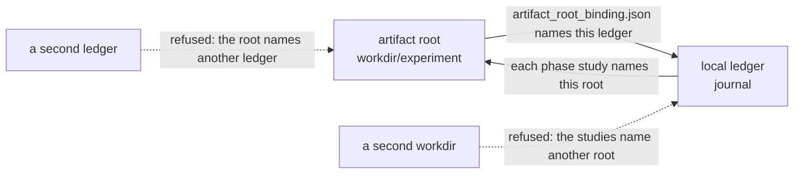

# Runtime behavior

PhaseSweep runs one ordered Experiment on a Linux or macOS host for a trusted researcher or team. It uses same-host file locks and process groups to serialize a persistent experiment and clean up trainer subprocesses. Every process identity records its boot, start time and PID namespace. Linux requires `/proc` to be the procfs of the orchestrator's own PID namespace, with that namespace's PID 1 readable; on hosts using `hidepid`, exempt the operator through its `gid=` option. macOS reads exact microsecond start times through native `libproc`, the boot UUID through `kern.bootsessionuuid`, and records the host PID space as `darwin`. Unreadable identities never authorize a stale-process signal. GPUs are optional; the core CLI can run CPU-only work.

## Output layout

For `workdir: ./runs` and `experiment: demo`, PhaseSweep writes under `runs/demo/` beside the config file:

```text
demo/
  .gitignore
  .ignore
  artifact_root_binding.json
  run.log                         # PhaseSweep's log: phase headers, RERUN, TRIAL, ABORTED and WINNER lines, warnings
  study.journal                   # storage: auto
  generation.yaml
  last_successful_generation.yaml
  attempts/
  generations/
    <generation-id>/
      generation.yaml
      config.snapshot.yaml
      reproducibility.json
      summary.yaml
      phases/<phase>/winner.yaml
  <phase>/
    trials.csv
    trial_00000__generation_<id>__attempt_<id>/
      attempt_lifecycle.json
      process_identity.json
      trainer_config.yaml       # yaml_file only
      overrides.json            # json_file only; nested trainer_config with overrides applied
      overrides_resolved.json
      command.txt
      stdout.log
      stderr.log
      result.json               # when produced by the trainer
```

`last_successful_generation.yaml` points to the immutable generation that represents the latest successful result. Its `generation_id` locates `generations/<generation-id>/summary.yaml` and `generations/<generation-id>/phases/<phase>/winner.yaml`. The summary retains each winner's `observed`, `repeats` and `confound` blocks, plus the recorded top-level `trainer_config` under `override_format: argparse` ([trainer inputs](config.md#trainer-inputs)). Use the [inspection commands](#inspection-commands) to read published or unfinished results.

The root `generation.yaml` names the latest [generation](#timeouts-cleanup-and-continuation) and its `state`: `running`, `published`, `failed` or `publication_failed`. A failed invocation does not replace the last-success pointer. Each generation embeds its carried winners, so reading those records does not require the older generations they cite. Selection and resume verify retained trial evidence.

`trials.csv` lists every trial with its sampled parameters and user attributes, including [`observe`](config.md#report-only-observations) readings as `user_attr:observed:<name>` and a rerun's source as `user_attr:phasesweep_rerun_of`. Its states match [`status --trials`](#inspection-commands); a repeats phase adds `repeat_group` ([repeat groups](#repeat-groups)). A winner's `completion` block records the counts checked against the publication: `finished_trials` counts `COMPLETE`, `INFEASIBLE` and `FAIL`; `completed_trials` counts `COMPLETE` alone, as `status` does.

`config.snapshot.yaml` is the executed configuration, including materialized defaults and the resolved invocation context. `reproducibility.json` is the shareable generation identity record. Its `code_revision` is the git commit of the trainer's working directory (`execution.cwd`, or the invocation directory when unset) and whether tracked files differ from it, or `null` outside a git work tree or when git fails; no check compares it. `show-winners` prints it as a `# code revision:` line, `unknown` for `null` and with `(dirty)` added when tracked files differed. Trial directories retain local evidence and attempt lifecycle information used for supported continuation and winner validation.

The generated `trainer_config.yaml` or `overrides.json` holds the trainer base with the effective overrides applied. For these file formats, `overrides_resolved.json` is an overrides-only audit record. For argparse and Hydra, it is the actual flattened input, merging the trainer base with effective overrides before command placeholders expand. Winner observations are empty when none were recorded; `repeats` is `null` outside a repeats phase.

MLflow-backed experiments additionally retain native run bindings in each trial directory and mutable delivery state and worker cleanup receipts under `tracking/<generation-id>/` (`delivery/` and `cleanup-receipts/`). These records support upload retries and recovery and are separate from the committed scientific manifests. See [MLflow tracking](mlflow.md) for ownership and offline replay.

W&B readers and MLflow workers use disposable scratch under `~/.cache/phasesweep/<backend>/workers/`, or the corresponding `XDG_CACHE_HOME/phasesweep` root; the default home comes from `Path.home()`. Each operation removes its temporary directory. Host locks use a [separate location](#storage-and-locks).

### Trust boundary

Logs, evidence, winners, resolved overrides and process identities use ordinary paths and permissions: new files follow umask, and replacements preserve existing modes. Process identity and lifecycle records use atomic replacement; lifecycle replacements have mode `0600`.

Private records inside the tree have these additional requirements:

| Path | Mode | PhaseSweep refuses to |
| --- | --- | --- |
| `generations/<generation-id>/config.snapshot.yaml` | `0600` | replace it unless the existing file is an owner-only regular file with no other hard links |
| `environment.json` in a trial directory, written only when `execution.record_env` is set | `0600` | replace it under the same condition |
| `attempts/`, the attempt registry | `0700` directory of `0600` entries | read it through a symlink or with shared permissions |

The two files are owner-only while their directories keep ordinary permissions. The same validated, no-follow path handling protects the runtime lock namespace and the MCP `state_dir`.

> [!WARNING]
> `config.snapshot.yaml` is private because it can contain command and environment values. PhaseSweep writes a `.gitignore` containing `*` and a `.ignore` that permits ripgrep searches, without replacing existing files. Keep generated outputs, ledgers, and MCP state out of commits yourself.

## Following a run

The CLI shows PhaseSweep's trial outcomes and causes by default, while Optuna logs only errors. `run --verbose` adds PhaseSweep's debug logs and Optuna's per-trial diagnostics and tracebacks. A failure-policy `ABORTED` line, such as `ABORTED: 3 consecutive failed/infeasible trials reached max_consecutive_failures=3.`, follows the `TRIAL` line that triggered it.

`run.log` is the process-free progress stream. `tail -f <workdir>/<experiment>/run.log` follows a run from any shell, with no MCP server, no lock, and no PhaseSweep process of its own. Each phase that runs logs a header line, and every trial that ends adds one `TRIAL` line, in the order trials end:

```text
2026-01-01 12:00:02 I phasesweep.engine.phase phase=lr study=demo::lr finished=2 remaining=4 reruns=1 n_jobs=1
2026-01-01 12:00:02 I phasesweep.engine.phase phase=lr RERUN trial=3 of=2 reason=orchestrator interrupted by signal 2
2026-01-01 12:00:03 I phasesweep.engine.phase phase=lr TRIAL trial=3 state=COMPLETE value=0.3 duration=0.4s params={'lr': 0.0003} rerun_of=2 (3/6 finished)
2026-01-01 12:00:04 I phasesweep.engine.phase phase=lr TRIAL trial=4 state=FAIL value=none duration=0.5s params={'lr': 0.001} (4/6 finished) reason=non-zero exit code 1; stderr: torch.OutOfMemoryError: CUDA out of memory. Tried to allocate 2.00 GiB
2026-01-01 12:00:09 I phasesweep.engine.run phase=lr WINNER trial=3 metric=0.3 params={'lr': 0.0003}
```

The header counts the phase's `finished` trials, the trials still `remaining` to its `n_trials`, and the `reruns` it schedules: [interrupted trials](#interrupted-trials-rerun) and the failed grid cells a raised `n_trials` retries. Reruns are among the `remaining` trials and run before any new draw. Each one the run schedules gets a `RERUN` line naming the trial it reruns and the first line of that trial's cause, and the rerun's `TRIAL` line carries its `rerun_of`; a rerun an earlier run queued but never started counts in `reruns` without a new `RERUN` line.

`state` reads as in [`status --trials`](#inspection-commands). In `(N/M finished)`, `M` is `n_trials` and `N` is the trial's own place in the phase's completion order: the trials counting toward `n_trials` when its outcome was recorded, itself included unless it was interrupted. With `n_jobs` above 1 every finished trial therefore gets a distinct `N`, though the lines may print out of order. `FAIL` and `INFEASIBLE` trials count toward the phase's `max_consecutive_failures`, a `COMPLETE` one resets that count, and an `INTERRUPTED` one leaves it unchanged. `value` is the metric, or `none` when the trial produced none. `params` names the sampled configuration, excluding the repeat key. A phase with [`repeats`](config.md#repeats) adds `repeat=<key>=<value>`, which names the seed or other repeat value that trial ran. The `WINNER` line closing each phase gives the winning `trial`, `metric` and params. In a repeats phase it adds the reducer, repeat count, `sd`, range and member trials, and an accepted partial result adds `INCOMPLETE <finished>/<requested> finished timeout_scope=<scope>`.

A trial whose outcome recorded a cause adds `reason=` with its first line. A trainer that exits nonzero records `non-zero exit code N`, followed by `; stderr: ` and the last non-empty line of the trial's `stderr.log` when it has one, so a crash is named without opening the trial directory. The line is read from the last few KiB of the file, stripped of control characters and cut at 200 characters with a trailing `...`. A reason the supervisor records itself, such as `timeout after Ns` or descendants still alive in the process group, replaces that text. The same text is the `user_attr:phasesweep_failure_reason` column of `trials.csv` and the `cause` of the trial's recorded outcome. It is whatever the trainer printed, so it stays in these operator-owned records and no MCP tool returns it.

A fatal objective error logs `FATAL OBJECTIVE ERROR` and skips the trial's `TRIAL` line. So does a trial a shutdown signal interrupts under `n_jobs: 1`; the next run's `RERUN` line names it.

`phasesweep` exits 0 on success, including an accepted incomplete winner and MLflow uploads left pending after a published result; 2 when the config does not load or the arguments are invalid, including a refused `init` overwrite and an unknown `--from-phase`; 1 when a command is refused or fails, including `sync-tracking` with uploads still pending; 70 on an internal error; and 128 plus the signal number after an [interrupt](#interrupted-trials-rerun). A PhaseSweep refusal or failure ends with a `fix:` line naming the operator step. [`mcp call`](mcp.md#calling-a-tool-from-a-shell) has its own exit codes.

## Repeat groups

A phase with [`repeats`](config.md#repeats) ranks complete configurations by the configured reducer over their member metrics. Each member must be COMPLETE, feasible and inside the metric's bounds. Exact ties go to the group with the lowest member [draw position](#interrupted-trials-rerun). The highest member trial number names the group and becomes the winner's `trial_number`; [invariant 27](invariants.md#27-a-repeat-group-is-fixed-once-complete-and-its-last-member-names-it) defines group identity across interruptions and top-ups.

The winner's scalar fields (`trial_number`, `generation_id`, `attempt_id`, `objective_provenance`, `trainer_input`, `constraints`) describe that last member. `metric` is the reduced value, so there is no single winning seed or checkpoint. `show-winners` prints the reducer, spread and member trial numbers, and links to the full record. Choose a checkpoint explicitly from that record's `repeats.members`, whose source identities locate the member trial directories and artifacts.

In the full record, `params` and `effective_overrides` omit the repeat key. `repeats` contains `key`, `reduce`, `spread` (`n`, `mean`, sample `sd`, `min`, `max`) and `members`: each member's trial number, repeat value, metric, generation and attempt IDs, objective provenance, trainer input, constraints and observations. Publication validates these against the members and config snapshot; selection and resume verify every member's trial evidence. In `trials.csv` and the member table, `repeat_group` is the highest trial number belonging to that configuration so far and can change as members arrive. `status --trials` follows the member table with each group's params, measured/expected count, reducer, eligible aggregate, mean, sample `sd`, range, eligibility and represented-winner mark. Statistics include infeasible measurements, but exclude failed, missing, interrupted and replaced attempts. A partial or ineligible group has no ranked aggregate, and fewer than two measurements have no `sd`. Eligibility uses the current config's bounds; the winner mark identifies the generation named in the header.

The group table also reports each observation's mean as `observed:<name>` and its contributor count as `observed_n:<name>`. Each name counts only completed current members that recorded a finite value for it. For example, two held-out readings in a three-member group have `observed_n:heldout = 2`; the group's objective count remains three. Missing observations do not become zero-valued measurements.

A failed member spends its draw. Seeded random moves on to another configuration slot when its target grows; a persistent grid can [retry a failed cell](config.md#repeats) when `n_trials` is raised beyond the full matrix, and the replacement can complete its original repeat group. An `INFEASIBLE` member is never retried, so its group cannot rank. An interrupted member reruns, and a resume also runs the members an interruption never started. A phase cut short by an accepted timeout ranks only the groups it completed; a failure abort ranks nothing until the config [retires it](#timeouts-cleanup-and-continuation). When no group is complete, the phase fails with a `No complete repeat group` error, which counts the incomplete groups and names any metric bound that kept members out.

## Confound verdicts

Each phase's `winner.yaml` carries a `confound` block: advisory verdicts on the population that selection ranked to pick the winner, computed once and frozen at selection time. It never blocks selection or publication and has no YAML switches or threshold settings. The authoritative copy belongs to the published generation; [invariant 26](invariants.md#26-a-confound-verdict-never-joins-a-fingerprint-or-gets-read-as-clean) describes its integrity, fingerprints, top-ups, and inheritance. In a repeats phase the block also lists `ranked_groups`, each complete group's member trial numbers, and its checks compare groups rather than trials.

The block runs three checks, each `ok` (checked, nothing found), `heterogeneous` (checked, found a potential confound, with evidence), or `n/a` (could not be checked - never treat this as clean):

- `evaluation_point`: whether the ranked objectives share a training-progress position. Envelope and W&B objectives use the configured `evaluation_axis`, such as optimizer step or tokens; MLflow objectives use the selected native observation's step. Positions within 1% of the highest count as the same point, and the exact positions are recorded either way. See [W&B evidence](config.md#wb-evidence) for aggregate positions. A phase that searches training length has distinct raw steps by design; see [training-length comparison](config.md#training-length-comparison). `n/a` for an extractor that records no position ([`json` and `log_regex`](config.md#objective-evidence-constraints-and-gates)); when a ranked objective has no recorded position or unreadable provenance; when the ranked objectives declare different axes; or when only one trial was ranked.
- `survivorship`: whether failed trials were at least as numerous as the ranked ones, so that whatever made configurations fail could have decided which ones were ranked. Failed trials include evidence-gate and extraction failures. Interrupted trials are left out, because their reruns stand in for them. So is a failed attempt that a `COMPLETE` or `INFEASIBLE` retry replaced, directly or through further retries of the same cell, because that cell has a measured trial; failures in a cell no retry measured stay counted. Infeasible trials, which violated a constraint or the metric's bounds, are counted too but never flag: the experiment's own constraints and bounds define what may win. In a repeats phase, `ranked` counts the members of ranked groups, and feasible members of groups that never completed are counted as `incomplete_group`, which never flags either. This check always runs.
- `tie`: whether the draw-position tiebreak chose between trials with different params tied on the exact metric value, rather than between repeats of one configuration. The lowest [draw position](#interrupted-trials-rerun) wins a tie, which outside reruns is the lowest trial number. `n/a` when only one configuration was ranked. `within_noise` is `null` without repeats. In a repeats phase `tied_trials` names the groups whose reduced value equals the winner's, and `within_noise` (`confound.checks.tie.detail.within_noise` in `winner.yaml`) names the groups whose reduced value lies within two combined standard errors of the winner's (sample standard deviation over the square root of the group size, for either reducer), exact ties included; either list flags the check. Groups are named by their last member, a group with the winner's params is skipped, and the check is `n/a` with one ranked group. Two standard errors is a heuristic for "these configurations are not separated by this many seeds", not a significance test; [Noisy objectives and small budgets](config.md#noisy-objectives-and-small-budgets) covers what extra seeds cost and when they are the right tool.

Fresh selection logs one `WARNING` naming every flagged check and its numbers. For repeat groups within noise it includes competing and winning params, the aggregate `gap` and `combined_se`. Grid winners can add [their own advisories](#retry-fixed-configurations-and-grids). A declared [`cost_key`](config.md#repeats) advises the cheapest complete feasible configuration within one standard error of the winner's mean (`sd_best / sqrt(n_best)`), preferring better objectives before trial order when costs tie. This advisory never changes the winner or inherited values and is recomputed from recorded groups on result reads, including after adding `cost_key` to a finished comparison. Replays and inheriting phases retain confound verdicts without repeating selection warnings. `validate` and dry runs disclose whether the reader records an evaluation position; selection does not repeat that limitation. For a checked comparison without repeats, `show-winners` reports the missing repeat-noise estimate and recommends comparing neighboring distinct values before repeating discrete finalists or running an explicit noise check. [MCP results](mcp.md#reading-status-responses) include the cost advisory, evaluation axis and reporting remedy when positions differ.

## Storage and locks

`storage: null`, or omitting `storage`, is in-memory and ends with the process; it cannot be resumed or topped up by a later invocation, and a trial it interrupts never reruns. Persistent local storage is an explicit `journal:///...` URL, or `auto`, which always resolves to `<workdir>/<experiment>/study.journal`, regardless of `n_jobs`. The journal backend supports parallel trials (`n_jobs > 1`) on one host. Any other storage value, including `sqlite:///...`, `:memory:`, and external database URLs, is refused at config load; the error names the supported forms.

PhaseSweep reads only the current artifact and study formats. When `status`, `show-winners`, or `run --dry-run` refuses an unsupported format, inspect the raw artifacts (`summary.yaml`, `winner.yaml`, trial logs, and the journal), or use the exact checkout that produced them for inspection if available. Development records may require an unreleased checkout. To launch a new run with the current checkout, use a fresh artifact root and ledger namespace.

The selected artifact root and ledger are bound to each other in both directions:



A reused root therefore cannot combine a second ledger's trial counts with the first ledger's publication, and a reused ledger cannot publish into a second tree. Both refusals happen before any trial runs, binding or claim; only the partial-record repair described below can write first.

Runs and confirmed MCP recovery check the tree's binding and ledger format before mutation; a failed check leaves both unchanged. Read-only commands, including `status`, `show-winners`, and `run --dry-run`, never create a missing ledger or directory. Readers skip an incomplete final journal record. The next `phasesweep run` or confirmed `phasesweep mcp recover-run` repairs it under the same inode lock every PhaseSweep append uses, after saving `<ledger>.<UTC stamp>.bak` beside it with permissions no broader than the journal's. Repair waits at most 30 seconds for an active writer; if it times out, wait for that writer to finish and retry. Kernel locks release when their owning process exits. Damage before the final record is refused as corruption. See [invariant 2](invariants.md#2-validation-writes-nothing) for the repair ordering.

A run, `sync-tracking` or confirmed `recover-run` takes the same-host experiment lock without waiting, and is refused with the lock file's path while another process holds it. The lock covers the artifact root and, with persistent storage, the experiment's ledger studies, so two configs sharing either cannot run at once; an MCP launch for an experiment with a live run is refused as busy before it spawns. Only PhaseSweep writes the live ledger; external Optuna writers do not participate in its lock.

Host locks default to `.cache/phasesweep/locks` beneath the effective user's OS account home, independently of `HOME` and `XDG_CACHE_HOME`. `PHASESWEEP_LOCK_DIR` selects an existing absolute directory provisioned by the operator; PhaseSweep validates its path, ownership, and permissions without creating or changing it. On macOS, the root-owned `/var` and `/tmp` aliases resolve to their physical paths before validation; other symlink components are refused. The directory must be owner-only (mode `0700`) or an administrator-owned shared directory with mode `03770` and a group the user belongs to. When the OS refuses access to the lock directory or a lock file, as in a sandbox that cannot reach the account home's `.cache`, the refusal names the path and the OS error and tells the operator to point `PHASESWEEP_LOCK_DIR` at one existing writable directory shared by every shell, MCP server, and sandbox that launches work on the host, or to run on the host. Separate lock directories bypass coordination, and PhaseSweep never prunes lock files, so do not remove them to clear a permission failure.

### Inspect the ledger with Optuna

The ledger is an ordinary Optuna journal holding one study per phase, named `<experiment>::<phase>`. `phasesweep status <config>` prints its real path, with symlinks resolved, as `ledger_path` (`null` for `storage: null`). Optuna's CLI reads the journal in place without writing to it, so these commands are safe while a sweep runs:

```bash
optuna studies --storage <ledger_path> --storage-class JournalFileBackend
optuna trials --study-name '<experiment>::<phase>' --storage <ledger_path> --storage-class JournalFileBackend
optuna best-trial --study-name '<experiment>::<phase>' --storage <ledger_path> --storage-class JournalFileBackend
```

Copy `ledger_path` exactly: Optuna creates an empty journal at a path that does not exist yet.

For the web dashboard, install `optuna-dashboard` and serve a copy of the ledger:

```bash
pip install optuna-dashboard
cp <ledger_path> /tmp/<experiment>.journal
optuna-dashboard /tmp/<experiment>.journal
```

> [!WARNING]
> Never point `optuna-dashboard` at the ledger itself. The dashboard can rename, delete, and write to studies, and a changed phase study no longer matches the results PhaseSweep published from it. The copy is a snapshot; copy the ledger again to see newer trials.

## Environment variables

No environment variable sets a config key, and the YAML has no `${VAR}` interpolation. PhaseSweep reads these from its own environment:

- The ambient environment is the base of the trainer environment, filtered by `execution.inherit_env` ([trainer contract](config.md#trainer-contract)).
- `CUDA_VISIBLE_DEVICES` takes part in [GPU pool discovery](#gpu-isolation), even when `execution.inherit_env` keeps it from the trainer.
- `PATH` is the base of the trainer's `PATH`, and the controller's own `PATH` finds `nvidia-smi` for GPU discovery and `git` for the generation's code revision.
- `HOME` expands a leading `~` in config paths and sets the default root of the W&B and MLflow workers' scratch. Host locks use the OS account home instead.
- `XDG_CACHE_HOME`, when absolute, moves only that worker scratch to `XDG_CACHE_HOME/phasesweep` ([output layout](#output-layout)). A relative value is ignored.
- `PHASESWEEP_LOCK_DIR` selects the [host-lock directory](#storage-and-locks).
- `PHASESWEEP_HOME` and `XDG_STATE_HOME` affect only the `state_dir` that `phasesweep mcp init-catalog` writes ([MCP setup](mcp_setup.md#2-create-and-review-the-catalog)).

## Trial execution and evidence

Each trial has an attempt-scoped directory and process group. The runtime captures `stdout.log` and `stderr.log`, prepares the configured input, and supervises cleanup. YAML input identifies the complete generated configuration; JSON identifies the nested overrides file. Argparse and Hydra retain the resolved-overrides identity together with the command. Historical inputs are verified using their saved format. Trainer return code and duration are retained on the trial before an evidence worker reuses the process slot; recovery prefers that trainer metadata to the worker's lifecycle, while guardian completion covers a runner that exits before the metadata commits.

W&B polling starts only after successful trainer cleanup and GPU-lease release. It uses the same durable attempt slot and process supervisor, so recovery can find the reader after abrupt parent exit, even if its phase was removed. Uncertain cleanup blocks further work. One absolute polling deadline covers worker startup, SDK construction, requests, retries, and summary visibility; phase/run deadlines can shorten it, while cleanup grace stays separate. A finished summary that still lacks a required key [fails the trial](config.md#wb-evidence) without waiting for that deadline. Once the trial is accepted, a second reader in the same slot locates the objective in run history within a fresh `timeout_seconds` and the remaining phase/run budget. History gets up to 30 seconds to catch up with the summary; reading it may use the rest. A failed or timed-out history read records no position and keeps the objective, while uncertain reader cleanup stops the phase.

Accepted remote captures are retained locally, so published results, selection and no-op replay need no SDK, credentials or network reads, even after remote edits or deletion. New remote work checks SDK availability after recognized-state recovery and before accepting a larger target. [W&B evidence](config.md#wb-evidence) and [MLflow metric selection](mlflow.md#select-metrics-and-require-evidence) define the captured values and identities.

MLflow captures the selected native observation and its step together after trainer cleanup and GPU release, without a second advisory history lookup. Its [tracking guide](mlflow.md) covers run ownership, missing evidence and result delivery.

W&B and MLflow workers run with the composed trainer environment, except that every `PYTHON*` variable is the controller's own and the controller's `DO_NOT_TRACK` and `MLFLOW_DISABLE_TELEMETRY` are copied in.

## GPU isolation

By default, `gpu_policy: single_per_trial` leases one device per parallel trial. On Apple silicon macOS, discovery returns one `mps` device without importing a trainer framework. Its `gpu_mps.lock` serializes trials and separate sweeps until the trainer process group exits, without assigning `CUDA_VISIBLE_DEVICES`. PhaseSweep does not select the trainer's device or verify framework MPS availability. macOS refuses explicit `gpu_ids` and `gpu_devices`; Intel Macs discover no GPU. `gpu_policy: none` opts out of the lease.

On Linux, discovery uses explicit phase `gpu_ids`/`gpu_devices`, then top-level `env.CUDA_VISIBLE_DEVICES`, then the controller's ambient value, then local inventory. Visibility tokens may be numeric, GPU UUIDs, or MIG tokens. Discovery reads ambient visibility even when `inherit_env` excludes it. The policy rebinds a leased device token, or preserves an empty/`-1` CUDA-disable sentinel, in each trainer. The lease controls visibility and same-host locking, not GPU memory allocation. Leases rotate through the pool: a trial takes the first free device whose host lock it can get, skipping devices another process holds, and a released device rejoins the back of the free list, so no trial is tied to a device. A trial queued for a lease has already drawn its parameters and created its attempt directory. A leased numeric token sets `CUDA_DEVICE_ORDER=PCI_BUS_ID` over any configured or inherited value, while a GPU- or MIG- token keeps a configured or inherited `CUDA_DEVICE_ORDER` and otherwise sets `PCI_BUS_ID`. When `allow_no_gpu_isolation` admits an ambient `CUDA_VISIBLE_DEVICES` whose tokens `nvidia-smi` cannot resolve, trainers get `CUDA_VISIBLE_DEVICES` set to an empty string.

`validate` checks GPU inventory for every phase; `run --dry-run` checks only phases that would launch trials. These read-only checks may invoke `nvidia-smi`, refuse explicit device IDs absent from the local inventory, and warn when workers exceed available devices. They acquire no GPU leases. A sandbox can hide the GPU inventory even when the host has CUDA devices; run GPU validation, dry runs, and training from a host shell with GPU access in that case. Missing-inventory refusals include this remedy, and for intentional CPU-only work they name `gpu_policy: none` with CUDA disabled in the trainer environment. Launch applies the same inventory checks. During a run, a trial blocked by local slots or another orchestrator's host locks logs one `Waiting for GPU lease` line at INFO level; retries do not repeat it.

`gpu_policy: whole_node` requires `n_jobs: 1` and, on Linux, a unique explicit device list; on macOS it leases the discovered pool. `gpu_policy: none` disables PhaseSweep's GPU isolation and cannot be combined with an explicit device list; parallel use requires the explicit `allow_no_gpu_isolation: true` acknowledgement. For CPU-only parallel work, make that acknowledgement deliberately rather than relying on failed device detection.

`gpu_policy: none` assigns no binding. Include ambient visibility in the trainer inheritance contract or set it in `env` if it must be retained.

## Timeouts, cleanup, and continuation

Trial, phase, and experiment timeouts are cooperative run controls. The experiment budget, `timeout_seconds_per_run`, bounds one invocation: its clock starts afresh at every `phasesweep run`, `--from-phase` resume or MCP launch, so it never counts time an earlier invocation spent. It starts once the ledger is claimed, so the experiment lock and ledger setup fall outside it, while stale-attempt recovery and the continuation and evidence checks count against it. Set the per-trial timeout above the longest trial you expect. `timeout_seconds_per_trial` defaults to 259200 seconds (72 hours), so a hung trial can hold its phase that long unless a phase or run deadline arrives first; an unbounded trial (`null`) needs `allow_unbounded_trials: true`. Its clock covers supervised launch and execution after GPU acquisition, including supervisor startup, but excludes the GPU queue and post-trainer evidence. Phase/run budgets cover those stages too. Cleanup can extend beyond a deadline. Unlike phase/run budgets, the per-trial timeout participates in semantic study identity; changing it cannot reuse a populated phase.

On a trial timeout PhaseSweep terminates the supervised process group and records a terminal failed attempt after cleanup. A phase or run deadline that stops a trial in flight records it as [interrupted](#interrupted-trials-rerun) instead.

The `max_consecutive_failures` threshold also stops a broken phase. The abort is recorded with the outcome that trips it, so a trial that succeeds afterwards cannot turn the phase back into a result, and a later run stays refused until the config retires the abort. A raised `n_trials` retires any abort. A failure-streak abort is also retired by a `max_consecutive_failures` above the count the abort recorded, but only while `n_trials` still leaves trials to run: the recovery runs exactly those trials, never repeats a completed one, and with none left the limit alone changes nothing. Either way the failure count starts again from zero.

The abort message and subsequent refusals name the applicable remedies in the config, or through the same `--set` assignments used to run and inspect the study. Recovery keeps recorded results; if a trainer defect invalidated them, change `experiment` to start fresh. A streak of out-of-bounds or constraint-violating trials is identified in the headline; a failed trial directs you to the phase's stderr logs.

When a phase exhausts its target without a feasible trial, `NoFeasibleTrialError` names the metric bounds and the best value among COMPLETE and INFEASIBLE trials, with its trial number. An all-infeasible streak abort identifies infeasibility in its headline; use the `status --trials` reason column for each violated bound and measured value.

For a grid or fixed configuration, the remedy names the exact target, for example `raise phases[arm_a].n_trials from 2 to 4 in the config and rerun to retry its 2 failed cells; COMPLETE and INFEASIBLE cells are not repeated, and the failure count starts again from zero`. A grid with unvisited cells adds `and run its N remaining cells`. When trials remain, it also gives the limit remedy, for example `raise phases[arm_a].max_consecutive_failures above 2 in the config and rerun to run the 2 trials still left at n_trials=4`. At the grid's retry ceiling only the limit can help; if every cell was measured and none is feasible, change the search space or bounds. A sampling phase is told to raise its target and, while trials remain, its limit. With `storage: null` there is no recovery advice because no study persists.

A fatal abort, such as an unexpected objective error, a failed attempt-record write or unconfirmed process cleanup, records no streak, so only a raised `n_trials` retires it and the message states its recorded cause. An unconfirmed-cleanup abort needs cleanup recovery first, which the next run's preflight or `phasesweep mcp recover-run` performs, and a dry run before then says so. A trial the abort stops before its trainer launched is [interrupted](#interrupted-trials-rerun), so the recovery reruns it first. Changing `max_consecutive_failures` governs new work only, apart from retiring a streak abort as above: it never aborts a completed phase retroactively, and a resumed phase whose failure streak already meets the new limit launches nothing until `n_trials` or the limit is raised.

When a timeout and the threshold both stop the same phase short of its target, the timeout decides the outcome: with `allow_incomplete_on_timeout` the phase publishes the winner its completed trials earned, and without it the run stops as a timeout, so a retry with a larger budget does not replay the failure abort. An accepted partial result is a successful run; its `WINNER` line says `INCOMPLETE`, gives the finished/requested trial counts and names the timeout scope, and the `completion` block of its `winner.yaml` and MCP results mark it `incomplete`. A later run or `--from-phase` replays an accepted partial target without filling unused slots or rerunning the trials the deadline interrupted, only while the config still sets `allow_incomplete_on_timeout`; its winner line retains that marker, and raising `n_trials` runs those reruns first. `n_trials` counts finished attempts: failed attempts consume the configured target, and interrupted ones do not.

Persistent trial targets cannot decrease, and the refusal names the accepted target to set `n_trials` to at least in the config. Failure and timeout controls never create an alternate winner.

Before a supported continuation, PhaseSweep first checks the artifact-root and ledger binding, then reconciles stale active attempts, and only then verifies recorded trial evidence. `--from-phase` requires earlier winners for the ancestors of the phases it reaches. When the workdir holds no earlier results at all, as with a fresh `--set workdir=...`, the run is refused before it creates the artifact tree, and the message says to run without `--from-phase` so the earlier phases run first. Earlier published winners are carried after their evidence checks, even when unrelated to the reached phases, and keep their original source provenance. An independent arm can therefore start after an earlier arm aborted, without a winner for that unrelated arm. The run still stops when a phase fails; starting another arm is an explicit resume. [Sampler rules](config.md#search-spaces-and-samplers) govern new draws and failed grid-cell retries when `n_trials` rises, and [fixed-configuration rules](config.md#phase-composition) govern retries without a search space. A launch and the dry run refuse an invalid larger target before any phase runs.

A phase's study stores the canonical payload its fingerprint is the digest of, beside the digest. When a later run's config disagrees, the refusal lists up to ten changed keys as dotted paths with their old and new values, truncates long values, and counts the rest. A trainer working directory that changed because `execution.cwd` is unset is called out with the fix. A winner file records only the hash, so a skipped phase whose winner no longer matches reports the two hashes.

Each trial records `phasesweep_trainer_env`, a plain-text mapping of its tracked trainer environment, and `phasesweep_trainer_env_digest`, the SHA-256 checksum the cohort check compares. The [trainer contract](config.md#trainer-contract) defines the tracked names, pass-through exclusions, and remedies when a resume composes a different environment.

A run writes a generation when it launches a trial or publishes winners that differ from the current publication. A refusal before the first trial, or a replay matching the existing publication, leaves `generation.yaml` and `last_successful_generation.yaml` unchanged; a replay with changed winners or no publication publishes a new generation. Before a claim, failure performs no post-failure study reconciliation and MCP reports stage `preflight` ([status responses](mcp.md#reading-status-responses)). After trials launch, an interrupted or failed generation retains its inspection record without advancing the last-success pointer. Signals are absorbed across the final publication commit.

### Retry fixed configurations and grids

A [fixed configuration](config.md#phase-composition), with no `search_space` or `repeats`, keeps at most one COMPLETE or INFEASIBLE result. After a failed attempt, including a per-trial timeout, raise `n_trials` by one to retry: one failure permits `n_trials: 2`. A higher target is refused, as is any increase after a measured result. Interrupted attempts rerun without spending the target. With in-memory storage, `n_trials` above 1 is refused at load because nothing can be retried. With persistent storage, `validate` warns while `run` and its dry run check recorded attempts, so a fresh fixed configuration with `n_trials: 2` is refused there. Use [repeats](config.md#repeats) to measure the configuration several times.

A persistent grid retries failed cells when `n_trials` rises beyond its matrix size, one extra attempt per failed cell per raise within the target. A retry that fails waits for the next raise; COMPLETE and INFEASIBLE cells never repeat. For a two-cell grid with two failures, `n_trials: 3` retries one and `n_trials: 4` retries both. A partial-grid target up to the matrix size keeps exploring unvisited cells.

Fresh grid selection warns when a numeric axis with at least three distinct values has a boundary winner, naming the key, value and range. Numeric categorical choices are ordered numerically; boolean, mixed, string, one-value, two-value and repeat axes are excluded. Another advisory reports how many cells have a COMPLETE or INFEASIBLE result and lists up to ten missing configurations, including repeat values, when failures, interruptions or unvisited cells leave gaps. Neither advisory changes the winner or repeats on replay.

### Interrupted trials rerun

An interrupt of `phasesweep run` is not a trial timeout. On SIGINT (Ctrl-C), SIGTERM or SIGHUP, PhaseSweep terminates the in-flight trials' process groups, records each trial's outcome as `interrupted` with the cause `orchestrator interrupted by signal N`, marks the trial `FAIL` in the ledger and exits with status 128 plus the signal number: 130 for Ctrl-C, 143 for SIGTERM. Once the signal arrives no trainer starts: a trial still waiting for a GPU slot or about to launch records `interrupted` with the same cause, and under `n_jobs` above 1 the run waits for every in-flight trial to record its own outcome before it exits. A phase or run deadline that stops a trial in flight records `interrupted` too, with the deadline as its cause, and so does a phase abort (a failure streak or a fatal error) that stops a queued trial before its trainer launched. After a hard kill, the trial stays `RUNNING` until recovery. Its surviving guardian retains the supervised process's exit status, elapsed time and confirmed cleanup. If an evidence worker reused that slot, the trainer's return code and duration are already retained in the ledger. Recovery first resolves the current process group, then extracts a successful completed trainer under its original config and commits `COMPLETE`, including measured infeasibility, without another training attempt. Otherwise recovery terminates surviving processes and records an interruption, unless an existing failure or fatal outcome must be preserved. A result file alone never proves a successful exit.

Successful settlement logs `Confirmed process cleanup for RUNNING trial ...` at INFO, including after an intentional interrupt. The trial's recorded cause distinguishes signal shutdown from stale-run recovery.

An interrupted trial reads `INTERRUPTED` in `status --trials`, `trials.csv` and `run.log`. It never counts toward `n_trials` or the `max_consecutive_failures` streak, and selection, its confound checks and repeat groups pass over it. The next run that reaches its phase adds one trial with the interrupted trial's parameters, logs a `RERUN` line for it, and runs every rerun before any new draw. A rerun is an ordinary trial with its own number, attempt and trial directory, and its `rerun_of` names the trial it reran; a rerun that is interrupted in turn gets a rerun of its own. An interruption therefore costs only the wallclock its in-flight trials had used. A phase whose partial result was [accepted at a deadline](#timeouts-cleanup-and-continuation) replays it without rerunning until `n_trials` is raised, and on `storage: null` nothing reruns, because the study ends with the process.

Every trial has a draw position. A trial that is not a rerun takes the next one, 0, 1, 2 and so on, and a rerun takes its source's. Samplers draw by position rather than trial number, so an interruption never repeats or skips a draw; a discrete space can still yield the same configuration twice. Grid and seeded random reproduce an uninterrupted run at any `n_jobs`; seeded TPE and CMA-ES do at `n_jobs: 1`, given the same trial values. [Invariant 29](invariants.md#29-a-seeded-phase-draws-by-position-so-an-interruption-never-repeats-or-skips-a-draw) gives the position contract. Grid shuffles with a fixed seed when none is set, so it reproduces unseeded too. `validate` and the dry run print this per phase as `(resumable, reproducible)` or `(resumable)`; on `storage: null`, where nothing resumes, they print `(reproducible, not resumable: in-memory storage)` or `(not resumable: in-memory storage)`.

## Inspection commands

Use `validate`, `run --dry-run`, `status`, and `show-winners` to inspect an experiment without launching work. The dry run captures the journal once without writing and reports each phase's `finished`, `remaining` and [rerun](#interrupted-trials-rerun) counts. A met target or accepted partial target replays its recorded winner, so children preview with real inherited values. Otherwise their sample commands use stand-ins: `DRY RUN example command` names those keys and the parent that must publish, as in `(placeholders until 'architecture' publishes a winner: model.name)`. Keys the child fixes itself are real values.

Pass the same `--set` assignments used for `run` to each inspection command so it resolves the same study; see [run-time overrides](config.md#run-time-overrides) for the syntax and config-relative path rules. `validate` and `run --dry-run` print the resolved `artifact root:` alongside the trainer working directory. `status` and `show-winners` refuse a missing or empty study directory and name the path they checked.

After the phase lines, `DRY RUN total: would launch 30 trials (2 reruns) across 3 phases (2 other phases replay)` sums new work, including reruns, and counts replaying phases separately. Phases skipped by `--from-phase` are omitted. A refused preview prints no total.

For readable, settled studies, the dry run applies the run's checks and messages before previewing phases:

- Publication access, integrity and retained phase-history boundaries, on every storage backend.
- Study direction and failure-policy state, accepted targets, [retry ceilings](#retry-fixed-configurations-and-grids), and top-ups that would invalidate bound descendants.
- [Abort recovery](#timeouts-cleanup-and-continuation), accepted partial results and a feasible winner on replay.

Several refused studies produce one combined refusal. Fingerprints are compared whenever inherited values are known; placeholders defer that comparison until the parent has a result.

An unreadable ledger produces a warning and fresh-phase previews; a real run refuses it. A RUNNING attempt whose successful trainer completion awaits extraction reads `EVIDENCE_PENDING` in recovery predictions. The dry run refuses to guess its trial and rerun counts and asks for a normal resume to recover the evidence first. Other RUNNING attempts are counted as recovery would settle them: failed when their outcome records failure or fatal error, otherwise interrupted and owed a rerun. Such phases get only the fixed/grid attempt-limit check, without failed-cell retries or accepted-target, abort and partial-decision checks until recovery; the warning names this limitation. The dry run does not recover attempts, check trainer environment or per-study artifact-root claims, or re-prove replayed trial evidence. `--from-phase` validates published ancestors and their evidence; unfinished winners remain inspectable, and a normal resume can reuse their completed trials. Inspection reads only current-format local experiments.

`status CONFIG` prints trial counts and publication identity as YAML: `workdir`, [`ledger_path`](#inspect-the-ledger-with-optuna), `current_generation_id` (the generation the root `generation.yaml` names), `published_generation_id` (the validated publication, or `null`), `represented_generation_id` (the latest claimed generation, falling back to the publication), `is_published`, and `publication_integrity`, which is `ok`, `absent`, `failed` or `permission_denied`, with `publication_error` beside the last two. Each phase entry starts with its `name`, then `trials` counts `COMPLETE`, `INFEASIBLE`, `FAIL`, `INTERRUPTED`, `RUNNING` and `WAITING`, listing only states that occur. `COMPLETE` counts feasible measured trials; infeasible measurements spend `n_trials` like failures. `generation_trials` counts trials owned by the represented generation. Each phase also gives `n_trials`, `trial_data_available`, `published_study_unavailable` and `winner`, the chosen winner path or `null`. `winner_generation_id` identifies that winner's producing generation, `winner_is_published` says whether it belongs to the validated publication, and `winner_config_matches_current` reports semantic agreement with the loaded config (`null` when unknown). These labels belong to each phase: a later unfinished generation can contribute a new winner for one phase while another retains its published winner. Top-level `is_published` describes the represented generation, rather than every chosen winner's source. An MLflow experiment adds its pending and delivered [upload](mlflow.md#result-delivery-and-recovery) counts.

`status CONFIG --trials` prints a header line and one aligned plain-text table per phase instead, one row per trial: `trial`, `state`, `value`, `params`, `duration_s`, `repeat_group` for a [`repeats`](config.md#repeats) phase, `rerun_of` once the phase holds a [rerun](#interrupted-trials-rerun), one `observed:<name>` column per [`observe`](config.md#report-only-observations) name any trial recorded, a `reason` column when any trial has a recorded failure, interruption or infeasibility cause, and `winner`. A [`repeats`](config.md#repeats) phase follows its rows with one [summary per repeat group](#repeat-groups). `state` is the Optuna state, except that a COMPLETE trial that violated a constraint or the metric's `min`/`max` bounds reads `INFEASIBLE` and an interrupted trial reads `INTERRUPTED`. `rerun_of` names the trial a rerun reran. `duration_s` is the trainer subprocess's wall-clock runtime, and it reads `-` for a trial that never ran one; the `duration` on a trial's `TRIAL` line in `run.log` spans the whole trial, GPU queue and evidence extraction included. `winner` is `*` on the trials the represented winner stands on: the one trial, or every member of the winning repeat group. The header names the common winner generation when there is one; otherwise it directs readers to the per-phase generation and publication labels. Finished phases can be marked while later phases run. A table prints even when the publication is corrupt or unreadable, followed by the same error and exit status as plain `status`. For plots and the dashboard, point Optuna's own tools at the ledger as described in [Inspect the ledger with Optuna](#inspect-the-ledger-with-optuna).

`show-winners CONFIG` reads each phase's usable winner from the latest claimed generation, falling back to its validated published winner when that generation has none. It does not search older unpublished generations. Each winner names its generation and whether it is published. Both published and unpublished results keep their producing metric, phase plan, annotations and `trainer_config` base; semantic config drift is marked historical. Each phase prints its comment, objective, params, effective overrides, completion flags, observations, repeat spread and confound summary, or `(no winner yet)`. Repeats winners include their repeat key, member values and trial directories for checkpoint selection. The `# full record:` path contains the retained evidence. A corrupt or inaccessible publication makes the command fail without printing winners.

For the packaged starter, the learning-rate winner contains this result (abridged; trial numbers depend on grid order):

```yaml
trial_number: 0
metric:
  eval_loss: 0.3
params:
  optimizer.lr: 0.0003
effective_overrides:
  model.n_layers: 8
  optimizer.lr: 0.0003
```

`params` contains what this phase sampled; `effective_overrides` also contains inherited and fixed values applied to the trainer's base configuration. See [repeat groups](#repeat-groups) for member checkpoint selection and the [output layout](#output-layout) for result files.

> [!TIP]
> `status` and `show-winners` take no lock and never write to the artifact root or ledger, so they are safe to run while a sweep is active.

For operator-managed detached runs, see [the MCP operator guide](mcp.md). Terminal MCP run results are frozen snapshots associated with a run ID; they are not a replacement for CLI inspection of an arbitrary experiment tree.
