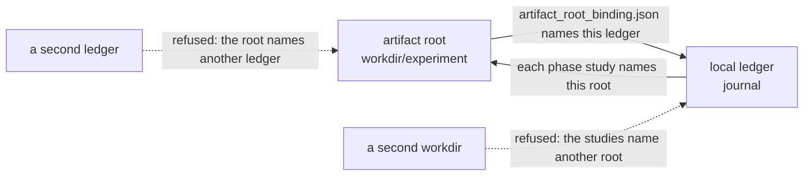

# Runtime behavior

PhaseSweep runs one ordered Experiment on a Linux host. It uses same-host file locks and process groups to serialize a persistent experiment and clean up trainer subprocesses. Every trial's process identity records the PID namespace its numbers belong to, so `/proc` must be the procfs of the orchestrator's own PID namespace, with that namespace's PID 1 readable; the trial launcher refuses to start a trial otherwise. GPUs are optional; the core CLI can run CPU-only work. The optional MCP server additionally requires Linux `/proc` process start times for detached-run cancellation and recovery.

## Output layout

For `workdir: ./runs` and `experiment: demo`, PhaseSweep writes under `runs/demo/` beside the config file:

```text
demo/
  .gitignore
  artifact_root_binding.json
  run.log
  study.journal                   # storage: auto
  generation.yaml
  last_successful_generation.yaml
  summary.yaml
  attempts/
  generations/
    <generation-id>/
      generation.yaml
      config.snapshot.yaml
      reproducibility.json
      summary.yaml
      phases/<phase>/winner.yaml
  <phase>/
    winner.yaml
    trials.csv
    trial_00000__generation_<id>__attempt_<id>/
      attempt_lifecycle.json
      process_identity.json
      trainer_config.yaml       # yaml_file only
      overrides.json            # json_file only; nested overrides
      overrides_resolved.json
      command.txt
      stdout.log
      stderr.log
      result.json               # when produced by the trainer
```

The root `summary.yaml` and per-phase `winner.yaml` files are convenience projections. `last_successful_generation.yaml` points to the immutable generation that authoritatively represents the latest successful result. A failed invocation does not replace that pointer.

`config.snapshot.yaml` is the executed configuration, including materialized defaults and the resolved invocation context. `reproducibility.json` is the shareable generation identity record. Trial directories retain local evidence and attempt lifecycle information used for supported continuation and winner validation.

MLflow-backed experiments additionally retain native run bindings in each trial directory and mutable delivery state and worker cleanup receipts under `tracking/<generation-id>/`. These records support upload retries and recovery and are separate from the committed scientific manifests. Disposable supervised-worker scratch uses `~/.cache/phasesweep/<backend>/workers/`, or the corresponding `XDG_CACHE_HOME/phasesweep` root; the default home comes from `Path.home()`. Each operation removes its temporary directory. Host lock placement retains its separate OS-account-home contract. See [MLflow tracking](mlflow.md) for ownership and offline replay.

### Confound verdicts

Each phase's `winner.yaml` carries a `confound` block: advisory verdicts on the population that selection ranked to pick the winner, computed once and frozen at selection time. It never blocks selection or publication and has no YAML switches or threshold settings. The authoritative copy belongs to the published generation; [invariant 19](invariants.md#19-a-confound-verdict-never-joins-a-fingerprint-or-gets-read-as-clean) describes its integrity, fingerprints, top-ups, and inheritance.

The block runs three checks, each `ok` (checked, nothing found), `heterogeneous` (checked, found a potential confound, with evidence), or `n/a` (could not be checked - never treat this as clean):

- `evaluation_point`: whether the ranked objectives share a training-progress position. Envelope and W&B objectives use the configured `evaluation_axis`, such as optimizer step or tokens; MLflow objectives use the selected native observation's step. Positions within 1% of the highest count as the same point, and the exact positions are recorded either way. See [W&B evidence](config.md#wb-evidence) for aggregate positions. Distinct positions are expected when the phase searches training length such as epochs or `max_steps`; otherwise the trials were not trained to one budget. `n/a` for `json` and `log_regex` extractors, which report no position (only `json_envelope`, `wandb` and `mlflow` bind one, and `validate` prints which case applies); when a ranked objective has no recorded position or unreadable provenance; or when only one trial was ranked.
- `survivorship`: whether failed and pruned trials were at least as numerous as the ranked ones, so that whatever made configurations fail could have decided which ones were ranked. Failed trials include evidence-gate and extraction failures. Infeasible trials, which violated a constraint, are counted too but never flag: the experiment's own constraints define what may win. This check always runs.
- `tie`: whether the trial-number tiebreak chose between trials with different params tied on the exact metric value, rather than between repeats of one configuration. The lowest trial number wins a tie. `n/a` with one ranked trial.

Selection logs one `WARNING` naming every flagged check and its numbers, and a phase that is about to build on a flagged parent winner logs its own `WARNING` before it runs. `phasesweep show-winners` prints the raw `winner.yaml`, including the full evidence behind each check.

> [!WARNING]
> `config.snapshot.yaml` is private because it can contain command and environment values. PhaseSweep writes a `.gitignore` containing `*` whenever the experiment namespace lacks one, but it never replaces an existing ignore file, so keep generated outputs, ledgers, and MCP state out of commits yourself.

### Trust boundary

The workdir is operator-trusted. By default its directories and files are not owner-only: new files take the process umask and a rewrite keeps the mode the file already had, so operators and tooling keep ordinary access to logs, evidence, winners, and resolved overrides. Engine records such as trial artifacts, `process_identity.json`, and `attempt_lifecycle.json` use ordinary path handling and are not symlink-hardened; records that need crash-safe replacement, including those two, are written to a temporary file and renamed into place atomically.

Three things inside the tree are hardened:

| Path | Mode | PhaseSweep refuses to |
| --- | --- | --- |
| `generations/<generation-id>/config.snapshot.yaml` | `0600` | replace it unless the existing file is an owner-only regular file with no other hard links |
| `environment.json` in a trial directory, written only when `execution.record_env` is set | `0600` | replace it under the same condition |
| `attempts/`, the attempt registry | `0700` directory of `0600` entries | read it through a symlink or with shared permissions |

The two files are owner-only while their directories keep ordinary permissions. The same validated, no-follow path handling protects the runtime lock namespace and the MCP `state_dir`.

## Storage and locks

`storage: null`, or omitting `storage`, is in-memory and ends with the process; it cannot be resumed or topped up by a later invocation. Persistent local storage is an explicit `journal:///...` URL, or `auto`, which always resolves to `<workdir>/<experiment>/study.journal`, regardless of `n_jobs`. The journal backend supports parallel trials (`n_jobs > 1`) on one host. Any other storage value, including `sqlite:///...`, `:memory:`, and external database URLs, is refused at config load; the error names the supported forms.

The selected artifact root and ledger are bound to each other in both directions:



A reused root therefore cannot combine a second ledger's trial counts with the first ledger's publication, and a reused ledger cannot publish into a second tree. Both refusals happen before any trial runs and write nothing.

Runs and confirmed MCP recovery check the tree's binding and then the ledger's format before mutating the ledger. When either check fails, the command stops and leaves both byte-for-byte as they were. PhaseSweep is not yet stable and does not keep backward compatibility with older on-disk formats: a release that changes what the tree or ledger stores refuses an older one at these checks rather than migrating it. Finish that experiment with the release that wrote it, or start again with a fresh `workdir` and storage. Read-only commands, including `status`, `show-winners`, and `run --dry-run`, never create a missing ledger or its directory. A process killed while it appended to the journal can leave a partial final record, which every reader skips. The next `phasesweep run` or confirmed `phasesweep mcp recover-run` cuts it under Optuna's own journal lock, after saving the journal as `<ledger>.<UTC stamp>.bak` beside it, with permissions no broader than the ledger's. The killed process can also leave that lock behind, as `<ledger>.lock`. If the lock is still held after 30 seconds, the command refuses and names it: once no process is writing the ledger, remove the lock and run the command again. A record damaged anywhere before the last is refused as corruption. Contributors will find the ordering rules behind these guarantees, and the tests that hold them, in [durability invariants](invariants.md).

MLflow delivery retries use the experiment lock and validate their saved target and generation, but do not open or mutate the ledger. See [result delivery and recovery](mlflow.md#result-delivery-and-recovery).

Persistent phases use same-host locks. A concurrent CLI or MCP launch for the same experiment waits or fails safely according to the operation; it never merges two active orchestrators. External database backends are not part of the runtime.

### Inspect the ledger with Optuna

The ledger is an ordinary Optuna journal holding one study per phase, named `<experiment>::<phase>`. `phasesweep status <config>` prints its real path, with symlinks resolved, as `ledger_path` (`null` for `storage: null`). Optuna's CLI reads the journal in place without writing to it, so these commands are safe while a sweep runs:

```bash
optuna studies --storage <ledger_path> --storage-class JournalFileBackend
optuna trials --study-name '<experiment>::<phase>' --storage <ledger_path> --storage-class JournalFileBackend
optuna best-trial --study-name '<experiment>::<phase>' --storage <ledger_path> --storage-class JournalFileBackend
```

Copy `ledger_path` exactly: Optuna creates an empty journal at a path that does not exist yet.

For the web dashboard, install `optuna-dashboard` and serve a copy of the ledger:

```bash
pip install optuna-dashboard
cp <ledger_path> /tmp/<experiment>.journal
optuna-dashboard /tmp/<experiment>.journal
```

> [!WARNING]
> Never point `optuna-dashboard` at the ledger itself. The dashboard can rename, delete, and write to studies, and a changed phase study no longer matches the results PhaseSweep published from it. The copy is a snapshot; copy the ledger again to see newer trials.

## Trial execution and evidence

Each trial has an attempt-scoped directory and process group. The runtime captures `stdout.log` and `stderr.log`, prepares the configured input, and supervises cleanup. YAML input identifies the complete generated configuration; JSON identifies the nested overrides file. Argparse and Hydra retain the resolved-overrides identity together with the command. Historical inputs are verified using their saved format.

W&B polling starts only after successful trainer cleanup and GPU-lease release. It uses the same durable attempt slot and process supervisor, so recovery can find the reader after abrupt parent exit, even if its phase was removed. Uncertain cleanup blocks further work. One absolute polling deadline covers worker startup, SDK construction, requests, retries, and summary visibility; phase/run deadlines can shorten it, while cleanup grace stays separate. Once the trial is accepted, a second reader in the same slot locates the objective in run history within a fresh `timeout_seconds` and the remaining phase/run budget. History gets up to 30 seconds to catch up with the summary; reading it may use the rest. A failed or timed-out history read records no position and keeps the objective, while uncertain reader cleanup stops the phase. Trainer return code and duration remain trainer measurements.

Finished W&B captures freeze only the requested numeric values and gate-presence evidence, with target, attempt, retrieval time, selected key, and consumer bindings. Published results, selection, and no-op replay need no SDK, credentials, or network reads, even after remote edits or deletion. New remote work checks SDK availability after recognized-state recovery and before accepting a larger target. Missing/invalid evidence fails a trial; a measured constraint violation remains complete but infeasible. See the [configuration guide](config.md) for scoring and environment details.

MLflow captures the selected native observation and its step together after trainer cleanup and GPU release, without a second advisory history lookup. Managed run creation happens before GPU acquisition. See [native MLflow tracking](mlflow.md#choose-run-ownership) for ownership and supervised controller operations.

## GPU isolation

By default, `gpu_policy: single_per_trial` leases one visible CUDA device per parallel trial. Discovery uses explicit phase `gpu_ids`/`gpu_devices`, then top-level `env.CUDA_VISIBLE_DEVICES`, then the controller's ambient value, then local inventory. Visibility tokens may be numeric, GPU UUIDs, or MIG tokens. Discovery reads ambient visibility even when `inherit_env` excludes it. The policy rebinds a leased device token, or preserves an empty/`-1` CUDA-disable sentinel, in each trainer. The lease controls visibility and same-host locking, not GPU memory allocation.

`gpu_policy: whole_node` requires `n_jobs: 1` and a unique explicit device list. `gpu_policy: none` disables PhaseSweep's GPU isolation and cannot be combined with an explicit device list; parallel use requires the explicit `allow_no_gpu_isolation: true` acknowledgement. For CPU-only parallel work, make that acknowledgement deliberately rather than relying on failed device detection.

`gpu_policy: none` assigns no binding. Include ambient visibility in the trainer inheritance contract or set it in `env` if it must be retained.

## Timeouts, cleanup, and continuation

Trial, phase, and experiment timeouts are cooperative run controls. Set the per-trial timeout above the longest trial you expect; an unbounded trial needs `allow_unbounded_trials: true`. Its clock covers supervised launch and execution after GPU acquisition, including supervisor startup, but excludes the GPU queue and post-trainer evidence. Phase/run budgets cover those stages too. Cleanup can extend beyond a deadline. Unlike phase/run budgets, the per-trial timeout participates in semantic study identity; changing it cannot reuse a populated phase.

On a trial timeout PhaseSweep terminates the supervised process group and records a terminal failed attempt after cleanup. The `max_consecutive_failures` threshold also stops a broken phase. The abort is recorded with the outcome that trips it, so a trial that succeeds afterwards cannot turn the phase back into a result, and a rerun stays refused until `n_trials` is raised. Changing `max_consecutive_failures` governs new work only: it never aborts a completed phase retroactively, and a resumed phase whose failure streak already meets the new limit launches nothing until `n_trials` or the limit is raised. When a timeout and the threshold both stop the same phase short of its target, the timeout decides the outcome: with `allow_incomplete_on_timeout` the phase publishes the winner its completed trials earned, and without it the run stops as a timeout, so a retry with a larger budget does not replay the failure abort. A rerun or `--from-phase` replays an accepted partial target without filling unused slots, only while the config still sets `allow_incomplete_on_timeout`. `n_trials` counts terminal attempts, so failed and pruned attempts consume the configured target.

Persistent trial targets cannot decrease. Raising a resumable sampler's `n_trials` schedules additional attempts after a durable abort or accepted partial timeout. Failure and timeout controls never create an alternate winner.

Before a supported continuation, PhaseSweep first checks the artifact-root and ledger binding, then reconciles stale active attempts, and only then verifies recorded trial evidence and applies sampler continuation rules. `--from-phase` is valid only when the earlier phase winners remain valid; reused winners keep their original source provenance. TPE and CMA-ES persistent targets cannot resume mid-target, while grid and seeded random phases can top up their local study.

An interrupted or failed generation leaves its immutable record for inspection but does not advance `last_successful_generation.yaml`. Signals are absorbed across the final publication commit so the authority pointer is never left ambiguous.

## Inspection commands

Use `validate`, `run --dry-run`, `status`, and `show-winners` to review an experiment without launching work; an ordinary `run` invocation launches trials. `--from-phase` requires valid earlier winners. These reads inspect only the current-format local experiment. For per-trial tables and plots, point Optuna's own tools at the ledger as described in [Inspect the ledger with Optuna](#inspect-the-ledger-with-optuna).

> [!TIP]
> `status` and `show-winners` take no lock and never write to the artifact root or ledger, so they are safe to run while a sweep is active.

For operator-managed detached runs, see [the MCP operator guide](mcp.md). Terminal MCP run results are frozen snapshots associated with a run ID; they are not a replacement for CLI inspection of an arbitrary experiment tree.
